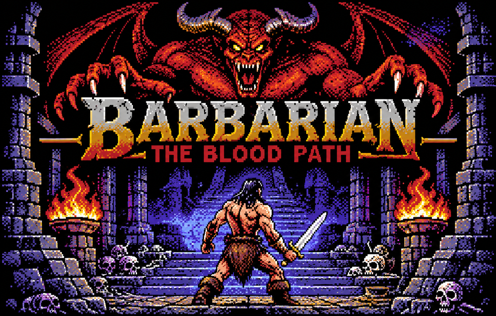

# Barbarian: The Blood Path



Action RPG for the Commodore 64 written in 6502 assembly (64tass).  
Copyright © 2026 - Simone Caporale.

Starting on the C64: `LOAD"BARBARIAN",8` and `RUN`: a menu with three entries, the story (lore), the manual, the game
([Start and story](docs/wiki/intro.md)). The disk is for the **1541** (and compatibles): the game loads and saves with
Krill's Loader ([Fast loader](docs/wiki/FastLoader.md)).

## Getting started
Everything runs in Docker containers: the host only needs sh, Docker, git and curl. **Full guide: [docs/getting-started.md](docs/getting-started.md)**
(folders, containers, build, tests, where the files end up).
```
lab64 check-env        # environment check (the first time; on Windows: project inside WSL2)
./build.sh               # EVERYTHING: disk + RAM/disk maps + atlas + smoke and sanity + PDF manual
./build.sh --fast        # fast build: disk only (skips atlas, maps and manual); smoke and sanity still run
./build.sh --fast --no-test   # the bare minimum: disk only, no tests
./build.sh --release     # full build + all tests (also regression and EMU-*) + manual (on request only)
./build.sh --view        # tests in VICE shown live in the browser: http://localhost:6080
lab64 run tools/build/mkdisk.sh       # any command in a container
```
The disk ends up in `out/releases/latest/blood_path_vX.Y_1541.d64` (POKE 1020,1 before RUN = straight into the game).

### `./build.sh` parameters
They combine freely (e.g. `./build.sh --no-atlas --no-manual`). With no parameters **everything** is built.

| Parameter | Effect |
|---|---|
| *(none)* | disk + RAM/disk maps + graphics atlas + smoke and sanity + PDF manual |
| `--fast` | skips atlas, maps and manual (= `--no-atlas --no-maps --no-manual`): the disk and the smoke and sanity tests remain |
| `--no-atlas` | skips the graphics atlas (`out/work/atlas/`) |
| `--no-maps` | skips the RAM and disk maps (`out/work/memory-map/`) |
| `--no-manual` | skips the PDF manual |
| `--no-test` | skips smoke and sanity |
| `--release` | full build + **all** tests (also regression and `EMU-*` on vc64web) with the memory probe (`--probe`, 15/11) + manual + `tools/build/release.sh` (GAME optimally compressed) |
| `--emu` | tests with the vc64web daemon running (`EMU-*`) |
| `--view` | tests open VICE on the viewer's screen (http://localhost:6080); if the viewer is already running they do it on their own |
| `--no-view` | tests on virtual displays even with the viewer running |
| `--probe` | (14/11) memory probe in VICE during the tests: the automatic map (`out/work/memory-map/index.html`) adds the RAM actually written ([docs/wiki/build.md](docs/wiki/build.md)) |
| `--manual` | **only** the PDF manual, without rebuilding the disk |
| `--images` | rebuilds all the Docker images, then the build |
| `--keep N` | how many versions to keep in `out/releases/` (default 5; also `KEEP_VERSIONS=N`) |

Every build publishes its artifacts in `out/releases/v<version>/` (with `manifest.json`: what it contains, SHA-256, test results, what is missing)
and updates `out/releases/latest`. A version's manual is there only if it was generated for that version.
Game version and save format version: `version.yaml`.

## Structure
| Folder | Contents |
|---|---|
| `data/` | source data (rules and balancing, village map, texts, title image, atlas groups) |
| `docs/` | `getting-started.md` and `index.md` (the game's wiki index), `wiki/` the wiki pages, `manual/` manual source, `screens/` menu screenshots |
| `lab/` | study material, not used by the build ([lab/README.md](lab/README.md)) |
| `lab64.env` | Lab64 configuration for the game |
| `out/` | everything that is generated (not in git): `releases/v<version>/` (last 5: disk, atlas, maps, manual, test reports), `work/` (intermediates of the current build), `cache/` (reusable), `tmp/` (throwaway) |
| `src/` | the game's assembly sources: one per disk file (`barbarian.asm` loader, `start.asm` startup, `game.asm`, `lobby.asm`, `menu.asm`, `lore.asm`, `help.asm`, `jukebox.asm`), included parts in `common/`, `game/`, `menu/`, `lore/`, `test/`; external C64 libraries in `third-party/` (Krill's Loader) |
| `tests/` | automated tests: `smoke/`, `sanity/`, `regression/`, library in `lib/` ([docs/wiki/test.md](docs/wiki/test.md)) |
| `tools/` | `build/` generators and build, `atlas/` graphics atlas, `memory-map/` RAM and disk maps, `manual/` manual, `simulators/` simulators, `vice/` VICE tools (screenshots, measurements, arena), `font/` UI font |
| Lab64 (outside the project) | **Lab64**, the generic C64 toolchain: since 14/11 a **separate repository**, used only through the `lab64` command (in the PATH: `<Lab64 folder>/cli/lab64 install`) (documentation in English: Lab64's `README.md` and `docs/`): `lab64-*` Docker images (`docker/Dockerfile`) and scripts in `cli/` and `build-scripts/` (`cli/run.sh`, `build-scripts/build-images.sh`, `cli/check_env.sh`); sources of VICE, zx0, cc1541 (compiled inside the images); `containers/vc64web/` (second emulator); C64 ROMs in `roms/` (list with SHA-256 and licenses in Lab64's roms/roms.md); automatic map `containers/tools/memmap/` |

## Combat arena (testing and balancing)
A separate build with the same combat code as the game: no loader, menu, village, disk,
backpack or drops; one room, the character with the equipment worn and 1 to 8 monsters, driven by a bot.
The build produces `out/work/arena_game.prg` (game with `ARENA=1`) and `out/work/arena.prg` (module `src/test/arena.asm`
at `$C900`: bot, startup, end of combat, parameters `$CF00`, results `$CF40`, log `$CF80`).
`tools/vice/arena.py` (in the `lab64-tools` container: `lab64 run python3 tools/vice/arena.py ...`) starts VICE, loads the two files and the graphics theme, writes the parameters and runs the series:
```
lab64 run python3 tools/vice/arena.py --lvl 5 --plvl 5 --weapon sword+1 --armor leather_armor --monster zombie --fights 20 --potions red:3
lab64 run python3 tools/vice/arena.py --help         # all parameters (floor, level, equipment, monsters, boss, abilities, potions...)
```
From Python, several scenarios in the same session: `from arena import Arena` (see `tools/vice/arena.py`).
Phase 1: character and monsters adjacent, the bot does not move (`--bot stand`): it turns towards the nearest monster and
attacks (Rage and Frenzy as soon as ready, then the best ability that is ready, potion below the `--pot` threshold). No seed: same parameters,
same results. Fast mode (default): about 25 times real time in VICE warp.

## Simulator of the new rules
`lab64 run python3 tools/simulators/sim_rules.py` simulates the new combat system (docs/wiki/SISTEMA_COMBATTIMENTO.md) with the
parameters of `data/rules.yaml` and writes `out/work/simulators/simulazione_regole.html`. A single group:
`python3 tools/simulators/sim_rules.py --fight 5 9 demon skeleton` (floor 5, level 9 character).
`python3 tools/simulators/fit_rules.py` retunes the monsters (floor 1-10 curves, final boss, Abyss table) on the
reference character and writes `data/rules.yaml` (`--abyss-only` only the Abyss, `--dry` without writing); `python3 tools/simulators/cmp_rules.py`
prints comparisons of items, abilities and potions (Markdown). Balancing: docs/wiki/BILANCIAMENTO.md; implementation
plan: the wiki in docs/ (index docs/index.md).

## Third-party libraries

External tools, emulators and ROMs are credited in Lab64's documentation.

- **Loader by Krill** — Krill's Loader, Repository Version 194 (© 2022 Gunnar Ruthenberg, BSD 3-clause license
  with mandatory attribution), https://csdb.dk/release/?id=226124: the game's loads and saves, and `cc1541`
  (included in the archive) to write the disk. Archive, license and notes in
  [src/third-party/krill/](src/third-party/krill/README.md); how we use it in [docs/wiki/FastLoader.md](docs/wiki/FastLoader.md).
  In the game the credit is in the barbarians' menu: "loader by krill - v194".
- **ZX0** v2 by Einar Saukas (BSD-3): compression of `GAME`, `LDAT` and the `MENU` module.
