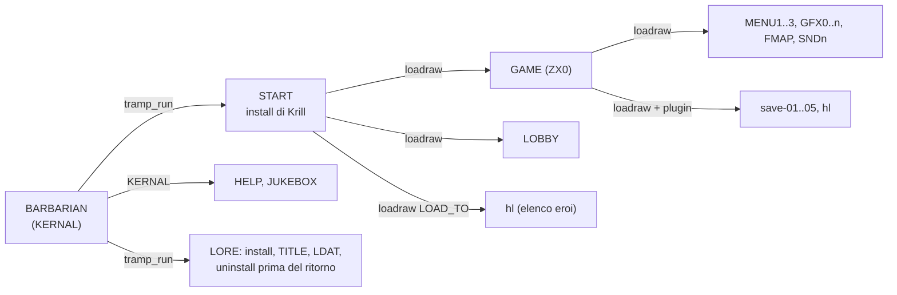
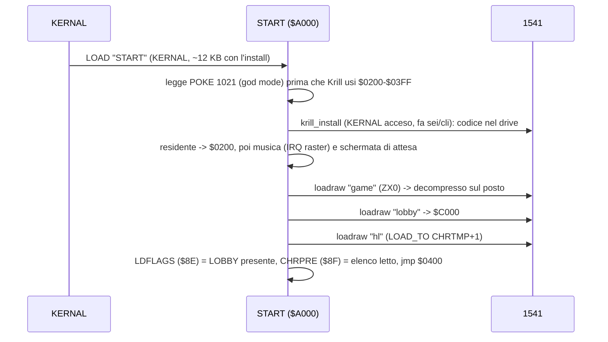

# Fast loader: Krill's Loader r194 (architettura)

Copyright © 2026 - Simone Caporale

Dal ramo `fast-loader` (11/11) il gioco carica e salva con **Krill's Loader r194** (© 2022 Gunnar Ruthenberg, BSD a
3 clausole con attribuzione obbligatoria: "Loader by Krill"). Questa pagina spiega **come lo usiamo, cosa fa, dove
interviene**, con le misure. Archivio e note: [src/third-party/krill/README.md](../src/third-party/krill/README.md).

Certezza: ciò che è marcato **[MISURATO]** è stato misurato in VICE (`x64sc`, 1541 emulato con true drive emulation);
**[NON VERIFICATO]** = mai provato (hardware reale, SD2IEC, altri drive).

## 1. In breve

| Cosa | Come |
|---|---|
| Chi lo installa | `START` (avvio del gioco), una volta, con il KERNAL acceso |
| Dove sta | residente `$0200-$0312` (275 B), pagina zero `$41-$47` (il plugin di save fino a `$57`) |
| Cosa carica | **tutti** i file letti da `GAME`, `LOBBY` e `START`: gioco, menu, villaggio, temi, `FMAP`, musica, salvataggi |
| Cosa salva | i salvataggi (`hl`, `save-01..05`) con il **plugin di save** (file `KSAVE`, caricato a `$E820` sotto il KERNAL a ogni salvataggio) |
| Chi altro lo usa | `LORE` (11/11 sera): installa Krill, legge `TITLE` e `LDAT`, lo disinstalla prima di tornare a `BARBARIAN` |
| Cosa resta sul KERNAL | `BARBARIAN` (menu del loader), `HELP`, `JUKEBOX` (ha i brani nel suo file: non legge il disco) |
| Drive | **solo 1541 e compatibili** (`ONLY_1541_AND_COMPATIBLE = 1`): i dischi si chiamano `blood_path_vX.Y[_dev]_1541.d64` |
| Credito | menu dei barbari (`LOBBY`), sotto la versione: **"loader by krill - v194"**; `README.md` |

## 2. Build

| Passo | Dove | Cosa |
|---|---|---|
| 1 | `tools/build/krill_build.sh` (chiamato da `tools/build/asm.sh`) | scompatta `src/third-party/krill/loader-v194.zip` in `out/work/krill/pkg` (usa e getta) e costruisce con `ca65`/`ld65` (pacchetto `cc65`) e la nostra configurazione `src/common/krill/loaderconfig.inc`: `out/work/krill/install.prg`, `loader.prg` (residente), `save.prg` (plugin), `cc1541` |
| 2 | `tools/build/krill_syms.py` | `out/work/krill.inc` per 64tass: `krill_install`, `krill_loadraw`, `krill_save`, `krill_uninstall`, `krill_loadaddrlo/hi`, `krill_endaddrlo/hi`, lunghezze |
| 3 | `src/start.asm` / `src/common/boot.asm` | include l'install (a `INSTALL = $0840`, dopo lo stub BASIC) e il residente (copiato a `$0200`) |
| 4 | `src/game/rel.asm` | plugin a `TRANSIENT = $E820` (`krill_save`), fra l'immagine del file dell'eroe e il buffer del plugin, sotto il KERNAL (`.cerror` sulle tre aree) |
| 5 | `tools/build/mkdisk.sh` | disco con il `cc1541` di Krill (`-M 8` = `FILENAME_MAXLENGTH`: hash dei nomi a 8 caratteri; collisioni rifiutate), `BARBARIAN` primo; crea `hl`, `save-01..05` della lunghezza giusta e `ksave` |

Configurazione (`src/common/krill/loaderconfig.inc`): `ONLY_1541_AND_COMPATIBLE 1`, `DECOMPRESSOR NONE` (il ZX0 resta
il nostro, `src/common/zx0.inc`), `LOAD_RAW_API 1`, `LOAD_TO_API 1`, `END_ADDRESS_API 1`, `UNINSTALL_API 1`,
`FILENAME_MAXLENGTH 8`, `NTSC_COMPATIBILITY 0`, `LOAD_UNDER_D000_DFFF 0`, `LOAD_VIA_KERNAL_FALLBACK 0`.
Dimensioni [MISURATO]: install 3225 B, residente 277 B, plugin 1205 B (con tutti i drive l'install sarebbe 6997 B e il
plugin non si costruisce con il nostro `ca65` senza cambiare `save.s`; TODO B16).

## 3. Avvio (`START`)

- Dopo l'install **il drive non risponde più ai comandi del KERNAL**: dopo `START` nessun programma può usare `LOAD`,
  `OPEN`, file REL. `quit the game` disinstalla Krill (`krill_uninstall`: il drive salta alla sua ROM) e fa il reset del
  C64; il BASIC rilegge il disco (test `SAVE-15`). Provato in VICE: anche il solo reset del C64 riporta il drive alla ROM
  (il codice di Krill nel drive si disinstalla quando vede ATN). Niente rientro dal BASIC (tolto l'11/11).
- `START` mostra una schermata di attesa ("the crypt door creaks open", "please wait"): niente barre (11/11 sera).
- Il villaggio non si precarica più: lo legge `GAME` entrando (`enter_gfx`).
- `$DD00`: con Krill installato si scrive **solo il banco VIC** (bit 0-1), i 6 bit alti a 0 (README di Krill,
  "Setting the VIC bank"): `lda #banco / sta $dd00`, mai lettura-modifica (`START`, `GAME start`).
- POKE prima del `RUN` (11/11, [docs/cheats.md](cheats.md)): `POKE 1020,1` = subito `START` senza il menu del loader,
  `POKE 1021,1` = god mode. Sono byte liberi dopo il trampoline (`$03FC`, `$03FD`), azzerati all'accensione e al reset.

## 4. Caricamenti nel gioco (`src/game/disk.asm`)

| Routine | Uso |
|---|---|
| `load_raw` | nome in `cmdbuf+3` (0 finale), destinazione `ptr0` (`LOAD_TO`): temi, villaggio, `FMAP`, brani, `LOBBY` |
| `load_file` | all'indirizzo scritto nel file (C = 0): le tre parti del modulo `MENU` (`menu1..3`) |
| `set_name`/`set_name4` | scrivono il nome e lo 0 finale |

- **Musica**: zittita prima del disco (`snd_io`), come con il KERNAL; gli IRQ restano accesi durante i caricamenti
  (Krill li permette, anche con sprite e badline).
- **Schermata**: titolo + "please wait" senza barra (`io_screen`): Krill non dà un avanzamento durante un `loadraw`
  e i caricamenti durano 1-2 s. Dall'11/11 sera niente barre in tutto il gioco (anche `START`).
- **Modulo MENU**: tre file `menu1..3` (`tools/build/pack_menu.py`): l'indirizzo di ogni file è la fine della sua zona meno
  la lunghezza compressa; Krill lo carica lì e lascia l'inizio in `krill_loadaddrlo/hi`, poi il ZX0 decomprime sul posto.
- Pagina zero: `$41-$47` sono di Krill durante un caricamento (il gioco usa fino a `$40`); `$41-$57` durante un save.

## 5. Salvataggi (`src/game/rel.asm`, [salvataggi.md](salvataggi.md))

- File preallocati dalla build (il plugin **riscrive solo file esistenti con lo stesso numero di blocchi**):
  `hl` (elenco eroi, 66 B, 1 blocco) e `save-01..05` (un file per eroe: eroe 210 B + 20 piani × 93 B = 2070 B, 9 blocchi).
- Ogni scrittura riscrive il file intero: `sv_read` (Krill) → si cambia la parte (eroe o piano) → `sv_write` (plugin).
  Con `rel_hold` (menu RUN/STOP, nuovo eroe) più parti vanno in una sola riscrittura (`rel_done`).
- RAM: immagine del file a `$E000` (`SV_IMG`), plugin a `$E820`, buffer del plugin `$0800` byte a `$ECE0` (`SV_SCR`), tutti sotto il
  KERNAL: durante il save `$01 = $35` e interrupt spenti; la lettura dell'immagine (`img_on`/`img_off`) idem. Nel
  villaggio `$E000` è il villaggio: dopo il salvataggio si rilegge (`sv_end`, `town_at`).
- **Il plugin modifica il proprio codice** (17 byte, [MISURATO]: una seconda chiamata senza ricarica si blocca): si
  **carica dal file `KSAVE` prima di ogni save** (~0,5 s) a `$E820`, nella RAM libera durante un salvataggio. Fino
  all'11/11 sera aveva un posto fisso di 1203 B in GAME: tolto, il margine del codice è tornato a 3193 B.

## 6. Memoria

| Area | Uso con Krill | Prima |
|---|---|---|
| `$0200-$0312` | residente di Krill | buffer di input del BASIC, variabili del KERNAL, segnali `LDFLAGS`/`CHRPRE`/`godmode` (`$02A7-$02B1`), `YN_SAV` |
| `$41-$47` (`$41-$57` nel save) | pagina zero di Krill (e del plugin) | libera |
| `$8E`, `$8F` | `LDFLAGS`, `CHRPRE` | liberi |
| `$0340-$0367` | `YN_SAV` (riga 24 salvata dalle domande y/n) | `$0200` |
| margine del codice | 3193 B (il codice del disco con il KERNAL è uscito; il plugin non sta in GAME) | 2930 B |
| `$97E9-$97FB` | `town_at`, parametri del plugin, nome del file dell'eroe | liberi |
| `$E000-$E815`, `$E820-$ECD2`, `$ECE0-$F4DF` | immagine del file dell'eroe, plugin, buffer del plugin: solo durante un salvataggio | cache del villaggio (tolta) |
| `godmode` | byte del PRG in CODE2 (non azzerato da `game_start`) | `$02A9` |

## 7. Misure (VICE, 1541 emulato, contatore di cicli) [MISURATO 11/11]

| Operazione | KERNAL (prima, senza cache) | Krill | Differenza |
|---|---|---|---|
| Avvio (`BARBARIAN` con `POKE 1020,1` → fine caricamenti di `START`) | 105 s (con il villaggio precaricato) | 34,5 s | −67% |
| Modulo `MENU` all'ingresso nel villaggio | 10,5 s | 2,3 s | −78% |
| Scale villaggio → piano 1 | 11,1 s | 3,1 s | −72% |
| Scale piano 1 → 2 (salva il piano lasciato) | 13,8 s | 10,2 s | −26% |
| Scale piano 2 → 1 (salva il piano lasciato) | 15,8 s | 11,4 s | −28% |
| Menu RUN/STOP "save game" (piano + eroe, una riscrittura) | 3,2–5,4 s | 7,1 s (dungeon) – 8,6 s (villaggio, con la rilettura del villaggio) | **+120–170%** |
| Uscita dalla locanda dopo una modifica (`save_char`) | 3,1 s | 8,5 s | **+174%** (dall'11/11 sera non salva più: 0 s) |
| Scale nello stesso capitolo (11/11 sera: stato del piano negli slot in RAM, `PERF-DISK-13`) | — | 2,64 s | — |
| Storia (`LORE`): tasto `1` del menu → PRESS SPACE | 70 s | 38 s (con ~5 s di comparsa del titolo) | −46% |

- I **caricamenti** sono molto più veloci (obiettivo del 35% superato); i **salvataggi** sono più lenti: il plugin
  riscrive il file intero (9 blocchi) dopo averlo letto, più la ricarica del plugin e, nel villaggio, del villaggio.
  Decisione aperta in `TODO.md` (B15).
- L'install costa circa 3,2 KB in più nel file `START`, letto dal KERNAL (compreso nei 34,5 s). Comprimerlo con ZX0
  dà solo il 13% (3223 → 2807 B): lasciato stare (decisione dell'11/11).

## 8. Compatibilità

| Ambiente | Stato |
|---|---|
| VICE `x64sc`, true drive emulation, 1541 | funziona (tutti i test) [MISURATO] |
| VICE, 1541-II (`-drive8type 1542`) | START, menu, nuovo eroe salvato, villaggio: test `KRILL-17` (12/11) [MISURATO] |
| VICE, 1570 / 1571 | non provabile qui: mancano le ROM dei drive (`KRILL-18` SKIP, 12/11) |
| Emulatore web **vc64web** (VirtualC64 in WebAssembly, ROM originali, 1541-II; dal 13/11 **dentro il repository**: `toolchain/vc64web-custom`, build 32 / API 25, vedi [emulatore.md](emulatore.md)) | **funziona** [MISURATO, 13/11, disco v1.225]: `LOAD"*",8` e `POKE1020,1:RUN` → `START` con Krill → lobby → nuovo eroe (salvataggio con il plugin di Krill sul 1541-II emulato) → villaggio (`GFX0`, `MENU`) → alchimista → cripta (piano 1) → mostro ucciso → pergamena del portale → villaggio → reset e nuovo avvio con l'eroe nell'elenco: test di regression `EMU-10..16`. `LORE` dal menu di `BARBARIAN` provato a schermo il 12/11 (non nei test). "save game" dal menu del gioco, i cambi di piano oltre il primo e gli altri drive non provati lì. VICE resta il riferimento |
| Emulatore web "C64 Emulator" di T. Hochgoetz (11/11, sostituito dal precedente il 12/11) | l'install termina, il primo load non finisce: non compatibile [MISURATO] |
| 1541 reale, 1541-II, 1570/71 in modo 1541 | [NON VERIFICATO] |
| 1581, CMD FD, SD2IEC | non supportati dalla nostra build (solo 1541); SD2IEC con il firmware di thierer supporta Krill, ma servirebbe la build con `LOAD_VIA_KERNAL_FALLBACK` (TODO B16) |

## 9. File toccati

| File | Cosa |
|---|---|
| `src/common/krill/loaderconfig.inc`, `tools/build/krill_build.sh`, `tools/build/krill_syms.py` | build del loader |
| `src/common/boot.asm` (START e LORE) | install, residente, caricamenti con `loadraw`, POKE 1021 → `godmode`; `LORE`: titolo da un buffer riga per riga; motore KERNAL tolto |
| `src/lore/scroll.asm` | `lore_exit`: disinstallazione, pagine 2-3 azzerate, trampoline |
| `src/barbarian.asm` | `POKE 1020` = avvio diretto di `START` |
| `src/game/disk.asm`, `src/game/stash.asm`, `src/game/music.asm`, `src/game/levels.asm` | caricamenti con Krill, niente cache del villaggio |
| `src/game/rel.asm` | salvataggi con il plugin (file per eroe + `hl`) |
| `src/game.asm` | `LDFLAGS` a `$8E`, banco VIC senza lettura di `$DD00`, `godmode` in CODE2 |
| `src/lobby.asm` | `CHRPRE` a `$8F`, credito "loader by krill - v194" |
| `src/game/ui.asm` | `io_screen` senza barra, `YN_SAV` a `$0340` |
| `tools/build/mkdisk.sh`, `tools/build/pack_menu.py`, `tools/memory-map/gen_diskmap.py`, `tools/build/asm.sh` | disco con `cc1541`, `menu1..3`, mappa del disco |
| `tests/lib/c64.py` | i test entrano sempre dal `START` vero (installa Krill) |
| strumenti VICE (`tools/vice/*.sh`, `tools/build/gen_help.py`) | partono da `START` (`g 080d`), non più da `GAME` a `$0400` |

## 10. Revisione dell'11/11 sera (implementazione contro la specifica di progetto)

Riletti i commit `8ef5b7b`..`4993696` contro la specifica originale (in git: `git show 8ef5b7b:docs/FastLoader.md`).

**Conforme**: Krill solo in `START`, `GAME`, `LOBBY`, `MENU` (D1); residente a `$0200` con i segnali spostati in pagina
zero (D4: `$02F0` proposto dalla specifica cadeva dentro i 275 B del residente); pagina zero `$41` (D5, con `.cerror`);
`$DD00` senza lettura (D6); nomi con 0 finale e `-M 8` (D7); precaricamento tolto e attese senza barra (D8); disco con
`cc1541`, `BARBARIAN` primo, ultimo blocco di directory `00 FF`; nessuna chiamata al KERNAL per il
disco in GAME, LOBBY, MENU e START (test `KRILL-13`).

**Corretto nella revisione**: (1) `save_char`/`save_lvlblk` riscrivevano il file anche se la sua lettura falliva (immagine
sbagliata su disco): ora C = 1 e niente scrittura (`sv_get`, `sv_fail`); (2) margine del codice stampato senza lo spazio
prima del plugin (1389 B invece di 1998 B); (3) codice KERNAL morto in START (`chan`, `rd`) solo per `LORE`; (4) test
"niente KERNAL" (`KRILL-13`) che mancava; (5) schermate `io_*` e menu iniziale, `docs/test.md`, `musica.md`,
`villaggio.md` non aggiornati.

**Scostamenti aperti** (decisione del committente o lavoro futuro):

| Specifica | Oggi | Dove |
|---|---|---|
| ~~D2: errore d'installazione → messaggio e ritorno a `BARBARIAN`~~ | **fatto** (12/11): `kr_fail` (START/LORE): schermo di testo, "this drive is not supported by the fast loader", un tasto o fire, `BARBARIAN` con il KERNAL (trampoline); test `KRILL-14` (errore simulato: VICE senza drive vero non carica nemmeno START con il KERNAL) | `kr_install`, `kr_fail` |
| ~~D9: `quit the game` disinstalla Krill~~ | **fatto** (11/11 sera): `krill_uninstall` + reset; test `SAVE-15` (LOAD del KERNAL dopo il quit) | `bb_quit` |
| ~~D10: non sacrificare il margine di GAME per il plugin~~ | **fatto** (11/11 sera): plugin a `$E820`, solo durante il save | — |
| D7: `MENU` in tre file **non** compressi, ZX0 fuori dal gioco | tre file compressi ZX0 (misurati 2,0–2,3 s; l'alternativa non è misurata) | `pack_menu.py` |
| 4.2: `SAVE_VER` cambiato | invariato (`$C6`): il blocco dell'eroe e lo stato del piano hanno gli stessi byte; cambia solo dove stanno | — |
| 5.1: passo `krill` con `cache_run.py` | gira a ogni build (~1,3 s) | `tools/build/asm.sh` |
| ~~7.2: test `KRILL-14` (errore d'install), `KRILL-17` (tipi di drive)~~ | **fatti** (12/11): `KRILL-14`, `KRILL-17` (1541-II, `tests/regression/krill_drives`); `KRILL-18` (1570/1571) SKIP: le ROM dei due drive non ci sono in questo ambiente | — |
| 8: un commit per passo | un commit unico (`4993696`) | — |
| salvataggi almeno −35% | **più lenti** (sezione 7) | B15, M4 |
