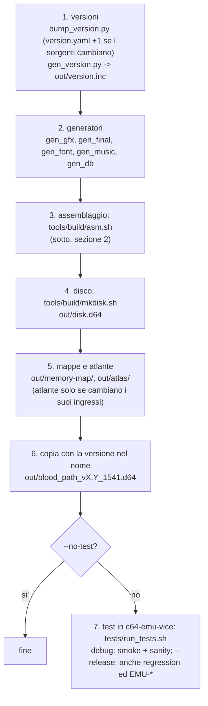
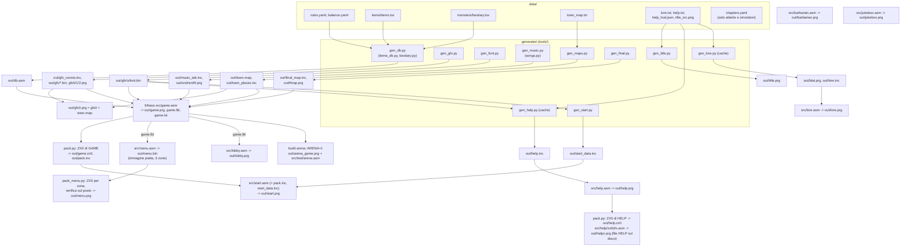
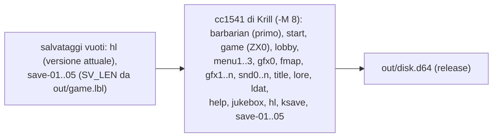
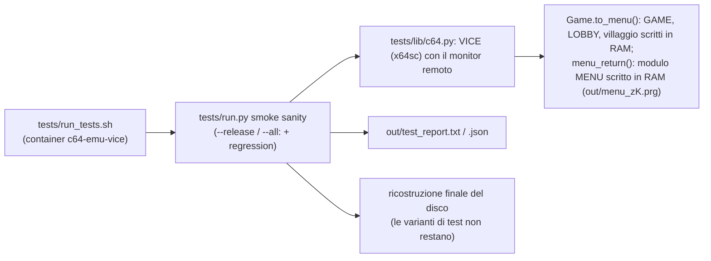

# Build e strumenti

Copyright © 2026 - Simone Caporale

Come si passa dai **sorgenti** (`src/`, `data/`, `tools/`) al **disco** e ai documenti generati (stato del 13/11, v1.227).
**Panoramica di build e test, container e comandi: [Getting started](getting-started.md)** (da leggere prima). Le regole (quando si
fa la build di release, versioni, commit) sono in `CLAUDE.md`; i test in [Test](test.md); la struttura del codice in
[Architettura](architettura.md). Tutti i passi girano nel container `c64-builder` (i test in `c64-emu-vice`).

## 1. Il percorso completo (`./build.sh` -> `tools/build/build_game.sh`)

| Comando | Cosa fa |
|---|---|
| `./build.sh` | build di tutti i giorni: tutto + smoke e sanity (deve passare prima di ogni commit) |
| `./build.sh --no-test` | build veloce senza test |
| `./build.sh --release` | la stessa build (GAME compresso in modo ottimo, `ZX0_BEST=1`) con **tutti** i test (anche regression ed `EMU-*`), manuale PDF (`barbarian-manual`) e `tools/build/release.sh` (disco, mappe, zip dei sorgenti in `out/`); solo quando la chiede il committente |
| `./build.sh --manual` | solo il manuale (`out/manual/`) |
| `toolchain/run.sh builder tools/build/asm.sh [test]` | solo generatori del gioco + assemblaggio (con `test`: varianti `TESTUI`, `NOKEYS`... per screenshot e prove) |

## 2. Assemblaggio (`tools/build/asm.sh`)

- **Ordine obbligato**: GAME per primo (le sue etichette `out/game.lbl` servono a LOBBY e MENU, che lo chiamano);
  `pack.py` dopo GAME (START deve sapere dove caricare il flusso compresso: `out/pack.inc`); START dopo (conosce anche la
  dimensione di GAME + LOBBY + GFX0 per dosare la barra, `OTHERS`).
- **Controlli in assemblaggio**: margine del codice (`.cerror`, avviso sotto 1 KB sotto `$8720`), zone del MENU, cache
  del tema, pagina zero, generatore sotto l'I/O. La build stampa i margini:
  `margine codice: N B (di cui M prima del plugin di Krill)` e `menu: zona 1 ... libera N B`.
- **Passi lenti in cache** (`tools/build/cache_run.py`): girano solo se cambiano i loro ingressi (storia `gen_lore`, manuale
  `gen_help`, atlante `gen_atlas`); impronta SHA-1 di ingressi e uscite.
- **Compressione** (`tools/build/pack.py`, `toolchain/zx0/`): modo rapido nelle build normali, ottimo con `ZX0_BEST=1`
  (`tools/build/release.sh`); cache in `out/zx0cache/`; decompressore di riferimento `tools/build/zx0dec.py`.

## 3. Il disco (`tools/build/mkdisk.sh`)

**Un solo disco** (11/11 sera, regola del committente): per lo sviluppo `POKE 1020,1` prima del `RUN` salta il menu del
loader. Comporre il disco costa ~0,1 s. Dall'11/11 il disco lo scrive il `cc1541` di Krill's Loader
(hash dei nomi a 8 caratteri, collisioni rifiutate); i salvataggi sono file preallocati ([FastLoader](FastLoader.md)).

### Krill's Loader (`tools/build/krill_build.sh`, dall'11/11)

`tools/build/asm.sh` lo chiama per primo: scompatta `src/third-party/krill/loader-v194.zip` in `out/krill/pkg` (usa e getta),
costruisce install, residente e plugin di save con `ca65`/`ld65` e `src/common/krill/loaderconfig.inc` (indirizzi:
`INSTALL` `$0840`, `RESIDENT` `$0200`, `TRANSIENT` `$7D00`, pagina zero `$41`), compila `cc1541` e scrive
`out/krill.inc` (`tools/build/krill_syms.py`) per 64tass. ~1,3 s.

## 4. Strumenti di supporto

| Strumento | Uso |
|---|---|
| `tools/memory-map/gen_rammap.py`, `tools/memory-map/gen_diskmap.py` | `out/memory-map/mappa_ram.html`, `out/memory-map/mappa_disco.html` a ogni build (se cambia la memoria o il disco vanno aggiornati) |
| `tools/atlas/gen_atlas.py` (+ `atlas_names.py`, `atlas_template.html`) | atlante grafico `out/atlas/` ([regole in CLAUDE.md](../CLAUDE.md)) |
| `tools/build/asm_audit.py` | analisi del codice assemblato (`out/asm_audit/analisi_assembly.md`, test `ASM-10`) |
| `tools/manual/gen_manual.py` | manuale per la release |
| `tools/vice/arena.py` + `src/test/arena.asm` | combattimenti veri in VICE per controllare i simulatori |
| `tools/vice/*` | screenshot (`shots_menus.sh`, `shots_manual.sh`), profilo per fotogramma (`frame_prof.py`), cronometro del MENU (`menu_time.py`) |
| `tools/simulators/*.py` | simulatori di combattimento, progressione, economia ([Bilanciamento](balancing-guide.md)) |
| `tests/run.py` | i test: `smoke`, `sanity`, `regression` ([Test](test.md)) |

## 4b. Programmi esterni compilati una volta (`toolchain/build.sh`, 13/11)
VICE, zx0 e cc1541 non cambiano: si compilano **una volta** nel container usa e getta `c64-tools-builder`
(target `tools-builder` di `toolchain/docker/Dockerfile`: compilatori e librerie di sviluppo), che alla fine si cancella (container
e immagine). `./build.sh` lo
lancia da solo se manca un binario.

| Programma | Sorgente | Risultato (non in git) | Licenza |
|---|---|---|---|
| VICE 3.10 (gtk3) | tarball ufficiale, scaricato **sull'host** (`curl`) in `toolchain/vice/src/` e scompattato lì | `toolchain/vice/bin/` (eseguibili e dati accanto) | GPL-2.0 (`toolchain/vice/LICENSE`) |
| zx0 v2.2 | `toolchain/zx0/*.c` (in git) | `toolchain/zx0/bin/zx0` | BSD-3 |
| cc1541 | dallo zip di Krill (`C64_KRILL_ZIP` in `toolchain.env`: `src/third-party/krill/loader-v194.zip`) | `toolchain/cc1541/bin/cc1541` (+ `src/`) | MIT |

- Versione di VICE: `VICE_VERSION` (predefinita 3.10) o `VICE_URL`; `toolchain/build.sh vice` rifà solo VICE.
- **Spostabile, senza percorsi assoluti** [MISURATO 13/11]: VICE ha nell'eseguibile il percorso di installazione (`/opt/vice`) ma
  cerca keymap, risorse e ROM **anche accanto all'eseguibile** (`bin/C64`, `bin/common`, ...): `build_tools.sh` copia i dati in `bin/`
  insieme ai programmi, quindi la cartella funziona ovunque (prima, con i dati in `share/vice`, la copia non partiva: "Default keymap
  not found"). Non conosco un'opzione per indicare la cartella dati.
- **Stessa base** (stage `base` di `toolchain/docker/Dockerfile`, ubuntu:24.04) per `c64-tools-builder`, `c64-builder` e
  `c64-emu-vice`: i binari compilati su una base più recente non partono su una più vecchia (una VICE compilata su 26.04 vuole glibc 2.42, la 24.04 ha la 2.39) [MISURATO].
- **VICE headless provato e scartato** [MISURATO 13/11]: la 3.10 con `--enable-headlessui` va in segfault all'avvio (`log_archdep` con
  un puntatore nullo mentre scrive "ROM image not found" per i drive 2000/3000/4000), anche con `-logfile`/`-console`: niente
  screenshot. Resta gtk3 con Xvfb. Non provato: fornire anche le ROM di quei drive.
- **gtk3, non sdl2** [MISURATO 13/11]: con sdl2 gli stessi test erano 3,2-3,6 volte più lenti (causa non indagata).
- Gli hash dei tarball non sono verificati contro valori ufficiali (lo script stampa lo sha256 scaricato).

## 5. I test nella build

## 6. Container, programmi esterni, Windows e WSL (13/11)
Nel progetto stanno **tutti i file** (sorgenti, dati, ROM in `toolchain/roms/`, VICE, zx0 e cc1541 in `toolchain/*/bin`). I
**programmi** stanno nei container (`toolchain/docker/Dockerfile`, `tools/manual/Dockerfile`, tabella in
[Getting started](getting-started.md) sezione 3); sull'host servono solo
sh, Docker con BuildKit, git e curl (`./validate_env.sh` li controlla).

| Programma | Container | A cosa serve |
|---|---|---|
| `64tass` 1.59, `cc65` 2.19, `make`, `perl`, `unzip`, `zip`, `git` | `c64-builder` | assemblaggio, Krill's Loader, release, versione dei branch |
| `python3` 3.12 + Pillow, PyYAML, NumPy, Matplotlib | `c64-builder` | generatori, atlante, mappe, simulatori |
| librerie di VICE (gtk3), `xvfb-run`, `pkill`, `ffmpeg` | `c64-emu-vice` (= builder + questi) | test, screenshot, arena, MP3 dei brani |
| node 22, Playwright 1.63 + Chromium, ffmpeg | `c64-emu-vc64web` | demone di vc64web (test `EMU-*`, video) |
| WeasyPrint 70 (+ PyYAML, Pillow del builder) | `barbarian-manual` (= builder + WeasyPrint) | PDF del manuale |
| Xvfb, x11vnc, noVNC | `c64-emu-viewer` | vista dal vivo nel browser |
| gcc e librerie di sviluppo | `c64-tools-builder` (usa e getta) | VICE, zx0, cc1541 |

Dimensioni misurate il 13/11 (`docker image inspect`, layer comuni contati in ogni immagine): c64-builder 868 MB, c64-emu-vice
1514 MB (comprende il builder), c64-emu-vc64web 2116 MB, c64-emu-viewer 803 MB; barbarian-manual: vedi `docker images` (parte dal
builder). Lo stage `base` (ubuntu + CA + `/work`) e' in comune fra builder, emu-vice ed emu-viewer [MISURATO: stessi id dei layer]. **Costo di Docker** [MISURATO 13/11, Linux su Linux]: smoke in container 15,1 s di media contro 15,6 s sull'host (3
prove): nessuna perdita misurabile. **Non misurato** su Docker Desktop / WSL2.

**Windows**: si lavora **dentro WSL2** con il progetto nel filesystem di WSL (`~/...`), non in `/mnt/c` (accessi lenti, permessi e fine
riga). `./validate_env.sh` lo riconosce dal tipo di filesystem del punto di montaggio che contiene il progetto (`/proc/self/mountinfo`:
`9p`/`drvfs`/`virtiofs` = disco Windows o condiviso, `ext4` & simili = filesystem Linux) e dai segni di WSL (`microsoft` nel kernel,
`WSL_DISTRO_NAME`). **Non provato su Windows** (solo la logica, con un `mountinfo` di prova). Fine riga: `.gitattributes` forza LF.
Windows nativo (senza WSL) non è supportato: gli script sono shell Unix.

Per giocare si usa un VICE con interfaccia installato sull'host (o un C64 vero): è indipendente dal progetto.
