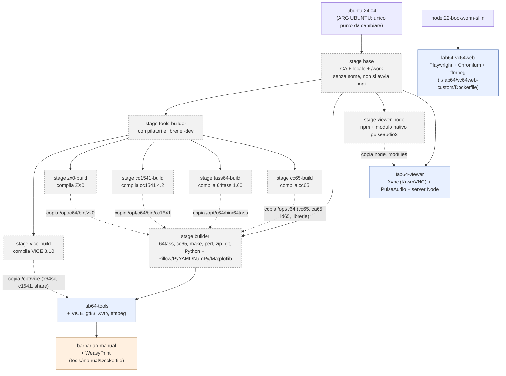
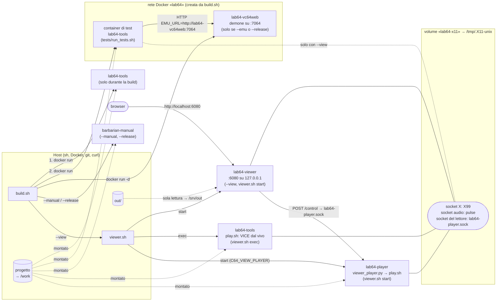
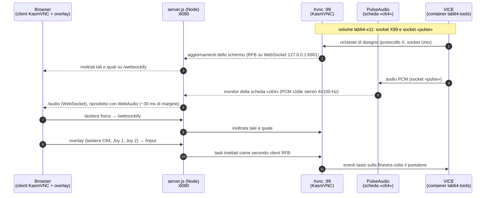

# Architettura Docker

Copyright © 2026 - Simone Caporale (note)

Come sono fatte le immagini e i container del progetto, chi dipende da chi, e come si parlano. Aggiornato al 14/11/2026 (versione 1.240).
Per l'uso pratico (comandi, prerequisiti) vedi [getting-started.md](getting-started.md); per i dettagli di ciascuna immagine
[../lab64/README.md](../../lab64/README.md).

**Legenda delle affermazioni**: *[misurato]* = verificato con una prova; *[dal codice]* = letto negli script o nel Dockerfile, non rieseguito
per questo documento; *[non verificato]* = ipotesi.

## 1. Due livelli: immagini e container

- **Immagini** (si costruiscono una volta, `../lab64/build-images.sh`): modelli di sola lettura. Sono 4: tre generiche (`lab64-*`, di
  **Lab64**, la toolchain che dal 14/11 e' un repository a parte, cartella `../lab64`, e non sa nulla del gioco) e una del gioco
  (`barbarian-manual`, che diventera' `lab64-pdf-gen`, TODO T2).
- **Due cartelle**: il progetto si monta in `/work` (lettura e scrittura), Lab64 in `/lab64` (sola lettura, `LAB64=/lab64`).
- **Container** (nascono e muoiono a ogni comando): quasi tutti con `--rm`. **Nessuno è sempre acceso**: dipendono da cosa chiedi a
  `build.sh` o a `viewer.sh`. Il progetto sta sull'host e si monta in `/work`.
- **Lingua** (14/11, regola del committente): tutto Lab64 è in inglese (anche i suoi commit) (codice, commenti, messaggi, pagine, README, il pacchetto
  `vc64web-custom/` compresi documenti ed esempi); la wiki, il TODO e i commit restano in italiano. Conseguenze visibili: il client
  vc64web stampa `ERROR CODE: messaggio`, la schermata del test tasti dice `KEY AND JOYSTICK TEST` ([emulatore.md](emulatore.md)).

## 2. Immagini e parentela

Un solo Dockerfile multi-stage (`../lab64/docker/Dockerfile`) produce due immagini (14/11: builder e VICE uniti in `lab64-tools`); `vc64web` ha un Dockerfile a parte; il manuale ne ha uno nel progetto.

Linea tratteggiata = si copia solo il risultato: **i compilatori non finiscono mai nelle immagini finali** (restano nella cache di BuildKit).
Linea piena = `FROM`, cioè si ereditano tutti i layer.

| Immagine | Target / Dockerfile | Cosa contiene | Dimensione [misurato 14/11] |
|---|---|---|---|
| (stage interno) | `builder` | 64tass, cc65, make, perl, zip, git, Python, zx0, cc1541 | - |
| `lab64-tools` | `tools` | il builder + VICE 3.10 (gtk3), Xvfb, ffmpeg | 1553 MB (come la vecchia `c64-emu-vice`) |
| `lab64-viewer` | `viewer` | Xvnc di KasmVNC 1.5.2, PulseAudio, Node + `server.js` | 780 MB |
| `lab64-vc64web` | `../lab64/vc64web-custom/Dockerfile` | Node, Playwright, Chromium, ffmpeg, demone dell'emulatore nel browser | 2116 MB |
| `barbarian-manual` | `tools/manual/Dockerfile` | `lab64-tools` + WeasyPrint 70 | 1620 MB [misurato 14/11, da `lab64-tools`; 937 MB quando partiva dal solo builder] |

Conseguenze della struttura:
- **Layer condivisi** [misurato 13/11]: `lab64-tools` e `lab64-viewer` hanno gli stessi layer fino a `base`, quindi occupano
  disco una volta sola per la parte comune. `vc64web` parte da un'altra base e non condivide nulla.
- **Cambiare Ubuntu**: `ARG UBUNTU` in un solo punto, poi `../lab64/build-images.sh --force` ricompila tutto (VICE, zx0 e cc1541 compresi) sulla base nuova.
- **`barbarian-manual`** eredita da `lab64-tools` (`FROM lab64-tools`): e' del gioco, per questo `build-images.sh` di Lab64 non lo costruisce, lo fa `build.sh` (funzione `manual_image`).
- **Sorgenti scaricati sull'host, non nel build** (14/11: tutti, all'ultima versione, elencati in `../lab64/sources.conf` con SHA-256 o
  commit): li scarica `build-images.sh` con `curl` o `git` dell'host (certificati e proxy del computer) in `../lab64/downloads/` e li passa
  al Dockerfile come *build context* `downloads`. Un eventuale proxy che intercetta TLS entra come segreto
  (`C64_CA_BUNDLE`) solo per le build che usano npm.
- Le pagine di `vc64web` si generano in `lab64-tools` (`build.py`, nella cartella `out/cache/vc64web/` **di Lab64**) e poi entrano nell'immagine come build context `pages`.
- **File di sola costruzione** (14/11, regola del committente): a immagini fatte `../lab64/build-images.sh` cancella il tarball di VICE
  (`../lab64/downloads/`, con tutti gli altri sorgenti e il `.deb` di KasmVNC) e `../lab64/out/cache/vc64web/c64-headless.html` (serve solo a
  costruire l'immagine). `--force` riscarica da solo; il contenuto e' lo stesso, quindi la cache di BuildKit resta valida [dal codice, non
  provato un `--force` dopo la cancellazione: serve la rete]. La pagina `VirtualC64-v*.html` in `../lab64/out/cache/vc64web/` resta: la usa l'indice del
  viewer (`viewer.sh` la monta sopra `out/cache/vc64web/` del progetto), e `build-images.sh viewer` la rigenera se manca.

## 3. Container a runtime

Chi li avvia: `build.sh` (build e test), `../lab64/run.sh` (qualsiasi comando in un'immagine) e `../lab64/viewer.sh` (viewer e VICE dal vivo).

Chi crea cosa:

| Comando | Container che nascono (in ordine) |
|---|---|
| `./build.sh` | `lab64-tools` (build) → container di test, sempre `lab64-tools` (smoke + sanity) |
| `./build.sh --no-test` | solo `lab64-tools` |
| `./build.sh --emu` | come sopra, più `lab64-vc64web` (demone, spento a fine comando) |
| `./build.sh --view` | come sopra, più `lab64-viewer` e `lab64-player` (restano accesi dopo la fine) e i test sul suo schermo; se il viewer è già acceso i test lo usano anche senza `--view` (`--no-view` per evitarlo) |
| `./build.sh --manual` | solo `barbarian-manual` |
| `./build.sh --release` | tutto: `--emu`, tutti i test, `barbarian-manual`, poi `lab64-tools` per il pacchetto |
| `../lab64/viewer.sh start` | `lab64-viewer`, poi `lab64-player` (immagine `lab64-tools`, `../lab64/viewer_player.py`) se `lab64.env` definisce `C64_VIEW_PLAYER` |
| `../lab64/viewer.sh exec tools/vice/play.sh` | `lab64-viewer` se non c'è, poi `lab64-tools` con VICE dal vivo e audio |
| `../lab64/run.sh tools …` | un container `lab64-tools` per quel comando |

Il container di test e quello di `play.sh` sono lo stesso tipo di immagine (`lab64-tools`) con parametri diversi. [dal codice]

## 4. Reti, volumi, porte

| Risorsa | Chi la usa | A cosa serve |
|---|---|---|
| Rete `lab64` | il container di test, `lab64-vc64web` | i test raggiungono il demone `vc64web` per nome (`http://lab64-vc64web:7064`). Il demone **non** pubblica la porta sull'host |
| Volume `lab64-x11` | `lab64-viewer`, `lab64-player`, container VICE collegati allo schermo | contiene il socket X (`X99`), il socket audio (`pulse`) e il socket del lettore (`lab64-player.sock`, 14/11) |
| `/work` | quasi tutti | il progetto dell'host, con l'utente (uid/gid) dell'host |
| `/srv/out` | solo `lab64-viewer`, **in sola lettura** | la cartella `out/` mostrata dal viewer |
| Porta `127.0.0.1:6080` | `lab64-viewer` | unica porta pubblicata: **solo localhost** (HTTP e WebSocket) |

Il viewer **non** sta sulla rete `lab64`: parla con gli altri container solo attraverso il volume `lab64-x11`. [dal codice: `viewer.sh` non passa `--network`]

**Niente socket di Docker nel viewer** (14/11, scelta del committente: la piu' sicura). Chi monta `/var/run/docker.sock` puo' avviare un
container con il disco dell'host montato, cioe' e' root sull'host; e la porta su 127.0.0.1 non basta, perche' una pagina qualsiasi aperta
nel browser puo' mandare richieste a localhost. Per avviare VICE dalla pagina il viewer parla quindi con un processo che gira gia'
(`lab64-player`, lanciato da `viewer.sh start` sull'host) attraverso il socket Unix `lab64-player.sock` del volume `lab64-x11`, con soli
quattro comandi (`status`, `play` di un file sotto `out/`, `basic`, `stop`). Il server del viewer accetta poi solo Host locali (`VIEW_HOSTS`
per gli altri), richieste della stessa origine su `/control` e sui WebSocket, e `/control` solo in JSON. [provato 14/11 con curl]

Variabili d'ambiente del viewer: `VIEW_PORT` (6080), `VIEW_PASSWORD` (facoltativa, protegge tutto), `VIEW_SIZE` (1280x1000), `VIEW_HOSTS`
(Host ammessi oltre a localhost), `C64_VIEW_DISK` (disco proposto per primo nell'indice), `C64_VIEW_PLAYER` (comando del lettore).
Per i container emulatori: `EMU_URL`, `C64_VIEW`, `DISPLAY`, `PULSE_SERVER`.

## 5. Dentro il viewer: video, audio, tasti

Non c'è un flusso video «tra container»: VICE è un normale client X e disegna direttamente sullo schermo X dell'altro container, perché
il socket Unix sta nel volume condiviso. Il resto è del viewer.

Il server Node ha una sola porta e queste rotte [dal codice, `server.js`]:

| Rotta | Contenuto |
|---|---|
| `/`, `/live.html`, `/config.js` | indice, schermo dal vivo con overlay e audio, disco proposto |
| `/vnc/` | il client web di KasmVNC (file del pacchetto ufficiale) |
| `/websockify` | WebSocket verso Xvnc, byte passati senza modifiche |
| `/audio` | WebSocket con l'audio (registrazione di `c64.monitor`, un solo flusso finché c'è almeno un ascoltatore) |
| `/input` | WebSocket dei tasti dell'overlay (`d <keysym>`, `u <keysym>`, `f`) |
| `/out/` | la cartella `out/` del progetto, in sola lettura, con elenco dei file; l'indice propone i dischi di `out/releases/v*/` |

Con `VIEW_PASSWORD` impostata, **tutte** le rotte chiedono HTTP Basic, WebSocket compresi [misurato 14/11: `/input` risponde 401 senza password o con password errata].

Particolarità di KasmVNC emerse durante il lavoro (se tocchi `/input` ti servono) [misurato]:
- Xvnc accetta il WebSocket solo con l'intestazione `Origin`, altrimenti risponde 404.
- Il `PointerEvent` è di **11 byte** (maschera da 2 byte più due scorrimenti), non 6 come nell'RFB standard: con il formato standard
  il server chiude la connessione (`invalid pixel format`) e i tasti dopo il primo puntatore vanno persi.
- Un tasto del tastierino numerico mandato come keysym `KP_8` fa accendere a Xvnc il NumLock da solo: il joystick 2 non dipende quindi dal NumLock del browser.
- `-PublicIP 127.0.0.1` è obbligatorio, altrimenti Xvnc interroga server STUN su Internet prima di aprire la porta web.

Misure di latenza [misurato 14/11, browser headless sulla stessa macchina]: immagine ~55 ms, audio ~41 ms, audio e immagine entro ~15 ms.
In un browser reale e su una macchina diversa **non** sono state misurate.

## 6. Dentro i container di test

- Senza `--view` il VICE di test usa un proprio schermo virtuale (`xvfb-run -a`) ed è **senza suono** (`-sounddev dummy`, quasi sempre in warp):
  non serve il viewer.
- Con `--view` (o `C64_VIEW=1`) apre la sua finestra sullo schermo del viewer, sempre senza suono.
- `play.sh` è l'unico caso con il suono: usa `-sounddev pulse`, il tastierino numerico per il joystick 2 e il keyset 1 su F13-F17 per il joystick 1
  (`tools/vice/play.vicerc`, caricato con `-addconfig`).
- `vc64web` è un secondo emulatore, usato solo dai test `EMU-*`. Gira dentro il suo container con un Chromium headless pilotato da Playwright; il
  container ha un `HEALTHCHECK` su `/ping` e `--shm-size 1g`.

## 7. Perché è fatto così

| Scelta | Motivo |
|---|---|
| Toolchain generica in un repository a parte (Lab64, 14/11), progetto che la configura con `lab64.env` | si può riusare per altri giochi per C64 senza copiare nulla del gioco |
| Un Dockerfile multi-stage con base comune senza nome | un solo punto per cambiare Ubuntu, layer condivisi, nessuna immagine «base» da gestire |
| Compilatori solo negli stage `*-build` | le immagini finali restano piccole; la cache di BuildKit evita di ricompilare VICE a ogni build |
| Due emulatori in due container separati (VICE, vc64web) | decisione del committente: basi e dipendenze molto diverse (gtk3/Xvfb contro Node/Chromium) |
| Viewer separato dagli emulatori | si può guardare e provare senza `lab64-tools`; e' l'unico componente raggiungibile dal browser, quindi contiene il minimo; schermo e audio condivisi con qualunque container tramite un volume |
| Video e audio via volume e socket Unix | niente rete tra container, nessun codec lato emulatore; Xvnc codifica una volta sola per il browser |
| Porta solo su `127.0.0.1` | lo schermo X non ha autenticazione (`-ac`): chi monta il volume può disegnarci; l'accesso da fuori richiede un tunnel (SSH) |

## 8. Cosa non è verificato

- **Docker su Windows (WSL2/Docker Desktop)**: tutto qui è stato provato in un solo ambiente Linux. Il comportamento di `127.0.0.1:6080`, del volume
  `lab64-x11` e dei socket Unix su Windows è *[non verificato]* (TODO I9).
- **Memoria condivisa X (MIT-SHM)**: non può essere condivisa fra due container (IPC separati). Se VICE la richiede, ripiega sul socket, ma non ho verificato che lo faccia.
- **Browser e tastiera reali, schermo a sfioramento, gamepad fisico** per l'overlay (TODO J13); **audio con un browser vero** in WSL2/Windows.
- **Client VNC nativi** (TigerVNC, ecc.): oggi non ci si può collegare, perché Xvnc non pubblica una porta RFB; vedi la discussione nel TODO se verrà aggiunta.
- Il **monitor remoto di VICE** nei test si blocca di tanto in tanto (TODO I11): durante le prove di questa sessione si è bloccato quando chiudevo la
  connessione subito dopo il comando `x`; non è dimostrato che sia la stessa causa dei blocchi nei test.
