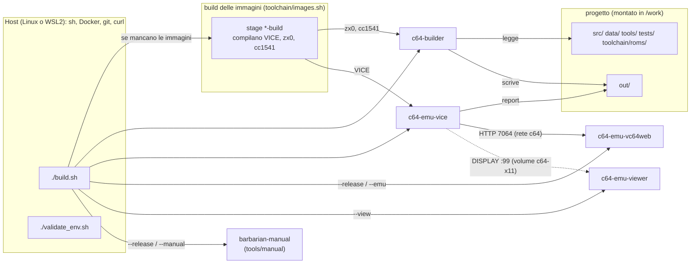
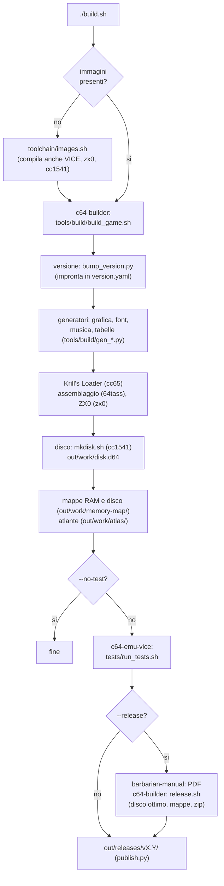
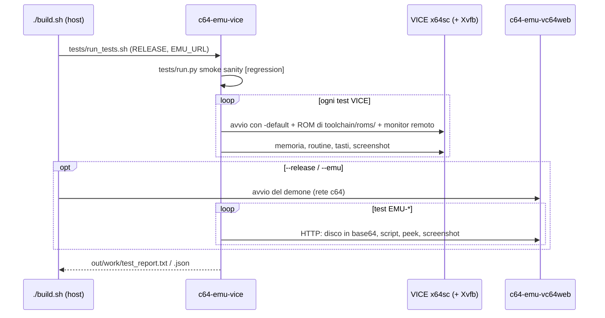

# Getting started: come si costruisce e si prova il progetto

Copyright © 2026 - Simone Caporale

Pagina da leggere **la prima volta** (persone e modelli): spiega dove sta ogni cosa, quali container esistono, come gira la build,
come girano i test e dove finiscono i file. I dettagli dei singoli passi sono in [build.md](build.md) (pipeline) e [test.md](test.md)
(suite e runner); l'emulatore secondario in [emulatore.md](emulatore.md).

## 1. In breve

```sh
./validate_env.sh          # una volta su un computer nuovo: controlla host, Docker, ROM, posizione del progetto (WSL/Windows)
./build.sh                 # TUTTO: disco + mappe + atlante + smoke e sanity + manuale PDF
./build.sh --fast          # solo il disco (salta atlante, mappe, manuale); smoke e sanity restano: il comando di tutti i giorni
./build.sh --fast --no-test  # il minimo: solo il disco
./build.sh --release       # build completa + tutti i test (anche regression ed EMU-*) + manuale PDF (solo su richiesta)
                           # tutti i parametri (--no-atlas, --no-maps, --no-manual, --keep N, ...): tabella nel README
./build.sh --view          # come ./build.sh, ma VICE si vede dal vivo nel browser: http://localhost:6080
toolchain/run.sh emu-vice python3 tests/run.py -k SAVE      # un comando qualunque in un container (qui: i test SAVE)
```

Sull'host servono **solo** `sh`, Docker (con BuildKit), `git` e `curl`. Python, 64tass, cc65, VICE, node, Chromium, WeasyPrint:
tutto sta nei container o nel progetto. Su Windows si lavora **dentro WSL2**, con il progetto nel filesystem di WSL (non in `/mnt/c`):
`./validate_env.sh` lo controlla dal tipo di filesystem del punto di montaggio (`/proc/self/mountinfo`).

## 2. Cartelle

| Cartella | Contenuto | In git |
|---|---|---|
| `src/` | sorgenti del gioco (6502, un `.asm` principale per file del disco) e `src/third-party/` (librerie per il C64: Krill's Loader) | sì |
| `data/` | dati del gioco (regole, bilanciamento, mappe, testi) | sì |
| `tools/build/` | generatori e script della build (Python, bash) | sì |
| `tools/atlas/`, `tools/memory-map/`, `tools/manual/`, `tools/simulators/` | generatori dei documenti riproducibili e simulatori; scrivono in `out/work/<nome>/` | sì |
| `tools/vice/`, `tools/font/` | strumenti che girano in VICE (screenshot, misure, arena); sorgenti del font della UI | sì |
| `tests/` | `smoke/`, `sanity/`, `regression/`, libreria `lib/`, runner `run.py` | sì |
| `docs/` | documentazione **scritta** (wiki), sorgente del manuale (`docs/manual/`), screenshot dei menu (`docs/screens/`) | sì |
| `toolchain/` | **toolchain C64 generica** (non sa nulla del gioco, [README](../toolchain/README.md)): `docker/Dockerfile` (immagini `c64-*`, multi-stage), script `run.sh`, `images.sh`, `viewer.sh`, `build.sh` (tool), `validate_env.sh`; programmi esterni `vice/`, `zx0/`, `cc1541/` (compilati una volta in `bin/`); `vc64web-custom/` (emulatore secondario, autonomo); `roms/` (ROM del C64: `vice-roms/{C64,DRIVES}/`, `open-roms/`, elenco in `roms.md`) | sì, senza `bin/` e `src/` |
| `toolchain.env` | configurazione della toolchain per il gioco: variabili passate ai container, immagini del gioco, disco proposto dal viewer, zip di Krill | sì |
| `lab/` | materiale di studio che la build non usa ([lab/README.md](../lab/README.md)) | sì, tranne `lab/music/` |
| `out/` | **tutto cio' che si genera**: `work/` (intermedi e uscite della build in corso), `cache/` (zx0, steps, vc64web: si riusano), `tmp/` (usa e getta), `releases/` (artefatti per versione, ultime 5) | no (solo `.gitkeep`) |

## 3. I container

Diagrammi e dettagli completi: [docker-architecture.md](docker-architecture.md).

Immagini della **toolchain** (`c64-*`, generiche) e del **gioco** (`barbarian-*`, accanto al loro codice). Le prime vengono da un solo
Dockerfile multi-stage (`toolchain/docker/Dockerfile`): lo stage `base` (ubuntu + CA + locale) e' il genitore comune, **non ha un
nome di immagine** (non si avvia mai) e contiene la versione di Ubuntu in un solo punto (`ARG UBUNTU`). I suoi layer sono gli
stessi in tutte le immagini che ne derivano (13/11, misurato: stessi id dei layer in `c64-builder`, `c64-emu-vice`, `c64-emu-viewer`).

| Immagine | Da | Cosa contiene | Quando si usa | Dimensione (13/11) |
|---|---|---|---|---|
| (stage `tools-builder`, `*-build`) | base | compilatori C e librerie di sviluppo | compilano VICE, zx0, cc1541 **durante la build** delle immagini; non diventano immagini (restano nella cache di BuildKit) | - |
| `c64-builder` | base | 64tass, cc65, make, perl, Python 3 con Pillow, PyYAML, NumPy, Matplotlib; zx0, cc1541 | build del gioco, generatori, simulatori | 868 MB |
| `c64-emu-vice` | c64-builder | + VICE 3.10 (`x64sc`, `c1541`), librerie gtk3, Xvfb, ffmpeg | test, screenshot, arena, misure in VICE, MP3 dei brani | 1553 MB |
| `c64-emu-viewer` | base | Xvnc di KasmVNC, PulseAudio, server Node (pagina indice, schermo con audio) | facoltativo: emulatori dal vivo **con l'audio** e ultima build in vc64web nel browser | 780 MB |
| `c64-emu-vc64web` | node:22-bookworm-slim | node, Playwright, Chromium, ffmpeg, pagine di vc64web gia' costruite (Dockerfile del pacchetto) | demone dei test `EMU-*` | 2116 MB |
| `barbarian-manual` | c64-builder | + WeasyPrint, pango (`tools/manual/Dockerfile`) | PDF del manuale | vedi `docker images` |

Le dimensioni sono quelle di `docker image inspect` (layer comuni contati in ogni immagine: sul disco i layer condivisi stanno una volta).



Regole: i container girano con l'utente dell'host (`toolchain/run.sh`: i file in `out/` restano suoi), il progetto e' montato in
`/work`, nessun file del progetto sta nelle immagini (tranne le pagine di vc64web nella sua immagine). `toolchain/run.sh builder ...`
usa `c64-builder`; un nome completo (`toolchain/run.sh barbarian-manual ...`) si usa cosi' com'e'. Le immagini mancanti le
costruisce `toolchain/images.sh` (lo chiama `./build.sh`), compilando dentro anche VICE, zx0 e cc1541.

## 4. La build



- **Versione**: cresce da sola a ogni build con sorgenti cambiati (`version.yaml`: `version` e `source_hash`).
- **Cache**: i passi lenti indipendenti dal gioco passano da `tools/build/cache_run.py` (girano solo se cambiano gli ingressi).
- Comandi singoli: `toolchain/run.sh builder tools/build/asm.sh` (solo assemblaggio), `toolchain/run.sh builder python3 tools/simulators/sim_rules.py`.

## 5. I test



- `smoke/` (veloci, happy path) + `sanity/` (feature corrente): a ogni build e prima di ogni commit. `regression/`: in release.
- Tetti di durata (`CAPS` in `tests/run.py`): smoke 20 s, smoke + sanity 35 s, un test 10 s. Valgono anche con il viewer acceso
  (i test sul suo schermo sono piu' lenti: 28,3 s contro 17,9 s, una misura del 14/11; `./build.sh --no-view` li tiene sui display virtuali).
- Test singoli: `toolchain/run.sh emu-vice python3 tests/run.py -k INN`, `toolchain/run.sh emu-vice python3 tests/run.py all --list`.
- Test su vc64web: `./build.sh --emu` (poi i `EMU-*` sono in regression: `-k EMU`). Senza demone sono SKIP, non FAIL.
- Regole dei test (ID, lingua, eroe di prova, dove va un test nuovo): [tests/CLAUDE.md](../tests/CLAUDE.md) e [test.md](test.md).

## 6. Vedere l'emulatore dal vivo

`./build.sh --view` (o `toolchain/viewer.sh start`) avvia `c64-emu-viewer`; **http://localhost:6080** (una sola porta, aperta solo
su localhost) e' il **centro di controllo** (14/11, richiesta del committente; tema Commodore 64: palette del VIC-II e font ricavato dal
chargen nell'immagine, stage `viewer-font`):
- **Stato dal vivo** (aggiornato ogni 2 s): **BUILD** (fase e esito di `./build.sh`, da `out/tmp/build.json`), **TEST** (barra di
  avanzamento, test in corso, ultimi esiti e FAIL, da `out/tmp/tests.json` che `tests/run.py` riscrive dopo ogni test), **VICE LIVE**
  (il VICE avviato dalla pagina, con "Gioca / prova" e "Chiudi").
- **Miniatura dello schermo dal vivo** fissa in basso a destra (client KasmVNC in sola vista, `view_only=1&resize=scale`): un clic la
  apre **grande e interattiva** (`/live.html`: tastiera fisica, overlay Tastiera / Joy 1 / Joy 2, Audio). Se il viewer e' acceso,
  `./build.sh` fa girare i test sul suo schermo da solo (`--no-view` per evitarlo) e la miniatura si apre quando partono i test.
  [misurato 14/11, una volta sola] smoke + sanity con la vista accesa e VICE del lettore in esecuzione: 28,3 s contro 17,9 s senza
  (tetto 35 s).
- **Una scheda per versione** di `out/releases/` (da `manifest.json`): esito dei test, commit, release/branch, modifiche non
  committate; pulsanti **vc64web (browser)**, **VICE sullo schermo dal vivo**, **Scarica .d64**; margini di RAM, blocchi liberi del
  disco, dimensione di GAME compresso, durate; tabella degli artefatti (dimensione, data, SHA-256) con quelli **non generati**; directory
  del disco; elenco dei test (o solo i FAIL, con il motivo).
- **Andamento** fra le versioni tenute (margini di RAM, blocchi liberi, GAME compresso, durata di build e di smoke + sanity) e
  **confronto** fra due versioni (misure, file del disco cambiati, test con esito o tempo diverso).
- **Prove a mano**: "VICE vuoto (READY.)" (`play.sh --bare`), "vc64web vuoto", e i **file propri**: un `.d64 .g64 .prg .t64 .crt`
  copiato in `out/tmp/` compare nella pagina con i pulsanti VICE e vc64web. Nella finestra di VICE il menu (File -> Smart attach)
  monta qualunque file del progetto (`/work`).

**Come la pagina comanda VICE** (14/11, scelta piu' sicura confermata dal committente): il viewer **non** ha il socket di Docker (chi
lo ha e' root sull'host). `viewer.sh start` avvia anche **`c64-emu-player`** (immagine `c64-emu-vice`, `toolchain/viewer_player.py`) se
`toolchain.env` definisce `C64_VIEW_PLAYER` (qui `tools/vice/play.sh`): la pagina manda `POST /control` al server del viewer, che lo
passa al lettore da un socket Unix nel volume `c64-x11` (`c64-player.sock`). Comandi: `status`, `play` (percorso sotto `out/`, solo
`.d64 .g64 .prg .t64 .crt`, niente `..`, il file deve esistere), `basic`, `stop`. Protezioni del server: Host solo `localhost`,
`127.0.0.1`, `[::1]` (o `VIEW_HOSTS`) contro il DNS rebinding; `/control` e i WebSocket solo dalla stessa origine; `/control` solo con
`Content-Type: application/json`. [provato 14/11 con curl: 421 con Host estraneo, 403 con Origin estraneo, 415 senza JSON, `disco non
valido` per `../version.yaml`; in un browser headless: VICE avviato dalla pagina, 100% e 50 fps nello schermo grande]

Dettagli dello schermo dal vivo:
- **Schermo dal vivo con l'audio** (`/live.html`, 14/11): lo schermo X condiviso e' il server X di **KasmVNC** (volume `c64-x11`),
  mostrato dal suo client web; l'audio viene da **PulseAudio** del viewer (scheda virtuale `c64`) ed e' mandato dal server del viewer
  su un WebSocket (`/audio`), acceso dal pulsante "Audio" della pagina. Gli emulatori di un altro container usano schermo e audio
  con `DISPLAY=:99` e `PULSE_SERVER=unix:/tmp/.X11-unix/pulse` (il socket dell'audio sta nello stesso volume). I VICE dei test si
  aprono su quello schermo (`C64_VIEW=1`) ma restano **senza suono** (`-sounddev dummy`, quasi sempre in warp).
  **VICE con il suono**, a velocita' reale, sull'ultima build: `toolchain/viewer.sh exec tools/vice/play.sh [disco.d64|versione]` (senza argomento `out/releases/latest`, con `1.239` quella versione)
  (`viewer.sh exec` = un comando in `c64-emu-vice` collegato a schermo e audio del viewer). La tastiera fisica del browser arriva a VICE.
  **Overlay** in `/live.html` (14/11): tre pulsanti nell'intestazione accendono, sopra lo schermo e semitrasparenti, la **tastiera del C64**
  (66 tasti con la disposizione originale e i tasti funzione a destra; SHIFT, CTRL e C= restano premuti fino al tasto successivo, SHIFT LOCK
  fino a un secondo tocco), **Joy 1** e **Joy 2** (ciascuno: un cerchio base con il pomello che segue il dito o il mouse, 8 direzioni, piu' un
  pulsante FIRE). I comandi vanno al server del viewer (WebSocket `/input`), che li inietta in Xvnc come secondo client RFB: non dipendono
  dal browser ne' dal NumLock. Joy 2 = porta 2 = quella che legge il gioco (tastierino numerico di VICE); Joy 1 = porta 1 (keyset 1 di VICE su
  F13-F17, `tools/vice/play.vicerc`). Con la tastiera fisica il tastierino numerico (NumLock attivo) muove il joystick 2; senza tastierino si gioca con
  W A S D e spazio/RETURN. Tutto serve solo con `play.sh` (VICE dal vivo); i test non usano l'overlay.
  Provato 14/11 in un browser headless sulla stessa macchina: 18 casi su 18 (8 direzioni e fire, per i due joystick, letti dall'indicatore
  «Joysticks» di VICE), `PRINT"HELLO"`, SHIFT+CLR/HOME, INST/DEL e SHIFT LOCK dalla tastiera a schermo, e nel gioco vero il menu cambia voce con Joy 2.
  **Non** provato: schermo a sfioramento (telefono, tablet), browser e tastiera reali, gamepad fisico. La password del viewer protegge anche `/input` (provato: 401 senza o con password errata).
  Misure [14/11, browser headless sulla stessa macchina, 2 x 10 eventi]: immagine ~55 ms, audio ~41 ms (il riproduttore tiene
  ~30 ms di margine), audio e immagine entro ~15 ms; la prima nota dopo un silenzio puo' arrivare con 100-200 ms. Confronto con le
  alternative (Guacamole, KasmVNC di linuxserver): [lab/viewer-audio](../lab/viewer-audio/README.md).
- **vc64web**: la pagina portable di vc64web (`out/cache/vc64web/`) aperta con `?disk=/out/releases/v<V>/<disco>`: l'emulatore gira
  **nel browser dell'utente**, quindi con l'audio. Il browser riscarica il disco solo se e' cambiato (`fetch` con `cache:'no-cache'`,
  il server risponde 304).
- la cartella `out/` (sola lettura: il viewer la monta in `/srv/out`).

Password facoltativa: `VIEW_PASSWORD=... toolchain/viewer.sh start` (di default nessuna): autenticazione HTTP del browser su
**tutto** il viewer (pagine, `out/`, schermo, audio; utente qualsiasi). Il server X di KasmVNC ascolta solo dentro il container
(127.0.0.1:6901): fuori c'e' solo la porta 6080. `toolchain/viewer.sh stop` lo ferma.

## 7. Dove finisce cosa (`out/`)

`out/` ha quattro cartelle (14/11): **`work/`** gli intermedi e le uscite della build in corso (riscrivibili: si puo' cancellare tutto),
**`cache/`** cio' che si riusa fra le build (non si cancella), **`tmp/`** usa e getta, **`releases/`** gli artefatti per versione.

| Percorso | Cosa |
|---|---|
| `out/releases/v<V>/` | **gli artefatti di ogni versione**: `blood_path_v<V>_1541.d64`, `atlas/`, `memory-map/`, `test_report.*`, `Barbarian_Blood_Path_Manuale_v<V>.pdf` (solo se generati per quella versione), `manifest.json` (file, SHA-256, data, esito dei test, cosa manca; dal 14/11 `stats`: commit e modifiche non committate, margini di RAM da `game.lbl`, blocchi liberi e directory del disco, dimensioni di GAME, durata di build e test). Si tengono le **ultime 5 versioni** (`./build.sh --keep N`, `KEEP_VERSIONS`); `out/releases/latest` e' il collegamento all'ultima |
| `out/work/disk.d64` | disco di lavoro della build in corso (da qui si pubblica) |
| `out/work/*.prg`, `*.lst`, `*.lbl`, `*.inc`, `*.log` | moduli assemblati, listati, etichette, sorgenti generati, log (`game`, `lobby`, `menu`, `start`, ...) |
| `out/work/gfx/`, `snd/`, `krill/` | grafica, musica e Krill's Loader generati |
| `out/work/atlas/` | atlante grafico (`index.html`) |
| `out/work/memory-map/` | mappa della RAM e del disco (HTML) |
| `out/work/manual/` | manuale (HTML, PDF, ritagli degli screenshot) |
| `out/work/simulators/` | report dei simulatori |
| `out/work/test_report.txt`, `.json` | esito dei test |
| `out/cache/zx0/` | compressioni ZX0 gia' fatte (`tools/build/pack.py`) |
| `out/cache/steps/` | impronte dei passi lenti saltati se gli ingressi non cambiano (`tools/build/cache_run.py`) |
| `out/cache/vc64web/` | pagine di vc64web (portable e headless): la pagina portable la usa l'indice del viewer |
| `out/tmp/` | file usa e getta (si puo' cancellare sempre), HOME dei container, stato dal vivo per il viewer (`build.json`, `tests.json`), file propri da provare nel viewer (`.d64 .g64 .prg .t64 .crt`) |

## 8. Problemi tipici

| Sintomo | Causa e rimedio |
|---|---|
| `./validate_env.sh`: "disco Windows" | il progetto sta in `/mnt/c/...`: clonarlo nel filesystem di WSL (`~/...`) |
| `pack: manca zx0` / `mkdisk: manca cc1541` | lo script e' stato lanciato fuori da `c64-builder`: `toolchain/run.sh builder ...` |
| download di VICE fallito | rete o proxy dell'host: scaricare `vice-3.10.tar.gz` a mano in `toolchain/vice/download/` |
| pip/npm: `SELF_SIGNED_CERT_IN_CHAIN` nella build di un'immagine | proxy che intercetta TLS: `C64_CA_BUNDLE=/percorso/ca.crt toolchain/images.sh --force emu-vc64web` e `./build.sh --images` (manuale) |
| Docker Hub `429 Too Many Requests` | limite delle richieste anonime: `docker login`, poi riprovare (le immagini restano in cache). In alternativa lo specchio di Google: `docker pull mirror.gcr.io/library/node:22-bookworm-slim` e `docker tag` col nome originale (usato il 13/11) |
| test `EMU-*` SKIP | demone non acceso: `./build.sh --emu` |
