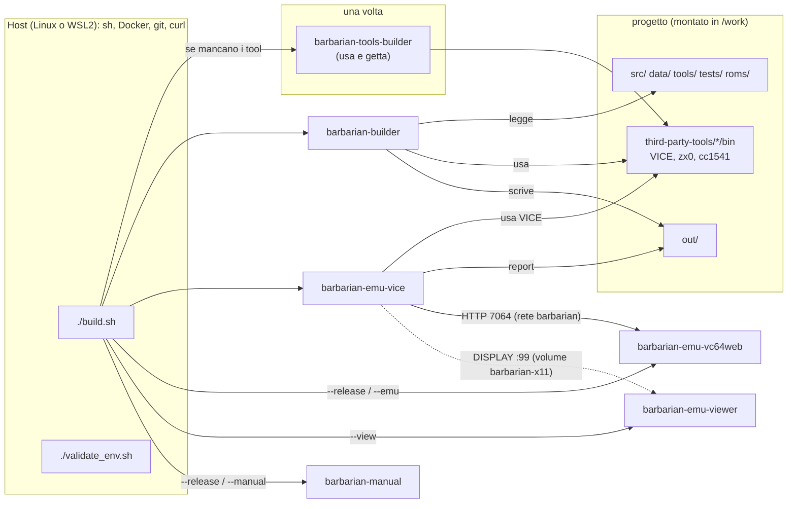
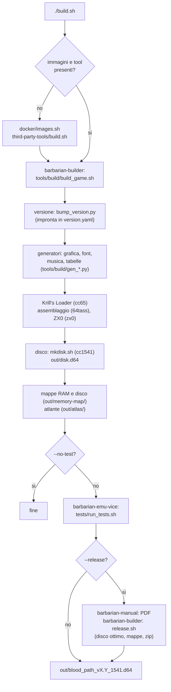
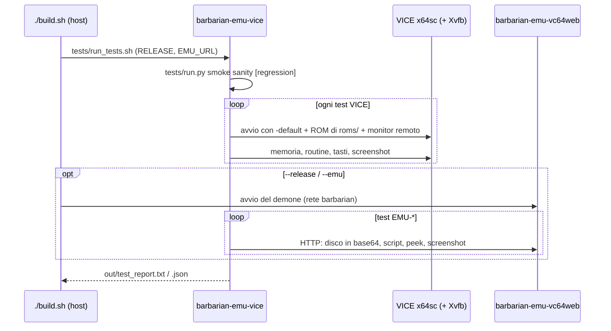

# Getting started: come si costruisce e si prova il progetto

Copyright © 2026 - Simone Caporale

Pagina da leggere **la prima volta** (persone e modelli): spiega dove sta ogni cosa, quali container esistono, come gira la build,
come girano i test e dove finiscono i file. I dettagli dei singoli passi sono in [build.md](build.md) (pipeline) e [test.md](test.md)
(suite e runner); l'emulatore secondario in [emulatore.md](emulatore.md).

## 1. In breve

```sh
./validate_env.sh          # una volta su un computer nuovo: controlla host, Docker, ROM, posizione del progetto (WSL/Windows)
./build.sh                 # build + smoke e sanity (il comando di tutti i giorni)
./build.sh --no-test       # solo la build
./build.sh --release       # build + tutti i test (anche regression ed EMU-*) + manuale PDF + zip dei sorgenti (solo su richiesta)
./build.sh --view          # come ./build.sh, ma VICE si vede dal vivo nel browser: http://localhost:6080
docker/run.sh emu-vice python3 tests/run.py -k SAVE      # un comando qualunque in un container (qui: i test SAVE)
```

Sull'host servono **solo** `sh`, Docker (con BuildKit), `git` e `curl`. Python, 64tass, cc65, VICE, node, Chromium, WeasyPrint:
tutto sta nei container o nel progetto. Su Windows si lavora **dentro WSL2**, con il progetto nel filesystem di WSL (non in `/mnt/c`):
`./validate_env.sh` lo controlla dal tipo di filesystem del punto di montaggio (`/proc/self/mountinfo`).

## 2. Cartelle

| Cartella | Contenuto | In git |
|---|---|---|
| `src/` | sorgenti del gioco (6502, un `.asm` principale per file del disco) e `src/third-party/` (librerie per il C64: Krill's Loader) | sì |
| `data/` | dati del gioco (regole, bilanciamento, mappe, testi) | sì |
| `tools/build/` | generatori e script della build (Python, bash) | sì |
| `tools/atlas/`, `tools/memory-map/`, `tools/manual/`, `tools/simulators/` | generatori dei documenti riproducibili e simulatori; scrivono in `out/<nome>/` | sì |
| `tools/vice/`, `tools/font/` | strumenti che girano in VICE (screenshot, misure, arena); sorgenti del font della UI | sì |
| `tests/` | `smoke/`, `sanity/`, `regression/`, libreria `lib/`, runner `run.py` | sì |
| `docs/` | documentazione **scritta** (wiki), sorgente del manuale (`docs/manual/`), screenshot dei menu (`docs/screens/`) | sì |
| `roms/` | ROM del C64: `vice-roms/{C64,DRIVES}/`, `open-roms/`, elenco in `roms/roms.md` | sì |
| `docker/` | Dockerfile dei container e script `run.sh`, `images.sh`, `viewer.sh` | sì |
| `third-party-tools/` | programmi esterni: `vice/`, `zx0/`, `cc1541/` (compilati una volta in `bin/`), `vc64web-custom/` (emulatore secondario) | sì, senza `bin/` e `src/` |
| `lab/` | materiale di studio che la build non usa ([lab/README.md](../lab/README.md)) | sì, tranne `lab/music/` |
| `out/` | **tutto cio' che si genera** (disco, atlante, mappe, manuale, report dei test, file temporanei in `out/tmp/`) | no (solo `.gitkeep`) |

## 3. I container

| Immagine | Base | Cosa contiene | Quando si usa |
|---|---|---|---|
| `barbarian-tools-builder` | ubuntu:24.04 | compilatori C e librerie di sviluppo | **una volta**: compila VICE, zx0, cc1541 in `third-party-tools/*/bin`, poi immagine e container si cancellano |
| `barbarian-builder` | ubuntu:24.04 | 64tass, cc65, make, perl, Python 3 con Pillow, PyYAML, NumPy, Matplotlib | build del gioco, generatori, simulatori |
| `barbarian-emu-vice` | barbarian-builder | + librerie di VICE (gtk3), Xvfb, ffmpeg | test, screenshot, arena, misure in VICE, MP3 dei brani |
| `barbarian-emu-vc64web` | node:22-bookworm-slim | node, Playwright, Chromium, ffmpeg, pagine di vc64web gia' costruite | demone dei test `EMU-*` |
| `barbarian-emu-viewer` | ubuntu:24.04 | Xvfb, x11vnc, noVNC | facoltativo: vedere VICE dal vivo nel browser |
| `barbarian-manual` | python:3.14-slim | WeasyPrint, PyYAML, Pillow | PDF del manuale |



Regole: i container girano con l'utente dell'host (`docker/run.sh`: i file in `out/` restano suoi), il progetto e' montato in
`/work`, nessun file del progetto sta nelle immagini (tranne le pagine di vc64web nella sua immagine). Le immagini mancanti le
costruisce `docker/images.sh` (lo chiama `./build.sh`); i tool mancanti `third-party-tools/build.sh`.

## 4. La build



- **Versione**: cresce da sola a ogni build con sorgenti cambiati (`version.yaml`: `version` e `source_hash`).
- **Cache**: i passi lenti indipendenti dal gioco passano da `tools/build/cache_run.py` (girano solo se cambiano gli ingressi).
- Comandi singoli: `docker/run.sh builder tools/build/asm.sh` (solo assemblaggio), `docker/run.sh builder python3 tools/simulators/sim_rules.py`.

## 5. I test



- `smoke/` (veloci, happy path) + `sanity/` (feature corrente): a ogni build e prima di ogni commit. `regression/`: in release.
- Tetti di durata (`CAPS` in `tests/run.py`): smoke 20 s, smoke + sanity 35 s, un test 10 s. Il viewer non conta.
- Test singoli: `docker/run.sh emu-vice python3 tests/run.py -k INN`, `docker/run.sh emu-vice python3 tests/run.py all --list`.
- Test su vc64web: `./build.sh --emu` (poi i `EMU-*` sono in regression: `-k EMU`). Senza demone sono SKIP, non FAIL.
- Regole dei test (ID, lingua, eroe di prova, dove va un test nuovo): [tests/CLAUDE.md](../tests/CLAUDE.md) e [test.md](test.md).

## 6. Vedere l'emulatore dal vivo

`./build.sh --view` (o `docker/viewer.sh start`) avvia `barbarian-emu-viewer`: uno schermo X condiviso (volume `barbarian-x11`)
mostrato da noVNC su **http://localhost:6080** (porta aperta solo su localhost). I VICE dei test si aprono su quello schermo
(`BARBARIAN_VIEW=1`, `DISPLAY=:99`) invece che ognuno sul suo Xvfb. Niente audio. `docker/viewer.sh stop` lo ferma.
Per giocare si usa VICE con interfaccia installato sull'host (o un C64 vero): e' indipendente dal progetto.

## 7. Dove finisce cosa (`out/`)

| Percorso | Cosa |
|---|---|
| `out/blood_path_vX.Y_1541.d64` | il disco della build (e `out/disk.d64`) |
| `out/atlas/` | atlante grafico (`index.html`) |
| `out/memory-map/` | mappa della RAM e del disco (HTML) |
| `out/manual/` | manuale (HTML, PDF, ritagli degli screenshot) |
| `out/simulators/` | report dei simulatori |
| `out/vc64web/` | pagine di vc64web (portable e headless) |
| `out/test_report.txt`, `.json` | esito dei test |
| `out/tmp/` | file usa e getta (si puo' cancellare sempre) |

## 8. Problemi tipici

| Sintomo | Causa e rimedio |
|---|---|
| `./validate_env.sh`: "disco Windows" | il progetto sta in `/mnt/c/...`: clonarlo nel filesystem di WSL (`~/...`) |
| `pack: manca third-party-tools/zx0/bin/zx0` | tool non compilati: `third-party-tools/build.sh` (`./build.sh` lo fa da solo) |
| download di VICE fallito | rete o proxy dell'host: scaricare `vice-3.10.tar.gz` a mano in `third-party-tools/vice/src/` |
| pip/npm: `SELF_SIGNED_CERT_IN_CHAIN` nella build di un'immagine | proxy che intercetta TLS: `BARBARIAN_CA_BUNDLE=/percorso/ca.crt docker/images.sh --force manual emu-vc64web` |
| Docker Hub `429 Too Many Requests` | limite delle richieste anonime: `docker login`, poi riprovare (le immagini restano in cache) |
| test `EMU-*` SKIP | demone non acceso: `./build.sh --emu` |
