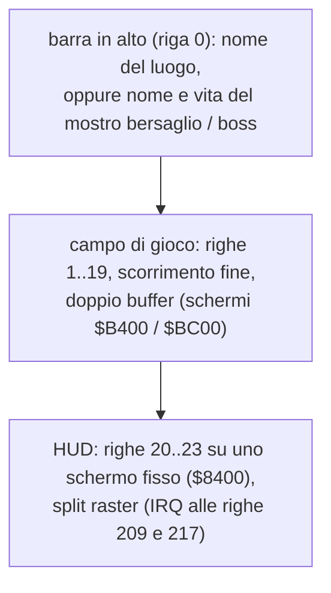

# Interfaccia

Sorgenti: `src/game.asm` (`read_input`), `src/game/game.asm` (`handle_keys`, `act_tick`), `src/game/hud.asm` (HUD),
`src/game/bar.asm` (barra in alto), `src/game/ui.asm` (schermate a tutto schermo), `src/lobby.asm` (menu iniziale).
Tutti i testi del gioco sono in inglese; i nomi di oggetti, mostri e abilità non si traducono.

## Comandi

| Comando | Effetto |
|---|---|
| Joystick porta 2 | movimento (8 direzioni) |
| Fire tenuto | abilità scelta (si ripete appena pronta) |
| Fire su scale, portale, porte, baule | usa il luogo / apre il baule (fermi, nessun mostro entro 2 caselle) |
| H / J / K / L | sceglie Slash / Whirlwind / Battle Cry / Smash (se il livello basta) — mano destra sulla riga centrale |
| U / O | attiva Rage / Frenzy (sopra J e L) |
| 1 2 3 4 | beve la pozione del posto 1..4 della cintura |
| 5 | legge una pergamena di portale |
| I | inventario |
| M | mappa del piano (solo le parti esplorate) |
| C | (11/11, branch `feature/stat-points`) schermata del personaggio: punti statistica e respec (`ui_charsheet`) |
| RUN/STOP | menu di gioco: resume, save game (salva e torna al gioco, senza schermata di conferma: basta l'attesa di `io_screen`, 08/11 sera), quit game (torna al menu dei barbari **senza salvare**, 11/11 sera) |

Scelta dei tasti (06/11): chi gioca di tastiera ha la sinistra su W A S D + spazio e la destra sulla riga
centrale H J K L (quattro abilità in fila) con U e O subito sopra per Rage e Frenzy; le pozioni 1–4 e la
pergamena 5 restano sulla riga dei numeri. I tasti funzione sono stati abbandonati (lontani e solo quattro).
Alternativa non implementata per chi usa il joystick con la destra: Q E R F + T G con la sinistra.

Lettura della tastiera: `keynew[riga]` contiene i tasti appena premuti per riga della matrice CIA (H = riga 3
bit 5, J = riga 4 bit 2, K = riga 4 bit 5, L = riga 5 bit 2, U = riga 3 bit 6, O = riga 4 bit 6).

## Schermate: un solo modo di muoversi (07/11 sera)

Tutte le schermate a tutto schermo usano lo stesso motore, `ui_nav` (`src/game/ui.asm`; progetto e storia in
[Refactor dei tasti](refactor-tasti.md)):
- **su/giù** (joystick 2 o **W/S**) spostano il cursore `>`; **fire / spazio / RETURN** confermano; **RUN/STOP**
  torna indietro (chiude la schermata). **Sinistra/destra e A/D non fanno nulla**; nessuna lettera di scorciatoia
  (tolte D, A, S, Q, DEL, cursore ←→). Eccezioni volute: **I** chiude ancora inventario e locanda, **M** la mappa.
- Il cursore scorre la lista dall'alto in basso, con giro. **Linguette tolte l'11/11** (ottimizzazione O1): nessuna
  schermata le usava più (`ui_tabs` mai chiamata, `tb_n` sempre 0); con la lista vuota `ui_lc` = $FF e Fire dà
  `NAV_TAB`, che le schermate senza voci ignorano, come prima.
- **Domande** (`ui_yesno`): fire o Y = sì, RUN/STOP o N = no.
- Riga 24: sempre `fire:select  run/stop:back` (`nav_help`; 08/11 tolto `w/s:move`, implicito).
- **Colori** (08/11, scelti dal committente su prove in VICE): cornici dei riquadri **grigio scuro** (`UC_BOX` = 11),
  titoli sulle cornici **grigio chiaro** (`UC_BTTL` = 15: `ui_at` riconosce il titolo perché il testo parte sopra un
  `BOX_H`), etichette ciano, **tutti i numeri gialli** (statistiche, quantità, prezzi, oro: `UC_VALUE` = 7, 08/11, prima
  bianchi), **nomi degli oggetti bianchi** (`UC_ITEM`; magici azzurri, rotti rossi), titolo della schermata giallo, riga dei tasti grigio medio.
- **Oro** (08/11, regola del committente): mai la parola, sempre la **moneta** (un glifo, `CH_COIN` = 92, gialla).
  Possesso: moneta e poi il valore (`ui_gold`: `o 2350` in purse, inventario, locanda, scheda). Prezzi e valori: numero e
  poi moneta, attaccati (`ui_coin`: `buy 25o`, `sell 600o`, `fix 45o`, `val 1200o`, `64o` nel baule, `buy for 1200o?`,
  `not enough o.`). Il danno delle armi (`1d8+2`) e' tutto giallo, `d` e `+` compresi (`ui_dice`).
- **Titolo** (08/11): ogni schermata ha un titolo, scritto da una sola routine `ui_title` (A/X = testo, Y = icona ai
  due lati o 0; riga `ti_row`, 0 di base): centrato, giallo. Negozi (martello, scudo, ampolla), bauli (moneta),
  backpack, inn (con il boccale `CH_INN` = 101 ai lati, 09/11), game menu, saved game.
- **Componenti comuni** (08/11): `ui_boxes` (riquadri da tabella), `list8` (lista da 8 in 2 colonne, `-` sui posti
  vuoti: merce dei negozi, contenuto dei bauli), `eq_std`/`eq_draw` (equipped), `draw_entries` (pack), `purse_draw`
  (oro, cintura, pergamene, chiavi), `sh_item` (selected item), righe in `l8_y`, `eq_y`, `de_y`, `pu_y`, `ib_y`.
- **Icona della categoria** (08/11 sera, `ui_cic`): in ogni lista di oggetti (pack, wares, contents, zaino e baule
  della locanda) e nel riquadro selected item, la colonna fra il cursore e il nome mostra l'icona della categoria al
  posto dello spazio: spada (`CH_SWORD` 97, bianca), armatura (`CH_ARMOR` 98, grigio chiaro), scudo (`CH_SHLD` 35,
  marrone), anello (`CH_RING` 99, giallo), pozione (`CH_POT` 94, nel colore della pozione), pergamena (`CH_SCR` 95,
  grigio chiaro); spazio sui posti vuoti e sulla riga dell'oro del baule. I nomi (con `+N `) stanno in **16 colonne**
  (`ui_item`, prima 17: il nome più lungo è `10 portal scroll` / `+2 viking sword`), così la colonna in più non sposta
  nulla. Le etichette weapon/armor/shield/ring non compaiono più in nessuna schermata.
- Variabili `ui_cur`, `ui_n`, `ui_lc` (e `tb_n`/`tb_i`, contatori di `ui_boxes`); `nav_init` legge una volta la tastiera
  all'apertura, così un tasto già premuto (fire, I) non conta. Nelle build `NOKEYS` (screenshot) `ui_nav` non legge
  nulla: in VICE, prima del ciclo di gioco, compariva un RUN/STOP fantasma (causa non trovata, **da verificare**).

**Help** (07/11 sera, terza versione): programma **`HELP`** sul disco di release, caricato dalla voce **read the game
manual** del loader `BARBARIAN`: 5 pagine con tutti i tasti del gioco e delle schermate e il **ritaglio dell'HUD** con
la legenda. Non sta nel gioco (nessun byte di RAM né tempo di CPU di `GAME`). Pagina [Help](help.md).

## Schermo di gioco

**Barra in alto: quale mostro** (`src/game/bar.asm`, `bar_target` / `update_bar`, 06/11 sera): ogni colpo a segno del
PG la sposta sul mostro colpito (`hit_one`); se non c'è un bersaglio (`bar_t` = 0) la prende il mostro che attacca
il PG (`mon_attack`) o quello che si sveglia (aggro, `mwake` 0 → 1); il boss del piano con nome è mostrato solo
quando la barra è libera. Ogni nuovo bersaglio la tiene per 250 fotogrammi (`bar_t`), rinnovati a ogni colpo.
Senza mostri: il nome del luogo sotto i piedi del PG (nel villaggio anche 1-2 caselle davanti alla porta di un
negozio o della locanda: `pl_tile`).

### HUD (`src/game/hud.asm`)

| Riga | Contenuto |
|---|---|
| HP | vita attuale / massima (16 bit) e barra rossa (24 caratteri, `scale`) |
| XP | esperienza / soglia del livello successivo e barra gialla della frazione (16 bit bassi). Da 10000 in su ogni numero (ciascuno per conto suo: `9999/27K`) è in **migliaia senza decimali** (`10K`, `11K` … `65K`, `hput_k`; 07/11 sera): `65K/30K` sta sempre negli 11 caratteri fra la colonna 4 e la barra. Al livello massimo: `MAX`. Test: `tests/regression/hud/test_hudxp.py` |
| LV | livello; H J K L alle colonne 9, 11, 13, 15 (12/11: due colonne più a destra, richiesta del committente; il nome dell'abilità scelta dalla colonna 8) (giallo la scelta, bianco le altre); U e O (giallo attiva, bianco pronta, ciano in ricarica). Una lettera compare **solo se l'abilità è disponibile** (livello raggiunto; 07/11: prima grigio 11, che è un colore ≥ 8 e rendeva il carattere multicolore e illeggibile); chiavi; cintura (4 pozioni, **blu durante la ricarica delle pozioni**) |

**Avvisi** (`hud_warn`, chiamata da `bs_body` una volta ogni 16 fotogrammi, 06/11 pomeriggio):
- **vita bassa** (`c_hp` ≤ `hpmax` / 4): le celle "HP nnn/nnn" della riga 21 (colonne 1–11, color RAM `$DB49`…)
  alternano rosso (2) e giallo (7) a ogni chiamata (bit 4 di `frame`); al passaggio sotto la soglia un suono
  (`SFX_LOWHP`), una volta (`hw_low`). Quando la vita risale la riga HP si ridisegna (`hud_pend` bit 0);
- **oggetto che si sta per rompere** (`hw_icons`): per arma, armatura e scudo indossati che si usurano, se la
  durabilità è ≤ `WARN_PC` = 20% del massimo (`rules.yaml durability.warn_percent`; nel codice durabilità ×
  `WARN_MUL` (5) ≤ massimo, a 8 bit con riporto: un pugnale nuovo 15/15 non si accende, 3/15 sì), la sua icona (`G_WSWORD`,
  `G_WARMOR`, `G_WSHIELD`: 3 glifi nei codici liberi del charset, `HUD_WARN` in `tools/build/gen_gfx.py`) lampeggia
  rossa/gialla in riga 21, colonne 29–31 (sopra la cintura); a durabilità 0 (arma rotta, 07/11) resta **fissa** in rosso. Restano accese anche nel villaggio. `hud_p3` le
  ridisegna subito dopo aver pulito la riga, così non sfarfallano.
Costo: ~160 B di codice, 1 byte di RAM, 24 B di glifi. Test: `tests/regression/items/test_items.py`; screenshot `TESTUI=27`.
- **punti statistica** (11/11, branch `feature/stat-points`): se `pts_avail` > 0, in riga 23 **accanto al numero del
  livello** (colonna 6) una **freccia verde in su** (colore 5, `G_LVUP`, quarto glifo di `HUD_WARN`; scelta del committente l'11/11, **glifo ancora da confermare**:
  proposte in `lab/concept/hud_glyphs/`): c'è un punto da spendere, il tasto C apre la schermata del personaggio.
  Disegnato da `hud_p2` (riga del livello). Test `STAT-11`.

Scegliendo un'abilità il suo nome compare per qualche istante al posto di "H J K L" (`SK_SHOW`, `hud_nm`);
lo stesso posto mostra "broken" quando un oggetto indossato si rompe (07/11: resta indossato, senza effetto). L'HUD si
ridisegna solo quando serve (`hud_dirty`). I caratteri hires nell'HUD multicolor accettano solo i colori 0–7
(per questo le pozioni in ricarica sono blu e non grigie).

## Schermate a tutto schermo (`src/game/ui.asm`)

Tutte spengono lo split raster (`ui_begin`), usano il font della UI (`$B800`) e tornano al gioco con
`ui_exit`.

| Schermata | Routine | Contenuto |
|---|---|---|
| Inventario | `ui_inventory` | 08/11: **niente linguette**; titolo "backpack" (riga 0; era "inventory"). Riquadri: statistiche (righe 1-6, titolo = nome del PG: lvl/xp/oro, hp/att/ac, str/dex/con, dmg/chiavi), **equipped** (righe 7-10, routine comune `eq_draw` del GAME, usata anche dalla locanda: glifi arma/armatura a sinistra, scudo/anello a destra), **pack** (righe 11-16, 8 oggetti in due colonne, ordinato per categoria all'apertura), **belt** (riquadro a sinistra, righe 17-21) e **selected item** (a destra). Esperienza come nell'HUD (08/11 sera, `ui_n5k`): `340/600`, da 10000 in migliaia con `k` (`12k/27k`), al livello massimo solo il valore. **Fire** usa (equipaggia, toglie, beve, pergamena); **DEL** chiede "drop this item?" in riga 23; RUN/STOP o I chiudono. Riga 24: `fire:use  del:drop  run/stop:back`. Screenshot aggiornati di tutti i menu in `docs/screens/` (`tools/vice/shots_menus.sh`) |
| Oggetto selezionato | `ibox_show` | nome, valore principale (`dmg 2d6+3`, `ac +5`, `+2 str`, `heal 60`, `portal`), secondario (`2h pen 1`, `dex max 2`), valore di vendita e durabilità `d 120/200` (solo armi, armature, scudi) |
| Baule | `ui_chest` | 08/11: la schermata dei negozi: titolo "o golden chest o" (moneta ai lati; chest / key chest / golden chest / epic chest), lista da 8 `contents` (prima voce l'oro preso aprendolo, `64o`, non selezionabile; riaprendolo non c'è), equipped, pack, purse, selected item (`val 40o`); riga 23 i messaggi ("the belt is full.": la pozione resta nel baule; "pack is full.", "max 10 scrolls."), riga 24 `fire:take  run/stop:back`. Niente `take all`/`close`. Chiuso a chiave: titolo + "it is locked", fire o RUN/STOP chiudono |
| Negozio | `enter_shop`, `sh_draw` | 08/11: riquadri wares / equipped / pack / purse / selected item, niente linguette; fire = buy (merce), sell (zaino, cintura, pergamene), repair (equipped, fabbro); R = repair (fabbro); pozione comprata: scelta del posto della cintura. Dettagli: [Villaggio](villaggio.md#negozi-enter_shop-sh_draw) |
| Locanda | `ov_stash` (modulo MENU) | 09/11: titolo "inn" fra due boccali (`CH_INN` = 101, glifo nuovo del font UI); 08/11: niente linguette. Riquadri del PG e dell'oggetto, equipped (icone), zaino e baule (3 pagine da 8, numero di pagina come pulsante); una sola lista, **destra** dallo zaino al baule (unica eccezione alla regola sinistra/destra), scelta dell'equipaggiamento da equipped con la lista filtrata ([Villaggio](villaggio.md#baule-di-casa-ov_stash-modulo-ovlt)) |
| Mappa | `ui_minimap` | si chiude con fire, M o RUN/STOP (`mm_close`); mappa esplorata del piano; in basso "chapter 3 level 4" (12/11; nel villaggio "town", seed e **coordinate x,y del PG** (tile, per il debug: "floor 1 anoano 6:10"); nel villaggio tutta visibile: strade e piazze in ciano, **fiume in blu** (celle con sola acqua: `mm_wat`), 3 icone (incudine, ampolla, boccale della locanda `CH_INN`; `MI_N`, 09/11: tolto lo scudo dell'armaiolo e la casetta) sopra le porte e la cripta segnata come scala |
| Menu di gioco | `ui_gamemenu` | resume, save game, **quit game** (09/11: voci a x=15 come il titolo "game menu", cursore a x=13; versione centrata, in ciano) (07/11 sera: prima "quit to main menu"; domanda "quit game?", salvataggio, `game_start` → menu iniziale; fino al 06/11 la voce quit tornava al menu di gioco: un `bne +` saltava al `+` della voce help, tolta il 07/11). Domanda "quit game?" (09/11): **vecchio stile** (testo centrato senza riquadro), riga dei tasti "y:yes  n:no" in riga 24 come tutte le domande; dall'11/11 sera il testo è "unsaved progress will be lost" e Y/fire esce **senza salvare**, N/RUN-STOP torna al menu di gioco (`ui_yesno`) |
| Morte | `ui_died` | 09/11: titolo **rosso** con il teschio (`CH_SKULL` = 100 nel font UI) in riga 3 (`ti_row`/`ti_col`), riquadro (2,6,36,9) con "you lose half of the o you carry." (riga 8), "the o in your inn chest is safe." (riga 10; moneta gialla `ui_coin`), "you wake up in town." in bianco (riga 13), riga 24 "fire:continue"; fire o RUN/STOP continuano (`ui_wait_fire`) |
| Salvataggi di un'altra versione | `ui_badsave` | 09/11, **vecchio stile** senza riga dei tasti: "bad save file version", "found    : n" (primo byte del record `REC_HDR`, `hdrbuf`) e "expected : n" (`SAVE_VER`), in **decimale** (`ui_b3l`); voci "destroy all data" (cancella tutti i salvataggi, "deleting saved games") e "quit" (`bb_quit`, `$C009`), cursore su quit |
| Caricamento / salvataggio | `io_screen`, `io_screen_scan` | 09/11: titolo ("saving barbarian", "loading level n" (12/11: n = piano del capitolo), "reading barbarians", "loading" (locanda); dal 09/11 **senza "..."** (risparmio di byte) e **centrato**: "reading barbarians" da x=11, "saving/loading barbarian" e "... level n" da x=12 (mezza colonna di scarto per la parità), "loading" da x=16) in riga 9, poi "please wait" in riga 15; **niente barra** (11/11 sera, regola del committente; prima una barra verde in un riquadro). |
| Attese senza caricamento | `ui_pwait` | 09/11: "deleting barbarian" (LOBBY, dopo il sì nella scheda; riga 9 da x=11, centrato) e "deleting saved games" (badsave; riga 9 da x=10, centrato), senza "...", poi "please wait" centrato in riga 15 come `io_screen`, **senza riquadro né barra**: è una sola scrittura del record `REC_HDR` (`hdr_write`, silenziosa). Regola: la barra solo se c'è un caricamento con un avanzamento da mostrare |
| Personaggio (tasto C) | `ui_charsheet` (`src/game/charsheet.asm`, 11/11, branch `feature/stat-points`) | titolo "character"; riquadro col nome: lvl, gettoni respec, hp max, att, ac, dmg (**con i punti in attesa**, anteprima); riquadro **stats**: str/dex/con con valore, punti in attesa `+N` in verde e modificatore, "points to spend"; riquadro **actions**: confirm (i punti in attesa diventano spesi), reset (azzera quelli in attesa), respec (consuma un gettone: "use a respec token?", tutti i punti spesi tornano da spendere). Sulle caratteristiche **A/D** (joystick sinistra/destra), **-/+** o Fire tolgono/aggiungono un punto in attesa ("no points." se non ce ne sono). **RUN/STOP**: i punti in attesa si confermano e, se è cambiato qualcosa, si salva (`gm_save`: piano + eroe). Riga 24 `a/d -/+:points fire:ok run/stop:back`. **Senza punti da spendere** (12/11, committente): nessuna voce, la frase "no points to spend." nel riquadro actions, riga 24 `run/stop:back`; con un gettone respec resta la sola voce **respec** (`fire:ok run/stop:back`; eccezione mia, da confermare: altrimenti il respec non si userebbe mai a punti finiti), e dopo il respec tornano tutte le voci. Screenshot `personaggio` (`TESTUI=39`). Test `STAT-10..16`, `CS-10/11` |
| Leva | `ui_lever` | piano 20 (la vittoria sul boss finale non ha menu dall'08/11 sera: tornera' col quest system, `quests.md` 6ter). Ancora nel vecchio stile: si rifà con l'Abisso (scelta normal/nightmare, TODO H3) |

**Domande sì/no** (09/11, decisione del committente): una sola routine `ui_yesno` per tutte (inventario "drop this
item?", negozi "buy/sell/repair for N●?", scheda "delete this barbarian?", "quit game?"). La domanda la scrive il
chiamante (riga 23, o al centro per quit); `ui_yesno` salva la riga 24 (i tasti della schermata) in `YN_SAV` ($0200,
40 B del buffer di input del BASIC), ci scrive **"y:yes  n:no"** e alla risposta la rimette. Sì = Y, fire, spazio o
RETURN; no = N o RUN/STOP (fire e RUN/STOP non sono scritti: sinonimi).

Titoli: `ui_title` (riga `ti_row`, colore `ti_col`; `ui_begin` li rimette a 0 e `UC_TITLE`), centrato, con un'icona ai
due lati. Screenshot di **tutte** le schermate (09/11): `docs/screens/` (un PNG per schermata, mosaico
`tutti_i_menu.png` e pagina offline `index.html`), rifatti con `tools/vice/shots_menus.sh` (varianti `TESTUI` 2-36 in
`src/game/levels.asm`; nella build degli screenshot le schermate restano ferme perché VICE dà tasti fantasma).

## Menu d'avvio (loader `BARBARIAN`, solo build di release)

Primo programma del disco (`BARBARIAN`, `src/barbarian.asm`): il logo della copertina e tre voci, **hear the legend**
(la storia, programma `LORE`), **read the game manual** (il programma `HELP`: [Help](help.md)) e
**walk the blood path** (`START`: schermata di attesa, poi il menu del gioco). Joystick 2 su/giù e fire, `1` `2` `3`,
`W`/`S` o joystick (niente tasti cursore, 09/11), spazio, RETURN. Nella storia fire e spazio non fanno nulla fino alla fine (fire: di nuovo il menu);
RUN/STOP torna al menu in qualunque momento, anche durante il caricamento. Dettagli in [Avvio e storia](intro.md).

## Menu iniziale (modulo `LOBBY`)

Testi del gioco in inglese con "barbarian" al posto di "hero" (06/11 sera): "create new barbarian", "new barbarian",
"barbarian:" nella scheda, "loading barbarian", "reading barbarians".
Impaginazione (09/11, standard dei menu): titolo `ui_title` "barbarian: the blood path" con le spade (`CH_SWORD`) in
riga 0, "the blood path" **rosso** (colonne 18-31, colore 2); riquadro (7,2,26,7) con etichetta " barbarians " e i
barbari salvati nelle righe 3–7 a x=9 (un "-" per ogni posto vuoto); secondo riquadro (7,9,26,4) con "create new
barbarian" in riga 10 e "quit the game" in riga 11 (`MR_HERO`/`MR_NEW`/`MR_QUIT`/`MR_X`); "version x.y" (riga 16) e
copyright (riga 21) centrati in grigio; "fire:select" in riga 24; "all 5 slots are used." in riga 14. "quit the game" torna al BASIC con il reset del KERNAL; prima `bb_quit` copia `$0400-$07FF` in `$CC00` e `$0800-$0802` in LOBBY, quindi **`SYS 49158`** rientra nel gioco: [Cheat](cheats.md#ritorno-al-basic-e-rientro-sys-49158)). Il
cursore passa solo su barbari, create e quit. Niente help (è nel menu del loader).
**Nuovo barbaro** (`name_entry`, 09/11): titolo "new barbarian" con le spade; tre riquadri name (4,2,32,4), seed
(4,6,32,4) e start (4,10,32,3) con etichette " name " e " seed "; il riquadro del campo attivo ha la cornice **verde**
(`ne_boxes`, `UC_CURSOR`), gli altri grigi; freccia a x=6, testo a x=8 (nome in 12 celle, `NAME_LEN`); "a-z 1-9" in grigio
nel riquadro seed; righe 23-24 "f1:random seed" e "enter:confirm  run/stop:exit". F1 seed casuale (sempre),
RUN/STOP esce.
**Flusso (09/11, decisione del committente)**: all'ingresso si **scrive il nome** (cursore a blocco nel campo);
ENTER lo valida (non vuoto né di soli spazi, non già usato da un altro barbaro: altrimenti "name already in use." in
riga 14 e si resta sul nome) e passa al **seed**, che si può riscrivere (il primo tasto lo fa ripartire, le altre
celle diventano punti, `sfresh`) o tenere; ENTER lo valida (6 caratteri) e porta il cursore su **start**. Mentre si
scrive nessun tasto sposta il cursore (W, S, A, D sono lettere; DEL cancella). Su start si è in **scelta**
(`nedit` = 0, nessun cursore a blocco): **joystick o W/S** spostano il `>` fra nome, seed e start in fila, senza
giro; fire / spazio / RETURN su start crea il barbaro (nome e seed sono già stati validati: nessun altro
controllo), su nome o seed riapre quel campo e la logica riparte da lì (ENTER valida e passa al campo dopo).
I tasti cursore non si usano (regola: ci si muove solo con WASD o joystick). Test: `tests/regression/saves/test_saves.py 8`.

Elenco dei 5 eroi (slot), creazione (nome, seed casuale o scritto), scheda dell'eroe salvato (`detail_screen`,
"saved game", rifatta l'08/11 con il committente: riquadri attaccati, **senza equipaggiamento**): **barbarian** (righe
3-6: `name` e `seed` con due spazi prima del valore; a destra `sessions` = numero della partita, 9 bit di `c_game`,
1..511 poi ricomincia, e `time` = ore in 3 cifre e minuti in 2), **progress** (righe 7-14 a sinistra: level, exp,
gold = oro totale, deaths, kills, abyss depth) e **stats** (a destra: max hp, attack, armor class, str, dex, con),
**quests** (righe 15-18: `current quest:` e `completed quests:`, **segnaposto** `-` e `0 / -` finché le quest non
esistono); etichette in ciano, valori in giallo allineati a destra fino alla colonna 17 o 37 (oro totale a 6 cifre,
`ui_num6`, dal 10/11: il baule conta le decine). Nel riquadro delle righe 19-23 tre voci in colonna,
**start game**, **delete** + nome del PG e **back** (`ui_nav`: su/giù scelgono, la scelta è gialla con la freccia); fire su
start game entra in partita, su delete chiede "delete this barbarian?" in riga 23 (tasti "y:yes  n:no" in riga 24): fire o Y cancella (`hero_delete`:
byte "eroe presente" a 0 e nome a spazi nel record `REC_HDR`, scritto subito; l'elenco si ricostruisce da `hdrbuf` senza
leggere il disco), RUN/STOP o N tornano alla scheda. back o RUN/STOP tornano all'elenco. **Domande** (elimina oggetto, quit game, cancella barbaro, conferma del negozio; `ui_yesno`, `shop_ask`): fire o Y conferma, N o **RUN/STOP** annulla (07/11 sera). L'avviso dei salvataggi di un'altra versione (`ui_badsave`, tabella sopra) è una lista di 2 voci, **destroy all data** e **quit**, con il cursore su quit (fire per abitudine non cancella nulla); quit = `bb_quit` del modulo LOBBY (`$C009`), come nel menu. **Senza musica** (06/11: il passaggio della musica del titolo dal loader al menu dava un glitch audio; da rifare). Se i salvataggi sono di un'altra versione (`SAVE_VER`) propone di cancellarli.

## Piano mostrato: capitolo e piano del capitolo (12/11, committente)

Internamente i piani vanno da 1 a 20 (profondità globale: difficoltà, generazione, salvataggi). Al giocatore si mostra
il **piano del capitolo** (1–5):

| Dove | Testo | Codice |
|---|---|---|
| HUD, riga 21 a destra (colonne 34–38) | `C3 L4` (nel villaggio solo `C3`) | `hud_cl` (`hud.asm`) |
| Etichette di scale, cripta, portale | "stairs down to level 4" | `loc_cl` (`bar.asm`) |
| Schermata di caricamento | "loading level 4" | `io_screen` (`ui.asm`) |
| Minimappa | "chapter 3 level 4" per intero (17 caratteri: seed e coordinate del PG non ci stanno più, si vedono 21 caratteri; restano nella mappa del villaggio) | `mm_sprites` |
| Dettagli del barbaro (menu iniziale) | "abyss depth": profondità raggiunta nell'Abisso (capitolo 5, piani oltre il 20); "-" finché non ci si entra | `lobby.asm` |
