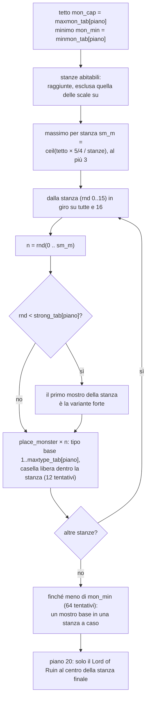
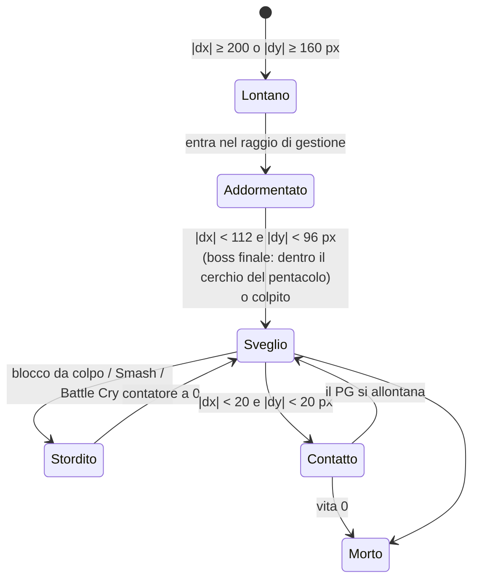

# Mostri

Sorgenti: `src/game/game.asm` (`spawn_monsters`, `place_monster`, `init_monsters_rt`, `update_monsters`,
`kill_monster`, `final_tick`), `src/game/bar.asm` (`place_boss`, nomi), `src/game/combat.asm` (`floor_types`,
`mon_hp_init`, `mon_attack`). Dati: il **bestiario** `data/monsters/bestiary.tsv`
(11/11: schede, tier, colore, velocità, bonus del bottino; [bestiario](bestiario.md), righe `implemented = yes`),
`data/rules.yaml` (`growth`, `boss`, `final_summons`) e `data/balance.yaml` (`spawn`, `boss`) → `out/work/db.asm`.

## Tipi

Quattro famiglie (base → variante forte, stessa grafica con un'aggiunta e altro colore) più il boss finale. **Dal 15/11 ogni
capitolo ha le sue famiglie** (grafica, colore e nome dal file del tema del capitolo, [bestiario](bestiario.md#nel-gioco-i-mostri-dei-capitoli-1511)):
la tabella sotto vale per il **tipo**, in ogni capitolo (statistiche uguali). Numero del tipo
(`mtype`): 1–4 base, 5–8 forti (`base + N_BASE`), 9 = `T_FINAL`.

| # | Tipo | Famiglia | Piano min. | Vita (scheda) | CA | ATT | Danno | Salv. | XP | Velocità (px/fot.) | +liv. bottino |
|---|---|---|---|---|---|---|---|---|---|---|---|
| 1 | fallen | fallen | 1 | 2d6 | 12 | +3 | 1d4+1 | 0 | 10 | 0,75 | 0 |
| 2 | skeleton | skeleton | 1 | 2d8+2 | 13 | +4 | 1d6+2 | 1 | 20 | 0,75 | 0 |
| 3 | zombie | zombie | 4 | 4d8+8 | 11 | +4 | 1d8+2 | 2 | 50 | 0,5 | 0 |
| 4 | demon | demon | 8 | 6d10+12 | 15 | +7 | 2d6+3 | 4 | 120 | 0,75 | 1 |
| 5 | fallen warchief | fallen | 1 | 4d6+4 | 14 | +5 | 1d8+2 | 2 | 40 | 0,875 | 1 |
| 6 | skeleton king | skeleton | 2 | 5d8+10 | 15 | +6 | 1d10+3 | 3 | 70 | 0,75 | 1 |
| 7 | lich | zombie | 5 | 7d8+14 | 15 | +7 | 2d6+4 | 5 | 150 | 0,75 | 1 |
| 8 | balrog | demon | 9 | 9d10+27 | 17 | +9 | 2d8+5 | 6 | 400 | 0,875 | 2 |
| 9 | Lord of Ruin | — | 20 | 45d10+90 | 22 | +13 | 4d8+32 | 10 | 3000 | 0,75 | 3 |

Velocità = `mon_spd` / 8 (da `balance.yaml speed` × `monster_speed_percent` 80%). Il PG si muove a passi più
rapidi. Valori al 06/11, provvisori (ritaratura di Fable).

## Statistiche al piano (`floor_types`)

Entrando in un piano si calcolano una volta le statistiche di ogni tipo (`ft_*`, 10 voci). Con
P = piano − piano minimo del tipo (0 se negativo; 0 per il boss finale):

| Statistica | Formula |
|---|---|
| CA | `mt_ac` + `gr_ac[P]` (+1 per piano) |
| ATT | `mt_att` + `gr_att[P]` (+0,6 per piano, troncato) |
| danno fisso K | `mt_dk` + `gr_dmg[P]` (+1 per piano) |
| salvezza | `mt_sv` + `gr_att[P]` / 2 |
| vita media | (media dei dadi + `gr_hpd[P]` dadi in più × media del dado) × `cv_hp[piano]` / 32 |
| moltiplicatore del danno | `cv_dmg[piano]` / 32 (uguale per tutti i tipi) |
| esperienza | xp base × (4 + P) / 4 |

`gr_hpd` = +0,5 dadi per piano; `cv_hp` = ×1,5 da piano 1 in poi; `cv_dmg` = ×0,5 al piano 1, ×0,75 piani 2–7,
×1 piano 8, ×1,25 piani 9–14, ×1,75 piani 15–20 (curve di `rules.yaml growth`).

### Vita del singolo mostro (`mon_hp_init`)
Alla nascita: vita media del tipo × (96 + rnd 0..64) / 128, cioè **±25%**; il boss con nome × 2,5
(`BOSS_HPH`/2); minimo 1. Vita a 16 bit (`mhp`/`mhph`) con il massimo in `mhm`/`mhmh` (serve alla barra).

## Piazzamento (`spawn_monsters`)

- `maxtype_tab`: tipi base disponibili (piano ≥ piano minimo): 2 ai piani 1–3, 3 ai piani 4–7, 4 dal piano 8.
- `strong_tab`: probabilità di una stanza "forte": 0 ai piani 1–2 (`strong_min_floor` 3), poi da 12% a 66%
  (piano 20) a gradini. Inizio graduale (06/11): la variante forte di una famiglia esce solo se il suo piano
  minimo è ≤ piano + 1 (`STRONG_EARLY`): skeleton king dal piano 1 (ma le stanze forti partono dal 3), lich dal 4,
  balrog dall'8; altrimenti al suo posto resta il tipo base.
- `maxmon_tab` / `minmon_tab`: da 10/5 (piano 1) a 22/11 (piano 19); piano 20 = 0 (solo il boss finale).
  Le tabelle di `balance.yaml spawn` sono scritte per 10 gradini: il piano L usa il gradino
  max(1, round(L × 9 / 19)) (piani 1–3 gradino 1, 4–5 gradino 2 … 18–19 gradino 9; piano 20 gradino 10 = 0).
- Una variante forte uscita un piano prima del suo piano minimo ha P = 0 (statistiche base della scheda).
- Massimo 32 mostri per piano (tabelle `MRT` da 32), comprese evocazioni e boss.

### Boss del piano (`place_boss`)
Piani 1–19: un mostro in più al centro della stanza delle scale giù, **variante forte di una famiglia a caso**
fra quelle del piano (con la stessa regola del piano minimo − 1; se la famiglia estratta è troppo presto, il
boss è un fallen warchief). È il "boss con nome": nome = uno di 8 nomi + uno di 8 epiteti (es. *Duriel the Burning*),
scelti da un hash del seed e del piano (`boss_name_idx`). Rispetto alla variante: vita × 2,5, CA + 2, ATT + 2,
esperienza × 4, **immune al blocco da colpo**; lampeggia in bianco; la barra in alto mostra nome e vita (quando
non segue un altro mostro: la barra va all'ultimo mostro colpito, [Interfaccia](interfaccia.md)). Alla
morte lascia una chiave e un tesoro con 4 oggetti a livello bottino + 3 ([Bottino](bottino.md)).

## Intelligenza (`update_monsters`)

- **Lontano** (fuori schermo): riesaminato 1 fotogramma su 16. **Addormentato** fuori dal raggio di risveglio:
  1 su 8. Svegli: elaborati a **fotogrammi alterni** (metà dei mostri per fotogramma).
- Movimento: solo i **4 mostri più vicini** fra quelli svegli si muovono (scelta con un fotogramma di ritardo,
  `sel_offer`/`sel_has`); passi da 2 px verso il PG (`mon_step`, prima l'asse più lontano), collisioni con muri,
  altri mostri e PG (`sep_check`, `occ_check`). Un mostro bloccato aspetta 16 fotogrammi.
- **Muri e angoli** (06/11 sera, segnalazione con il seed ANOANO, piano 2): se il mostro è bloccato su **entrambi** gli
  assi verso il PG (per esempio nell'angolo di una stanza con il PG oltre il muro) passa allo **scorrimento lungo il
  muro** (`slide_start` / `mon_slide`, tabelle `mslide` / `mslc` a `$9ABF`): direzione voluta = l'asse con la
  distanza maggiore, verso il PG; scorrimento = l'altro asse, dalla parte opposta al PG. A ogni passo prova prima la
  direzione voluta: appena è libera la segue fino a entrare nella casella nuova più 8 px, poi torna a inseguire.
  Scorrimento bloccato: si gira; al massimo `SLIDE_N` = 64 passi (128 px). Non è un pathfinding completo: un
  percorso a labirinto lungo può ancora fermarlo.
- **Spigoli** (anche per il PG): `try_step_x` / `try_step_y` controllano due sonde sul bordo (±5 px); se ne è
  bloccata una sola (spigolo), l'essere scivola di 1 px dalla parte libera invece di fermarsi, così si entra nei
  varchi anche non allineati. `tests/regression/monsters/test_ai.py`.
- I mostri **non entrano nella casella del PG**: si fermano sulla casella adiacente e da lì colpiscono.
- **Attacco** a contatto (`mon_attack`) ogni 45 fotogrammi (`MON_ATK_T`): regole in
  [Combattimento](combattimento.md). Un mostro forte o un boss con nome a contatto attiva il tema musicale di combattimento; acceso, lo tiene qualsiasi mostro ([Musica](musica.md)).
- Stordimento (`mstun`) e ricarica dell'attacco (`mcd`) scendono di 2 a fotogrammi alterni.

## Morte di un mostro (`kill_monster`)

1. `malive` = 0; casella del corpo → `loot_x`/`loot_y`.
2. Esperienza: `ft_xp` del tipo; boss con nome × 4. Livello del mostro = piano (+2 se forte, +1 ancora se boss).
   Se il PG è sopra di d livelli: 75% (d = 1), 50% (2), 25% (3), **niente esperienza e niente bottino** da d ≥ 4.
   Il chestLevel del tesoro si calcola qui, dalla vita massima del mostro ([Bottino](bottino.md#chestlevel)).
3. Contatore uccisioni (`c_kills`, 16 bit); la barra si libera se era il bersaglio.
4. Boss finale: `c_won` = 1, si aprono le stanze dei tesori (`fin_doors`), schermata di vittoria.
5. Bottino (`roll_loot`), tranne al piano 20 e con d ≥ 4.

## Boss finale: Lord of Ruin

- Piano 20, centro della sala del trono; si sveglia quando il PG entra nel cerchio del pentacolo (`FIN_R_PX`).
- Immune al blocco da colpo (Smash e Battle Cry lo stordiscono comunque).
- **Evocazioni** (`final_tick`): quando la vita scende sotto 3/4, 1/2 e 1/4 del massimo (`fb_th`) parte
  un'ondata, se i mostri vivi (boss compreso) sono al più 2 (`SUM_MAXALIVE`): 2 mostri (`SUM_WAVE`) di tipo base
  a caso fra i quattro (`SUM_FLOOR` 20), con le statistiche del piano 20, sulle punte della stella (mai due
  vicine), già svegli. Rientrando nel piano le ondate già superate non si ripetono (`final_init`). Ritaratura
  06/11 sera: vita della scheda ×0,75 e al massimo 2 vivi per ondata → ~75% di vittorie nel simulatore con il PG
  di riferimento di livello 20 e 4 pozioni (con 4 vivi per ondata era sotto il 25%).
- Né il boss né le evocazioni lasciano bottino; i premi sono i 4 bauli epici.
