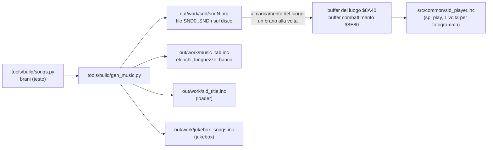

# Musica ed effetti sonori

Copyright © 2026 - Simone Caporale

Sorgenti: `tools/build/songs.py` (i brani, come dati), `tools/build/gen_music.py` (compilatore), `src/common/sid_player.inc` (player
unico), `src/game/music.asm` (logica del gioco: scelta, caricamento, dissolvenze, combattimento), `src/common/sfx.inc` (effetti),
`src/jukebox.asm` (prova di tutti i suoni), `src/barbarian.asm` (titolo). Test: `tests/regression/music/test_music.py`.

## Brani del gioco (scelte del committente, 06/11)

| Ruolo | Brani (`tools/build/songs.py`, `PLAYLIST`) | Quando |
|---|---|---|
| Titolo | Demon's Eye (`01_demons_eye`) | START, dal RUN a PRESS SPACE (dentro il file `START` della release; nella debug `START` non ha titolo né musica), e la storia (`LORE`: titolo, PRESS SPACE e scorrimento, [Avvio e storia](intro.md)) |
| Villaggi | Tavern of Dawn (`00_tavern`, la vecchia "Taverna dell'Alba" portata nel formato nuovo) per tutti e 4 i villaggi (temi propri: **tbd**) | ogni ingresso nel villaggio del capitolo (`snd_town_c`) |
| Livelli | un **tema per capitolo** (12/11, committente): Iron Crown (cap. 1), Blood Path (2), Fear Below (3), Black Chant (4) | tutti i 5 piani del capitolo, anche il piano del boss del capitolo (`snd_lvl_c`) |
| Boss finale | Abyss Gate (`05_abyss_gate`) | piano `MAXLEVEL` (sala del trono): il suo tema ad hoc |
| Combattimento | Fight 1 (`31_fight_1`) | un motivetto a caso per piano, scelto al caricamento del piano |

**Dal 12/11** (TODO M2) `PLAYLIST` ha in `town` e `level` **un brano per capitolo** (1..4, nell'ordine); un brano ripetuto è
un solo file (`songs.game_files`), e `tools/build/gen_music.py` scrive le tabelle `snd_town_c` / `snd_lvl_c` (`out/work/music_tab.inc`).
`snd_get` **non rilegge un brano già nel buffer** (`snd_cur`): fra i piani dello stesso capitolo il brano del luogo e il
motivetto di combattimento non toccano il disco. Misura (`PERF-DISK-13`, VICE): scale nello stesso capitolo da 2,80 s a
**2,24 s**. Il combattimento resta un elenco (uno a caso per piano; al massimo 36 file `SND0`–`SNDZ`). I candidati non scelti (`03_the_watcher`, `11_crypt_steps`,
`12_bone_halls`, `14_war_drums`, `21_*`–`23_*`, `32_fight_2`, `33_fight_3`) restano in `SONGS`.

## Architettura

- **Un solo player** (`src/common/sid_player.inc`, ~1 KB con la tabella delle frequenze) per loader, gioco e jukebox. Per
  voce: forma d'onda, ADSR, PWM a rimbalzo, vibrato triangolare, arpeggio (4 note a rotazione), glissato, stacco del
  gate prima della fine della nota, seconda forma d'onda + secondo ADSR per le note con bit 7 (rullante sul basso,
  eco morbida sul lead). Filtro globale con sweep del cutoff. Nessuna pagina zero (letture con codice
  automodificante), nessun `sei`.
- **Tre voci anche nel gioco**: lead sulla voce 2 del SID, accordi sulla voce 1, basso e batteria sulla voce 3. La
  voce 1 è condivisa con gli effetti sonori (`src/common/sfx.inc`): `sfx_play` mette `sp_mute+1` = 1 per la durata
  dell'effetto più `SFX_REL` (25) fotogrammi di rilascio; poi `$80` = la voce torna al brano dalla nota seguente.
  Mentre la voce è degli effetti il filtro non la prende. I brani a 2 voci (Fear Below, Black Chant, Tavern,
  Fight 1) hanno la voce 1 muta.
- **File su disco**: un file per brano (`SND0`…), nell'ordine villaggio, livelli, boss, combattimento
  (`out/work/music_tab.inc` ha il commento con l'elenco). Si leggono **al caricamento del luogo** (`load_location` →
  `music_town` / `music_dungeon`, a schermo spento, senza schermata): **un brano alla volta**, direttamente nel suo
  buffer, e nessuna copia in RAM (decisione del 06/11 sera: la copia sotto l'I/O è stata tolta e quella RAM è libera).
  Se il brano scelto è già nel buffer non si rilegge (es. il motivetto di combattimento quando ce n'è uno solo).
- **Buffer** grandi quanto il brano più lungo: brano del luogo a `$8A40` (`SND_SMAX`, oggi 312 B, negli slot sprite
  41-47) e motivetto di combattimento a `$8E80` (`SND_FMAX`, oggi 142 B, slot 58-63); il resto degli slot è libero.
  Servono due buffer perché il motivetto interrompe il brano del luogo, che poi riprende dal punto in cui era.
  `.cerror` in `music.asm`: brano più lungo ≤ 448 B, motivetto ≤ 384 B.
- Variabili: player `$9B4E`–`$9BF7` (`SP_VARS`, dopo le variabili dei salvataggi, azzerate da `game_start`); logica `$93A0`.

Tempi misurati in VICE (`tests/regression/music/test_music.py`, cicli / 985248): un cambio di piano senza lettura di brani ~3,4–3,8 s;
leggere il brano (1–2 blocchi) aggiunge ~1,5 s. Il brano cambia a ogni piano, quindi ogni cambio di piano lo legge.

## Logica nel gioco (`src/game/music.asm`)

- `music_dungeon` (a ogni piano): motivetto a caso fra quelli di combattimento → buffer 1; brano a caso fra i
  livelli (o fra i boss al piano `MAXLEVEL`) → buffer 0; se esce lo stesso del piano precedente si prende il
  successivo nell'elenco. Il caso viene da `$DC04 ^ frame ^ $D012` (non da `rnd`: non deve cambiare la generazione).
- `music_town`: brano a caso fra quelli del villaggio.
- `music_request` (A = 0 silenzio, `MUS_LVL`, `MUS_FIGHT`; X = velocità): il cambio avviene con un **rilascio
  naturale** (gate spento e release 8 o 9 su tutte le voci, `sp_release`) di 16 × X fotogrammi, poi parte il brano
  nuovo.
- **Combattimento** (06/11 sera, richiesta del committente): il motivetto parte **solo** a contatto con un mostro
  forte (variante, `mtype` > `N_BASE`) o un boss con nome (`mon_named`); una volta acceso **lo tiene qualsiasi
  mostro** a contatto; si spegne `CMB_HOLD` = 150 × 4 fotogrammi (**12 s**) dopo l'ultimo contatto e riprende il
  brano del luogo **dal punto in cui era** (`sp_save` / `sp_resume`; la nota interrotta si perde). La fine del
  combattimento per i bauli in coda (`drops_tick`) usa un contatore a parte (`cmb_t`, 100 fotogrammi, ogni mostro).
- **A tempo**: `sfx_update` (effetti + `music_update`) gira nell'IRQ di fine HUD (riga 250, `hud.asm`), una volta
  per fotogramma anche quando il ciclo principale sfora (prima era nel ciclo: nel villaggio, più pesante da
  scorrere, il tempo dei brani "inciampava"). Nelle schermate a tutto schermo (IRQ spento) lo chiama `ui_input`.
- **Disco**: prima di ogni lettura o scrittura (`load_raw`, salvataggi) `snd_io` zittisce il SID — dissolvenza del
  volume in 15 fotogrammi se suona qualcosa, poi voci spente e volume 0 — perché il caricamento tiene il processore e il
  SID resterebbe sulla nota corrente (glitch all'help, al salvataggio, all'uscita al menu). Con Krill's Loader (11/11)
  gli interrupt restano accesi durante i caricamenti: la musica durante il disco è possibile (TODO M2, M5). Il volume
  torna pieno alla prima `music_update` seguente.
- `music_fadeout` (bloccante, prima di un cambio di luogo o del menu principale) e `snd_fade` / `snd_mute`
  (`levels.asm`, volume generale) come prima. Il menu principale resta senza musica.

## Formato dei brani (`tools/build/gen_music.py`)

Rilocabile: tutti gli indirizzi sono offset dall'inizio del brano (16 bit little endian).

| Offset | Contenuto |
|---|---|
| 0 | velocità: fotogrammi per tick |
| 1–6 | filtro: cutoff iniziale, minimo, massimo, passo dello sweep, `$D417` (risonanza<<4 \| voci: 0 o $F), `$D418` (modo<<4 \| volume) |
| 7–57 | strumenti: 17 parametri × 3 voci, un parametro per tutte le voci di fila: wave, wave2, ad, sr, ad2, sr2, pwlo, pwhi, pwd, pwmin, pwmax, vd, vw, arp, slo, shi, gcut |
| 58–63 | offset dell'ordine delle voci 0, 1, 2 |
| 64 | numero di pattern N, poi N byte bassi e N byte alti degli offset dei pattern |
| … | ordini e pattern |

- **Ordine** di una voce: `$00`–`$7F` pattern; `$80`–`$BF` trasposizione = byte − `$A0` semitoni; `$C0`–`$DF` il
  pattern seguente si ripete (byte − `$BF`) volte; `$FF` da capo (trasposizione 0; con `sp_once` il brano si ferma).
- **Pattern**: `$E0`–`$EF` nuova durata = `DUR[byte & 15]` tick (1, 2, 3, 4, 5, 6, 7, 8, 10, 12, 13, 14, 16, 24, 32,
  48); `$FF` fine; altro = nota (0 pausa, 1 = C0 … , bit 7 = seconda forma d'onda / secondo ADSR).
- `gcut` con il bit 7 = *hard restart*: al momento dello stacco anche AD/SR a 0, così la nota seguente attacca
  subito (bug dell'ADSR del SID: dopo un rilascio lento l'attacco può ritardare fino a ~30 ms). Oggi solo nel
  brano del villaggio (glitch segnalati il 06/11; **non certo** che fossero solo questo: l'altra causa era il tempo
  irregolare, vedi sopra).
- Il compilatore taglia ogni voce a fine battuta (16 tick; 6 per il 6/8 della taverna) e riusa i pattern uguali
  anche **trasposti**: i brani pesano 140–310 B (prima, a sequenza piatta, 260–450).
- Frequenze: `out/work/sid_freq.inc` (generata, PAL, A4 = 440 Hz), indice 0 = pausa.

## File .sid e player nel browser (14/11, richiesta del committente)

Ogni build scrive un **file .sid per brano** (`tools/build/gen_sid.py` -> `out/work/sid/<nome>.sid`), pubblicati con la versione in
`out/releases/v<V>/music_sid_v<V>/` (gruppo `music` del manifest, `kind: "sid"`). Ogni `.sid` (PSID v2, intestazione scritta da
`../lab64/py/psid.py`) contiene il **player vero del gioco** (`src/common/sid_player.inc`, assemblato a `$1000`, variabili a `$C000`,
voci come nel gioco: lead sulla 2, accordi sulla 1, basso sulla 3) e i dati del brano (`out/work/snd/<nome>.bin`): init `$1000`,
play `$1003` una volta per fotogramma (50 Hz, PAL), SID 6581. Titolo dal nome in `songs.TITLES`, autore "Barbarian: The Blood Path",
rilascio con la versione.

**Ascolto** (14/11): nella pagina di controllo di Lab64 (`./lab64 view`, http://localhost:6080) la riga delle musiche di ogni versione
ha **♪ play**, che apre il **SID Studio** (`sid.html`, jsSID 0.9.1 di Hermit servito in locale). Elenco dei brani sempre a sinistra,
con i `.sid` della release e quelli che aggiungi tu (pulsante "+ SID" o trascinandoli: restano nel browser); trasporto con sottobrani,
fine brano CONT / NEXT (passa al successivo) / LOOP (ricomincia) dopo la durata scelta, chip 6581/8580, volume, **registrazione WAV**.
Attorno: VU meter a lancetta, spettro a 1/3 d'ottava con la curva del filtro del SID (approssimata), CPU del player (cicli della
routine `play` per fotogramma, stima di jsSID: la misura vera e' in VICE), una striscia per voce (oscilloscopio, inviluppo con la fase,
forma d'onda, nota, ADSR, instradamento, mute / solo) e una master (missaggio, filtro del SID acceso/spento), piano roll degli ultimi
10 s, automazioni (larghezza degli impulsi, cutoff), spettrogramma, tasti di filtro ed equalizzatore a 3 bande dopo il SID, tabella dei
registri `$D400-$D418` con le modifiche evidenziate. **Disposizione** (14/11): i pannelli stanno su una griglia grossa (12 colonne per unita' da 100 px); ognuno si
sposta trascinando la maniglia ⠿, si allarga solo alle misure previste per lui (bottone `L×A` nell'intestazione: clic = misura
successiva, Shift+clic = precedente; oppure l'angolo ◢, che scatta), si chiude alla sola intestazione; il VU ha misura fissa; gli
altri scendono e riempiono i buchi. La disposizione resta nel browser, **⟲ VIEW** torna a quella di partenza. Elenco e barra in alto
restano fissi. Il piano roll mostra 10 s a 6 colonne e 20 s a 12. I `.sid` si sentono anche con VICE `vsid`, sidplayfp o DeepSID.
Test: `MUSIC-11` (regression) controlla l'intestazione di ogni `.sid` e che init + 50 fotogrammi di play scrivano il SID.

## Effetti sonori (`src/common/sfx.inc`)

8 effetti sulla voce 1 (`SFX_SWING`, `HIT`, `HURT`, `PICK`, `LEVEL`, `DIE`, `PORTAL`, `LOWHP`): frequenza, forma
d'onda, ADSR, durata e salita della frequenza per fotogramma. `sfx_step` una volta per fotogramma (da `sfx_update`,
che poi chiama `music_update`).

## Jukebox (da rifare più bello, TODO E8)

`JUKEBOX` sul disco (`LOAD"JUKEBOX",8` + `RUN`; i brani sono dentro il file: non legge il disco, quindi Krill's Loader non serve): una schermata con tutti i
brani (nome e ruolo) e gli 8 effetti, con il player e la mappatura delle voci del gioco. Tasti: cursore su/giù
(o W/S) sceglie, RETURN suona, SPAZIO pausa, R ripetizione / singolo, X stop. Gli MP3 di ascolto si rifanno con
`python3 tools/build/gen_music.py --render [nomi]` (jukebox con `AUTOPLAY` → VICE → `out/work/music/*.mp3`).
