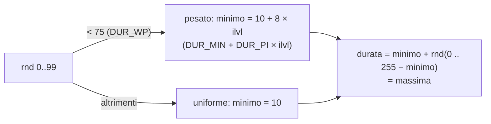
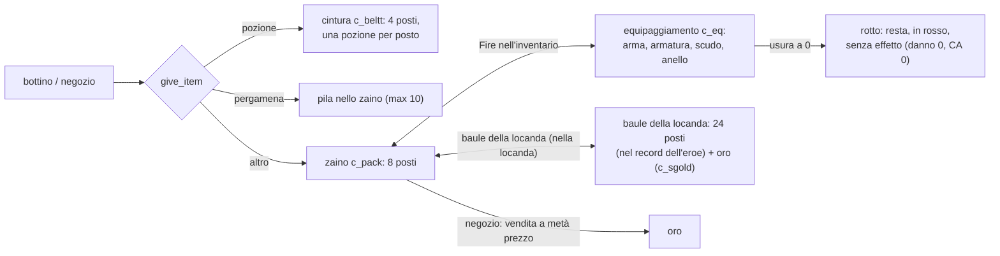

# Oggetti

Sorgenti: `out/db.asm` (generato), `src/game/game.asm` (`give_item`, `add_to_pack`, `use_scroll`, `gen_item`),
`src/game/ui.asm` (inventario, negozi, baule della locanda), `src/game/combat.asm` (`recalc_stats`, `drink`). Dati:
il **database degli oggetti** `data/items/items.tsv` (11/11, una riga per oggetto, colonne in
[data/items/README.md](../data/items/README.md), letto da `tools/build/items_db.py`); le regole che non sono oggetti
(durabilità, `dex_cap`, `magic_max`, dove escono le pozioni) in `data/rules.yaml`. Set minimo deciso il 06/11.

Categorie del database: **consumabili** (`potion`, `scroll`) ed **equipaggiamento** (`weapon`, `armor`, `shield`,
`ring`). Colonna `hands` delle armi: 1 o 2 mani; con un'arma a **due mani** (`itfl` bit 0) lo scudo non si può
indossare, né nell'inventario né alla locanda (test `INV-2H-10/11`, `INN-2H-10/11`), e in combattimento non conta.

## Catalogo

Ogni oggetto ha un id (1..17, 0 = niente) e le tabelle `itcat` (categoria), `itprice` (16 bit), `itilvl`
(livello oggetto; 255 = mai nel bottino), `itdn`/`itds` (dadi), `itval` (valore principale), `itrate`, `itpen`,
`itfl` (flag).

| Id | Nome | Categoria | Valore | Altro | Liv. oggetto | Prezzo |
|---|---|---|---|---|---|---|
| 1 | dagger | arma | 1d4 | cadenza 12 | 0 | 40 |
| 2 | sword | arma | 1d8 | cadenza 14 | 3 | 200 |
| 3 | viking sword | arma | 2d6 | cadenza 20, **due mani** (niente scudo), penetrazione 1 | 12 | 2400 |
| 4 | leather armor | armatura | CA 2 | leggera (DES senza limite) | 0 | 80 |
| 5 | chain mail | armatura | CA 5 | media (DES massimo +2) | 7 | 900 |
| 6 | plate mail | armatura | CA 8 | pesante (DES non conta) | 14 | 3600 |
| 7 | small shield | scudo | CA 1 | | 0 | 60 |
| 8 | mid shield | scudo | CA 2 | | 5 | 400 |
| 9 | tower shield | scudo | CA 3 | | 10 | 1800 |
| 10 | copper ring | anello | +1 | al modificatore di FOR, DES o COS | 7 | 700 |
| 11 | silver ring | anello | +2 | | 12 | 2500 |
| 12 | gold ring | anello | +3 | | 17 | 8000 |
| 13 | minor healing (red) | pozione | cura 20 | ricarica 5 s | — | 25 |
| 14 | healing potion (yellow) | pozione | cura 60 | ricarica 7 s | — | 90 |
| 15 | greater healing (violet) | pozione | cura 40 + 4 × livello | ricarica 10 s | — | 250 |
| 16 | portal scroll | pergamena | portale per il villaggio | pila fino a 10 (08/11, prima 4) | 1 | 60 |

`itfl`: armi bit 0 = due mani, bit 1 = libero (era finesse, tolto 08/11), bit 2 = senza modificatori (non usato dal 07/11: erano i pugni); armature = limite al
modificatore di DES (99 = nessuno); pozioni = colore (2 rosso, 7 giallo, 4 viola). `itrate` delle pozioni =
ricarica / 2. Il livello oggetto 0 degli oggetti base li fa uscire in qualunque tesoro ([Bottino](bottino.md)).

### Nomi: lunghezza massima (08/11)
Il nome si mostra in colonne da **17 caratteri** (`ui_item` riempie di spazi fino a 17): zaino e baule della locanda,
equipped (dopo l'icona), inventario, negozi, riquadro dell'oggetto selezionato. Il **nome mostrato** deve stare in
**16 caratteri** (`NAME_SHOW` in `tools/build/gen_db.py`, che ferma la build se un nome è più lungo), così resta sempre uno
spazio prima della cornice o della colonna accanto:

| Categoria | Come si mostra | Nome in `items.tsv` al massimo |
|---|---|---|
| arma, armatura, scudo | `+3 leather armor` (`+N ` davanti) | 13 caratteri |
| anello | `silver ring dex` (` str`/` dex`/` con` dietro) | 12 |
| pergamena | `3 portal scroll` (quantità davanti, 08/11: senza la `x`; si contano 3 caratteri per una pila fino a 10) | 13 |
| pozione | `greater healing` | 16 |

Oggi i più lunghi sono `leather armor` (13: mostrati 16; `medium shield` è diventato `mid shield` l'08/11) e `greater healing` (15). Caratteri ammessi:
minuscole, cifre, spazio, `'`, `-`, `.` (`asm_str`). Il nome del PG è a parte: 12 caratteri (`NAME_LEN`).

### I byte accanto all'id (`c_eqb`/`c_packb`, `c_eqd`/`c_packd`, `c_eqm`/`c_packm`)
Ogni oggetto posseduto ha tre byte accanto all'id (le tabelle dello zaino proseguono in quelle
dell'equipaggiamento: indice 16..19):
- **bonus**: armi, armature, scudi = **magia +N** (0..3), sommata ad ATT e danno (armi) o alla CA; anelli = la
  **caratteristica** (1 FOR, 2 DES, 3 COS, il nome mostra il suffisso `copper ring str`); pergamene = la
  **quantità** della pila (1..4, `SCR_MAX`); pozioni: non usato;
- **durabilità attuale** e **massima** (armi, armature, scudi; 0 = non si usura).

### Durabilità
Generata quando l'oggetto entra nello zaino (`give_item` → `dur_roll`: bottino, acquisto; dal baule della locanda
arriva con la sua) secondo `rules.yaml durability`:

In media gli oggetti durano molto (pugnale ~135, spada vichinga ~170) ma ogni tanto un bell'oggetto dura poco
(viking sword sotto 50: ~4%). Usura e rottura: [Combattimento](combattimento.md#durabilità-e-usura-wear-dur_roll);
riparazione dal fabbro: costo 25% del prezzo (`REPAIR_PC`), durabilità al massimo e **massimo − 1** (un
oggetto da 100 si ripara al più 100 volte). Numeri: `tools/simulators/sim_durability.py`.
**Correzione dell'08/11**: `add_to_pack` chiamava `dur_roll` con A = 0 invece dell'oggetto, quindi gli oggetti
nuovi (bottino dei bauli, negozi) avevano durabilità 0 = **non si usuravano**; solo quelli dell'eroe di prova e del
baule della locanda (durabilità già data) si usuravano. Ora la durabilità si tira davvero, come nel simulatore.

Usura misurata con il simulatore (`tools/simulators/sim_durability.py`, PG di riferimento, usura 2/1/1 del 06/11
pomeriggio): l'arma perde ~20 punti per piano ai piani 1–3 e 55–65 ai piani 10–19, **~880 punti in tutto nei
piani 1–19**: con l'arma della sua profondità e la durabilità media **una riparazione ogni ~3 piani** (2,1–3,2
dal piano 8; 6–7 ai primi piani, dove i colpi sono pochi); armatura e scudo 20–45 punti per piano. Un
combattimento con il boss del piano costa all'arma 6–14 punti (12–27 colpi a segno): **con durabilità ≥ 25 non
si rompe mai**, con 20 l'1% al piano 11, con 15 fino al 35% (piani 9–11). L'avviso nell'HUD si accende al
**20% della durabilità massima** (`warn_percent`, dal 06/11 sera; prima "≤ 20 o ≤ 1/8": un pugnale nuovo da 10–15
risultava già danneggiato): con l'arma media della profondità la soglia è 27–34 punti, sopra il rischio del boss
(colonna "avviso" di `tools/simulators/sim_durability.py`). Boss finale: ~28 colpi, ~14 punti, rottura solo con durabilità ≤ 20.

Arma iniziale: fino al 06/11 sera aveva sempre durabilità 10 (`DUR_MIN`) perché `rnd` è 0 dopo `game_start` e lo
xorshift resta fermo; ora `new_character` semina `rnd` dal timer del CIA prima di `dur_roll`. Dopo ogni uso
`ap_d`/`ap_m` si azzerano (`ap_clr`, anche con lo zaino pieno), così un oggetto preso dopo non eredita la
durabilità di un altro.

## Dove stanno gli oggetti

- **Equipaggiamento** (4 posti, indice = categoria − 1): l'arma non si toglie né si vende (si sostituisce:
  il PG ha sempre un'arma; rotta resta in mano, con danno 0 e il nome in rosso, finché non si ripara o si scambia); uno scudo con la
  vichinga equipaggiata è rifiutato; equipaggiando la vichinga lo scudo torna nello zaino (se c'è posto). Ogni
  cambio chiama `recalc_stats`. Nella locanda (08/11) l'equipaggiamento si cambia dal riquadro equipped, prendendo
  dallo zaino o dal baule; l'arma si può solo sostituire. Il PG senza arma non deve esistere (08/11: tolto il pugnale
  messo d'ufficio da `recalc_stats`). **Audit del 09/11** (lettura del codice, v1.132): `c_eq` non può diventare 0 da nessun
  comando del giocatore. Inventario: l'arma non si toglie (`_unequip`, `cpx #PACK_N`) e la sostituzione scambia con un oggetto non vuoto;
  locanda: `remove` non è offerto per l'arma (`h_rm` = 0 in `h_enter`) e la sostituzione scrive sempre l'oggetto scelto; negozi: l'equipaggiamento
  si ripara ma non si vende (`sh_fire`, voci 8..11); `DEL` (`inv_delete`) agisce solo sullo zaino; rottura: resta in mano a danno 0; morte: tocca solo
  l'oro (`player_die`); baule del dungeon: non tocca l'equipaggiamento; nuovo eroe: `I_START`; varianti di test: `tu_eq` ha un'arma. **Unica lacuna**:
  `load_char` / `migrate_char` non controllano `c_eq` = 0 in un salvataggio (impossibile con i comandi di oggi, ma non verificato per i
  salvataggi creati da build precedenti). Risolta alla radice (decisione del committente, 09/11): nessun controllo al caricamento, `SAVE_VER` alzata a `$C4` così i
  salvataggi precedenti vengono scartati (avviso "bad save file version").
- **Zaino**: 8 posti (`PACK_N`, 07/11 sera; prima 16), dopo ogni cambio compattato e **ordinato per categoria**
  (`sort_pack` → `sort4`, stabile, 08/11: armi, armature, scudi, anelli, pozioni, pergamene). Nell'inventario la
  tasto DEL elimina l'oggetto selezionato (08/11; prima la linguetta `drop`).
- **Pergamene** (08/11): una pila nello zaino (`SCR_MAX` = 10, quantità nel byte del bonus; solo quelle dello zaino
  aprono il portale) e una pila nel baule della locanda (fino a 10): spostandole si accumulano sulla pila che c'è già
  (`st_move`, modulo MENU), quello che non ci sta resta dov'era; con la pila piena: "max 10 scrolls." / "the chest is
  full". Mostrate come `3 portal scroll` / `10 portal scroll`.
- **Cintura**: 4 pozioni (tasti 1–4); se è piena la pozione resta nel baule.
- **Pergamena di portale** (tasto 5): apre un portale accanto al PG verso il villaggio (`c_portal`,
  `c_retlvl` = piano, `c_retx`/`c_rety` = posizione); il portale precedente sparisce. Nel villaggio il portale
  riporta al piano e alla posizione salvati.
- **Baule della locanda** (porta della locanda nel villaggio): 24 posti (`STASH_N`, 07/11 sera; prima 48), su 3 pagine da 8 (08/11), sempre ordinato per categoria. Sta nel **blocco dell'eroe** (dall'08/11 sera: `st_id`, `st_b`,
  `st_du`, `st_m`, 24 × 4 byte), sempre in RAM, e si salva con l'eroe (file `save-0N`, [Salvataggi](salvataggi.md)) con
  "save game" o al cambio di capitolo (dall'11/11 sera uscendo dalla locanda non si salva); il codice della schermata è nel modulo MENU ([Tecnica](tecnica.md#moduli-su-disco)).
- **Oro nel baule della locanda** (07/11 sera): nella schermata del baule la prima riga di ogni colonna è l'oro (zaino =
  `c_gold`, baule = `c_sgold`); Fire sulla riga dello zaino mette **tutto** l'oro nel baule (quello che non ci sta resta addosso, con "the chest is
  full"). **Dal 10/11 niente prelievo** (decisione del committente): Fire sull'oro del baule non fa nulla (`K_GC` in
  `ovlt.asm`), perché i negozi spendono anche l'oro del baule e nel dungeon l'oro addosso non serve (a vita 0 se ne perde
  metà). **Dal 10/11 il baule conta le decine** (decisione del committente):
  `c_sgold` = numero di decine (16 bit, al massimo 65 535 = **655 350 monete**); si spostano solo multipli di 10 e il resto
  (0..9) resta sempre addosso (`st_gold`: `g_div10` / `g_mul10` in `stash_io.asm`). Il baule mostra il **totale in monete** (decine × 10, 6 cifre:
  `ui_x10` + `ui_num6` in `ui.asm`). `c_sgold` sta nell'eroe (`CHRBLK`), non nel
  record del baule: si salva con l'eroe, come l'oro addosso, quindi lo spostamento non può duplicare oro. **Morendo si
  perde metà del solo oro addosso**; quello nel baule resta. L'**oro totale** (scheda del barbaro nel menu) è
  `c_gold + 10 × c_sgold` (24 bit, al massimo 665 350: 6 cifre con `ui_num6`; prima del 10/11 17 bit). Test: `tests/sanity/gold/cases.py`.

## Prezzi

Acquisto = `itprice`; vendita = metà di `itprice` (la magia +N non aumenta il prezzo). **Oro addosso al massimo
10 000** (`GOLD_MAX`, `player.gold_max` in `data/balance.yaml`, 07/11 sera): oro raccolto (mostri, bauli, bauli epici)
oltre il tetto **si perde** (`add_gold16`); la **vendita** che lo supererebbe **non fa nulla**
(`purse_room`, l'oggetto resta nello zaino; dal 10/11 senza messaggio, decisione del committente: caso rarissimo). Oro nel baule della locanda in decine (655 350, dal 10/11).
**Pagamento nei negozi (10/11, decisione del committente)**: acquisto e riparazione si pagano con l'**oro totale**
(addosso + baule della locanda): prima tutto l'oro addosso, il resto dal baule a decine arrotondate per eccesso, e le
unità che avanzano tornano addosso (`gold_need` / `gold_pay` in `ui.asm`; es. 7 addosso, prezzo 15: una decina dal
baule, 2 tornano addosso). Il purse dei negozi mostra il **totale** (`shop_gold` con `sh_mask` <> 0, somma in `gold_total`, anche nella scheda del barbaro; da 100 000 in
migliaia, `657k`); nei bauli dei dungeon mostra solo l'oro addosso. La vendita resta addosso (tetto `GOLD_MAX`).
Test: `tests/sanity/gold/cases.py` (casi del negozio). Salvataggi della v1.58–1.60 con più di 10 000 monete addosso: l'eccedenza si perde al primo oro raccolto
(formato invariato, niente SAVE_VER). Oro iniziale **100** (`PL_START_GOLD`, dal 06/11 sera; prima 1000). Nei negozi l'assortimento dipende
dal livello del PG ([Villaggio](villaggio.md#negozi-enter_shop-sh_draw)). Prezzi proporzionali al guadagno:
**proposta** in [BILANCIAMENTO](BILANCIAMENTO.md) (non applicata, in attesa di conferma).
