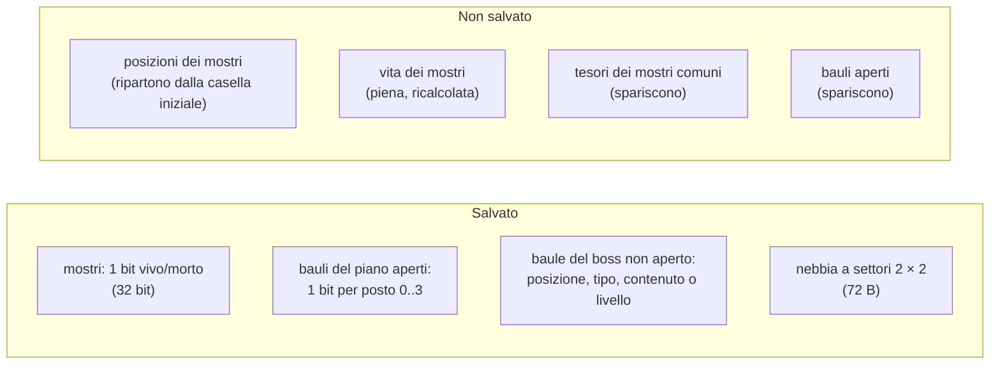
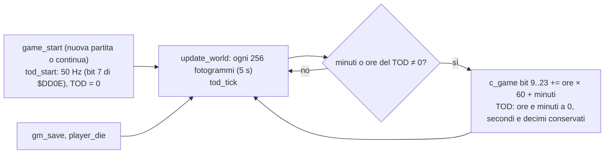
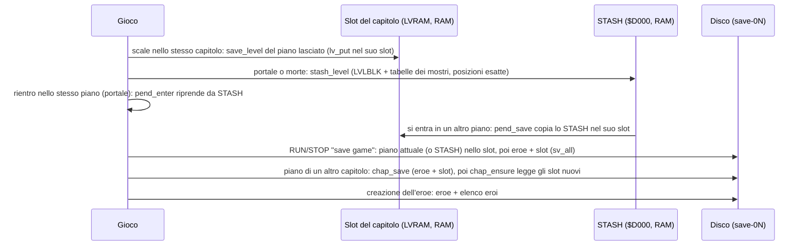

# Salvataggi

Sorgenti: `src/game/rel.asm` (file `hl` e `save-0N` con il plugin di save di Krill, `lv_put`/`lv_get`, `save_char`, `load_char`), `src/game/disk.asm`
(`save_level`, `load_level`), `src/game/levels.asm` (`change_level`, `stash_level`, `pend_enter`, `pend_save`),
`src/game/ui.asm` (`gm_save`), `tools/build/mkdisk.sh` (file preallocati). Formato byte per byte: [FORMATO_DATI.md](FORMATO_DATI.md);
loader e plugin: [FastLoader.md](FastLoader.md).

## Principio

La mappa e il contenuto iniziale di ogni piano **non si salvano**: si rigenerano dal seed. Si salvano solo:

| Cosa | Dove | Dimensione |
|---|---|---|
| L'eroe (`CHRBLK`: livello, xp 24 bit, oro, vita 16 bit, posizione, equipaggiamento e zaino (8) con bonus e durabilità, cintura, chiavi, piani visitati, partita e minuti, morti, oro nel baule della locanda…) **e il baule della locanda** (24 oggetti × 4 byte, dall'08/11 sera) | `save-0N`, offset 0 | 210 B |
| Le differenze di un piano rispetto al seed | `save-0N`, offset 210 + (piano − 1) × 93 | 82 o 93 B |
| L'elenco degli eroi (versione, presenti, nomi) | file `hl` | 66 B |

Dall'11/11 (ramo `fast-loader`, scelta del committente: pochi file sul disco) **un file per eroe** (`save-01`..`save-05`,
2070 B, 9 blocchi) e l'elenco `hl`, già creati dalla build con la lunghezza giusta: il plugin di save di Krill
**riscrive solo file esistenti con lo stesso numero di blocchi** e la directory non cambia mai. 5 slot di eroi × 20 piani.

**Quando si scrive il disco** (11/11 sera, decisione del committente): **solo** con "save game" (menu RUN/STOP), alla
creazione dell'eroe e al **cambio di capitolo**. Gli stati dei piani del capitolo corrente stanno in RAM negli **slot**
`LVRAM` (5 × 93 B = 465 B, RAM sotto l'I/O dopo il generatore, `$D8DA`–`$DAAA`): scale, portale, morte, locanda e scheda
del personaggio **non** scrivono il disco. "Quit game" torna al menu **senza salvare** ("unsaved progress will be lost"):
vale l'ultimo salvataggio. Spegnendo senza salvare si perde tutto ciò che è successo dopo (eroe e piani insieme: niente
duplicati).

**Capitoli** (regola del committente: **5 piani per capitolo**, `CH_LV` in `rel.asm`; [quests](quests.md) 3.8): oggi,
con un solo villaggio, i piani 1–5, 6–10, 11–15, 16–20 sono quattro capitoli. Entrando in un piano di un altro capitolo
(scale 5 → 6, 10 → 11, 15 → 16 o all'indietro, oppure la cripta del villaggio con gli slot di un capitolo più profondo)
il gioco salva da solo eroe e piani del capitolo lasciato (`chap_save`, eroe registrato **dove era prima** del cambio:
`c_loc` e posizione) e rilegge dal file gli stati del capitolo nuovo (`chap_ensure`).

Ogni scrittura riscrive **il file intero** (`sv_all`): il gioco legge il file dell'eroe (`sv_read`, Krill, ~0,8 s)
nell'immagine a `$E000`, ci copia l'eroe e i 5 slot del capitolo (blocco contiguo, `chap_copy`), ricarica il plugin
(file `ksave`, ~0,5 s: modifica il proprio codice) e riscrive i 9 blocchi (`sv_write`). Nel villaggio l'immagine copre il
villaggio, che poi si rilegge (`sv_end`, ~1 s). Gli stati degli altri capitoli restano quelli del file.

| Evento | Disco | Tempo misurato (VICE, `PERF-DISK`) |
|---|---|---|
| Scale nello stesso capitolo | nessuno (slot in RAM) | 2,64 s il cambio piano (tema + generazione), limite 3 s |
| Save game fuori dal villaggio | lettura + scrittura del file | 7,6–8,1 s, limite 9,5 s |
| Save game nel villaggio | lettura + scrittura + villaggio riletto | 8,7–9,1 s |
| Cambio di capitolo | salvataggio + lettura degli slot nuovi | non misurato (stima ~10 s) |
| Ingresso nel primo piano dopo l'avvio | lettura degli slot | ~1 s in più (stima) |

## Stato di un piano

- Il bit di `c_vis` (1 per piano, 3 byte) dice che il piano ha un record valido. `c_vis` si salva con l'eroe:
  un piano salvato dopo l'ultimo salvataggio dell'eroe, alla ripresa, si rigenera da zero.
- Rientrando: rigenerazione dal seed → `load_level` applica i bit (mostri morti tolti, bauli generati aperti tolti,
  baule del boss rimesso, nebbia espansa a settori) → `init_monsters_rt` (vita piena ±25%).

### Cancellazione di un barbaro (07/11 sera)
Dalla scheda del barbaro nel menu: voce **delete barbarian** e conferma Y. Si scrive solo l'elenco (`REC_HDR`): byte
"eroe presente" del posto a 0 e nome a spazi (`hero_delete`, `src/lobby.asm`). Il baule della locanda sta nel record
dell'eroe (08/11 sera): un barbaro nuovo nello stesso posto nasce con il blocco azzerato (`new_character`) e non
eredita nulla. Test: `tests/regression/saves/test_saves.py` caso 7. Il record dell'eroe e
quelli dei suoi piani restano sul disco ma non contano più: il prossimo eroe creato in quel posto riscrive il suo
record e parte con `c_vis` = 0 (nessun piano visitato), quindi i vecchi record dei piani non vengono mai letti.

### Partite: i piani si ripopolano a ogni avvio
Il record del piano porta il **numero della partita** (9 bit di `c_game`). Ogni "continua" dal menu lo aumenta
di 1 (1..511, poi 1); una nuova partita parte da 1. Se il record è di un'altra partita, `lv_get` ignora i bit
dei mostri morti e dei bauli tolti (tutti vivi, tutti chiusi: si può tornare a fare esperienza e tesori) e
scarta il baule del boss non aperto; la nebbia resta. Nella stessa partita i piani ripuliti restano puliti
(portale compreso). Nessun accesso al disco in più: il numero viaggia nei record già scritti; se si spegne senza
salvare, l'eroe riparte con il numero vecchio e i piani salvati nel frattempo risultano "di un'altra partita"
(ripopolati), coerentemente con l'eroe ripristinato. Per l'Abisso la regola è da decidere (`TODO.md`).
`c_game` porta anche i **minuti giocati** (bit 9..23, fino a 32767) e `c_deaths` le morti.

### Tempo giocato: orologio TOD del CIA2
Il tempo è misurato dall'orologio **TOD** del CIA2 (`$DD08`–`$DD0B`, BCD), che conta da solo i 50 impulsi al
secondo della rete forniti dall'alimentatore (9 V AC): niente CPU né interrupt, conta anche menu, negozi,
baule, help e caricamenti. In memoria c'è solo il contatore dei minuti; ore e minuti si calcolano solo nella
scheda dell'eroe (`detail_screen`, `dt_div60`).

- `tod_tick` legge le ore per prime (congelano i registri) e i decimi per ultimi (li sbloccano); riscrive
  l'orologio solo quando c'è almeno un minuto da sommare (la riscrittura azzera il divisore interno: perdita
  ≤ 0,1 s al minuto).
- Il tempo nel menu principale non conta (`tod_start` azzera il TOD a ogni avvio di partita).
- Limite: più di ~12 ore fermi in una schermata senza `tod_tick` (formato a 12 ore del TOD) farebbero perdere
  il conteggio; nel gioco non succede (il ciclo lo legge ogni 5 s).
- **Senza il segnale a 50 Hz** (alimentatori moderni o di terze parti senza 9 V AC, alcuni emulatori/hardware) il
  TOD resta fermo e il tempo giocato non cresce; nessuna protezione nel codice (decisione 06/11, impatto minimo):
  il manuale lo spiega nel capitolo finale. Uso del TOD a 0 ore non verificato su hardware reale (il 6526 usa
  ore 1–12): in VICE funziona.

### Baule della locanda (dall'08/11 sera, `SAVE_VER` $C3)
In fondo al blocco dell'eroe (`st_id`, `st_b`, `st_du`, `st_m`: 4 × `STASH_N` = 96 byte dopo `c_sgold`): sempre in RAM,
letto e scritto con l'eroe. Entrare nella locanda non legge il disco e **uscendo non si salva** (11/11 sera; prima si
salvava l'eroe se si era premuto Fire, `st_dirty`, tolto): il baule va sul disco con l'eroe a "save game" o al cambio di
capitolo. Spegnendo prima si ritrovano eroe e baule dell'ultimo salvataggio insieme, quindi non si duplica nulla.

Storia (prima dell'11/11 sera, uscita dalla locanda con salvataggio):
Tempo misurato in VICE con il REL (08/11 sera, prima di Krill): **~3,1 s**,
così ripartiti: apertura del file e ricerca del record (`OPEN` + primo comando `P`) ~1,4 s, 206 byte ~0,43 s, fine
record ~0,18 s, `CLOSE` del file ~1,05 s. Il `CLOSE` costa ~1 s anche senza dati da scrivere (provato forzando la
scrittura del record con un secondo `P` prima del `CLOSE`: 0,74 s + 1,07 s): è lavoro del DOS del 1541, non del
gioco. Un record REL va scritto intero (i byte non scritti diventano 0), quindi non si può scrivere solo il baule.
Con Krill (11/11, `tests/regression/saves/test_rel.py` lo stampa): **~8,5 s** (lettura del file, plugin, 9 blocchi, villaggio). Su un 1541 vero i tempi non sono misurati.

## Quando si salva

- **Scale**: il piano lasciato va nel suo slot (`save_level` → `save_lvlblk`, nessun disco), l'eroe no.
- **Portale e morte**: il piano resta in RAM sotto l'I/O (`STASH` a `$D000`, `STASHM` = copia delle 12 tabelle
  dei mostri), con le posizioni esatte dei mostri e i tesori; tornando con il portale si ritrova tutto com'era.
- **Salvataggio completo** (menu RUN/STOP "save game"): un'unica riscrittura del file per eroe + piani del capitolo.
- **Quit, locanda, scheda del personaggio** (punti statistica, respec): nessun salvataggio (11/11 sera).
- I tesori in coda (`flush_drops`) si piazzano prima di ogni salvataggio o STASH.
- Test: `CHAP-SAVE-10`..`13` (`tests/sanity/chapters`), `PERF-DISK-13` (scale), `PG-LOAD-01` (quit senza salvare).

## Versione

`SAVE_VER` (`version.yaml save_version`, oggi `$C5`: 10/11, `c_sgold` in decine; `$C4`: 09/11, alzata senza cambiare i byte per scartare i salvataggi precedenti, che potevano avere l'eroe senza arma; `$C3` = 08/11 sera, baule della locanda nel record dell'eroe) è il primo byte dell'eroe e
dell'elenco (oggi `$C7`, 12/11, capitolo e sblocco `c_chap`/`c_unl`; `$C6`, 11/11, punti statistica): va cambiata a ogni modifica del formato. Il menu propone di cancellare i salvataggi **solo** se l'elenco è davvero di un'altra versione: versione diversa, byte "eroe presente" tutti 0 o 1 e almeno un eroe. Un elenco vuoto, azzerato, illeggibile o con byte a caso o il file `hl` assente valgono "nessun eroe", senza errori (`tests/regression/saves/test_saves.py`: disco nuovo, `hl` cancellato, elenco azzerato / a caso, altra versione con un eroe, 4 cicli nuova partita → piano → quit → menu → continua). La build crea `hl` con la versione attuale e nessun eroe.

## File hl assente
Se `hl` manca (cancellato a mano) la lettura fallisce: `START` lo scarta (`CHRTMP` = 0) e `hdr_read` azzera `hdrbuf`
(errore di Krill). Il menu mostra nessun eroe e la partita parte, ma l'elenco non si salva (il plugin non crea file).
Test: `SAVE-11`.
