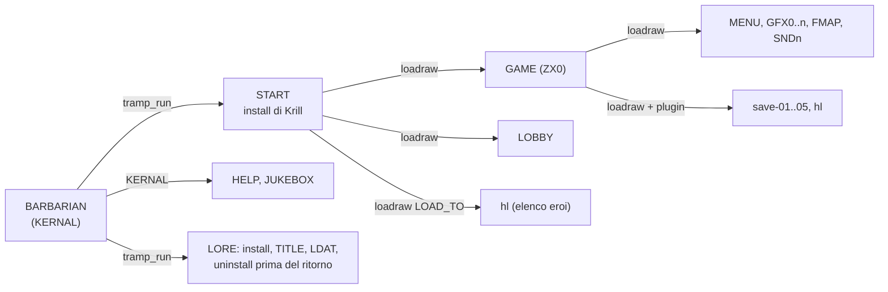
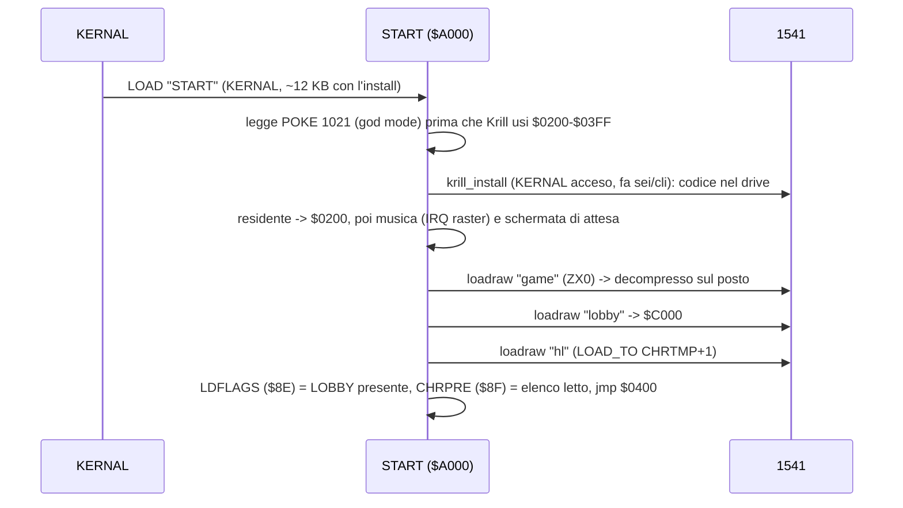

# Fast loader: Krill's Loader r194 (architettura)

Copyright © 2026 - Simone Caporale

Dal ramo `fast-loader` (11/11) il gioco carica e salva con **Krill's Loader r194** (© 2022 Gunnar Ruthenberg, BSD a
3 clausole con attribuzione obbligatoria: "Loader by Krill"). Questa pagina spiega **come lo usiamo, cosa fa, dove
interviene**, con le misure. Archivio e note: [src/third-party/krill/README.md](../../src/third-party/krill/README.md).

Certezza: ciò che è marcato **[MISURATO]** è stato misurato in VICE (`x64sc`, 1541 emulato con true drive emulation);
**[NON VERIFICATO]** = mai provato (hardware reale, SD2IEC, altri drive).

## 1. In breve

| Cosa | Come |
|---|---|
| Chi lo installa | `START` (avvio del gioco), una volta, con il KERNAL acceso |
| Dove sta | residente `$0200-$0312` (275 B), pagina zero `$41-$47` (il plugin di save fino a `$57`) |
| Cosa carica | **tutti** i file letti da `GAME`, `LOBBY` e `START`: gioco, menu, villaggio, temi, `FMAP`, musica, salvataggi |
| Cosa salva | i salvataggi (`hl`, `save-01..05`) con il **plugin di save** (file `KSAVE`, caricato a `$E820` sotto il KERNAL a ogni salvataggio) |
| Chi altro lo usa | `LORE` (11/11 sera): installa Krill, legge `TITLE` e `LDAT`, lo disinstalla prima di tornare a `BARBARIAN` |
| Cosa resta sul KERNAL | `BARBARIAN` (menu del loader), `HELP`, `JUKEBOX` (ha i brani nel suo file: non legge il disco) |
| Drive | **solo 1541 e compatibili** (`ONLY_1541_AND_COMPATIBLE = 1`): i dischi si chiamano `blood_path_vX.Y[_dev]_1541.d64` |
| Credito | menu dei barbari (`LOBBY`), sotto la versione: **"loader by krill - v194"**; `README.md` |

## 2. Build

| Passo | Dove | Cosa |
|---|---|---|
| 1 | `tools/build/krill_build.sh` (chiamato da `tools/build/asm.sh`) | scompatta `src/third-party/krill/loader-v194.zip` in `out/work/krill/pkg` (usa e getta) e costruisce con `ca65`/`ld65` (pacchetto `cc65`) e la nostra configurazione `src/common/krill/loaderconfig.inc`, dopo **una correzione del codice del drive 1541** (15/11, sezione 4.1: due byte, applicata con `sed` alla copia scompattata, la build si ferma se il sorgente non è quello atteso): `out/work/krill/install.prg`, `loader.prg` (residente), `save.prg` (plugin) |
| 2 | `tools/build/krill_syms.py` | `out/work/krill.inc` per 64tass: `krill_install`, `krill_loadraw`, `krill_save`, `krill_uninstall`, `krill_loadaddrlo/hi`, `krill_endaddrlo/hi`, lunghezze |
| 3 | `src/start.asm` / `src/common/boot.asm` | include l'install (a `INSTALL = $0840`, dopo lo stub BASIC) e il residente (copiato a `$0200`) |
| 4 | `src/game/rel.asm` | plugin a `TRANSIENT = $E820` (`krill_save`), fra l'immagine del file dell'eroe e il buffer del plugin, sotto il KERNAL (`.cerror` sulle tre aree) |
| 5 | `tools/build/mkdisk.sh` | disco con `cc1541` (14/11: 4.2 di Lab64, compilato dai sorgenti; prima quello dello zip di Krill) (`-M 8` = `FILENAME_MAXLENGTH`: hash dei nomi a 8 caratteri; collisioni rifiutate; `-S 4` = interleave 4, 14/11: avvio 14,2 -> 11,4 s, MENU 3,23 -> 2,64 s, ingresso nel villaggio 5,0 -> 3,6 s in VICE; i file caricati dal KERNAL prima di Krill, BARBARIAN, START, LORE, HELP, misurati con LOAD del KERNAL in VICE: stessi tempi con interleave 10 e 4, entro 0,1 s, quindi niente eccezioni), `BARBARIAN` primo; crea `hl`, `save-01..05` della lunghezza giusta e `ksave` |

Configurazione (`src/common/krill/loaderconfig.inc`): `ONLY_1541_AND_COMPATIBLE 1`, `DECOMPRESSOR NONE` (il ZX0 resta
il nostro, `src/common/zx0.inc`), `LOAD_RAW_API 1`, `LOAD_TO_API 1`, `END_ADDRESS_API 1`, `UNINSTALL_API 1`,
`FILENAME_MAXLENGTH 8`, `NTSC_COMPATIBILITY 0`, `LOAD_UNDER_D000_DFFF 0`, `LOAD_VIA_KERNAL_FALLBACK 0`.
Dimensioni [MISURATO]: install 3225 B, residente 277 B, plugin 1205 B (con tutti i drive l'install sarebbe 6997 B e il
plugin non si costruisce con il nostro `ca65` senza cambiare `save.s`; TODO B16).

## 3. Avvio (`START`)

- Dopo l'install **il drive non risponde più ai comandi del KERNAL**: dopo `START` nessun programma può usare `LOAD`,
  `OPEN`, file REL. `quit the game` disinstalla Krill (`krill_uninstall`: il drive salta alla sua ROM) e fa il reset del
  C64; il BASIC rilegge il disco (test `SAVE-15`). Provato in VICE: anche il solo reset del C64 riporta il drive alla ROM
  (il codice di Krill nel drive si disinstalla quando vede ATN). Niente rientro dal BASIC (tolto l'11/11).
- (21/11, TODO D15) **Il gioco gira con il KERNAL escluso** (`$01 = $35`): Krill carica e salva così (nella nostra
  configurazione il residente non tocca `$01`: lo farebbe solo con `LOAD_UNDER_D000_DFFF` o `LOAD_VIA_KERNAL_FALLBACK`, entrambi
  a 0). Provato in VICE con smoke, sanity e regression.
- `START` mostra una schermata di attesa ("the crypt door creaks open", "please wait"): niente barre (11/11 sera).
- Il villaggio non si precarica più: lo legge `GAME` entrando (`enter_gfx`).
- `$DD00`: con Krill installato si scrive **solo il banco VIC** (bit 0-1), i 6 bit alti a 0 (README di Krill,
  "Setting the VIC bank"): `lda #banco / sta $dd00`, mai lettura-modifica (`START`, `GAME start`).
- POKE prima del `RUN` (11/11, [docs/wiki/cheats.md](cheats.md)): `POKE 1020,1` = subito `START` senza il menu del loader,
  `POKE 1021,1` = god mode. Sono byte liberi dopo il trampoline (`$03FC`, `$03FD`), azzerati all'accensione e al reset.

## 4. Caricamenti nel gioco (`src/game/disk.asm`)

| Routine | Uso |
|---|---|
| `load_raw` | nome in `cmdbuf+3` (0 finale), destinazione `ptr0` (`LOAD_TO`): temi, villaggio, `FMAP`, brani, `LOBBY` |
| `load_file` | all'indirizzo scritto nel file (C = 0): il modulo `MENU` (un file solo dal 18/11; prima `menu1..5`) |
| `set_name`/`set_name4` | scrivono il nome e lo 0 finale |

- **Musica**: zittita prima del disco (`snd_io`), come con il KERNAL; gli IRQ restano accesi durante i caricamenti
  (Krill li permette, anche con sprite e badline).
- **Schermata**: titolo + "please wait" senza barra (`io_screen`): Krill non dà un avanzamento durante un `loadraw`
  e i caricamenti durano 1-2 s. Dall'11/11 sera niente barre in tutto il gioco (anche `START`).
- **Modulo MENU** (18/11: un file solo, `menu`, che finisce alla fine della zona 2; vedi [FORMATO_DATI](FORMATO_DATI.md)). Fino al 18/11 un file per zona (`tools/build/pack_menu.py`): l'indirizzo di ogni file era la fine della sua zona meno
  la lunghezza compressa; Krill lo carica lì e lascia l'inizio in `krill_loadaddrlo/hi`, poi il ZX0 decomprime sul posto.
- Pagina zero: `$41-$47` sono di Krill durante un caricamento (il gioco usa fino a `$40`); `$41-$57` durante un save.

### 4.1 File di un blocco e cache del file seguente nel drive (15/11, ex TODO A2) [MISURATO]

**Sintomo**: entrando nel villaggio 2 dal piano 6 (e in altri ingressi) il gioco si bloccava. `SND0` (241 B, un blocco) arrivava
in `SND_LBUF` solo per i primi 118 B, **senza errore** (C = 0, `krill_endaddr` = `$8AB6` invece di `$8B31`); il resto del buffer era
ancora il brano di prima e `sp_next` girava per sempre nell'IRQ (fermato: PC in `sp_next`, nello stack `sp_play` ← `sfx_update` ←
`irq_h`, il programma principale in `wait_vblank`: il caricamento era **finito**, corto, non interrotto).

**Causa** (codice del drive 1541 di Krill r194, `drivecode1541.s` + `drivecode-common.inc`): dopo un caricamento riuscito il drive
prepara il file **seguente nella directory** e ne tiene in memoria il primo blocco (`setnextfile` → `prpdnxtfil`). Se il C64 chiede
proprio quel file, il blocco si serve dalla cache (`servecache`) senza rileggerlo. Se quel blocco è anche l'**ultimo** del file
(file di un solo blocco), la sua lunghezza si calcola al momento dell'invio da `LINKSECTOR41` (`sbc LINKSECTOR41`, drive `$0695`),
che è lo **stesso byte** (`$7F`) di `TEMP`, il temporaneo dell'**hash del nome** (`gethashval`, `hashloop: sta TEMP`, drive
`$04B6`): l'hash del nome appena ricevuto lo sovrascrive. La lunghezza diventa una funzione del **nome chiesto**, sempre la
stessa: più corta o più lunga, e il loader non lo sa. Visto nel drive in VICE (punti di fermata nella memoria del drive):
dopo `MENU3` il drive mette in cache il primo blocco di `SND0` con `LINKSECTOR41` = `$F4` (244: 241 B + 2 di indirizzo),
l'hash di "SND0" lo porta a `$79` e il blocco parte con 118 B. Il 1571 non ha il difetto perché lì Krill spegne la cache
(`inc prpnxtfjmp` in `GET_FILENAME`).

**Chi colpiva**: **ogni file di un solo blocco caricato subito dopo il file che lo precede nella directory**, con qualunque
disposizione del disco; i file di più blocchi no (il loro primo blocco non è l'ultimo). Sul disco del 15/11 (`hubchap`), misurato
caricando ogni file dopo il suo predecessore (`KRILL-23` prima della correzione): `menu3` +39 B, `snd0` −123 B, `snd3` −61,
`snd4` −120, `snd5` −74, `snd6` −6, `bossch1` +48, `bossch2` +54, `bossch3` +60, `hl` +12; tutti gli altri 32 file giusti.
Nel gioco: `MENU3` dopo `MENU2` a **ogni** lettura del modulo MENU (tutte le disposizioni, dall'11/11): 39 B scritti oltre
`$A800`, dentro il charset, che `gfx_install` riscrive subito dopo (per questo non si vedeva; dedotto dal codice, non misurato a
schermo); `SND0` dopo `MENU3` solo con `hub` e `hubchap` (`SND0` subito dopo `MENU3`): il blocco. Con `end` `SND0` non segue `MENU3`,
per questo "non succedeva". I brani in fila (`snd3..6`) si sarebbero rotti con una sequenza di letture che oggi il gioco non fa.

**Correzione** (`tools/build/krill_build.sh`): nel codice del drive 1541 l'hash usa come temporaneo `PREVBLOCKINDEXPLUS1` (`$29`)
invece di `LINKSECTOR41`; `BLOCKSIZE` resta `LINKSECTOR41`. `$29` non serve fra la fine di un caricamento e `loadfile41`, che lo
azzera dopo l'hash, e il codice di salvataggio (`save.s`, che chiama `findfile41`) non lo usa. Cambiano **due byte** dell'install
(`$7F` → `$29` a `$04B9` e `$04BF` del file), stesse dimensioni e posizioni; la cache resta (i tempi non cambiano: `PERF-DISK-*`
invariati). Prima prova scartata: `NUMCONTIGUOUSBLOCKS` (`$74`) è `NUMBLOCKS` del codice di salvataggio, azzerato prima di
`findfile41`: i salvataggi scrivevano un eroe vuoto (`PG-SAVE-01`).

**Difesa nel gioco** (anche con un loader che sbagliasse ancora): dove il gioco conosce la fine esatta del file la confronta con
`krill_endaddrlo/hi` e rilegge, fino a 3 volte: `snd_get` (buffer + lunghezza del brano; poi niente musica, il player non parte su
un buffer letto a metà) e `ovl_town` (ogni parte del MENU deve finire alla fine della sua zona; poi C = 1). Provato con il loader
**senza** correzione: `CHAP-SEQ-14`, `MUSIC-10`, `VIL-TWN-22` passano (la seconda lettura non viene dalla cache). Costo: 37 B di
GAME (margine 2002 → 1965 B, build di debug). Gli altri caricamenti (villaggio, temi, `FMAP`, `BOSSCHc`, salvataggi) non hanno
una lunghezza attesa nel codice: li copre la correzione del loader e il test `KRILL-24`.

**Cosa garantisce ora** [MISURATO in VICE, 1541]: ogni file del disco, letto da solo o subito dopo il suo predecessore nella
directory, arriva intero e con l'indirizzo di fine giusto (`KRILL-23`); in un giro di tutti i capitoli (piani, piani dei boss, sala
del trono, villaggi 1-5, salvataggi, viaggi, LOBBY: 131 letture, fra cui 12 volte `MENU3` dopo `MENU2` e 8 volte `SND0` dopo `MENU3`) ogni lettura è uguale al suo file (`KRILL-24`). **Non verificato**:
1541 vera, 1541-II e 1570/71 vere (i test `KRILL-17/18` in VICE passano), vc64web (test `EMU-*` non rifatti: servono il demone).
Versioni di Krill più recenti della r194: non controllate (potrebbero avere già la correzione).

Test: `KRILL-20` (l'ingresso nel villaggio: MENU e poi SND0, ogni file giusto alla prima lettura), `KRILL-21` e `KRILL-22`
(controlli del gioco), `KRILL-23`, `KRILL-24` (`tests/regression/krill_cache`, `tests/regression/krill_walk`, `tests/lib/loads.py`).

## 5. Salvataggi (`src/game/rel.asm`, [salvataggi.md](salvataggi.md))

- File preallocati dalla build (il plugin **riscrive solo file esistenti con lo stesso numero di blocchi**):
  `hl` (elenco eroi, 66 B, 1 blocco) e `save-01..05` (un file per eroe: eroe 210 B + 20 piani × 93 B = 2070 B, 9 blocchi).
- Ogni scrittura riscrive il file intero: `sv_read` (Krill) → si cambia la parte (eroe o piano) → `sv_write` (plugin).
  Con `rel_hold` (menu RUN/STOP, nuovo eroe) più parti vanno in una sola riscrittura (`rel_done`).
- RAM: immagine del file a `$E000` (`SV_IMG`), plugin a `$E820`, buffer del plugin `$0800` byte a `$ECE0` (`SV_SCR`), tutti sotto il
  KERNAL: durante il save interrupt spenti (dal 21/11 il KERNAL è sempre escluso, `$01 = $35`); la lettura dell'immagine non ha più involucri. Immagine e plugin coprono il
  segmento CORE (`$E000`-, 21/11): `sv_write` lo rilegge dopo la scrittura (`core_need`, file `core` fra `ksave` e `save-01`). Il file
  del villaggio (`$EC00` dal 21/11) serve solo fino a `gfx_install`: dal 18/11 non si rilegge dopo il salvataggio (`sv_end`, `town_at` tolti).
- **Il plugin modifica il proprio codice** (17 byte, [MISURATO]: una seconda chiamata senza ricarica si blocca): si
  **carica dal file `KSAVE` prima di ogni save** (~0,5 s) a `$E820`, nella RAM libera durante un salvataggio. Fino
  all'11/11 sera aveva un posto fisso di 1203 B in GAME: tolto, il margine del codice è tornato a 3193 B.

## 6. Memoria

| Area | Uso con Krill | Prima |
|---|---|---|
| `$0200-$0312` | residente di Krill | buffer di input del BASIC, variabili del KERNAL, segnali `LDFLAGS`/`CHRPRE`/`godmode` (`$02A7-$02B1`), `YN_SAV` |
| `$41-$47` (`$41-$57` nel save) | pagina zero di Krill (e del plugin) | libera |
| `$8E`, `$8F` | `LDFLAGS`, `CHRPRE` | liberi |
| `$0340-$0367` | `YN_SAV` (riga 24 salvata dalle domande y/n) | `$0200` |
| margine del codice | 3193 B (il codice del disco con il KERNAL è uscito; il plugin non sta in GAME) | 2930 B |
| `$97E9-$97FB` | parametri del plugin, nome del file dell'eroe (`town_at` tolto il 18/11) | liberi |
| `$E000-$E815`, `$E820-$ECD2`, `$ECE0-$F4DF` | immagine del file dell'eroe, plugin, buffer del plugin: solo durante un salvataggio | cache del villaggio (tolta) |
| `godmode` | byte del PRG in CODE2 (non azzerato da `game_start`) | `$02A9` |

## 7. Misure (VICE, 1541 emulato, contatore di cicli) [MISURATO 11/11]

| Operazione | KERNAL (prima, senza cache) | Krill | Differenza |
|---|---|---|---|
| Avvio (`BARBARIAN` con `POKE 1020,1` → fine caricamenti di `START`) | 105 s (con il villaggio precaricato) | 34,5 s | −67% |
| Modulo `MENU` all'ingresso nel villaggio | 10,5 s | 2,3 s | −78% |
| Scale villaggio → piano 1 | 11,1 s | 3,1 s | −72% |
| Scale piano 1 → 2 (salva il piano lasciato) | 13,8 s | 10,2 s | −26% |
| Scale piano 2 → 1 (salva il piano lasciato) | 15,8 s | 11,4 s | −28% |
| Menu RUN/STOP "save game" (piano + eroe, una riscrittura) | 3,2–5,4 s | 7,1 s (dungeon) – 8,6 s (villaggio, con la rilettura del villaggio) | **+120–170%** |
| Uscita dalla locanda dopo una modifica (`save_char`) | 3,1 s | 8,5 s | **+174%** (dall'11/11 sera non salva più: 0 s) |
| Scale nello stesso capitolo (11/11 sera: stato del piano negli slot in RAM, `PERF-DISK-13`) | — | 2,64 s | — |
| Storia (`LORE`): tasto `1` del menu → PRESS SPACE | 70 s | 38 s (con ~5 s di comparsa del titolo) | −46% |

- I **caricamenti** sono molto più veloci (obiettivo del 35% superato); i **salvataggi** sono più lenti: il plugin
  riscrive il file intero (9 blocchi) dopo averlo letto, più la ricarica del plugin e, nel villaggio, del villaggio.
  Decisione aperta in `TODO.md` (B15).
- L'install costa circa 3,2 KB in più nel file `START`, letto dal KERNAL (compreso nei 34,5 s). Comprimerlo con ZX0
  dà solo il 13% (3223 → 2807 B): lasciato stare (decisione dell'11/11).
- (18/11) **Come misurano i test `PERF-DISK`** (`tests/regression/perf_disk/cases.py`): ogni operazione parte da uno snapshot di
  VICE (macchina e drive) e si ripete in 6 fasi del giro del disco; conta la piu' lenta. Una misura fuori limite non ferma
  piu' la sequenza (lo stato di testina e directory lasciato al passo dopo resta lo stesso). Risultato: due run danno gli
  stessi numeri. **Il file letto per ultimo conta** fino a ~1,3 s (villaggio → piano 1: 4,56 s dopo il villaggio, 5,7-5,8 s
  dopo `hl` o il salvataggio dell'eroe; causa probabile la ricerca nella directory di Krill, **non verificata**: TODO M3).

### 7.1 Posizione dei villaggi sul disco e tempi per villaggio (15/11) [MISURATO, tempo emulato]

Richiesta del committente: tutti i villaggi devono caricarsi in un tempo ragionevole; misurare, poi decidere. Misure di un
agente (test `PERF-DISK-21..25`, cronometro di VICE in cicli: il carico dell'host non le sposta), su cinque disposizioni
(`TWN_LAYOUT` in `tools/build/mkdisk.sh`). Ingresso completo nel villaggio *c* (`change_level` a 0 dal primo piano del capitolo:
dissolvenza, `TWNc`, modulo MENU, `gfx_install`, brano), **media / massimo su 10 fasi del disco** (lo stesso ingresso cambia fino a
1,5–2 s secondo la posizione della testina e la rotazione nel momento in cui parte):

| Disposizione | Villaggio 1 | 2 | 3 | 4 | 5 |
|---|---|---|---|---|---|
| `end`: `TWN1` fra i primi file, `TWN2..5` in fondo (15/11 mattina) | 4,69 / 5,37 | 3,60 / 3,72 | 3,82 / 4,10 | 4,10 / 4,24 | 3,81 / 4,16 |
| `start`: `TWN1..5` tutti all'inizio | 4,43 / 5,54 | 4,87 / 5,33 | 4,70 / 5,14 | 5,17 / 5,53 | 2,65 / 3,73 |
| `chapter`: ogni `TWNc` con la grafica del suo capitolo | 4,46 / 4,98 | 3,70 / 3,93 | 3,71 / 3,90 | 3,72 / 3,93 | 2,74 / 2,76 |
| `hub`: MENU, `SND0`, `TWN1..5` insieme | 3,92 / 4,81 | 4,51 / 4,98 | 4,16 / 4,37 | 4,62 / 4,97 | 2,60 / 3,75 |
| **`hubchap`** (scelta): MENU, `SND0`, `TWN1`, `FMAP` insieme; `TWN2..4` e `BOSSCH2/3` con la grafica dei loro capitoli; `TWN5` in fondo | **4,17 / 4,93** | **3,47 / 3,86** | **3,49 / 3,84** | **3,45 / 3,84** | **2,96 / 3,94** |

- **Rimisura del 17/11** (GAME più grande: quest e percorsi dei mostri), tutti i caricamenti di `PERF-DISK` con i 5 ordini (e `hubchap`
  con `TWN1` prima di `SND0`): nessun ordine porta tutto sotto il 90% dei limiti. `TWN1` (file da solo) misura 1,71–1,86 s **con
  ogni ordine** (il 15/11 0,68 s); `hubchap` resta il migliore (fuori solo `song` 1,61 s e `twn1` 1,76 s; gli altri ordini
  sforano anche su grafica dei capitoli, `town_in` o `hdr`). Decisione del committente: limiti alzati alla misura arrotondata
  per eccesso al mezzo secondo: `song` 2,0 s, `twn1` 2,0 s, `hdr` 1,0 s (aveva misurato fino a 0,91 s).
- **Decisione (15/11): `hubchap`**, ora predefinita. (15/11 sera) Il blocco entrando nei villaggi con `hub`/`hubchap` (ex TODO A2)
  era un difetto del loader, corretto (sezione 4.1): `hubchap` resta la predefinita, tempi invariati (`PERF-DISK-21..25` passano
  con le stesse soglie). Tenere tutti i villaggi all'inizio del disco (`start`) è la disposizione
  **peggiore**: spinge la grafica e i brani del capitolo 1 in un altro settore di directory e su altre tracce, e ogni ingresso
  attraversa tre settori di directory (89 tracce percorse contro 46). Conta che i file che un ingresso carica (MENU, brano,
  villaggio) siano vicini fra loro e nello stesso settore di directory, non che i villaggi siano vicini fra loro.
- **Perché** (dal sorgente di Krill e dal percorso della testina registrato nel drive): il drive tiene in memoria un solo settore
  di directory (8 file); un file che non è lì costa un viaggio sulla traccia 18. Il MENU sta sempre sulla traccia 8.
- **Soglie per villaggio** (`tests/regression/perf_disk/cases.py`, regola del 90%): ingresso 5,7 / 5,3 / 5,0 / 5,0 / 4,6 s; file
  del villaggio da solo 1,0 / 2,2 / 2,1 / 2,8 / 1,6 s (misurati 0,68 / 1,63 / 1,56 / 2,14 / 1,20). Con `hubchap` l'ingresso nel
  villaggio 1 nell'ordine dei test (`PERF-DISK-14`) è 3,3–3,5 s (era 4,9).
- **Costi**: il piano del boss dei capitoli 2 e 3 sale a 2,2–2,4 s (era 1,6–1,8; causa non trovata); la misura `song` (`SND0`
  letto subito dopo `GFX1`, sequenza che il gioco non fa) sale a 1,12 s e il suo limite è passato da 0,6 a 1,5 s.
- **Non misurato**: hardware reale, vc64web, il passaggio di capitolo (`chap_travel`: legge `TWNc` due volte e salva), le fasi per
  le altre misure (tema, scale, boss: una fase sola). Quando ogni villaggio avrà il suo brano (TODO M2), i file nuovi vanno
  accanto al MENU o al loro villaggio, e si rimisura.
- **Noto**: il setup della suite `PERF-DISK` a volte non parte ("no answer to 'load ... start.prg' in 20 s"), circa una volta
  su due il 15/11; non dipende dalla disposizione (TODO I-test).

### 7.2 Ordine dei file e directory (18/11, PERF-12) [MISURATO, tempo emulato]

**Come cerca Krill** (`loader-v194`, `drivecode-common.inc`, letto il 18/11): il drive tiene in memoria una **finestra di 11
voci** della directory (hash dei nomi, `DIRBUFFSIZE`). Se il file non c'e', legge i settori della directory **successivi**
(solo in avanti, in giro fino a tornare al punto di partenza) e la finestra riparte da li'. Dopo ogni caricamento il drive
prepara il primo blocco del file che segue nella finestra. Quindi il tempo di un caricamento dipende da **dove sta la
finestra** (cioe' dai file letti prima) e da **quante voci** bisogna attraversare: un giro intero della directory (7
settori, 52 voci) costa ~1,2-1,5 s. Per questo i tempi cambiano "a scatti" di ~1,3 s spostando anche un solo file, e in1
(5,6 s) costava ~2 s piu' degli altri ingressi: nessun refuso nel codice, solo la posizione di TWN1/MENU/SND0 (prima di
GFX1/BOSSCH1/GFX2) rispetto alla finestra dopo il piano del boss.

**Prove** (tutte con `PERF-DISK`, `PERF-12`, `PERF-17` su dischi costruiti a mano; totale = somma delle misure, avvio x 0,2):

| Disco | Cosa cambia | villaggio → 1 | in1 | in2-in4 | Totale | Test fuori |
|---|---|---|---|---|---|---|
| L0 | ordine `hubchap` del 15/11, directory interleave 3 (cc1541) | 6,01 | 5,64 | 3,3-3,6 | 83,6 | 1 |
| L0 k=8 / k=2 / k=1 | solo l'interleave della directory | 6,61 / 5,41 / 7,76 | 5,8 / 5,2 / 2,9 | ≈ / ≈ / ≈ | 87,0 / **79,9** / 94,6 | 4 / 1 / 6 |
| L1, L2, L3 | file raggruppati per capitolo (L2, L3: voci doppie di MENU, SND0, SND6 in ogni capitolo; L3: gruppi di 11 voci) | 4,6 | 5,3 / 4,5 / 2,9 | 2,5-4,3 | 81,1 / 77,8 / 81,1 | 5 / 5 / 3 |
| L4a-L4e | L0 + voci doppie o file di salvataggio spostati | 4,0-5,8 | 2,8-5,2 | 2,7-4,8 | 79,2-86,3 | 2-4 |
| L5 | L4a + MENU/SND0 doppi nei capitoli 2-5 (k=2) | 5,81 | 4,7-4,8 | 2,7-3,7 | 79,8-85,3 | 3-5 |
| **L6 k=2** (scelto) | L0 + **GFX1 e SND1 anche subito dopo save-05** al posto di QST0/QST1 (spostate in fondo: stesse posizioni per il resto), **directory interleave 2** | **3,81** | **2,84** | 3,0-3,5 | **75,9** | 2 (tema 2 e 4 sopra il 90% del limite: limiti 1,2 e 1,1 s) |

Scelta: **L6 con interleave 2** (`tools/build/mkdisk.sh`, `tools/build/d64_dirilv.py`). L'interleave 2 e' un guadagno
"strutturale" (stesso ordine: 0,1-0,6 s in meno quasi ovunque, niente di piu' lento); le due voci in piu' servono al caso
"salvo nel villaggio, poi scendo", che con R10 era peggiorato. Rispetto a L0: villaggio → piano 1 dopo un salvataggio
6,0 → 3,8 s (PERF-12 torna sotto i 5 s), in1 5,6 → 2,8 s, scale 1 → 2 2,5 → 1,9 s, totale −7,7 s; capitolo 2 un po' piu' lento
(twn2 2,1 → 2,2 s, tema 0,76 → 1,04 s), capitolo 4 tema 0,57 → 0,89 s e twn4 0,98 → 2,11 s (entro i limiti).
In release al posto di CHEATS c'e' una voce doppia di HL: stesse voci nelle stesse posizioni, stessi tempi.

**Limite di questo metodo**: con 52 voci e la finestra di 11 l'ordine "migliore" vale per le sequenze dei test; altre
sequenze del gioco vero possono finire dalla parte sbagliata della finestra. La leva robusta, suggerita anche dal README di
Krill, e' **avere meno file**: ad esempio unire QST2-QST8 (7 voci) e i brani SND (8 voci) in pochi file (TODO M3).

### 7.3 Meno file da cercare: code dei file (18/11 pomeriggio) [MISURATO, tempo emulato]

Proposta del committente: un file per capitolo con tutto dentro. **Scartata**: villaggio, tema dei piani e MENU usano a turno le
stesse zone di RAM, quindi ogni cambio di luogo rileggerebbe tutto il capitolo (~35-50 blocchi, ~65 ms a blocco: scale 3-4 s
invece di 1,4-1,9 s). **Fatto** invece: i dati che si leggono **sempre insieme** stanno nello stesso file (coda dei file `TWNc` e
`GFXn`, [FORMATO_DATI](FORMATO_DATI.md)): il brano del villaggio in `TWNc`, il brano del capitolo in `GFX(2c−1)`, la mappa del
piano del boss in `GFX(2c)` (niente più `BOSSCH1..3` sul disco), il brano del boss finale in `GFX8`. Una ricerca nella directory
costa 0,1-1,4 s, un blocco in più ~65 ms. Misure (somma di `PERF-DISK`, `PERF-12`, `PERF-17`; grotte comprese):

| Disco | Totale | Note |
|---|---|---|
| L6 (7.2, prima delle grotte) | 75,9 | riferimento |
| B1: code dei file, stesso ordine | 76,2 | `town_in` 3,84 → 2,98 s, `song` 1,40 → 1,21; in3 4,93 (oltre il 90%) |
| **B2: B1 senza la voce doppia di SND1** (scelto) | **73,6** | nessun test fuori; `song` 0,21 s, `save_dng` 6,6 s, in3 3,73 s |
| B4-B6: brani SND, poi anche TITLE/LORE/LDAT/HELP/JUKEBOX in fondo | 75,1-77,6 | peggio: lo spostamento cambia le finestre |

Le stazioni di gioco con meno ricerche (villaggio, boss, prima discesa) migliorano in modo stabile; il resto dipende ancora
dalla finestra di Krill (7.2). Restano 50 voci.

### 7.4 Il file `core` (21/11, TODO D15) [MISURATO, tempo emulato, PERF-DISK]
Il segmento CORE (`src/game/core.asm`, 10 blocchi, non compresso: ZX0 ne toglierebbe solo 2) si legge alla prima schermata e
dopo ogni salvataggio, perché immagine e plugin lo coprono. Le letture dell'eroe senza scrittura (`load_char`, `chap_ensure`)
vanno a `SV_ALT` (`$EC00`) e non lo toccano. Posizione scelta misurando tutti i tempi di `PERF-DISK` con il file in 9 posti
(dopo `menu`, prima di `menu`, prima di `hl`, fra `ksave` e `save-01`, dopo `save-05`, prima di `cheats`, dopo `twn5`, prima di `qst0`,
in fondo): **fra `ksave` e `save-01`** la somma è la più bassa, 81,7 s contro 79,2 s senza il file.

| Misura (s) | senza `core` | `core` fra `ksave` e `save-01` |
|---|---|---|
| save_dng / save_char / hdr_write | 6,91 / 6,60 / 3,62 | 8,59 / 7,02 / 3,54 |
| ingresso nei villaggi in1..in5 | 3,46 / 3,34 / 3,21 / 3,63 / 3,99 | 2,73 / 3,14 / 4,55 / 3,23 / 3,92 |
| scale, menu, avvio | 2,03 / 2,30 / 12,00 | 1,84 / 2,49 / 11,97 |

- Il costo della rilettura dopo un salvataggio va da +0,4 a +1,7 s secondo dove stava la testina. L'ingresso nel villaggio 3
  (in3) sale di 1,3 s **senza leggere `core`** (verificato con i punti di arresto): è l'effetto della posizione dei file sul disco
  (in ogni posizione provata o in3 o twn3 peggiorano; con il file prima di `menu` in3 3,35 s ma twn3 2,07 s). PERF-DISK-23 è
  fuori soglia (in3 4,55 s, soglia 4,50 s, limite 5,0 s) nelle prove della sola suite PERF-DISK. Nella regression completa
  (il disco di lavoro e' gia' stato scritto dai test di prima: salvataggi diversi) i numeri cambiano: in3 3,34 s, save_dng 7,39 s,
  save_char 7,03 s, ma in1 4,91 s, in2 4,34 s e twn1 2,28 s (soglia 1,80, limite 2,0). Da sola la suite PERF-DISK da' sempre gli
  stessi numeri della tabella (ripetuta due volte). Le misure dipendono dalla testina e dalla directory piu'
  che dal codice: **da decidere con il committente** se alzare i limiti o cercare un'altra disposizione (TODO D15).
- Il budget del committente per il passaggio fra dungeon e villaggio (3 s, 21/11) è già superato oggi in tutti i capitoli
  (3,2-4,0 s senza il file `core`; con il file 2,7-4,6 s).

### 7.5 Studio del 22/11: da cosa dipende il caso peggiore e perché l'ordine dei file non basta [MISURATO, tempo emulato]

Soglie proposte dal committente (22/11): villaggio ⇄ dungeon al massimo **4 s**, morte e portale 4 s, menu 3 s, salvataggio
libero (anche 10 s), lobby → villaggio lungo va bene.

**Cosa si legge** (cronologia con il cronometro di VICE a ogni `load_raw` / `load_file`): ingresso nel villaggio = `TWNc`
(~1,0 s, con il brano in coda) + `MENU` (~1,2 s) + installazione; scale = il tema `GFXn` (0,5–0,8 s) + generazione (0,6–1,2 s).
**Caso tipico**: ingresso 2,5–2,7 s, scale 1,7–2,4 s, morte e portale 2,7 s, scheda C 0,3–1,4 s, salvataggio 5–7 s: tutto
dentro le soglie.

**Caso peggiore**: lo stesso ingresso nel villaggio costa **5,1 s** se prima si è letto un file la cui voce sta più avanti
nella directory (la scheda C, un salvataggio, la pagina Q): `TWN1` passa da 1,07 a 2,25 s e `MENU` da 1,34 a 2,53 s, cioè
**+1,2 s per ogni file cercato "all'indietro"**. Il motivo è la ricerca di Krill (7.2): 11 voci nel drive, riempite a
blocchi consecutivi, solo in avanti; un file dietro la finestra costa un giro della directory, e il costo sembra crescere con il
**numero di blocchi di 11 voci** attraversati (~0,24 s l'uno: 52 voci = 5 blocchi = 1,2 s; **ipotesi** dedotta dai tempi e dal
sorgente `drivecode-common.inc`, non misurata blocco per blocco). È lo stato
lasciato dai caricamenti precedenti a decidere, per questo le misure cambiano "a scatti" fra una sequenza di test e l'altra.

**Prove del 22/11** (stessi test `PERF-DISK`, tempi in s; ognuna è un disco costruito con `TWN_LAYOUT`):

| Disposizione | in1..in5 | scale cap. 1 / 2–4 | scheda C | morte, portale | salvataggio | Note |
|---|---|---|---|---|---|---|
| `hubchap` (in uso) | 5,10 4,72 3,14 3,42 3,85 | 1,7 / 2,3–2,4 | 0,8–1,4 | 2,70 | 5,2–6,8 | in1 sopra il limite di 5,0 dopo la fase 6 |
| scheda C in fondo al disco | 2,70 3,17 4,00 3,01 3,84 | 1,7 / 2,3–2,5 | 0,5–1,1 | 2,69 | — | twn1 2,20, boss2 2,78, boss3 2,93 |
| settori da 8 voci per capitolo (voci doppie) | 2,50 2,71 4,14 4,21 2,43 | 1,7 / 2,6–2,9 | 0,3–0,6 | 2,49 | 6,0–7,7 | con un'altra sequenza in1 = 4,70 |
| `seg11`: gruppi di 11 voci per capitolo (voci doppie, 99 voci) | 3,10 2,72 2,55 2,40 2,43 | 1,7 / 2,8–3,1 | 0,3–0,6 | 2,50 | 8,5 | con un'altra sequenza in3 = 4,54, twn4 = 3,18 |
| `seg11` con il tema ripetuto dopo scheda C e pagina Q | 4,26 2,77 2,45 4,46 2,42 | 1,7 / 2,8–3,3 | 0,3–0,6 | 2,66 | 6,6–8,5 | peggio: boss2 3,66 |

Conclusioni:
- Le voci doppie ("loop file" di cc1541, nessun blocco in più) migliorano il caso tipico e la scheda C, ma **allungano la
  directory** (99 voci = 9 blocchi: un giro costa ~2 s) e rallentano le scale dei capitoli 2–4 di ~0,5 s (dopo ogni file il
  drive prepara il primo blocco della voce seguente e sposta la testina). Il caso peggiore resta fra 4,1 e 4,7 s e **dipende
  ancora dalla sequenza**: nessuna disposizione provata lo garantisce sotto i 4 s. `seg11` resta in `mkdisk.sh` come opzione
  sperimentale; il disco predefinito è ancora `hubchap`.
- **La leva robusta è avere un solo file per passaggio**, così il caso peggiore è "un file + un giro": (a) **`MENU` in coda a
  ogni `TWNc`** (come già il brano): ingresso nel villaggio = 1 file, stimato 2,3 s tipico e ~3,5 s nel caso peggiore; costa
  14 blocchi × 4 villaggi in più (ne restano ~50) e va rivisto dove si appoggia il file (oggi `TWNc` a `$EC00` e `MENU`
  subito dopo `CORE`: insieme non stanno sotto il KERNAL senza decomprimere il MENU a pezzi mentre arriva); (b) **meno voci**:
  i 9 file `QSTn` in 1–2 file e i brani usati solo dal jukebox fuori dalla directory del gioco (52 → ~38 voci: un giro da
  1,2 a ~0,9 s); (c) Krill senza ricerca per nome (file aperti per traccia e settore, tabella scritta dalla build): toglie il
  problema alla radice ma cambia la configurazione del loader e il plugin di salvataggio (da studiare).

## 8. Compatibilità

| Ambiente | Stato |
|---|---|
| VICE `x64sc`, true drive emulation, 1541 | funziona (tutti i test) [MISURATO] |
| VICE, 1541-II (`-drive8type 1542`) | START, menu, nuovo eroe salvato, villaggio: test `KRILL-17` (12/11) [MISURATO] |
| VICE, 1570 / 1571 | **funziona** in modo 1541 (`KRILL-18` PASS dal 13/11, ROM `dos1570`/`dos1571` di Lab64; verificato il 15/11) |
| Emulatore web **vc64web** (VirtualC64 in WebAssembly, ROM originali, 1541-II; dal 13/11 **dentro il repository**: `containers/vc64web` di Lab64, build 32 / API 25, vedi [emulatore.md](emulatore.md)) | **funziona** [MISURATO, 13/11, disco v1.225]: `LOAD"*",8` e `POKE1020,1:RUN` → `START` con Krill → lobby → nuovo eroe (salvataggio con il plugin di Krill sul 1541-II emulato) → villaggio (`GFX0`, `MENU`) → alchimista → cripta (piano 1) → mostro ucciso → pergamena del portale → villaggio → reset e nuovo avvio con l'eroe nell'elenco: test di regression `EMU-10..16`. `LORE` dal menu di `BARBARIAN` provato a schermo il 12/11 (non nei test). "save game" dal menu del gioco, i cambi di piano oltre il primo e gli altri drive non provati lì. VICE resta il riferimento |
| Emulatore web "C64 Emulator" di T. Hochgoetz (11/11, sostituito dal precedente il 12/11) | l'install termina, il primo load non finisce: non compatibile [MISURATO] |
| 1541 reale, 1541-II, 1570/71 in modo 1541 | [NON VERIFICATO] |
| 1581, CMD FD, SD2IEC | non supportati dalla nostra build (solo 1541); SD2IEC con il firmware di thierer supporta Krill, ma servirebbe la build con `LOAD_VIA_KERNAL_FALLBACK` (TODO B16) |

## 9. File toccati

| File | Cosa |
|---|---|
| `src/common/krill/loaderconfig.inc`, `tools/build/krill_build.sh`, `tools/build/krill_syms.py` | build del loader |
| `src/common/boot.asm` (START e LORE) | install, residente, caricamenti con `loadraw`, POKE 1021 → `godmode`; `LORE`: titolo da un buffer riga per riga; motore KERNAL tolto |
| `src/lore/scroll.asm` | `lore_exit`: disinstallazione, pagine 2-3 azzerate, trampoline |
| `src/barbarian.asm` | `POKE 1020` = avvio diretto di `START` |
| `src/game/disk.asm`, `src/game/stash.asm`, `src/game/music.asm`, `src/game/levels.asm` | caricamenti con Krill, niente cache del villaggio; (15/11) fine del file controllata in `snd_get` e `ovl_town` |
| `tools/build/krill_build.sh` (15/11) | correzione del codice del drive 1541 (hash del nome e lunghezza dei file di un blocco, sezione 4.1) |
| `src/game/rel.asm` | salvataggi con il plugin (file per eroe + `hl`) |
| `src/game.asm` | `LDFLAGS` a `$8E`, banco VIC senza lettura di `$DD00`, `godmode` in CODE2 |
| `src/lobby.asm` | `CHRPRE` a `$8F`, credito "loader by krill - v194" |
| `src/game/ui.asm` | `io_screen` senza barra, `YN_SAV` a `$0340` |
| `tools/build/mkdisk.sh`, `tools/build/pack_menu.py`, `tools/build/asm.sh` | disco con `cc1541`, `menu` (mappa del disco: `lab64 map`, sezione "Disk" dell'indice) |
| `tests/lib/c64.py` | i test entrano sempre dal `START` vero (installa Krill) |
| strumenti VICE (`tools/vice/*.sh`, `tools/build/gen_help.py`) | partono da `START` (`g 080d`), non più da `GAME` a `$0400` |

## 10. Revisione dell'11/11 sera (implementazione contro la specifica di progetto)

Riletti i commit `8ef5b7b`..`4993696` contro la specifica originale (in git: `git show 8ef5b7b:docs/wiki/FastLoader.md`).

**Conforme**: Krill solo in `START`, `GAME`, `LOBBY`, `MENU` (D1); residente a `$0200` con i segnali spostati in pagina
zero (D4: `$02F0` proposto dalla specifica cadeva dentro i 275 B del residente); pagina zero `$41` (D5, con `.cerror`);
`$DD00` senza lettura (D6); nomi con 0 finale e `-M 8` (D7); precaricamento tolto e attese senza barra (D8); disco con
`cc1541`, `BARBARIAN` primo, ultimo blocco di directory `00 FF`; nessuna chiamata al KERNAL per il
disco in GAME, LOBBY, MENU e START (test `KRILL-13`).

**Corretto nella revisione**: (1) `save_char`/`save_lvlblk` riscrivevano il file anche se la sua lettura falliva (immagine
sbagliata su disco): ora C = 1 e niente scrittura (`sv_get`, `sv_fail`); (2) margine del codice stampato senza lo spazio
prima del plugin (1389 B invece di 1998 B); (3) codice KERNAL morto in START (`chan`, `rd`) solo per `LORE`; (4) test
"niente KERNAL" (`KRILL-13`) che mancava; (5) schermate `io_*` e menu iniziale, `docs/wiki/test.md`, `musica.md`,
`villaggio.md` non aggiornati.

**Scostamenti aperti** (decisione del committente o lavoro futuro):

| Specifica | Oggi | Dove |
|---|---|---|
| ~~D2: errore d'installazione → messaggio e ritorno a `BARBARIAN`~~ | **fatto** (12/11): `kr_fail` (START/LORE): schermo di testo, "this drive is not supported by the fast loader", un tasto o fire, `BARBARIAN` con il KERNAL (trampoline); test `KRILL-14` (errore simulato: VICE senza drive vero non carica nemmeno START con il KERNAL) | `kr_install`, `kr_fail` |
| ~~D9: `quit the game` disinstalla Krill~~ | **fatto** (11/11 sera): `krill_uninstall` + reset; test `SAVE-15` (LOAD del KERNAL dopo il quit) | `bb_quit` |
| ~~D10: non sacrificare il margine di GAME per il plugin~~ | **fatto** (11/11 sera): plugin a `$E820`, solo durante il save | — |
| D7: `MENU` in tre file **non** compressi, ZX0 fuori dal gioco | tre file compressi ZX0 (misurati 2,0–2,3 s; l'alternativa non è misurata) | `pack_menu.py` |
| 4.2: `SAVE_VER` cambiato | invariato (`$C6`): il blocco dell'eroe e lo stato del piano hanno gli stessi byte; cambia solo dove stanno | — |
| 5.1: passo `krill` con `cache_run.py` | gira a ogni build (~1,3 s) | `tools/build/asm.sh` |
| ~~7.2: test `KRILL-14` (errore d'install), `KRILL-17` (tipi di drive)~~ | **fatti** (12/11): `KRILL-14`, `KRILL-17` (1541-II, `tests/regression/krill_drives`); `KRILL-18` (1570/1571) PASS (ROM di Lab64, verificato il 15/11) | — |
| 8: un commit per passo | un commit unico (`4993696`) | — |
| salvataggi almeno −35% | **più lenti** (sezione 7) | B15, M4 |
