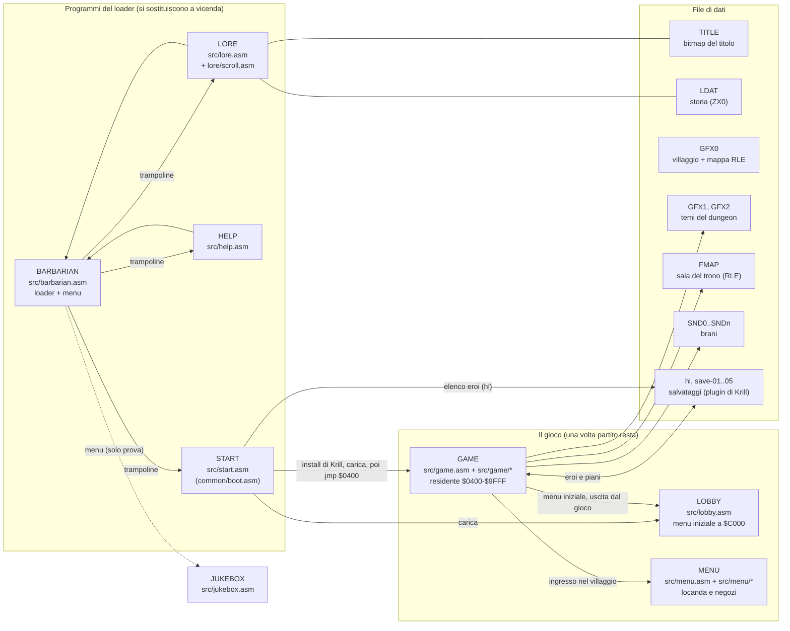
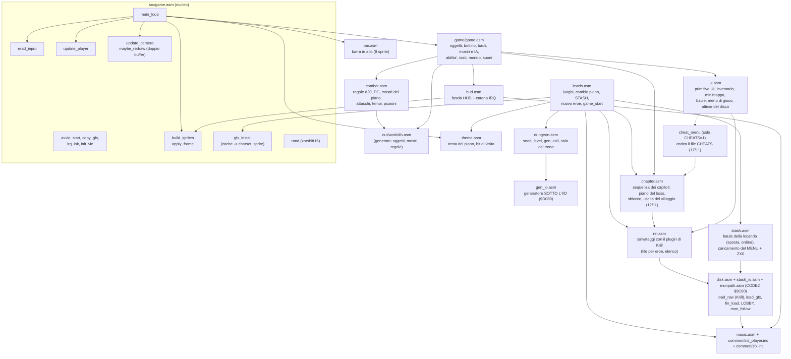
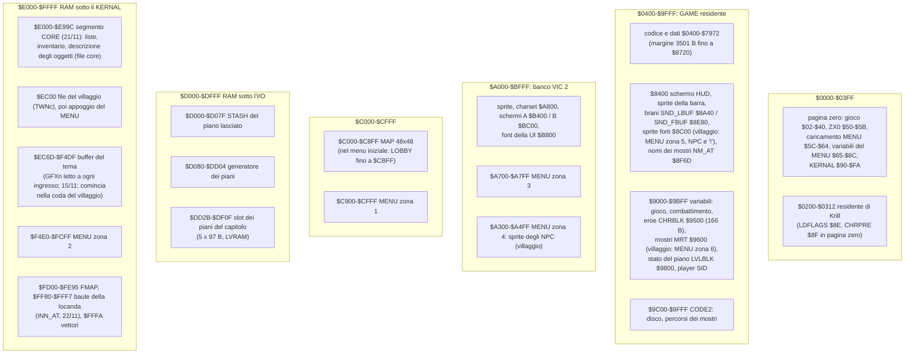
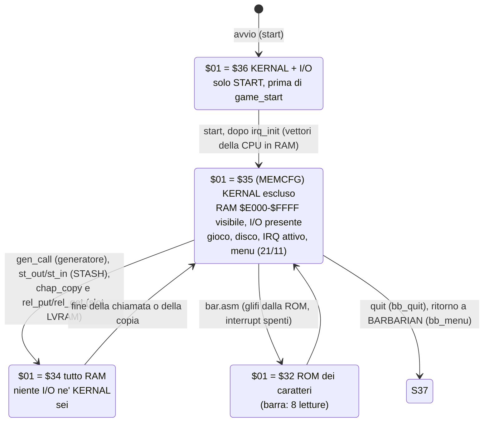

# Architettura del gioco

Copyright © 2026 - Simone Caporale

Vista d'insieme di **come è fatto il codice** (stato dell'11/11, v1.223): programmi e moduli, dipendenze, memoria e suo
ciclo di vita, regole trasversali (banchi `$01`, interruzioni, KERNAL, pagina zero), decisioni con il loro motivo. Per i
dettagli rimanda alle pagine della wiki; i **flussi** del codice (avvio, ciclo per fotogramma, caricamenti, combattimento,
salvataggi...) sono in [Flussi del codice](flussi.md), la **build** in [Build e strumenti](build.md).

Se questa pagina e il codice non coincidono, ha ragione il codice (regola in `CLAUDE.md`).

## 1. I programmi sul disco

Il gioco non è un solo programma: è una catena di programmi che si caricano uno sopra l'altro con il **trampoline**
(`src/common/tramp.inc`, nel buffer della cassetta `$0334`), più file di dati letti dal gioco. Un sorgente principale in
`src/` per ogni file del disco.

| File | Sorgente | Dove gira | Ruolo | Pagina |
|---|---|---|---|---|
| `BARBARIAN` | `src/barbarian.asm` | `$0801` | loader: menu (storia, manuale, gioco); con `POKE 1020,1` prima del `RUN`: subito `START` | [Avvio e storia](intro.md) |
| `START` | `src/start.asm` + `common/boot.asm` | `$0801`, install di Krill a `$0840`, corpo a `$A000` | installa **Krill's Loader** ([FastLoader](FastLoader.md)); barra e musica; carica con Krill `GAME` (ZX0, decompresso sul posto), `LOBBY`, elenco eroi (`hl`); salta a `$0400` | [Avvio e storia](intro.md) |
| `LORE` | `src/lore.asm` + `lore/scroll.asm` | `$0801` / `$A000` | titolo + storia a scorrimento (`LDAT`) | [Avvio e storia](intro.md) |
| `HELP` | `src/help.asm` | `$0801` | il manuale (5 pagine) | [Help](help.md) |
| `GAME` | `src/game.asm` + `src/game/` | `$0400`–`$9FFF` (residente) | il gioco | sotto |
| `LOBBY` | `src/lobby.asm` | `$C000`–`$CBFF` | menu iniziale: elenco eroi, scheda, nuovo eroe; non resta in partita | [Interfaccia](interfaccia.md) |
| `MENU` (un file, 18/11) | `src/menu.asm` + `src/menu/` | zone `$C900`, `$F4E0`, `$A700`, `$A300` (sprite degli NPC, 17/11), `$8C00` (NPC e "!", 18/11) | menu del villaggio: locanda e negozi, un file per zona; caricati all'ingresso nel villaggio, poi residenti | [Tecnica](tecnica.md#moduli-su-disco) |
| codice del piano (19/11, nessun file proprio) | `src/game/ovl_final.asm` (+ `final.asm`), `src/game/ovl_boss1..3.asm` (+ `ovl_boss.inc`) | `$C900`–`$CFFF` (copiato dalla coda di `GFX8`, `GFX2`, `GFX4`, `GFX6`) | sala del trono (evocazioni, leva) e meccaniche dei boss dei capitoli; solo nel suo piano | [Dungeon](dungeon.md#codice-del-piano-1911) |
| `JUKEBOX` | `src/jukebox.asm` | `$0801` | prova di brani ed effetti (i brani sono nel programma: non legge i file `SNDn`) | [Musica](musica.md) |
| dati | `tools/gen_*.py` | — | grafica, mappe, brani, storia, salvataggi | [Build](build.md), [FORMATO_DATI](FORMATO_DATI.md) |

## 2. GAME: i moduli e le loro dipendenze

`src/game.asm` è il programma principale: hardware, pagina zero, avvio, ciclo principale, mappa, input, camera, rendering,
sprite; poi include gli altri moduli in quest'ordine (`.include`), tutti assemblati insieme in un solo PRG.

| Modulo | Righe (11/11) | Responsabilità | Pagina |
|---|---|---|---|
| `src/game.asm` | 1911 | hardware e costanti, pagina zero, variabili, avvio, grafica dei luoghi (cache → charset), palette, PRNG, mappa (`set_tile`), input, `main_loop`, giocatore, camera, rendering a doppio buffer, sprite, dati grafici, inclusioni | [Panoramica](panoramica.md) |
| `game/game.asm` | 3729 | stato del piano e dell'eroe (blocchi salvati), oggetti e inventario, bottino a terra, bauli, mostri (spawn, IA, i 4 più vicini, separazione), attacco e abilità, tasti, mondo (tile, esplorazione, timer, morte), suoni | [Mostri](mostri.md), [Oggetti](oggetti.md), [Bottino](bottino.md) |
| `combat.asm` | 895 | aritmetica (d20, dadi, moltiplicazioni), statistiche del PG, schede dei mostri del piano (`floor_types`), tiro per colpire e danni (`hit_one`, `mon_attack`), usura, tempi di abilità, pozioni | [Combattimento](combattimento.md) |
| `levels.asm` | 1112 | nuovo eroe, villaggio, `enter_gfx`, `load_location`, `place_player`, `change_level`, STASH del piano lasciato, `game_start`, varianti di test `TESTUI` | [Flussi](flussi.md) |
| `dungeon.asm` + `gen_io.asm` | 139 + 840 | generazione dal seed; il generatore vero gira nella RAM sotto l'I/O (`gen_call`, `$01 = $34`); (18/11) stanze, grotte, palude o (19/11) cittadella secondo `lv_look` | [Dungeon](dungeon.md) |
| `core.asm` (`slist.asm`, `inv.asm`) | ~1100 | (21/11, TODO D15) **segmento CORE** a `$E000` (RAM sotto il KERNAL, file `core`): liste a scorrimento (`sl_*`), schermata dell'inventario, descrizione degli oggetti; costruito in due passate come il generatore | [Interfaccia](interfaccia.md) |
| `ui.asm` | 3240 | primitive delle schermate (testo, numeri, riquadri), motore dei menu (`ui_nav`), ingresso dell'inventario, voci condivise coi negozi, minimappa, schermate varie, barra di I/O, menu di gioco, baule del piano | [Interfaccia](interfaccia.md) |
| `stash.asm`, `stash_io.asm` | 135 + 125 | baule della locanda (logica residente), caricamento del modulo MENU (`ovl_town`) e decompressore ZX0; oro del baule (CODE2) | [Villaggio](villaggio.md) |
| `hud.asm`, `bar.asm` | 796 + 798 | fascia HUD in basso e catena degli interrupt raster; barra in alto (vita e nome del bersaglio, 8 sprite) | [Interfaccia](interfaccia.md), [Prestazioni](prestazioni.md) |
| `music.asm` | 361 | richieste di musica, caricamento dei brani, combattimento; player e effetti in `src/common/` | [Musica](musica.md) |
| `theme.asm` | ~50 | `lvl_theme` (piano → file `GFXn`), `vis_bit`. Dall'11/11 (ramo `fast-loader`) il precaricamento in sottofondo e le cache sono tolti | [Flussi](flussi.md#8-precaricamento-del-tema-tolto) |
| `chapter.asm` | ~140 | (12/11) sequenza dei capitoli: `chap_first`, `is_cboss`, `chap_enter` (`lv_cboss`), `chap_won` (sblocco), `at_exit`/`exit_open` (uscita del villaggio), `chap_travel` (passaggio al capitolo dopo) | [Capitoli](capitoli.md) |
| `cheats/menu.asm` (`src/cheats.asm`) | ~150 | (15/11, 17/11) **solo con `CHEATS=1`** (debug e test; la release non ha nulla): menu dei trucchi come **modulo su file** `CHEATS`, letto a `$BC00` (schermo B) quando si apre ed eseguito; in GAME resta `cheat_menu` (~30 B, il caricamento). Fino a 1000 B | [Trucchi](cheats.md) |
| `rel.asm` | ~650 | salvataggi con il plugin di save di Krill: file `save-0N` (eroe + piani), elenco `hl`, stato compatto dei piani | [Salvataggi](salvataggi.md) |
| `disk.asm` | ~180 | nomi dei file, `load_raw`/`load_file` (Krill), grafica, sala del trono, LOBBY (blocco `CODE2` `$9C00`–`$9FFF`) | [Tecnica](tecnica.md) |
| `monpath.asm` | ~70 | (17/11) `mon_follow` e tabelle della ricerca di percorso dei mostri bloccati (`mon_path` sta in `game.asm`; blocco `CODE2`) | [Mostri](mostri.md) |
| `quest.asm` | ~150 | (17/11, concept) NPC del villaggio: punti d'ingresso nel modulo MENU (`npc_tick` → zona 6 in `MRT`, passo dei vaganti fermi con il PG vicino, `src/menu/npc_tick.asm`; `npc_here` → zona 1, chi è accanto; zona 5: piazzamento, sprite e "!", Fire, `src/menu/npc.asm`); `ui_quest` che legge ed esegue il file `QST0` (18/11: elenco e dettaglio) | [Quest](quests.md) |
| `src/qpage.asm` | ~330 | (17/11; 18/11 elenco e dettaglio) pagine delle quest: modulo in testa al file `QST0` (con l'indice), eseguito a `$BC00`; legge il testo `QSTn` a `$B000` | [Quest](quests.md) |
| `src/menu/*` (modulo MENU) | 1765 | locanda (`inn.asm`, `inn_eq.asm`), negozi (`shop.asm`, `shop_act.asm`, `shop_fix.asm`) | [Villaggio](villaggio.md) |

**Dati generati** che GAME include (cartella `out/`): `db.asm` (oggetti, mostri, regole, negozi: `tools/build/gen_db.py` da
`data/*.yaml`, `data/items/items.tsv`, `data/monsters/bestiary.tsv`), `gfx_consts.inc` (tile e sprite), `town_places.inc`
(porte per la minimappa), `final_map.inc` (sala del trono), `music_tab.inc`, `version.inc`, `pack.inc`. Dettagli in
[Build e strumenti](build.md).

## 3. La memoria e il suo ciclo di vita

Mappe automatiche (Lab64), **una per programma** del disco (i programmi della sezione 1 si sostituiscono in memoria):
[indice](../../out/work/memory-map/index.html), [GAME](../../out/work/memory-map/program-game.html); dichiarazione e confronto dei numeri
in [Build](build.md) sezione 4a. Qui le zone di GAME e **chi le possiede quando**.

| Zona | Scritta da | Valida fino a | Note |
|---|---|---|---|
| GAME `$0400`–`$9FFF` | `START` (ZX0 sul posto) | sempre | la coda del PRG (grafica fissa, immagine del generatore compressa ZX0 dal 21/11) è copiata (il generatore decompresso) all'avvio e poi è dato morto |
| `MAP` `$C000`–`$C8FF` | `gfx_install` (villaggio: RLE dalla cache) / `gen_dungeon` (dal seed) / `fin_load` | cambio di luogo | nel menu iniziale la copre il LOBBY |
| LOBBY `$C000`–`$CBFF` | `START` la prima volta, poi `load_menu` | inizio della partita | copre anche `$C900`–`$CBFF`: per questo `ovl_cur` = 0 |
| MENU zona 1/2/3 | `ovl_town` a **ogni** ingresso nel villaggio (`enter_gfx` azzera `ovl_cur`) | uscita dal villaggio | dentro una visita al villaggio restano |
| codice del piano `$C900`–`$CFFF` (19/11) | `ovp_copy` (`gfx_tail`) dalla coda del tema del piano (oggi `GFX8`, sala del trono) | lettura del tema successivo | nel dungeon la zona 1 del MENU è libera: [dungeon](dungeon.md#codice-del-piano-1911) |
| STASH `$D000`–`$D07F` | `st_out` (portale, morte) | rientro nel piano (`st_in`) o cambio | boss, 5 mostri caldi e 10 bauli lasciati del piano lasciato (19/11) |
| generatore `$D080`– | avvio (`gen_install`) | sempre | eseguito con `$01 = $34` |
| modulo CSHEET `$EC00`– (21/11 sera) | `cs_load` (file `csheet`) col tasto C | finché un caricamento (`load_file`/`load_raw`) o un salvataggio non lo copre (`cs_ok` = 0) | la schermata del personaggio (`src/csheet.asm`, `src/csheet/charsheet.asm`, assemblata con `game.lbl`); fino a ~1,4 s di lettura (soglia del committente 2 s, PERF-DISK) |
| segmento CORE `$E000`–`core_end` (21/11, TODO D15) | `core_need` (file `core`): alla prima schermata, in `sv_write` dopo ogni salvataggio, in `ui_begin`, `ui_inventory` e `main_loop` se manca | finché un salvataggio o una lettura dell'eroe (`sv_read`, `sv_save`: `core_ok` = 0) non lo copre | codice di GAME fuori dal PRG: liste a scorrimento, inventario, descrizione degli oggetti (`src/game/core.asm`); il KERNAL sempre escluso lo rende chiamabile come il resto del gioco. Fine al massimo all'inizio dell'appoggio del file MENU (`ML_LO` = `core_end`, `pack_menu.py`) |
| file del villaggio `$EC00` (21/11; prima `$E000`) | `load_gfx 0` | `gfx_install` lo usa subito; poi il file MENU ci si appoggia (18/11) | (11/11) nessuna cache: si rilegge a ogni ingresso; dal 18/11 non si rilegge dopo un salvataggio; copre la zona 2 del MENU, che si rilegge a ogni ingresso nel villaggio |
| immagine del salvataggio `$E000`, buffer del plugin `$ECE0` | `sv_read` / plugin di save | fine del salvataggio | solo durante un salvataggio (interrupt spenti) |
| buffer del tema `GFX_DUN_AT` (`$EC6D`)–`$F4DF` | `load_gfx n` | `gfx_install` (poi dato morto: un salvataggio lo copre) | (15/11) i primi 147 B sono la coda del buffer del villaggio: villaggio e dungeon non sono mai in RAM insieme |
| colori e nomi dei mostri `NM_AT` (`$8F6D`–`$8FFF`) | `gfx_install` (blocco info del tema) | tema successivo | (15/11) `build_sprites` (colore), `bar_name` (nome) |
| FMAP `$FD00` | `fin_load` | ingresso successivo | mappa di base del piano 20, riletta a ogni ingresso |
| slot dei piani `$DD05`–`$DED5` (`LVRAM`) | `save_level` (scale, portale, morte), `chap_ensure` (dal file) | cambio di capitolo | stato compatto dei 5 piani del capitolo (11/11 sera): sul disco solo con save game e al cambio di capitolo |
| `hl`, `save-0N` (disco) | `sv_all` (save game, cambio di capitolo), `save_char` (nuovo eroe), `hdr_write` | — | file riscritti interi dal plugin di Krill, la directory non cambia mai |

## 4. Regole trasversali

### Banchi di memoria (`$01`)

- (21/11, TODO D15) **KERNAL sempre escluso**: dopo `start` il gioco gira con `$01 = MEMCFG = $35`. Il KERNAL non serve più
  (Krill non lo usa, tastiera e IRQ sono del gioco): i vettori della CPU sono nella RAM sotto il KERNAL (`irq_init`: IRQ →
  `irq_entry`, copia esatta dell'ingresso della ROM `$FF48`, stessi cicli; NMI → `nmi_stub`), l'IRQ esce da `irq_exit` (copia
  di `$EA81`). La RAM `$E000-$FFF9` è memoria normale: niente cambi di banco per leggerla (cache, MENU zona 2, immagine del
  salvataggio). `$37` solo per uscire (`bb_quit`, `bb_menu`).
- **Codice sotto l'I/O** (generatore) si esegue solo con `$01 = $34` e interruzioni spente: non deve toccare VIC, SID, CIA,
  colori, KERNAL, disco (regola di `CLAUDE.md`).
- **Il disco usa Krill's Loader** (11/11, [FastLoader](FastLoader.md)): `loadraw` con `$01 = $35` (dal 21/11; prima `$36`)
  e IRQ accesi; il plugin di save con interruzioni spente (immagine e buffer sotto il KERNAL). Prima di ogni operazione
  `snd_io` (musica zitta). Dopo `START` il KERNAL non può più usare il drive. `$DD00`: si scrive solo il banco VIC.

### Interruzioni

- Solo l'**IRQ raster** (CIA spente all'avvio: `$DC0D`/`$DD0D` = `$7F`); (21/11) vettore della CPU `$FFFE` → `irq_entry`
  (copia dell'ingresso della ROM, poi `jmp ($0314)` → `irq_h`), uscita con `jmp irq_exit` (copia di `$EA81`, in RAM). NMI
  (RESTORE) → `nmi_stub` (`rti`) da `$FFFA` e da `$0318`.
- In gioco la catena raster divide lo schermo in campo di gioco e HUD ([Flussi](flussi.md#interrupt-raster)); musica ed
  effetti (`sfx_update`) girano nell'IRQ di fine HUD.
- Nelle schermate (`ui_begin`) l'IRQ raster è **spento** (`irq_off`, `sei`): la musica gira chiamando `sfx_update` da
  `ui_input` a ogni fotogramma; `ui_exit` la riaccende (`irq_on`).
- Durante i caricamenti lo schermo è nero (`change_level`) o mostra titolo e "please wait" (`io_screen`): niente barre.

### Pagina zero

| Indirizzi | Uso |
|---|---|
| `$02`–`$3A` | temporanei `tmp0`-`tmp7`, puntatori `ptr0`-`ptr3`, `rnd`, PG `px`/`py`, camera, schermo attivo, `tx`/`ty`, joystick, puntatori della UI |
| `$3B`–`$40` | (11/11) `ui_cur`, `ui_n`, `ui_col`, `ui_ib`, `ui_sel`, `ui_lc` |
| `$41`–`$47` | Krill's Loader durante un caricamento (`$41`–`$57` con il plugin di save) |
| `$48`–`$4F` | libera (`$4A`/`$4B` = `rpt`, flusso dei salvataggi) |
| `$50`–`$5B` | `ZX_ZP`: decompressore ZX0 (in START e nel gioco) |
| `$5C`–`$62` | `ml_src`, `ml_i`: caricamento del MENU |
| `$65`–`$81` | variabili della locanda (modulo MENU) |
| `$82`–`$8C` | variabili dei negozi (modulo MENU) |
| `$8D` | libera |
| `$8E`, `$8F` | `LDFLAGS`, `CHRPRE`: segnali di START al gioco (11/11) |
| `$90`–`$FA` | KERNAL (dall'11/11 il disco non passa più dal KERNAL; tastiera non usata) |

### Determinismo

Un piano dipende solo da **seed dell'eroe + numero del piano** (`seed_level`): generazione, mostri, bauli, boss. Il
generatore casuale è deterministico fino a `init_monsters_rt`, poi si mescola con raster e timer della CIA. Ogni
cambiamento del generatore cambia i piani salvati: lo controlla `tests/regression/gen/test_gen.py`, che confronta con
mappe di riferimento ([Dungeon](dungeon.md)).

## 5. Decisioni architetturali (perché è fatto così)

| Decisione | Motivo | Dove |
|---|---|---|
| Catena di programmi con trampoline, invece di un solo PRG | ogni programma ha tutta la RAM; il gioco non porta con sé titolo, storia e manuale | [Avvio](intro.md) |
| `GAME` compresso ZX0, decompresso sul posto | avvio da 154 a 111 s (1541 a velocità KERNAL) | [FORMATO_DATI](FORMATO_DATI.md#compressione-zx0) |
| Piani generati dal seed, salvato solo lo stato compatto (82–93 B) | un posto fisso per piano nel file dell'eroe; mappe mai su disco | [Salvataggi](salvataggi.md) |
| Krill's Loader r194 per caricamenti e salvataggi (11/11) | caricamenti dal 26% al 78% più veloci; salvataggi più lenti (file intero); un file per eroe per avere pochi file | [FastLoader](FastLoader.md) |
| Generatore nella RAM sotto l'I/O | +1,1 KB di margine per GAME | [Dungeon](dungeon.md) |
| ~~Cache della grafica e precaricamento del tema~~ (tolti l'11/11, ramo `fast-loader`) | erano: villaggio e temi senza disco al ritorno; il disco in sottofondo | [Flussi](flussi.md#8-precaricamento-del-tema-tolto) |
| Menu del villaggio nel modulo MENU residente (11/11) | priorità del committente: spazio del codice, velocità, RAM; 3501 B liberi in GAME | [Prestazioni](prestazioni.md) |
| Menu iniziale LOBBY fuori da GAME, al posto della mappa | non occupa RAM durante la partita | [Interfaccia](interfaccia.md) |
| Un solo player SID per loader, gioco e jukebox | un formato di brano, un codice da mantenere | [Musica](musica.md) |
| Regole e dati in YAML/TSV, generati in `db.asm` | simulatori (`tools/simulators/`) e gioco leggono gli stessi numeri | [Bilanciamento](balancing-guide.md) |
| Una build, un solo disco (11/11 sera; prima due, un byte di differenza) | deriva zero fra sviluppo e release; `POKE 1020,1` per lo sviluppo | [Build](build.md) |

## 6. Dove guardare

- Gameplay e ciclo per fotogramma: [Panoramica](panoramica.md).
- Flussi del codice (sequenze e stati): [Flussi del codice](flussi.md).
- Build, generatori, test: [Build e strumenti](build.md), [Test](test.md).
- Byte per byte: [FORMATO_DATI](FORMATO_DATI.md), [mappa di GAME](../../out/work/memory-map/program-game.html) (zone, campi di `CHRBLK` e `LVLBLK`, scenari).
