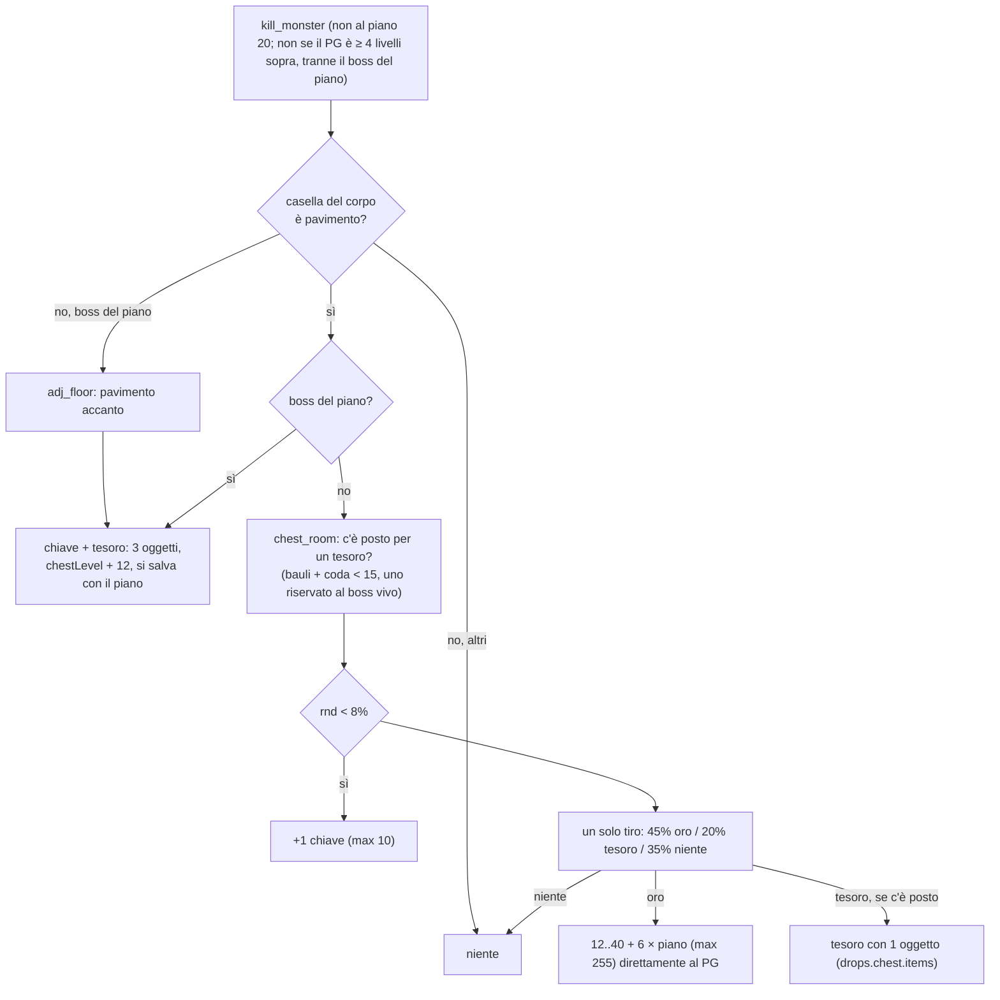
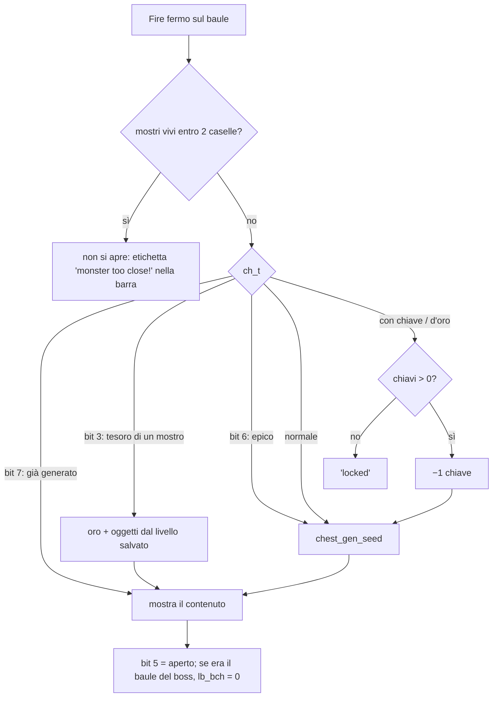
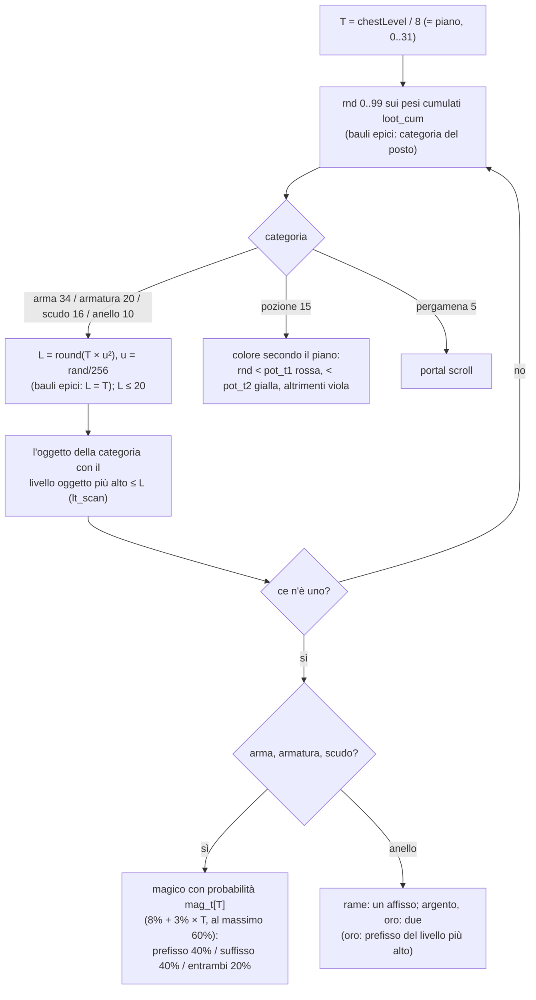

# Bottino e bauli

Sorgenti: `src/game/game.asm` (`roll_loot`, `mon_ll`, `defer_drop`, `drop_now`, `drop_chest`, `find_free`,
`place_chests`, `chest_open`, `chest_gen_seed`, `ch_goldroll`, `gen_item`, `lt_scan`), `src/game/dungeon.asm`
(`fin_chests`), `src/game/ui.asm` (`ui_chest`). Dati: `data/balance.yaml` (`drops`, `chest_level`, `chests`, `loot`,
`boss`) → `out/work/db.asm`. Simulazione: `tools/simulators/sim_chest.py`, `tools/simulators/sim_gold.py`.

## chestLevel

Ogni baule o tesoro ha un **chestLevel** CL (`gi_ll`, byte 1..255) che decide oggetti, magia e oro
(formula del 06/11, `balance.yaml chest_level`, `per_floor` = 8):

| Origine | chestLevel |
|---|---|
| mostro comune (`mon_ll`) | 8 × piano + 4 × `loot_level_bonus` del tipo (0..3) + 4 se variante forte ± 4 secondo la vita (sotto) |
| boss del piano | come sopra + 12 (`BOSS_LL_ADD`) |
| baule normale del piano | 8 × (piano + 0..1, il minore di due tiri) |
| baule con chiave | 8 × (piano + 1..3) |
| baule d'oro | 8 × (piano + 3..5) |
| baule epico (piano 20) | 255 |

Vita: il mostro nasce con vita media × (96..160)/128; se la sua vita massima supera la media del tipo di più
di 1/8 il tesoro vale +4, se è sotto di più di 1/8 vale −4 (`CL_HP`). Tutto saturato a 255, minimo 1.
Il chestLevel si calcola **al momento della morte** (nulla della vita resta in RAM) e si conserva nel tesoro
(`ch_b[0]`) fino alla prima apertura; nell'Abisso potrà crescere fino a 255 (piano ~30).

## Cosa lascia un mostro (`roll_loot`)

- I tesori non compaiono subito: vanno in coda (`defer_drop`, 8 posti) e `drops_tick` li piazza **uno per
  fotogramma a combattimento finito** (`cmb_t` = 0: 100 fotogrammi senza mostri a contatto). Se la coda è piena il tesoro va
  giù subito. Prima di salvare o lasciare il piano la coda si svuota (`flush_drops`).
- Posizione (`find_free`): ricerca in ampiezza dalla casella del corpo fino alla prima casella di pavimento
  libera (niente bauli, oggetti, mostri vivi, PG) raggiungibile; in ripiego una casella adiacente, altrimenti il
  corpo stesso.
- Massimo 15 bauli nel piano (`CH_MAX`), compresi quelli del piano.
- (22/11, committente) **Il boss del piano lascia sempre il suo baule** (non il boss finale, piano 20): anche con il PG 4 o più
  livelli sopra (per gli altri mostri niente bottino) e anche se muore su una scala, una porta o un arredo (il baule va su
  una casella di pavimento accanto, `adj_floor`; se non ce n'è nessuna, niente). Test `LOOT-BOSS-10`, `LOOT-BOSS-11`.
- (22/11, correzione) Fino al 22/11 `kill_monster` prendeva la riga del corpo dal mostro sbagliato (`mon_tx` non conserva X:
  `mon_ty` leggeva la riga del mostro numero "colonna / 16"): i tesori e il baule del boss cadevano su un'altra riga o, su un
  muro, non cadevano affatto. Probabile causa del "campione che non lascia il baule".

### Tesoro di un mostro: contenuto alla prima apertura
Il tesoro nasce con il bit 3 di `ch_t` e conserva solo **numero di oggetti** (`ch_i[0]`) e **chestLevel**
(`ch_b[0]`). Alla prima apertura (`chest_open`, ramo `_drop`) si generano l'oro (dato subito) e gli oggetti; il
bit 3 si spegne e si accende il bit 7 (contenuto generato).

## Bauli del piano (`place_chests`)

Generati dal seed con il piano, **al massimo 4** (`CH_GEN_MAX`), marcati con il bit 4 di `ch_t`:

1. **Baule d'oro** (dal piano 3, 55%): accanto al mostro con il numero di tipo più alto, se è almeno un
   zombie (tipo ≥ 3). Serve una chiave.
2. Poi stanza per stanza (esclusa quella delle scale su), finché i bauli sono meno di 4:
   - **normale**: 27% per stanza, si apre senza chiave, 1..2 oggetti;
   - **con chiave** (dal piano 2): 16% per stanza, al più 2 per piano, 2..3 oggetti.
   Il baule d'oro dà 3 oggetti.

Il contenuto dei bauli del piano si genera alla prima apertura dal **seed del baule** (`chest_gen_seed`:
`seed_level` + coordinate del baule): ricaricando si ritrova lo stesso contenuto. Un baule aperto sparisce
cambiando piano (anche se non vuoto).

## Apertura (`chest_fire` → `chest_open` → `ui_chest`)

- Oro all'apertura (`ch_goldroll`): T × 3 .. T × 7 (T = chestLevel / 8, max 255), aggiunto subito al PG.
- Nella schermata: Fire prende la voce, A prende tutto, I chiude. Un baule svuotato sparisce dalla mappa.

Con un mostro vivo entro 2 caselle (distanza di Chebyshev < 3, `chest_blocked`) il Fire sul baule è rifiutato e la barra
mostra **"monster too close!"** (`ch_blk` = 1, etichetta 15, `ls_near`) finché il PG non cambia casella. Decisione
del committente dell'11/11: il messaggio **resta** nel gioco (test `DUNG-CHEST-11`).

## Generazione di un oggetto (`gen_item`)

`u²` schiaccia il livello verso il basso: metà degli oggetti ha L ≤ T/4, uno su dieci L ≥ 0,8 T. Così i tesori
danno quasi sempre roba scarsa (pugnale, cuoio, scudo piccolo: livello oggetto 0) ma ogni tanto l'oggetto che
permette di scendere (la spada vichinga, livello 12, compare dal piano 11 nei tesori del boss e dal 13 in quelli
comuni, con il 2–11% dei tiri d'arma; `tools/simulators/sim_chest.py` stampa la tabella per piano). **Affissi** (21/11 sera, fase 3: `af_gen` / `af_pick` in `combat.asm`, regole in
`data/items/next/affix_rules.yaml`, modello `tools/simulators/items_model.py`): la probabilità di un oggetto magico cresce con T; la riga
si sceglie fra quelle del tipo dell'oggetto con `min_level` ≤ L, prima decidendo se maledetta (5%, a ogni livello), poi nella
**finestra** 2 × `min_level` ≥ min(L, 20) (se nessuna, senza finestra), pesata da `chance`. Un oggetto di livello 0 non ha righe
adatte: resta bianco. **Unici** (22/11, decisione D9 del committente, [quests](quests.md) sezione 0): **mai** dai tesori normali, dai bauli epici o
dai negozi (`af_gen` non li genera più; dal 22/11 mattina al 22/11 pomeriggio `un_roll` li tirava nella finestra di livelli con
probabilità 4/256). Gli unici della **trama** vengono solo dalle **quest** (premio `unique` di `quests.yaml`); gli **altri** solo
dal **baule del boss**, alla prima apertura (`bu_roll` in `combat.asm`, chiamata da `chest_open` dopo `chest_fill`): se il
sottoinsieme del capitolo `c_chap` non è vuoto (colonna `boss_chapter` di `data/items/next/uniques.tsv`, tabella `un_bch`), con
probabilità `UNB_C`/256 = 50% per il **boss del capitolo** (piano multiplo di 5) e `UNB_N`/256 = 12,5% per il **boss con nome**
degli altri piani (`boss_unique` di `affix_rules.yaml`) uno di loro a caso prende il posto del primo oggetto del baule (base
dell'unico, prefisso 0, suffisso $80 + numero). Sottoinsiemi di oggi (prima proposta, da rivedere con i boss dei capitoli, D8):
capitolo 1 warchief's hide e bone king's ward (D17, 22/11: armatura e scudo nuovi, livelli 2-6); 2 censer-bearer, stitchripper; 3 oath blade; 4 tithe-taker, ruin's crown. Simulatore:
`items_model.boss_unique_roll`. Test: `BU-10`, `BU-11`, `UNQ-13`.

## Bauli epici della sala del trono

Il boss finale e le sue evocazioni non lasciano nulla: i premi sono i 4 bauli della stanza dei tesori, uno per
categoria nell'ordine dei posti (armi, armature, scudi, anelli: `gi_force`), chestLevel 255 e L = T (sempre
l'oggetto migliore: dal 21/11 great sword, gothic plate, gothic shield, gold ring, magia fino a +3), `EPIC_ITEMS` (3)
oggetti e `FIN_GOLD` monete ciascuno. `FIN_GOLD` = 430: il 10% dell'oro raccoglibile uccidendo tutti i mostri e
aprendo tutti i bauli dei piani 1–19 (~17 000 con la stima del 10/11; ~14 300 con il censimento del 20/11,
`tools/simulators/sim_gold.py`, cioè ~360 a baule: da ritoccare con E4) diviso sui 4 bauli.

## Chiavi

Massimo 10 (`c_keys`), mostrate nell'HUD. Si trovano: 8% per mostro ucciso, sempre dal boss del piano. Servono
per i bauli con chiave e d'oro (una per baule).

## Oggetti a terra: tolti (06/11 sera)

Il vecchio sistema degli oggetti lasciati a terra e raccolti passandoci sopra (`gi_add`, `apply_items`, `pickup`,
`pk_retile`, variabili `gi_x/gi_y/gi_k/gi_v/gi_b` in `LVLBLK`, tile `LGOLD`, `LPOTION`, `LSCROLL`, `LITEM`) non era
più usato dal gioco dal passaggio del bottino ai bauli: lo metteva solo la build di prova `TESTSP=1` (e quindi la
copertina del manuale mostrava un'ampolla a terra). Tolto tutto: ~250 B di codice e 80 B di variabili; i posti dei
tile 8–11 dei dungeon sono **liberi** (`FREE8`..`FREE11`, solidi, senza grafica; nel villaggio restano lapidi e
cripta). Il bottino sta solo nei bauli.

## Un solo tile per i bauli (10/11, decisione del committente)

I tile del baule con la chiave (`KCHEST`) e del baule d'oro (`GCHEST`) erano troppo simili al baule normale: tolti. Tutti i
bauli (normale, con la chiave, d'oro, epico della sala del trono) si disegnano con **`T_CHEST`**; il tipo stava già nella
tabella dei bauli (`ch_t` & 3: 1 normale, 2 chiave, 3 oro, bit 6 epico), che resta l'unica fonte: `apply_chests` e la
creazione del baule mettono sempre `T_CHEST`; i controlli `T_CHEST..T_GCHEST` (percorribilità `bf_walk`, `tile_trigger`,
Fire in `act_tick`) sono diventati `= T_CHEST`; l'etichetta della riga del bersaglio (`loc_id`, "chest", "locked chest",
"golden chest", "epic chest") e la chiave richiesta leggono il tipo da `ch_t` tramite `chest_here` (che ora restituisce
anche l'indice del baule). Il titolo della schermata del baule usava già `ch_t`. Nessun cambio dei salvataggi (la mappa non
si salva; i bauli sì, con `ch_t`) né del generatore. GAME: −22 B. I posti 25 e 26 dei file dei dungeon sono liberi
(`FREE25`, `FREE26`); nel villaggio ospitano la cripta, quindi lì non si libera nulla (45 su 45).
