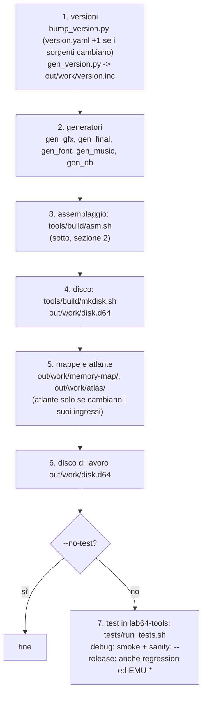
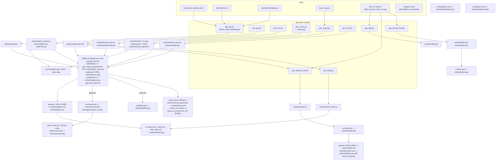
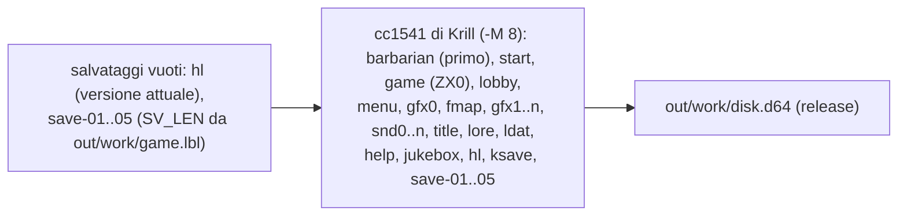
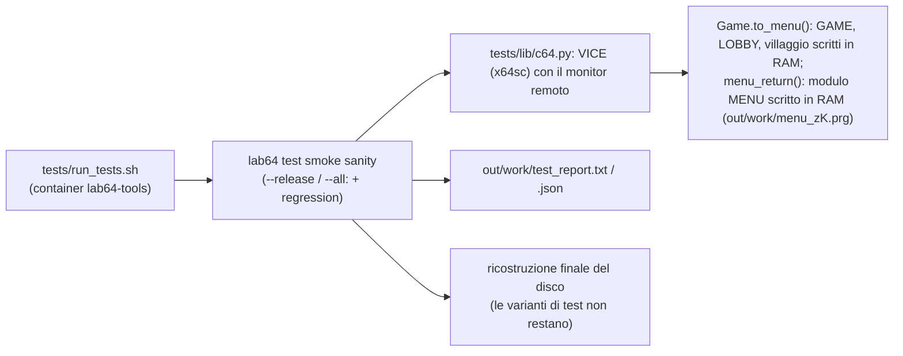

# Build e strumenti

Copyright © 2026 - Simone Caporale

Come si passa dai **sorgenti** (`src/`, `data/`, `tools/`) al **disco** e ai documenti generati (stato del 13/11, v1.227).
**Panoramica di build e test, container e comandi: [Getting started](../getting-started.md)** (da leggere prima). Le regole (quando si
fa la build di release, versioni, commit) sono in `CLAUDE.md`; i test in [Test](test.md); la struttura del codice in
[Architettura](architettura.md). Tutti i passi girano nel container `lab64-tools` (i test in `lab64-tools`).

## 1. Il percorso completo (`./build.sh` -> `tools/build/build_game.sh`)

| Comando | Cosa fa |
|---|---|
| `./build.sh` | **tutto**: disco, mappe, atlante, smoke e sanity (devono passare prima di ogni commit) e manuale PDF |
| `./build.sh --fast` | solo il disco + smoke e sanity (salta atlante, mappe, manuale: `--no-atlas`, `--no-maps`, `--no-manual`, tutti separati) |
| `./build.sh --no-test` | salta smoke e sanity (si combina con `--fast`) |
| `./build.sh --release` | la stessa build (GAME compresso in modo ottimo, `ZX0_BEST=1`) con **tutti** i test (anche regression ed `EMU-*`), manuale PDF (`lab64-pdf-gen`) e `tools/build/release.sh` (senza zip dei sorgenti) (disco, mappe, zip dei sorgenti in `out/`); solo quando la chiede il committente |
| `./build.sh --manual` | solo il manuale (`out/work/manual/`, poi copiato in `out/releases/v<V>/`) |
| `./build.sh --keep N` | quante versioni tenere in `out/releases/` (default 5, anche `KEEP_VERSIONS=N`) |
| `lab64 run tools/build/asm.sh [test]` | solo generatori del gioco + assemblaggio (con `test`: varianti `TESTUI`, `NOKEYS`... per screenshot e prove) |
| `lab64 run tools/build/asm.sh release-game` | (15/11) solo GAME con i flag della release (`CHEATS=0`) in `out/tmp/release_game.prg/.lst/.lbl`, senza generatori ne' disco (serve una build gia' fatta): il controllo che la release non abbia i trucchi (`CHEAT-22`) |

### Debug e release: che cosa cambia (15/11)

`tools/build/build_game.sh` stampa `build debug` o `build release + debug`: la release e' la build di debug **piu'** ZX0 ottimo
(`ZX0_BEST=1`), regression ed `EMU-*`, manuale `--strict` e `tools/build/release.sh`. Il codice del gioco cambia in **un solo
punto**, il flag dell'assemblatore **`CHEATS`** (`-D CHEATS=...`, scelto da `tools/build/asm.sh` con `RELEASE`, che `./build.sh
--release` esporta e `lab64.env` passa ai container):

| Build | `CHEATS` | Effetto |
|---|---|---|
| debug (`./build.sh`, `--fast`, `tools/build/asm.sh`) | 1 | voce **cheats** nel menu di gioco (RUN/STOP), modulo `CHEATS` sul disco (`src/cheats.asm`, `src/cheats/menu.asm`; 17/11) |
| test (`tools/build/asm.sh test`, anche durante la release) | 1 | come la debug (i test `CHEAT-*` e lo screenshot `trucchi`) |
| release (`RELEASE=1`: GAME assemblato da `build_game.sh` e rifatto da `tests/run_tests.sh` alla fine dei test) | 0 | **nessun byte** dei trucchi: GAME e listato identici a quelli di prima dei trucchi (a parte la versione e la riga del `-D`) |

A mano: `CHEATS=0 ./build.sh --fast` (debug senza trucchi; i test `CHEAT-10..21` diventano SKIP), `CHEATS=1 RELEASE=1 ...` (release
con i trucchi, solo per prove), `CHEATS=0 lab64 run tools/build/asm.sh test` (varianti di test senza trucchi: lo fa
`tools/vice/shots_manual.sh`, il manuale e' per i giocatori). Durante `./build.sh --release` i test girano sulla GAME della
release: `CHEAT-10..21` sono SKIP e `CHEAT-22` controlla che non ci siano trucchi.

## 2. Assemblaggio (`tools/build/asm.sh`)

- **GAME in due passate** (21/11, `asm_game` in `asm.sh`, per la build normale, l'arena e `release-game`): la prima
  (`GENPASS=1`) mette il codice del generatore dopo `CODE2` solo per leggerne i byte, `tools/build/gen_imgz.py` li comprime ZX0
  in `out/work/gen_img.zx0` (3243 → 2177 B), la seconda (`GENPASS=2`) li include dopo la grafica fissa e tiene il generatore in
  un blocco virtuale (etichette identiche nelle due passate); `copy_gfx` lo decomprime a `GEN_AT` all'avvio. Il PRG di GAME
  finisce ~1 KB prima (`$96F6` invece di `$9B28`): le varianti di test con più codice restano sotto `$9C00`.
- **Segmento CORE** (21/11, TODO D15): la prima passata assembla anche `src/game/core.asm` dopo il generatore (`core_raw`, logico
  a `CORE_AT` = `$E000`), `gen_imgz.py` ne scrive il PRG non compresso (`out/work/core.prg`; arena e `release-game`:
  `arena_core.prg`, `release_core.prg`, accanto al loro PRG), la seconda ne tiene solo le etichette (blocco virtuale). Il file `core`
  sta sul disco fra `ksave` e `save-01` (si rilegge dopo ogni salvataggio). Non e' compresso: ZX0 risparmierebbe 2 blocchi (2461 -> 1854 B) ma non
  tempo (Krill lo legge direttamente a `$E000`, niente appoggio).
- **Ordine obbligato**: GAME per primo (le sue etichette `out/work/game.lbl` servono a LOBBY e MENU, che lo chiamano);
  `pack.py` dopo GAME (START deve sapere dove caricare il flusso compresso: `out/work/pack.inc`); START dopo (conosce anche la
  dimensione di GAME + LOBBY + GFX0 per dosare la barra, `OTHERS`).
- **Controlli in assemblaggio**: margine del codice (`.cerror`, avviso sotto 1 KB sotto `$8720`; dal 23/11 alle 02 `$86F8`, poi di nuovo `$8720` con l'HUD compatto), zone del MENU, cache
  del tema, pagina zero, generatore sotto l'I/O. La build stampa i margini:
  `margine codice: N B (di cui M prima del plugin di Krill)` e `menu: zona 1 ... libera N B`.
- **Passi lenti in cache** (`tools/build/cache_run.py`): girano solo se cambiano i loro ingressi (storia `gen_lore`, manuale
  `gen_help`, atlante `gen_atlas`); impronta SHA-1 di ingressi e uscite.
- **Compressione** (`tools/build/pack.py`, zx0 di `lab64-tools`): modo rapido nelle build normali, ottimo con `ZX0_BEST=1`
  (`tools/build/release.sh`); cache in `out/cache/zx0/`; decompressore di riferimento `tools/build/zx0dec.py`.

## 3. Il disco (`tools/build/mkdisk.sh`)

**Un solo disco** (11/11 sera, regola del committente): per lo sviluppo `POKE 1020,1` prima del `RUN` salta il menu del
loader. Comporre il disco costa ~0,1 s. Dall'11/11 il disco lo scrive il `cc1541` di Krill's Loader
(hash dei nomi a 8 caratteri, collisioni rifiutate); i salvataggi sono file preallocati ([FastLoader](FastLoader.md)).

### Krill's Loader (`tools/build/krill_build.sh`, dall'11/11)

`tools/build/asm.sh` lo chiama per primo: scompatta `src/third-party/krill/loader-v194.zip` in `out/work/krill/pkg` (usa e getta),
costruisce install, residente e plugin di save con `ca65`/`ld65` e `src/common/krill/loaderconfig.inc` (indirizzi:
`INSTALL` `$0840`, `RESIDENT` `$0200`, `TRANSIENT` `$7D00`, pagina zero `$41`), compila `cc1541` e scrive
`out/work/krill.inc` (`tools/build/krill_syms.py`) per 64tass. ~1,3 s.

## 4. Strumenti di supporto

| Strumento | Uso |
|---|---|
| `containers/tools/memmap/c64map.py` di Lab64 (14/11, generico) | (15/11, Lab64 1.4) **una mappa per programma**: il disco ha programmi che si sostituiscono in memoria (BARBARIAN, LORE, HELP, START, GAME, JUKEBOX), dichiarati in `lab64.env` con `C64_MAP_PROGRAM_<NOME>="file principale, poi i file che carica"` (sezione 4a). `out/work/memory-map/index.html` = **indice** dei programmi, `program-<nome>.html` = mappa di un programma, `memmap.json` (`schema` 2) a ogni build: mappa **automatica**, dai listati di 64tass (`-L`), dalle etichette (`-l`) e dal disco. Moduli = listati il cui file e' sul disco (stesso contenuto o stesso nome: `game` compresso, `menu` diviso in `menu1..4`); per ogni byte: indirizzo nel file, indirizzo di esecuzione (`.logical`) e file sorgente; variabili di `.virtual`; indirizzi usati dalle istruzioni (pagina zero, I/O, KERNAL). Mostra: panoramica per pagine, strati per modulo, spazio libero per banco, moduli nella stessa memoria (overlay), disco completo. **Analisi statica**: non vede dati copiati o decompressi all'avvio, buffer dietro puntatori, dati che diventano liberi (es. `gfx_data` dopo `copy_gfx`). Verifica: il libero `$9E7B-$9FFF` = 389 B coincide con il margine del blocco `$9C00` di `asm.sh`. **Sonda in VICE** (14/11, `./build.sh --probe`, `memmap/probe.py` di Lab64): con `C64_MEMPROBE=1` ogni sessione VICE dei test (`tests/lib/c64.py`) riempie la RAM (`$033C-$03FB`, `$0400-$07FF`, `$0803-$FFFF`, anche sotto ROM e I/O) con uno schema noto subito dopo il boot e la salva alla fine in `out/work/memprobe/` (scenario = modulo dei test, impronta del disco); `c64map.py` usa solo i dump fatti con lo stesso disco e aggiunge la sezione "Measured in VICE" (byte mai scritti per banco e per pagina, confronto con l'analisi statica, scenari) e la misura `ram_never_written`. Misurato [14/11]: smoke + sanity con la sonda 28,6 s contro 29,8 s senza (una misura per parte: costo trascurabile); mai scritti 1862 B in 3 sessioni, fra cui `$9E7D-$9FFF` (387 B: il libero statico del blocco `$9C00` meno 2 byte). Limiti: vede solo cio' che i test eseguono; le scorciatoie del monitor contano come scritture; un byte scritto con lo stesso valore dello schema sembra intatto (schema senza `$00`/`$FF`/`$20`). `memmap.json` porta anche `metrics`, una serie per programma (`ram_free_static_game`, `ram_never_written_game`, ...: fino al 15/11 `ram_free_static` era la somma di tutti i programmi), che `publish.py` mette nel manifest quando pubblica le mappe. I dump della sonda vanno al programma il cui file principale e' in RAM alla fine della sessione. (15/11, Lab64 1.5) annotazioni, memoria libera per uso, scenari con file, campi dei blocchi: sezione 4a |
| `tools/atlas/gen_atlas.py` (+ `atlas_names.py`, `atlas_template.html`) | atlante grafico `out/work/atlas/` ([regole in CLAUDE.md](../../CLAUDE.md)) |
| `tools/build/asm_audit.py` | analisi del codice assemblato (`out/work/asm_audit/analisi_assembly.md`, test `ASM-10`) |
| `tools/build/gen_qdata.py` | (22/11) quest: `data/quests/next/quests.yaml` → `out/work/qtab.inc` (tabelle del motore in GAME), `qgiv_rw.inc` (premi del modulo `QGIV`), `qtx1..4.prg` (testi a 5 bit per capitolo); prima (concept) `gen_quests.py`, `out/work/quests_m.inc` (capitoli, modulo MENU) e, dopo `src/qpage.asm`, i file `QST0` (codice della pagina + indice) e `QST1`…`QST8` (premio, stato, testo) |
| `tools/manual/gen_manual.py` | manuale per la release (`lab64 manual`): ritagli, mappa del mondo (19/11: `tools/art/world_map.py` usa numpy, che `lab64-pdf-gen` non ha: la genera `./build.sh` in `lab64-tools` in `out/work/art/`, il manuale la copia in `out/work/manual/img/`) e dati del gioco, poi `c64manual` di Lab64 con il tema base "c64" + `manual/tema.css` |
| `tools/vice/arena.py` + `src/test/arena.asm` | combattimenti veri in VICE per controllare i simulatori |
| `tools/vice/floor_census.py` (20/11) | censimento dei piani veri in VICE (mostri, boss, bauli di 24 semi × 20 piani) per `sim_gold.py`: `tools/simulators/data/floor_census.json`, da rifare se cambia il generatore |
| `src/game/ovl_decor.asm` → `out/work/ovl_decor{1..4}.bin` | (19/11) codice del piano dei piani generati: la passata degli arredi (`-D DK_CHAP=c`, regole in `out/work/decor.inc` da `tools/build/decor_gfx.py`); nel capitolo 4 con dentro la cittadella (`src/game/gen_citadel.asm`, prima `out/work/gen_cit.bin`); `tools/build/bundle.py` li mette nella coda di `GFX1`, `GFX3`, `GFX5`, `GFX7` ([Dungeon](dungeon.md) "Arredi dei piani") |
| `tools/vice/video_perf.py` | (19/11) video in tempo reale dei piani 1 e 14 con la Frenzy ([prestazioni](prestazioni.md)) |
| `tools/vice/*` | screenshot (`shots_menus.sh`, `shots_manual.sh`), profilo per fotogramma (`frame_prof.py`), cronometro del MENU (`menu_time.py`) |
| `tools/simulators/*.py` | simulatori di combattimento, progressione, economia ([Bilanciamento](balancing-guide.md)) |
| `lab64 test` | i test: `smoke`, `sanity`, `regression` ([Test](test.md)) |

## 4a. Mappe della memoria: un programma per mappa (15/11, TODO Z6)

Il disco non contiene un programma solo: BARBARIAN, LORE, HELP, START, GAME e JUKEBOX si **sostituiscono** in memoria (si caricano
uno sopra l'altro con il trampoline, [Architettura](architettura.md) sezione 1). Fino al 15/11 `lab64 map` li disegnava tutti in
una sola immagine da 64 KB, quindi la RAM libera che riportava (6395 B) era la somma di programmi che non stanno mai in memoria
insieme: un numero senza significato. Dal 15/11 (Lab64 1.4) ogni **programma** ha la sua mappa. Un programma = il file
principale (quello che gira) + i file che carica (moduli, dati, salvataggi). Lo dichiara `lab64.env`, una riga per programma:

| Programma | `C64_MAP_PROGRAM_...` | Perche' questi file |
|---|---|---|
| `barbarian` | `barbarian` | il loader con il menu; carica LORE, HELP, START, che lo sostituiscono |
| `lore` | `lore ldat title` | titolo (`TITLE`) e storia (`LDAT`), caricati da `src/common/boot.asm` con `LORE=1` |
| `help` | `help` | il manuale a schermo (sul disco compresso: moduli `help` e `helpz`) |
| `start` | `start game lobby hl` | installa Krill, carica GAME (ZX0, decompresso sul posto), LOBBY e l'elenco eroi |
| `game` | `game lobby menu? twn? gfx? bossch? fmap snd* hl ksave save-*` | il gioco con tutto cio' che legge dal disco (`src/game/disk.asm`) |
| `jukebox` | `jukebox` | i brani sono **dentro** il programma (`jukebox_songs.inc`): non legge i file `SNDn` |

Cosa si scopre da solo (Lab64): i moduli (listato <-> file del disco), dove si carica ogni file, a quale programma appartiene ogni
modulo e a quale programma va ogni dump della sonda (quello il cui file principale e' in RAM alla fine della sessione: misurato
97-100% per il programma giusto, al piu' 37% per gli altri). Cosa si dichiara: solo i gruppi qui sopra. Un file del disco che
non sta in nessun programma compare nell'indice ("Files in no program") e come avviso di `lab64 map`. Dal 15/11 anche JUKEBOX si
assembla con il listato (`-L` in `tools/build/asm.sh`): senza, la sua mappa conosceva solo dove si carica il file.

**Annotazioni nei sorgenti (15/11, Lab64 1.5)**: cio' che l'analisi statica non vede lo dicono commenti nei sorgenti, vicino alle
costanti che definiscono le zone (sintassi ed esempi: `docs/memory-maps.md` di Lab64):
- `;@map` = zona scritta solo con puntatori o copie, conta come usata: righe dell'HUD, puntatori e sprite di `$8720-$8FFF`, banco VIC
  `$A000-$BFFF` e `MAP` (`src/game.asm`), `SND_LBUF`/`SND_FBUF` (`src/game/music.asm`, coppie `..._end`), `STASH`
  (`src/game/levels.asm`), slot dei piani `LVRAM` e buffer del plugin di save (`src/game/rel.asm`), `MRT`; `free-after=start` per
  `gfx_data..$8720` e `$87E8-$87F7` (grafica fissa del PRG, dato morto dopo `copy_gfx`); `scenario=` per le zone usate solo in
  alcune fasi (`MAP`, `CHRBUF`, `STASH`, buffer del save); `layout` su `CHRBLK` e `LVLBLK`: la mappa ne fa la **tabella dei campi**
  (offset, byte, commento della riga del sorgente), quella che prima stava nella mappa del disco a mano. Anche START, LORE, HELP,
  BARBARIAN e JUKEBOX hanno le loro (schermi, font, sprite, buffer).
- `;@free ... use=code|code-io-off|data` = memoria libera e cosa ci puo' stare: margine del programma principale e coda di CODE2
  (codice), RAM sotto l'I/O dopo gli slot dei piani (codice con l'I/O spento), slot sprite liberi e fondo della cache sotto il KERNAL
  (solo dati), code delle tre zone del MENU (`src/menu.asm`). La mappa controlla che siano libere davvero: se no, avviso di
  `lab64 map` (`@free ... not free`). Prima lo diceva solo la mappa a mano, senza controllo.
- `;@scenario` = cosa e' in memoria insieme, moduli e **file del disco**: `menu-iniziale` (game, lobby, hl), `villaggio` (game, menu,
  `twn?`), `dungeon` (game, menu, `gfx?`, `fmap|bossch?`), `salvataggio` (game, menu, `ksave`, `save-??`). I file di un modello sono
  alternative (un villaggio alla volta). Per ogni scenario la pagina disegna chi sta dove su 64 KB: sono gli "spaccati" della
  vecchia mappa a mano, ora calcolati dagli indirizzi di caricamento dei file.

Le annotazioni sono commenti e coppie di etichette: il binario non cambia (confrontato byte per byte: unico byte diverso la versione).

**Numeri del 15/11** (dopo D2, D12, J4): RAM libera `$0400-$FFFF` per programma (statica, con le annotazioni): barbarian 59997 B,
lore 22179 B, help 49943 B, start 7653 B (9469 dopo l'avvio), **game 3036 B, 4852 B dopo l'avvio**, jukebox 58696 B. GAME per uso
(`;@free`): 2515 B per codice, 1289 B per codice con l'I/O spento, 862 B solo dati. **Sonda** (regression completa + `PROBE-10..14`): ogni programma ha almeno una sessione.

**Mappe a mano tolte (15/11)**: `tools/memory-map/gen_rammap.py` e `gen_diskmap.py` (`mappa_ram.html`, `mappa_disco.html`). Il loro
contenuto ora e' nelle annotazioni (zone, memoria libera per uso, scenari, campi dei salvataggi), nell'indice di `lab64 map` (file,
tracce e settori del disco) e nell'atlante (grafica e spazio libero del charset). Le pagine `$0000-$03FF` le
mappa Lab64 dalla 1.6 (sezione "Pages 0-3" di ogni programma: chi usa ogni byte dai listati, piu' la sonda; i `;@free` li' sono
controllati; la mappa a mano dava liberi `$0200-$02FF` e `$8D-$8F`, ma li usano il residente di Krill e `LDFLAGS`/`CHRPRE`: era gia'
sbagliata). Non e' stato portato solo il testo delle descrizioni dei singoli blocchi di variabili `$9000-$9BFF` (la mappa automatica mostra
le variabili con i loro nomi).

## 4b. Programmi esterni compilati dentro le immagini (13/11; 14/11 ultime versioni dai sorgenti)
(14/11, regola del committente) i programmi esterni sono **all'ultima versione** e si compilano **dai sorgenti** dentro la build
delle immagini di Lab64 (`docker/Dockerfile` di Lab64, stage `vice-build`, `tass64-build`, `cc65-build`, `cc1541-build`,
`zx0-build`, tutti da `tools-builder` = base + compilatori e librerie di sviluppo). Versioni, URL e SHA-256 stanno **solo** in
`build-scripts/sources.conf` di Lab64; `lab64 images` scarica i sorgenti sull'host (curl o git) in `downloads/` di Lab64, li
controlla e li cancella a immagini fatte. Nelle immagini finali entrano **solo i binari e le licenze** (`/opt/c64/licenses/`).
I compilatori non ci sono. La cache di BuildKit tiene gli stage
compilati: si ricompila solo se cambia un sorgente o la base (`docker builder prune` svuota la cache: poi VICE si ricompila, ~5 min
misurati il 13/11 insieme alle tre immagini). `./build.sh` costruisce le immagini mancanti da solo (`lab64 images`).

| Programma | Versione (14/11) | Sorgente | Dove finisce | Licenza |
|---|---|---|---|---|
| VICE (gtk3) | 3.10 | tarball ufficiale (SourceForge) | `lab64-tools`: `/opt/vice/bin/x64sc`, `/opt/vice/bin/c1541`, dati in `/opt/vice/share/vice` (gli altri emulatori di VICE non entrano) | GPL-2.0 |
| 64tass | 1.60.3243 (prima 1.59 di Ubuntu) | zip dei sorgenti (SourceForge) | `lab64-tools`: `/opt/c64/bin/64tass` | GPL-2.0 |
| cc65 (cc65, ca65, ld65) | V2.19 (30/05/2020, ultimo tag; i suoi sorgenti stampano "2.18"). Confrontato con il master dell'08/11/2026: binari di Krill identici byte per byte, le correzioni di ca65/ld65 riguardano altre CPU e casi che non usiamo: resta il tag (decisione del committente, 14/11) | GitHub, commit del tag | `lab64-tools`: `/opt/c64/bin`, librerie in `/opt/c64/share/cc65` | zlib |
| cc1541 | 4.2 (prima 4.0, dallo zip di Krill) | tarball originale conservato da Debian (il repository Bitbucket rispondeva 404 il 14/11) | `lab64-tools`: `/opt/c64/bin/cc1541` | MIT |
| zx0 | ultimo commit (17/12/2021, formato v2: uguale ai sorgenti di prima) | GitHub, commit fisso | `lab64-tools`: `/opt/c64/bin/zx0` | BSD-3 |

- Effetto misurato il 14/11 del passaggio a 64tass 1.60 e cc1541 4.2: **tutti i `.prg` identici** byte per byte; il **disco cambia**
  (cc1541 4.2 scrive la stessa lista di file in modo diverso) e passa smoke, sanity e regression (Krill su 1541, 1541-II, 1570/1571,
  salvataggi, `EMU-*` su vc64web).
- Per aggiornare un programma: versione, URL o commit e SHA-256 in `build-scripts/sources.conf` di Lab64, poi `lab64 images --force tools`.
- **Prova da ambiente pulito** (14/11): immagini, cache di BuildKit, rete e volume cancellati; clone dei due repository affiancati;
  `lab64 check-env`, `./build.sh --release` (immagini ricostruite da zero, tutto ricompilato: ~8 min; 185 PASS + 1 SKIP, `EMU-*`
  compresi), `lab64 images --force` (riscarica i sorgenti, la cache resta valida), progetto di esempio di `lab64 init`
  (build e test passati). Unico intoppo esterno: Docker Hub ha risposto 429 (troppe richieste) all'immagine `node`, riuscito dopo
  qualche minuto.
- VICE e' installato con `--prefix=/opt/vice` e sta in `/opt/vice` anche nell'immagine finale: trova i suoi dati (keymap, risorse)
  dove li cerca. Prima (fino al passo A del 13/11) era compilato nel progetto in `vice/bin` di Lab64 con i dati copiati accanto
  all'eseguibile per renderlo spostabile.
- **Stessa base** (stage `base`, ubuntu:24.04) per gli stage di compilazione e per le immagini che eseguono i binari: i binari
  compilati su una base più recente non partono su una più vecchia (una VICE compilata su 26.04 vuole glibc 2.42, la 24.04 ha la
  2.39) [MISURATO]. Con un solo Dockerfile la cosa non puo' piu' sfuggire.
- **VICE headless provato e scartato** [MISURATO 13/11]: la 3.10 con `--enable-headlessui` va in segfault all'avvio (`log_archdep` con
  un puntatore nullo mentre scrive "ROM image not found" per i drive 2000/3000/4000), anche con `-logfile`/`-console`: niente
  screenshot. Resta gtk3 con Xvfb. Non provato: fornire anche le ROM di quei drive.
- **gtk3, non sdl2** [MISURATO 13/11]: con sdl2 gli stessi test erano 3,2-3,6 volte più lenti (causa non indagata).
- Gli hash dei tarball non sono verificati contro valori ufficiali (lo script stampa lo sha256 scaricato).

## 5. I test nella build

## 6. Container, programmi esterni, Windows e WSL (13/11)
Nel progetto stanno **tutti i file** (sorgenti, dati, ROM in `roms/` di Lab64, sorgenti di VICE, zx0 e cc1541). I
**programmi** stanno nei container (`docker/Dockerfile` di Lab64, `tools/manual/Dockerfile`, tabella in
[Getting started](../getting-started.md) sezione 3); sull'host servono solo
sh, Docker con BuildKit, git e curl (`lab64 check-env` li controlla).

| Programma | Container | A cosa serve |
|---|---|---|
| `64tass` 1.60, `cc65` 2.19, `cc1541` 4.2, `zx0` (dai sorgenti); `make`, `perl`, `unzip`, `zip`, `git` | `lab64-tools` | assemblaggio, Krill's Loader, release, versione dei branch |
| `python3` 3.12 + Pillow, PyYAML, NumPy, Matplotlib | `lab64-tools` | generatori, atlante, mappe, simulatori |
| VICE (`x64sc`, `c1541`) e le sue librerie (gtk3), `xvfb-run`, `pkill`, `ffmpeg` | `lab64-tools` (= builder + questi) | test, screenshot, arena, MP3 dei brani |
| node 22, Playwright 1.63 + Chromium, ffmpeg | `lab64-vc64web` | demone di vc64web (test `EMU-*`, video) |
| WeasyPrint 70 (+ PyYAML, Pillow, pango, font DejaVu) | `lab64-pdf-gen` (14/11, di Lab64: 276 MB) | PDF del manuale |
| Xvnc di KasmVNC 1.5.2, PulseAudio, node (server del viewer) | `lab64-viewer` | vista dal vivo nel browser, con l'audio |
| gcc e librerie di sviluppo | stage `tools-builder` (non e' un'immagine) | compilare VICE, zx0, cc1541 |

Dimensioni misurate il 13/11 (`docker image inspect`, layer comuni contati in ogni immagine), con i nomi di oggi: lab64-tools
1553 MB (il builder e VICE: dal 14/11 un'immagine sola; il builder da solo era 868 MB), lab64-vc64web 2116 MB, lab64-viewer 803 MB;
lab64-pdf-gen 276 MB (14/11; il vecchio barbarian-manual era 937 MB, 1620 MB quando partiva da lab64-tools). Lo stage `base` (ubuntu + CA + `/work`) e' in comune fra
lab64-tools e lab64-viewer [MISURATO 13/11: stessi id dei layer]. **Costo di Docker** [MISURATO 13/11, Linux su Linux]: smoke in container 15,1 s di media contro 15,6 s sull'host (3
prove): nessuna perdita misurabile. **Non misurato** su Docker Desktop / WSL2.

**Windows**: si lavora **dentro WSL2** con il progetto nel filesystem di WSL (`~/...`), non in `/mnt/c` (accessi lenti, permessi e fine
riga). `lab64 check-env` lo riconosce dal tipo di filesystem del punto di montaggio che contiene il progetto (`/proc/self/mountinfo`:
`9p`/`drvfs`/`virtiofs` = disco Windows o condiviso, `ext4` & simili = filesystem Linux) e dai segni di WSL (`microsoft` nel kernel,
`WSL_DISTRO_NAME`). **Non provato su Windows** (solo la logica, con un `mountinfo` di prova). Fine riga: `.gitattributes` forza LF.
Windows nativo (senza WSL) non è supportato: gli script sono shell Unix.

Per giocare si usa un VICE con interfaccia installato sull'host (o un C64 vero): è indipendente dal progetto.
