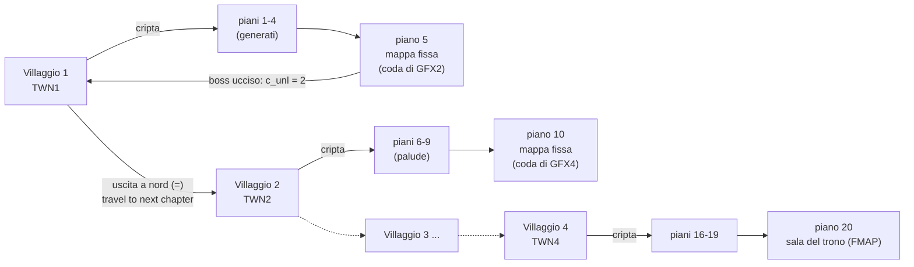
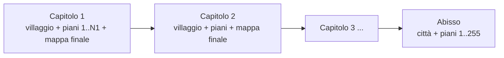

# Capitoli — analisi della proposta (11/11)

Copyright © 2026 - Simone Caporale

Proposta del committente (11/11): dividere il gioco in **capitoli**. Ogni capitolo ha un **villaggio** proprio (stessi
negozi e locanda), un certo numero di **piani di dungeon** e una **mappa finale fissa** come la sala del trono di
oggi; l'ultimo capitolo è l'**Abisso**, con una mappa propria (la città) e **255 piani**. Questa pagina è l'analisi:
dal 12/11 il gioco ha la **sequenza** dei capitoli con contenuti segnaposto (sezione sotto); il resto della pagina è
l'analisi dell'11/11. Strumenti già divisi per capitoli dall'11/11:
l'atlante grafico ([grafica/index.html](../../out/work/atlas/index.html)) e i simulatori del bilanciamento (`tools/simulators/chapters.py`), entrambi
da `data/chapters.yaml`.

## Nel codice: la sequenza dei capitoli (12/11, TODO M1)

Dal 12/11 (branch `capitoli`) il gioco ha la **sequenza** dei 4 capitoli, con contenuti segnaposto:

| Elemento | Com'è | Dove |
|---|---|---|
| Indice dei piani | **1–20 interno** (profondità globale: decide la difficoltà, regola del committente); il gruppo di 5 è il capitolo (`lv_grp`) | `rel.asm`, `chapter.asm` |
| Stato dell'eroe | `c_chap` (capitolo in cui si gioca) e `c_unl` (capitolo più alto sbloccato), `SAVE_VER` $C7 | `game.asm`, [formato](FORMATO_DATI.md) |
| Villaggi | file `TWN1`…`TWN5` (`load_gfx 0` con `c_chap`). **Dal 15/11 ogni villaggio è diverso**: tile, mappa, colori, tile solidi, nome della cura e posizioni propri, nell'intestazione del file ([villaggio](villaggio.md#i-villaggi-dei-capitoli-1511)): Aldric's Crossing, BadWater Mill (palafitte), The Last Camp (terrazze nella neve), Ruin's Gate (rovine attorno al cratere), The City of the Abyss (prototipo) | `disk.asm`, `levels.asm` (`town_k`), `tools/build/villages.py` |
| Cripta | porta al primo piano del capitolo (`go_tdown`: `5(c−1)+1`); dal primo piano le scale salgono al villaggio | `game.asm`, `bar.asm` |
| Piano del boss (5, 10, 15) | mappa fissa `BOSSCHc` (`data/maps/bosschapN.txt` → `tools/build/gen_bossmap.py`: 4 byte di intestazione con scale e boss, poi RLE come `FMAP`; dal 19/11 mappe vere a tema: cripta, isola nella palude, grotta crollata, [dungeon](dungeon.md#piani-del-boss-dei-capitoli-13-5-10-15-gen_cboss-1211-mappe-vere-dal-1911)), (18/11) nella coda del tema `GFX(2c)`, scompattata da lì da `bmap_load` (il file `BOSSCHc` non è più sul disco: [FORMATO_DATI](FORMATO_DATI.md) "Coda dei file"), completata da `gen_cboss` (`post_walls`). Niente scale in giù, solo il boss del piano (`place_boss`, statistiche del piano). **Dal 15/11 ogni boss ha il suo sprite** (The Hollow Abbot, The Miller of BadWater, Varok the Oathbreaker: `tools/build/monsters.py` `CBOSS`), nel posto del boss finale del file `GFX(2c)`, con il suo colore e il suo nome nella barra (blocco info del file); meccaniche decise ma non nel codice ([bestiario](bestiario.md#meccaniche-dei-boss-di-capitolo-decise-il-1511)); grafica `GFX(2c)` (dal 19/11: tile dei piani del capitolo + arredi propri, `tools/build/boss_gfx.py`), palette propria (`final.palette`: 8, 12, 10) | `gen_io.asm`, `disk.asm`, `game.asm` |
| Sblocco | uccidere il boss del piano del boss del capitolo *c* → `c_unl` = *c*+1 (lampo del bordo) | `chap_won` |
| Uscita | caselle `=` di `data/town_map.txt` (sentiero largo 2 a nord, dalla chiesa al bordo; il bordo della mappa è solido): chiusa = nessuna etichetta, il PG si ferma; aperta = `travel to next chapter` e con Fire `chap_travel`: musica sfumata, schermo nero, `c_chap`+1, eroe all'ingresso sud, salvataggio di eroe e piani (`chap_savef`), villaggio nuovo | `chapter.asm`, `tools/build/gen_maps.py` (`ALIASES`, `tx_exit`) |
| Capitolo 4 | il piano 20 resta la sala del trono e il boss finale. (15/11, prototipo) Ucciso il boss finale `c_unl` = 5: l'uscita del villaggio 4 (la scala nel cratere) porta alla **città dell'Abisso** (`TWN5`), dove la Bocca non porta ancora da nessuna parte (`go_tdown`) | `game.asm` |
| Mostri (15/11) | **ogni capitolo ha i suoi**: i due file del tema del capitolo portano sprite, colori e nomi delle sue 4 famiglie + 4 varianti forti (capitolo 1 i mostri di sempre, 2–4 `tools/build/monsters_chap.py`); **statistiche e IA restano quelle del tipo** (tipo *t* = tipo *t* del capitolo 1, `data/balance.yaml` per profondità). Tabella e dettagli: [bestiario](bestiario.md#nel-gioco-i-mostri-dei-capitoli-1511) | `gen_gfx.py`, `gfx_install`, `bar_name` |
| Musica | un tema per villaggio (oggi lo stesso, tbd) e uno per capitolo per i suoi 5 piani; il piano finale ha il suo; il brano non si rilegge se non cambia (scale 2,80 → 2,24 s) | `music.asm`, [musica](musica.md) |

Test: `CHAP-SEQ-10..14`, `VIL-TWN-*`, `VIL-BOSS-10` (regression), `MON-CHAP-*` (regression, mostri dei capitoli). Aperto (TODO M1): effetto grafico del passaggio, ritorno ai villaggi precedenti, cosa mostra la UI (piano
locale o globale: oggi il globale), boss con statistiche e IA propri (H6/M9).

## Com'era l'11/11

| Elemento | Oggi | Dove |
|---|---|---|
| Villaggio | uno, Aldric's Crossing: `cur_level` = 0, file `GFX0`, mappa `data/town_map.txt`, N = 8 | [villaggio](villaggio.md) |
| Piani | 1–19 generati dal seed (`gen_io.asm`), temi 1–7 a rotazione (`lvl_theme`) | [dungeon](dungeon.md) |
| Mappa finale | piano 20 = sala del trono (`FMAP`, `tools/build/gen_final.py`), boss finale, leva, portale verso l'Abisso | [dungeon](dungeon.md) |
| Abisso | solo progetto (TODO): città, piani oltre il 20 | [quests](quests.md) |
| Quest | progetto: 3 villaggi (`cur_level` 0 / 21 / 22) su un dungeon unico 1–20, tre "tratti" | [quests](quests.md) parte 3.6 |
| Salvataggi | un file per eroe `save-0N` (11/11, Krill): eroe + 20 piani da 93 B, `c_vis` = 3 byte, un bit per piano | [salvataggi](salvataggi.md) |
| Disco | 360 blocchi liberi su 664 (build dell'11/11) | [mappa del disco](../../out/work/memory-map/index.html) (sezione "Disk") |

## Il modello a capitoli

- **Dati**: `data/chapters.yaml` (11/11) descrive i capitoli per gli strumenti: nome, villaggio (file, mappa, N),
  numero di piani, temi, mappa finale, profondità di partenza (per mostri e bottino). Il codice del gioco, quando
  arriverà, avrà la stessa tabella generata (`tools/build/gen_db.py`), come oggi per le regole.
- **Stato del PG**: `c_chap` (1 byte) + `cur_level` (oggi: 0 = villaggio, 1..N piani, N+1 mappa finale). Per l'Abisso
  `cur_level` 0 = città, 1..255 i piani: un byte basta esattamente. La **profondità globale** (somma dei piani dei
  capitoli precedenti + piano) regola mostri, `chestLevel` e oro, così il simulatore e il gioco restano coerenti: oggi
  `chestLevel` = 8 × piano satura a 255 al piano 32 (vedi [bottino](bottino.md)): nell'Abisso va ripensata (TODO).
- **Villaggi**: stessa regola di oggi per ognuno (locanda con lo stesso baule, fabbro, alchimista, fontana, portale,
  N del villaggio, audit delle distanze). Un villaggio alla volta in cache (`$E000`, 2,7 KB l'uno: [quests](quests.md) 3.6).
- **Mappa finale per capitolo**: un file `FMAPn` (RLE, ~400 B, ~2 blocchi) generato da una descrizione per capitolo
  (`tools/build/gen_final.py` diventa parametrico); boss del capitolo con nome fisso; leva/portale verso il capitolo dopo.
- **Abisso**: città (una mappa fissa come un villaggio) e 255 piani generati. **Non si possono salvare 255 piani per eroe**
  (oggi 20 piani da 93 B per eroe nel file `save-0N`; 255 piani × 93 B × 5 eroi ≈ 465 blocchi, il disco ne ha 664): o si salvano solo gli
  ultimi K piani visitati (anello di record, K = 8–16) o nessuno (il piano si rigenera dal seed a ogni ingresso, i mostri
  rinascono). Da decidere (D-CAP-3).

## Cosa cambia nel codice (stime, da verificare)

| Area | Lavoro | Costo stimato |
|---|---|---|
| Stato e salvataggio | `c_chap`, `c_vis` per capitolo (bit per piano), `SAVE_VER` nuovo; record dei piani per (capitolo, piano) | 100–200 B di GAME, formato REL nuovo |
| Generatore | seed per (capitolo, piano); temi del capitolo da tabella; profondità globale per spawn e bottino | 50–100 B (sotto l'I/O, già pieno al 90%: da misurare) |
| Mappe finali | `fin_load` con il nome `FMAPn` (O3: `set_name4` + cifra), `gen_final.py` per capitolo | ~30 B + 2 blocchi per capitolo |
| Villaggi | `cur_level` 0 = villaggio del capitolo; file `GFXn` del villaggio da tabella (11/11: niente più `TOWN_PF_N`) | ~60 B + 11 blocchi per villaggio |
| Passaggio di capitolo | dalla mappa finale (leva/portale) al villaggio del capitolo dopo; ritorno ai villaggi precedenti (portale o menu) | 100–150 B |
| Abisso | città + 255 piani, salvataggio a anello, difficoltà oltre il piano 32, versione del generatore | grande: è il TODO dell'Abisso |
| Musica | **un tema per villaggio (tbd) e uno per capitolo**, uguale per i suoi 5 piani; il piano finale ha un tema suo ad hoc (12/11, committente; `PLAYLIST` per capitolo in `tools/build/songs.py`); il cambio piano nello stesso capitolo non rilegge il brano | dati su disco; codice: non rileggere se il brano è lo stesso |
| Quest | ogni quest appartiene a un capitolo (`docs/wiki/quests.md` va riletta con questo modello) | — |
| Test | prestazioni, generatore (mappe di riferimento) e salvataggi per capitolo; Abisso fino al piano 255 (`PERF-20`) | — |

Disco: ogni capitolo in più costa ~11 blocchi (villaggio) + ~2 (mappa finale) + brani; con 360 blocchi liberi ci stanno
più capitoli, ma i temi dei dungeon (oggi 8 file `GFXn`) vanno condivisi fra capitoli.

## Struttura proposta (11/11, dopo la decisione del committente sui due contatori)

**Piano locale** (riparte da 1 a ogni capitolo, quello che vede il giocatore) e **profondità globale** 1..255 (somma dei piani
dei capitoli precedenti + piano locale: regola la difficoltà). Esempio del committente: il primo piano sotto il villaggio
del capitolo 2 è il piano **1** con la difficoltà del piano **6**.
**Regola del committente (11/11 sera): 5 piani per ogni capitolo** (l'ultimo è la mappa finale), Abisso escluso: il gioco
tiene in RAM gli stati dei 5 piani del capitolo ([salvataggi](salvataggi.md)) e salva da solo cambiando capitolo. Dettagli: [quests](quests.md) sez. 3.8.

| Capitolo | Villaggio | Piani (l'ultimo = mappa finale) | Profondità globale | Boss ([bestiario](bestiario.md)) |
|---|---|---|---|---|
| 1 | Aldric's Crossing | 5 | 1–5 | The Hollow Abbot (nuovo) |
| 2 | BadWater Mill | 5 | 6–10 | The Miller of BadWater |
| 3 | The Last Camp | 5 | 11–15 | Varok the Oathbreaker |
| 4 | (cittadella: The Throne of Ruin) | 5 | 16–20 | Lord of Ruin (la sala del trono di oggi, profondità 20 come oggi) |
| Abisso | la città dell'Abisso | 1–235 | 21–255 | boss con nome a ogni piano |

Numeri in `data/chapters.yaml` (5 piani per capitolo; nomi e boss ancora da decidere, B11), da cui `tools/simulators/chapters.py` e l'atlante calcolano le
profondità. La profondità 20 resta la sala del trono, così le curve di oggi (mostri, bottino, oro) valgono ancora.
Oggi il codice ha un solo villaggio e i piani 1..20 (= profondità 1..20): i capitoli sono solo nei dati e negli strumenti.

## Decisioni da prendere

- **D-CAP-1**: quanti capitoli (i piani sono 5 per capitolo: decisione dell'11/11 sera).
- **D-CAP-2**: si torna ai villaggi dei capitoli precedenti? (portale tra villaggi, o solo avanti).
- **D-CAP-3**: piani dell'Abisso salvati (anello di K record) o rigenerati a ogni ingresso.
- **D-CAP-4**: mappe fisse nell'Abisso (ogni 50 piani? solo la città?).
- **D-CAP-5**: difficoltà oltre la profondità 32 (saturazione di `chestLevel` e dello spawn): curva nuova per l'Abisso.
  (11/11: la profondità globale non supera più 255: l'Abisso ha 255 − (piani dei capitoli) piani locali.)
