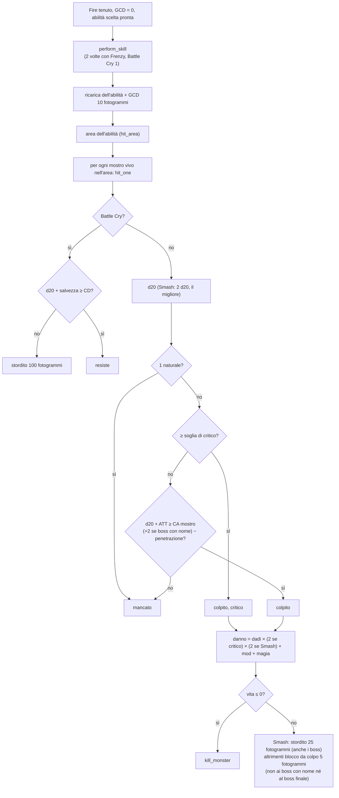

# Combattimento (regole d20)

Sorgenti: `src/game/combat.asm` (tutte le regole), `src/game/game.asm` (`update_attack`, `perform_skill`, `hit_area`,
`handle_keys`, `kill_monster`), `src/game/hud.asm`. Dati: `data/rules.yaml` → `tools/build/gen_db.py` → `out/work/db.asm`.
Progetto originale: [SISTEMA_COMBATTIMENTO.md](SISTEMA_COMBATTIMENTO.md). Valori al 06/11, provvisori.

Tutto è in tempo reale (50 fotogrammi al secondo), ma ogni colpo è un tiro di d20 alla D&D.

## Il PG (`recalc_stats`)

**Dall'11/11 (branch `feature/stat-points`)**: le caratteristiche **non crescono più da sole**. Valore = base
(`PL_STR0` 16, `PL_DEX0` 13, `PL_CON0` 15) + punti spesi (`c_sadd`) nella schermata C; il PG riceve **1 punto a ogni
livello, dal 2 al 20** (17/11, richiesta del committente; `pl_pts`, `rules.yaml player.stat_points`: 19 punti al 20; fino al
17/11 1 punto ogni 2 livelli, 9 punti al 20, quanti ne dava la crescita automatica). Oltre il 20 resta la crescita automatica
(`epic_every`). Il bilanciamento dei mostri non è stato rifatto (da verificare con i simulatori).
Vita = 10 + COS + (livello − 1) × (6 + mod COS) con la COS di adesso (**retroattiva**: alzare COS alza la vita di tutti
i livelli). Il PG di riferimento del simulatore, dell'arena e l'eroe di prova (`TESTCL`) spendono i punti come
`player.reference_alloc` (FOR, COS, FOR, DES, FOR, COS, FOR, DES, FOR): la tabella qui sotto è quella del riferimento
**prima** dell'11/11 (crescita automatica); con i punti ogni incremento arriva 2 livelli prima e la vita al 20 è 198 (prima 192).
**Respec**: un gettone (`c_resp`, max 255) azzera i punti spesi. Gettoni: +1 uccidendo il boss finale (`RESP_FINAL`), +1 da
una quest (progetto), nell'Abisso nei bauli con probabilità 2% (`resp_roll`, `RESP_DROP` = 5/256), presi come l'oro.

Caratteristiche per livello fino al 10/11 (crescita automatica, `player.scores` + `increases`):

| Livello | 1 | 4 | 5 | 6 | 7 | 8 | 9 | 10 | 11 | 12 | 13 | 14 | 15 | 16 | 17 | 18 | 19 | 20 |
|---|---|---|---|---|---|---|---|---|---|---|---|---|---|---|---|---|---|---|
| FOR | 16 | 16 | 17 | 17 | 17 | 17 | 18 | 18 | 18 | 18 | 19 | 19 | 19 | 19 | 20 | 20 | 20 | 21 |
| DES | 13 | 13 | 13 | 13 | 13 | 13 | 13 | 14 | 14 | 14 | 14 | 14 | 14 | 14 | 14 | 15 | 15 | 15 |
| COS | 15 | 15 | 15 | 16 | 16 | 16 | 16 | 16 | 16 | 16 | 16 | 17 | 17 | 17 | 17 | 17 | 17 | 17 |
| Competenza | 2 | 2 | 3 | 3 | 3 | 3 | 4 | 4 | 4 | 4 | 5 | 5 | 5 | 5 | 6 | 6 | 6 | 6 |
| Vita max | 25 | 49 | 57 | 66 | 75 | 84 | 93 | 102 | 111 | 120 | 129 | 138 | 147 | 156 | 165 | 174 | 183 | 192 |

(Livelli 2 e 3: vita 33 e 41.) Modificatore = (valore − 10) / 2. Vita: livello 1 = 10 + COS, poi + 6 + mod COS
per livello. Tetto del livello prima dell'Abisso: 20 (`PL_MAXLVL`).

| Valore | Formula |
|---|---|
| mod d'attacco | mod FOR (per tutte le armi; 08/11 tolto il "finesse" del pugnale) |
| ATT | competenza + mod d'attacco + magia dell'arma |
| danno | dadi dell'arma + mod d'attacco + magia dell'arma (`s_dk`) |
| CA | 10 + min(mod DES, limite dell'armatura) + CA armatura + magia + CA scudo + magia (scudo ignorato con arma a due mani) |
| critico | 20 naturale; dal livello 17 (`CRIT_LVL`) 19–20 |
| CD di Battle Cry | 8 + competenza + mod FOR |
| cadenza | (18/11, committente: "con Fire tenuto la velocità dipende dalle stat, all'inizio più lenta") `itrate` dell'arma + max(0, `ATK_SLOW` − `ATK_DEX` × mod DES) fotogrammi fra due Slash (`s_rate`, `recalc_stats`; `data/rules.yaml` `player.attack_speed`: 12 e 3). DES 13 (mod +1): +9 (pugnale 12 → 21, 0,24 → 0,42 s); DES 16-17 (+3): +3; DES 18 (+4) o più: la cadenza dell'arma. Vale per ogni Slash, tenuto o premuto ogni volta |
| penetrazione | `itpen` dell'arma: si sottrae alla CA del mostro |

(22/11) Il **modificatore** di una caratteristica è (valore − 10) / 2 e **non scende mai sotto 0** (`modv`); il danno fisso (modificatore + affissi) non scende sotto 0. Prima, con oggetti maledetti (*of weakness* su più pezzi, arma *bent* o *dull*), una FOR sotto 10 dava un modificatore di ~+126 e un danno fisso di 255; inoltre un totale negativo degli affissi aggiungeva 1 alla caratteristica (riporto). Test `AFP-14`.

(21/11) Si indossano **due anelli** e contano tutti e due. Ogni anello aggiunge +N (rame 1, argento 2, oro 3) al **modificatore** della caratteristica scritta nel suo byte
bonus (1 FOR, 2 DES, 3 COS), cioè +2N al valore; quello di COS aggiunge anche N × (livello + 1) alla vita.
Il PG ha **sempre un'arma** equipaggiata (si scambia, non si toglie; 07/11: i pugni non esistono più). Un'arma
**rotta** (durabilità 0) resta in mano ma `recalc_stats` le dà 0 dadi e 0 danno fisso (vedi Durabilità).

## Attacco del PG

Ogni colpo sveglia il mostro e lo rende il bersaglio della barra in alto.

### Abilità (`perform_skill1`)

Si scelgono con H J K L (`sel_skill`, solo se il livello basta) e si usano tenendo Fire.

| Abilità | Tasto | Livello | Ricarica | Area (semilarghezza × semialtezza, px) | Effetto |
|---|---|---|---|---|---|
| Slash | H | 1 | cadenza (arma + DES bassa, vedi sopra) | 15 × 15, 16 px davanti al PG | un tiro d'attacco |
| Whirlwind | J | 3 | 100 fot. (2 s) | 26 × 26 intorno al PG | un tiro a ogni mostro vicino |
| Battle Cry | K | 6 | 750 fot. (15 s) | 80 × 64 intorno al PG | tiro salvezza o stordito 100 fot. (2 s) |
| Smash | L | 12 | 300 fot. (6 s) | 44 × 44 intorno al PG | vantaggio, dadi × 2, stordimento 25 fot. |
| Rage | U | 9 | 1500 fot. (30 s) | — | per 300 fot. (6 s) i danni subiti sono dimezzati |
| Frenzy | O | 15 | 1500 fot. (30 s) | — | per 250 fot. (5 s) un attacco in più per Fire e corsa più veloce |

- **Rage e Frenzy** si attivano subito con il tasto (`buff_act`), se il livello basta e la ricarica è finita;
  lampo del bordo e suono.
- **Frenzy**: ogni Fire esegue l'abilità due volte nello stesso fotogramma (Battle Cry una). Ogni colpo a segno
  aumenta la corsa: +25% al primo, +15% ai successivi, massimo +100% (`fz_run` 0..100, `fz_hit`); `fz_move`
  accumula `fz_run` in cinquantesimi di pixel e aggiunge 1 px sugli assi in movimento per ogni 50 accumulati:
  a +100% il passo base di 2 px diventa 4 px a fotogramma. Finita la Frenzy la corsa torna normale.
  Misura del 06/11 (VICE, `TESTFZ`, villaggio): a 4 px/fotogramma nessun fotogramma perso in orizzontale,
  verticale e diagonale; il tetto resta quindi +100% (`FZ_RUN_MAX`). Nei dungeon le diagonali perdono qualche
  fotogramma anche senza Frenzy (ridisegno su due assi): limite del motore, non della corsa.
- Le ricariche sono a 16 bit in fotogrammi (`sk_cdl`/`sk_cdh`), le durate in `tmr` (Rage, Frenzy, pozioni):
  tutte scendono in `tick_timers` a ogni fotogramma; quando una arriva a 0 l'HUD si ridisegna.

## Attacco dei mostri (`mon_attack`)

Ogni 45 fotogrammi un mostro a contatto tira d20 + ATT (+2 se boss con nome) contro la CA del PG:
1 naturale manca, 20 naturale è critico (dadi × 2). Danno = (dadi + K) × `cv_dmg[piano]` / 32, poi metà con
Rage, minimo 1, meno il **danno subito degli affissi** (`s_gh`, dal 21/11 sera; ne resta almeno 1), sottratto dalla vita a 16 bit (`hurt_player`: lampo rosso, suono). Ogni colpo subito usura
armatura e scudo (sotto).

## Durabilità e usura (`wear`, `dur_roll`)

Armi, armature e scudi hanno una durabilità attuale e massima (10..255, [Oggetti](oggetti.md#durabilita)).
Solo gli oggetti **indossati** si usurano, con probabilità 1/N per evento (`rules.yaml durability.wear`):

| Oggetto | Evento | 1 punto ogni |
|---|---|---|
| arma | colpo a segno del PG (ogni tiro d'attacco riuscito, anche con Whirlwind/Smash) | 2 (`WEAR_W`) |
| armatura | colpo subito | 1 (`WEAR_A`) |
| scudo | colpo subito, solo se conta (non con un'arma a due mani) | 1 (`WEAR_S`) |

Valori del 06/11 pomeriggio (prima 4/3/4), scelti per **una riparazione ogni ~3 piani** in profondità e
spingere il giocatore a tornare al villaggio; un boss costa all'arma 6–14 punti. Avviso nell'HUD sotto
il 20% della durabilità massima (`WARN_PC`, [Interfaccia](interfaccia.md)).

A 0 (07/11): l'**arma** resta equipaggiata ma è **rotta**: `recalc_stats` le dà 0 dadi e 0 danno fisso; il colpo
arriva (ATT normale, suono) ma non fa danno, non stordisce e non usura più (`wear` salta un oggetto già a 0). Nome
in **rosso** nell'inventario, icona dell'arma **fissa** in rosso nell'HUD (lampeggia solo mentre si sta rompendo),
avviso "broken". Si ripara dal fabbro o si scambia con un'altra arma. Lo stesso per **armatura e scudo** (07/11):
a 0 restano indossati, in rosso, ma non danno CA (l'armatura non limita più nemmeno la DES). Sempre: `recalc_stats`,
lampo rosso, suono.
I pugni (`I_FISTS`) non esistono più: tolti da `data/rules.yaml`, gli id degli oggetti sono scesi di 1
(`SAVE_VER` $C1).
Riparazione dal fabbro: [Villaggio](villaggio.md#negozi). Simulazione: `tools/simulators/sim_durability.py`.

## Pozioni (`use_potion`, `drink`)

| Pozione | Cura | Ricarica (blocco di tutte le pozioni) | Dove esce |
|---|---|---|---|
| red (minor healing) | 20 (Abisso 30) | 250 fot. (5 s) | piani 1–10 |
| yellow (healing potion) | 50 (Abisso 75) | 350 fot. (7 s) | piani 5–17 |
| violet (greater healing) | 40 + 4 × livello (Abisso 28 + 5 × livello) | 500 fot. (10 s) | dal piano 12 |

- Tasti 1–4 = i 4 posti della cintura; dall'inventario con Fire.
- Non si beve a vita piena né durante la ricarica (il posto resta pieno). La ricarica blocca **tutte** le
  pozioni; nell'HUD le icone diventano blu finché dura.
- Cura = `itval` + `itdn` × livello, fino alla vita massima; oltre il livello 20 (Abisso) `pab_val` + `pab_dn` × livello
  (colonna `heal_abyss`, [oggetti.md](oggetti.md#cura-delle-pozioni-1511-todo-j4)).

## Esperienza e livelli (`add_xp`)

- Esperienza a 24 bit (`c_xp`); soglie `xp_n0/1/2[livello − 1]` (da `rules.yaml xp_needed: auto`): 210 per il
  livello 2 … 27 146 per il 20. Si sale di un livello alla volta: `recalc_stats`, **vita piena**, lampo giallo.
- Esperienza per mostro e calo con la differenza di livello: [Mostri](mostri.md#morte-di-un-mostro-kill_monster).
- L'HUD mostra "xp attuale / soglia" e la barra gialla della frazione del livello (16 bit bassi); da 10000 in su in migliaia senza decimali (`10K`, `hput_k`). Oltre 65535 servirebbe il 24 bit (Abisso: `TODO.md`).

## Morte del PG (`player_die`)

Vita 0 → schermata "you have died", **metà dell'oro addosso** persa (`c_gold`; l'oro nel baule della locanda, `c_sgold`, resta: 07/11 sera), contatore delle morti +1 (`c_deaths`), vita piena,
risveglio nel villaggio (`spawn_mode` 3). Del piano lasciato restano in memoria (STASH, 19/11) il boss, 5 mostri "caldi" (feriti, poi svegli) e fino a 10
bauli lasciati: tornando con il portale si ritrovano com'erano, gli altri mostri ripartono dal seed ([Salvataggi](salvataggi.md)).

## Fontana

Nel villaggio la fontana di Saint Aldric riporta la vita al massimo appena ci si passa sopra.
