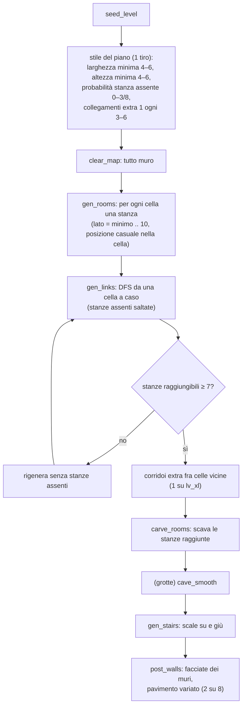
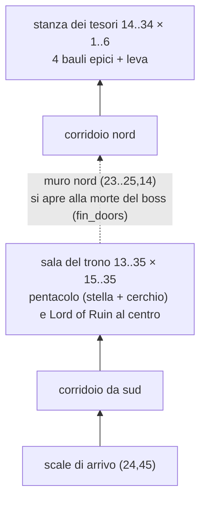

# Dungeon: generazione dei piani

Sorgenti: `src/game/dungeon.asm` (parte residente: `seed_level`, `gen_dungeon`, `gen_call`, `fin_doors`, `fin_chests`),
`src/game/gen_io.asm` (il generatore, nella RAM sotto l'I/O), `src/game.asm` (`rand`, `rndrange`), `src/game/theme.asm`
(`lvl_theme`), `tools/build/gen_final.py` (mappa fissa del piano 20, file `FMAP`), `src/game/disk.asm` (`fin_load`).
Test: `tests/regression/gen/test_gen.py` (mappe di riferimento con un seed fisso, `tests/regression/gen/gen_ref.json`).

Il dungeon ha **20 piani** (`MAXLEVEL`, da `rules.yaml dungeon.floors`): 1–19 generati dal seed, 20 = sala del
trono a mappa fissa. La mappa **non si salva mai**: ogni ingresso la rigenera identica dal seed; si salvano solo
le differenze ([Salvataggi](salvataggi.md)).

## Dove gira il generatore (dal 07/11)

Il generatore vero (`src/game/gen_io.asm`: stile del piano, `gen_rooms`, `gen_links`, `carve_*`, `gen_stairs`,
`post_walls`, `gen_final`) sta nella **RAM sotto l'I/O** a `GEN_AT` = `$D480` (dopo lo `STASH`), ~1,1 KB:

- nel PRG `GAME` è assemblato con `.logical GEN_AT` dopo la grafica fissa (dato morto dopo l'avvio); `copy_gfx`
  lo copia a `$D480` come prima cosa (`$01` = `$34`, interrupt spenti);
- si chiama solo con `gen_call` (`dungeon.asm`, residente): `$01` = `$34` (I/O e KERNAL spenti) e `sei` per tutta la
  generazione, poi `$36` e flag ripristinati. Ingressi: `GEN_MAIN` (il piano `cur_level`) e `GEN_WALLS`
  (`post_walls`, usato dall'arena);
- quel codice **non deve toccare** VIC, SID, CIA, RAM dei colori, KERNAL o il disco; le routine residenti che
  chiama (`rand`, `rndrange`, `set_tile`, `seed_level`, `clear_map`, `fin_doors`) non lo fanno (`set_tile` ridisegna
  lo schermo solo con `tp_on` = 1, che nel cambio di piano è 0). Il cambio di piano ha già lo schermo spento,
  l'IRQ raster spento e l'audio muto: tenere gli interrupt spenti durante la generazione non si nota.
- Mappe identiche alla versione precedente (v1.15) per i piani 1–20, verificato in VICE byte per byte.

## Seed e generatore casuale

- Il seed dell'eroe sono **6 cifre in base 36** (`c_seedt`, mostrato come "R83818" nella scheda).
- `seed_level` mescola le 6 cifre e il numero del piano nello stato a 16 bit `rnd` (con alcuni giri di `rand`;
  stato 0 vietato). Stesso seed + stesso piano = stessa mappa, stessi mostri, stessi bauli.
- `rand` è uno xorshift a 16 bit; `rndrange(n)` dà 0..n−1.
- Dopo la costruzione del piano (`load_location`) lo stato viene mescolato con il raster e la CIA: combattimento
  e bottino dei mostri non sono ripetibili.

## Struttura della mappa

Mappa di **48 × 48 caselle** (un byte per casella = numero del tile, `MAP` a `$C000`), divisa in una griglia
**4 × 4 di celle da 12 × 12**: al massimo una stanza per cella (16 stanze).

### Stanze e corridoi
- `gen_rooms`: larghezza e altezza tra il minimo dello stile e 10; la stanza sta dentro la sua cella con almeno
  una casella di margine. Centro della stanza = (`rcx`, `rcy`).
- `gen_links`: visita in profondità (DFS) sulla griglia 4 × 4 a partire da una cella a caso; dalla cella corrente
  sceglie a caso un vicino non visitato (sinistra/destra/su/giù) e scava un **corridoio a L largo 2 caselle** tra
  i due centri (prima orizzontale alla y del primo, poi verticale alla x del secondo). Le celle "assenti" (tiro
  `lv_drop`/8 per cella, mai quella di partenza) non si visitano. Se restano meno di 7 stanze si rigenera senza
  assenti.
- Collegamenti extra: per ogni coppia di stanze vicine (destra e sotto) già raggiunte, un corridoio in più con
  probabilità 1/`lv_xl` (anelli nella mappa).

### Grotte (capitolo 3, dal 18/11)
Lo **stile della mappa** è per capitolo (`data/chapters.yaml`, campo `map`: `style: rooms|caves`, `palettes` per piano locale),
compilato da `tools/build/gen_db.py` nella tabella **`lv_look`** (un byte per piano: bit 0-3 palette, 0 = quella casuale di
`pal_for_level`; bit 4 = grotte). Oggi: capitolo 3 a grotte, piano 11 palette 9 (roccia innevata), 12-14 palette 10 (roccia);
gli altri capitoli come prima. Con le grotte (`lv_cave`) cambiano tre passi, tutto il resto (stile, celle, `vis`, albero, anelli,
scale, `post_walls`) resta uguale:
- `carve_blob` al posto di `carve_rooms`: nella stanza una **macchia** = passeggiata casuale di (larghezza + altezza) × 8 passi
  dal centro con un pennello 2 × 2, sempre dentro il rettangolo della stanza (che resta in `rx`/`ry`/`rw`/`rh` per mostri e
  bauli). Il primo colpo è sul centro: (`rcx`, `rcy`) è sempre pavimento.
- `carve_worm` al posto del corridoio a L: **galleria tortuosa** larga 2 dal centro di una stanza a quello dell'altra, 3 passi
  su 4 verso la meta e 1 di lato (mai oltre le colonne/righe 1..45): arriva sempre e passa per i due centri, quindi la mappa è
  collegata come quella a stanze.
- `cave_smooth` dopo lo scavo: un passo di **automa cellulare** sui muri interni (un muro con al massimo 2 muri fra gli 8 vicini
  diventa pavimento: niente spuntoni); i muri si segnano prima e si cambiano dopo, così il risultato non dipende dall'ordine.
- Grafica: nel file del tema dei piani del capitolo (`GFX5`) muro, parete e pavimenti sono di **roccia**
  (`tools/build/cave_gfx.py`): parete con la cresta nel colore `pal_c2` (bianco = neve nella palette 9, grigio chiaro nella 10),
  strati e crepe neri. Il file del boss (`GFX6`) resta quello di prima.
- Costi (misurati in VICE, 18/11): generazione 0,76-0,95 s (stanze ~0,3 s); codice +567 B sotto l'I/O (`gen_io_end` `$DB5D`,
  `LVRAM` fino a `$DD2E`, 722 B liberi fino a `$E000`). Bauli: `chest_in_room` prova fino a 4 caselle del rettangolo (prima 1).
- Test: `GEN-10` (mappe di riferimento, anche i piani 11 e 13) e `GEN-11` (6 seed × piani 11-14: tutto il pavimento
  raggiungibile dalle scale, bordo di muro, almeno 300 caselle di pavimento, generazione sotto 1,2 s, palette 9/10).
- Versione del generatore `GVER` 6: un eroe salvato con la 5 tiene il seed e rigenera i piani (`migrate_char`).

### Scale
- `gen_stairs`: scale **su** al centro di una stanza a caso (`st_s`), scale **giù** al centro di un'altra (`st_e`)
  con distanza di indice di cella 5..11 (modulo 16) per allontanarle; dopo 60 tentativi si accetta. Al piano 20
  non ci sono scale giù.
- La stanza delle scale su non riceve mostri né bauli; la stanza delle scale giù ospita il **boss del piano**.

### Rifinitura
- `post_walls`: ogni muro con pavimento sotto diventa "facciata" (`T_WALLFACE`); ogni pavimento ha 2/8 di
  probabilità di diventare una variante (`T_FLOORB`, `T_FLOORC`).

## Temi grafici

`lvl_theme` (12/11, un file di grafica per capitolo): capitolo *c* = `lv_grp(piano)`; piani del dungeon → `GFX(2c−1)`,
piano del boss del capitolo (5, 10, 15) → `GFX(2c)`, piano 20 → `GFX(2·CHAPTERS)`. Per ogni capitolo due file, **tile + sprite dei mostri del capitolo**: `GFX(2c−1)` per i piani del dungeon,
`GFX(2c)` per il piano del boss (sala del trono: piani 5, 10, 15 e 20; i file dei capitoli 2–4 sono copie segnaposto,
pronte da modificare; dal 18/11 `GFX5` ha muri e pavimenti di roccia: grotte). Niente più deduplica: 8 file `GFX1`…`GFX8` (8 blocchi ciascuno). La palette per piano resta
`pal_for_level`.
Il tema del piano successivo si precarica in background ([Tecnica](tecnica.md)).

## Piani del boss dei capitoli 1–3: 5, 10, 15 (`gen_cboss`, 12/11)

Ultimo piano dei capitoli 1–3 (`is_cboss`: indice 4 nel gruppo di 5, non `MAXLEVEL`; `lv_cboss` da `chap_enter`):
mappa fissa `BOSSCHc` (`data/maps/bosschapN.txt` → `tools/build/gen_bossmap.py`, segnaposto quadrato: sala 16×16 e corridoio
da sud) letta da `bmap_load` nel buffer di `FMAP`; i 4 byte di testa danno scale di arrivo e posto del boss (`bm_hdr`).
`gen_cboss` (sotto l'I/O) prepara le due stanze logiche (arrivo, sala) e chiama `post_walls`. Niente scale in giù, nessun
mostro normale (`spawn_monsters` esce subito), solo il boss del piano (`place_boss`, al centro della sala, statistiche del
piano) disegnato con lo **sprite del boss finale** (`build_sprites`). Grafica `GFX(2c)` (tile della sala del trono, set
di mostri del capitolo), palette rossa. La sua morte sblocca il capitolo dopo (`chap_won`, [capitoli](capitoli.md)).

## Piano 20: la sala del trono (`gen_final`)

Mappa fissa **pregenerata** (dal 07/11): `tools/build/gen_final.py` (nella build) scrive il file `FMAP` del disco
(`out/work/fmap.prg`, RLE come la mappa del villaggio, ~400 B) con la mappa **di base** e `out/work/final_map.inc` con le
costanti e le poche tabelle che servono ancora in gioco (`fin_door`, `fin_chest`, `fin_tip`).

- Mappa di base = com'era in `gen_final` subito prima di `post_walls`: rettangoli di pavimento, muro nord chiuso,
  scale, leva. Le caselle della stella e del cerchio sono **marcatori** `$80 | tile`: `post_walls` le tratta come
  pavimento (facciate dei muri) e consuma il generatore casuale come per un pavimento, poi scrive il tile della
  figura. Così mappa, variazioni del pavimento e stato del caso dopo la generazione (mostri, bauli) sono identici a
  quando le figure si disegnavano con il codice.
- `fin_load` (`CODE2`): la prima volta legge `FMAP` nella cache sotto il KERNAL, **in fondo** (`FIN_AT` = `$FD00` = `PF_END`, fino ai vettori `$FFFA`; dal 10/11: prima stava subito dopo la mappa del villaggio fino a `$ECFF` e con il villaggio nuovo della v1.145 il file, 406 B, veniva troncato a 178 B dal limite di lettura; `fin_ok` = 1,
  azzerato da `game_start`), poi a ogni ingresso scompatta da lì in `MAP` (`rle_unpack`, ~nessuna attesa). Prima
  lettura: ~1–2 s in più, solo al primo ingresso nel piano 20 della sessione.
- `gen_final` (sotto l'I/O) fa solo ciò che dipende dalla partita: boss già morto → `fin_doors` (le 3 caselle del
  muro nord diventano pavimento: è la stessa routine che apre il muro alla morte del boss, in gioco); leva tirata →
  portale; scale, stanze logiche (`vis`, `rcx`, `rcy`); poi `post_walls`.

- Niente mostri comuni: solo il boss finale (`spawn_monsters` lo mette al centro della stanza `st_e`) e le sue
  evocazioni ([Mostri](mostri.md)).
- I 4 **bauli epici** (`fin_chests`, `ch_t` = $53: grafica d'oro, epico, del piano) si aprono senza chiave e
  danno `EPIC_ITEMS` (3) oggetti al livello bottino massimo.
- La **leva** (`ui_lever`): tirata, `c_lever` = 1 e al suo posto compare il **portale nero** (15/11, `T_BPORTAL` = posto
  libero 8 dei file del tema della sala del trono, `black_portal_tile` in `gen_gfx.py`) per *The Endless Abyss*, che
  per ora non porta da nessuna parte (`go_down` si ferma al piano 20). Perche' un tile a parte e non una nuova palette:
  i colori (`BGCOL1/2`, color RAM) sono **uno solo per tutto lo schermo** (palette 4: nero, rosso, rosa, giallo), quindi il
  "nero" si ottiene solo con i pixel: pietra rosso scuro, bordo rosa, vano e ovale **neri** con un vortice rosso (niente
  giallo, che e' il colore del portale normale). Il portale normale (`T_PORTAL`, ritorno al villaggio) resta com'e'.
  Il posto 8 e' calpestabile in `solid_dun` (nei dungeon non ha altri usi). Un salvataggio vecchio con il portale normale
  sulla leva funziona ancora (`at_lever` nel ramo `T_PORTAL`). Etichetta: "the endless abyss" come prima.
- Il generatore resta deterministico (`seed_level`, chiamato dopo `fin_load`) per il contenuto dei bauli.

## Nebbia (mappa esplorata)

`EXPL` (288 byte, 1 bit per casella, 48 righe da 6 byte): `mark_explored` segna il rettangolo di ±4 caselle
in orizzontale e ±3 in verticale intorno al PG; la
minimappa (tasto M) mostra solo le caselle esplorate. Nel salvataggio la nebbia è ridotta a settori 2 × 2.
