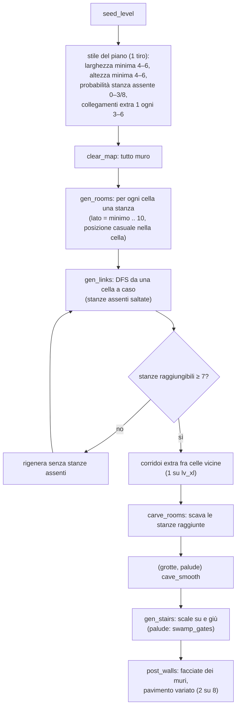
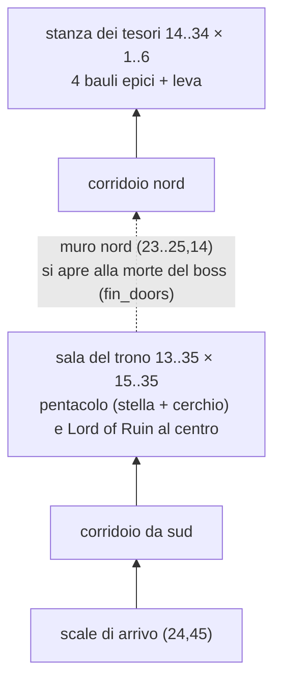

# Dungeon: generazione dei piani

Sorgenti: `src/game/dungeon.asm` (parte residente: `seed_level`, `gen_dungeon`, `gen_call`, `fin_doors`, `fin_chests`),
`src/game/gen_io.asm` (il generatore, nella RAM sotto l'I/O), `src/game.asm` (`rand`, `rndrange`), `src/game/theme.asm`
(`lvl_theme`), `tools/build/gen_final.py` (mappa fissa del piano 20, file `FMAP`), `src/game/disk.asm` (`fin_load`).
Test: `tests/regression/gen/test_gen.py` (mappe di riferimento con un seed fisso, `tests/regression/gen/gen_ref.json`).

Il dungeon ha **20 piani** (`MAXLEVEL`, da `rules.yaml dungeon.floors`): 1–19 generati dal seed, 20 = sala del
trono a mappa fissa. La mappa **non si salva mai**: ogni ingresso la rigenera identica dal seed; si salvano solo
le differenze ([Salvataggi](salvataggi.md)).

## Dove gira il generatore (dal 07/11)

Il generatore vero (`src/game/gen_io.asm`: stile del piano, `gen_rooms`, `gen_links`, `carve_*`, `gen_stairs`,
`post_walls`, `gen_final`) sta nella **RAM sotto l'I/O** a `GEN_AT` = `$D080` (dopo lo `STASH`), ~3,2 KB (19/11, con grotte e palude):

- nel PRG `GAME` è assemblato con `.logical GEN_AT` dopo la grafica fissa (dato morto dopo l'avvio); `copy_gfx`
  lo copia a `$D080` come prima cosa (`$01` = `$34`, interrupt spenti);
- si chiama solo con `gen_call` (`dungeon.asm`, residente): `$01` = `$34` (I/O e KERNAL spenti) e `sei` per tutta la
  generazione, poi `$36` e flag ripristinati. Ingressi: `GEN_MAIN` (il piano `cur_level`) e `GEN_WALLS`
  (`post_walls`, usato dall'arena);
- quel codice **non deve toccare** VIC, SID, CIA, RAM dei colori, KERNAL o il disco; le routine residenti che
  chiama (`rand`, `rndrange`, `set_tile`, `seed_level`, `clear_map`, `fin_doors`) non lo fanno (`set_tile` ridisegna
  lo schermo solo con `tp_on` = 1, che nel cambio di piano è 0). Il cambio di piano ha già lo schermo spento,
  l'IRQ raster spento e l'audio muto: tenere gli interrupt spenti durante la generazione non si nota.
- Mappe identiche alla versione precedente (v1.15) per i piani 1–20, verificato in VICE byte per byte.

## Seed e generatore casuale

- Il seed dell'eroe sono **6 cifre in base 36** (`c_seedt`, mostrato come "R83818" nella scheda).
- `seed_level` mescola le 6 cifre e il numero del piano nello stato a 16 bit `rnd` (con alcuni giri di `rand`;
  stato 0 vietato). Stesso seed + stesso piano = stessa mappa, stessi mostri, stessi bauli.
- `rand` è uno xorshift a 16 bit; `rndrange(n)` dà 0..n−1.
- Dopo la costruzione del piano (`load_location`) lo stato viene mescolato con il raster e la CIA: combattimento
  e bottino dei mostri non sono ripetibili.

## Struttura della mappa

Mappa di **48 × 48 caselle** (un byte per casella = numero del tile, `MAP` a `$C000`), divisa in una griglia
**4 × 4 di celle da 12 × 12**: al massimo una stanza per cella (16 stanze).

### Stanze e corridoi
- `gen_rooms`: larghezza e altezza tra il minimo dello stile e 10; la stanza sta dentro la sua cella con almeno
  una casella di margine. Centro della stanza = (`rcx`, `rcy`).
- `gen_links`: visita in profondità (DFS) sulla griglia 4 × 4 a partire da una cella a caso; dalla cella corrente
  sceglie a caso un vicino non visitato (sinistra/destra/su/giù) e scava un **corridoio a L largo 2 caselle** tra
  i due centri (prima orizzontale alla y del primo, poi verticale alla x del secondo). Le celle "assenti" (tiro
  `lv_drop`/8 per cella, mai quella di partenza) non si visitano. Se restano meno di 7 stanze si rigenera senza
  assenti.
- Collegamenti extra: per ogni coppia di stanze vicine (destra e sotto) già raggiunte, un corridoio in più con
  probabilità 1/`lv_xl` (anelli nella mappa).

### Grotte (capitolo 3, dal 18/11)
Lo **stile della mappa** è per capitolo (`data/chapters.yaml`, campo `map`: `style: rooms|caves|swamp|citadel`, `palettes` per piano locale),
compilato da `tools/build/gen_db.py` nella tabella **`lv_look`** (un byte per piano: bit 0-3 palette, 0 = quella casuale di
`pal_for_level`; un bit per stile: bit 4 grotte `LK_CAVE`, bit 5 palude `LK_SWAMP`, bit 6 cittadella `LK_CIT` (19/11), nessuno = stanze;
il codice prova il suo bit con `and #LK_x`). Oggi: capitolo 3 a grotte, piano 11 palette 9 (bianca, innevata), 12 palette 11 (ghiaccio azzurrino), 13-14 palette 10 (roccia grigia);
gli altri capitoli come prima. Con le grotte (`lv_cave`) cambiano tre passi, tutto il resto (stile, celle, `vis`, albero, anelli,
scale, `post_walls`) resta uguale:
- `carve_blob` al posto di `carve_rooms`: nella stanza una **macchia** = passeggiata casuale di (larghezza + altezza) × 8 passi
  dal centro con un pennello 2 × 2, sempre dentro il rettangolo della stanza (che resta in `rx`/`ry`/`rw`/`rh` per mostri e
  bauli). Il primo colpo è sul centro: (`rcx`, `rcy`) è sempre pavimento.
- `carve_worm` al posto del corridoio a L: **galleria tortuosa** larga 2 dal centro di una stanza a quello dell'altra, 3 passi
  su 4 verso la meta e 1 di lato (mai oltre le colonne/righe 1..45): arriva sempre e passa per i due centri, quindi la mappa è
  collegata come quella a stanze.
- `cave_smooth` dopo lo scavo: un passo di **automa cellulare** sui muri interni (un muro con al massimo 2 muri fra gli 8 vicini
  diventa pavimento: niente spuntoni); i muri si segnano prima e si cambiano dopo, così il risultato non dipende dall'ordine.
- Grafica: nel file del tema dei piani del capitolo (`GFX5`) muro, parete e pavimenti sono di **roccia**
  (`tools/build/cave_gfx.py`): parete con la cresta nel colore `pal_c2` (bianco = neve nelle palette 9 e 11, grigio chiaro nella 10),
  strati e crepe neri. Il file del boss (`GFX6`) resta quello di prima.
- Costi (misurati in VICE, 18/11): generazione 0,76-0,95 s (stanze ~0,3 s); codice +567 B sotto l'I/O (`gen_io_end` `$DB5D`,
  `LVRAM` fino a `$DD2E`, 722 B liberi fino a `$E000`). Bauli: `chest_in_room` prova fino a 4 caselle del rettangolo (prima 1).
- Test: `GEN-10` (mappe di riferimento, anche i piani 11 e 13) e `GEN-11` (6 seed × piani 11-14: tutto il pavimento
  raggiungibile dalle scale, bordo di muro, almeno 300 caselle di pavimento, generazione sotto 1,2 s, palette 9/11/10).
- Versione del generatore `GVER` 6: un eroe salvato con la 5 tiene il seed e rigenera i piani (`migrate_char`).

### Palude (capitolo 2, dal 18/11)
Piani 6-9 (`map: {style: swamp}`, palette 12 per tutti): una **palude unica** fatta di quattro piani **affiancati lungo un
percorso a caso** (dal seed del capitolo): dal piano *L* al piano *L*+1 si va in una direzione *d(L)* (nord, est, sud, ovest),
mai indietro (*d(L+1)* ≠ opposto di *d(L)*: in tre passi il percorso non torna su un pezzo già usato). Così l'uscita non sta
sempre dalla stessa parte (decisione del committente del 18/11 pomeriggio: il giocatore non deve sapere dove andare).
Si passa da un piano all'altro con un **cancello** sul bordo (il caricamento resta): il cancello d'**ingresso** prende il posto
delle scale su (verso il piano prima; dal piano 6 verso il villaggio, "gate back to town"), quello d'**uscita** delle scale giù
(verso il piano dopo; dal piano 9 verso il mulino del boss, piano 10). Fire sul cancello come sulle scale; si arriva accanto al
cancello del piano vicino, **sul lato opposto e nello stesso punto**: la palude continua oltre il bordo.
- Lati: ingresso = opposto di *d(L−1)*, uscita = *d(L)*; nel primo piano l'ingresso è su un lato a caso diverso dall'uscita,
  nell'ultimo l'uscita è su un lato a caso diverso dall'ingresso (`swamp_gates`, `dir_of`, `gate_hd`). I lati restano in
  `sw_in` / `sw_out` (RAM di GAME): `place_player` mette l'eroe una casella verso l'interno (`sw_dxt` / `sw_dyt`).
- Punto del cancello sul lato = `gate_hash` mod 36 + 6 (19/11: `gate_hash` = byte del PRNG con lo stato di `seed_mix(confine | $C0)`, cioè tutto il seed e il confine come `seed_level` fa con il piano; prima la somma delle cifre, ~195 valori e uguale per i seed anagrammi; anche le direzioni `gate_hd` ne dipendono), dove il confine è il
  numero del piano da cui si esce: i due piani vicini lo calcolano uguale (`gate_row`). Cancello sul bordo a x o y = 1 o 46,
  con la passerella fino al centro dell'isola della sua fascia su quel lato (`gate_put`; `st_s`, `st_e`).
- **Cancelli lontani** (19/11, segnalazione del committente: piano 9 del seed `ANOANO` con ingresso e uscita quasi
  accanto, una passerella sola li univa): l'uscita deve stare ad almeno `SW_DMIN` = 40 caselle (|dx| + |dy|) dal
  cancello d'ingresso. Se il punto `gate_row` non basta si prova lo stesso lato spostato di 12 e di 24 caselle (sempre in
  6..41); se nessuno basta si prende il più lontano (`sw_adj`). Il piano dopo riparte dal punto scelto (catena dal primo
  piano del capitolo: `sw_sin`, `sw_sout`), così i due cancelli del confine restano uno di fronte all'altro. I lati non
  sono forzati opposti: va bene anche un angolo, purché lontano. `GVER` = 7 (i piani salvati della palude si rigenerano).
- Isole: le macchie delle grotte (`carve_blob` + `cave_smooth`), tutte e 16 (`lv_drop` = 0); acqua = muro (tile 0, solido),
  riva = facciata del muro (`post_walls`).
- `carve_plank` al posto dei corridoi: **passerelle** di assi larghe 1, a L fra i centri delle isole dell'albero di
  `gen_links` (anelli compresi), solo sull'acqua; tile `PATH` (posto 14: calpestabile e mai usato nei dungeon).
- Differenza dal disegno del mattino (quadrato 2 × 2) e dal primo prototipo (fila ovest → est): il percorso a caso ha sempre
  due soli vicini per piano, quindi bastano i due cancelli al posto delle scale, ma l'uscita può stare su qualunque lato.
- Etichette: "gate to level N", "gate back to level N", "gate back to town" (`loc_id`, `gate_id`).
- Grafica: `tools/build/swamp_gfx.py` nel tema `GFX3` (acqua verde scura con riflessi, riva con le canne, fango ed erba,
  passerelle, cancelli); il file del boss (`GFX4`) resta com'era.
- Misure (VICE, 18/11): generazione fino a 0,89 s. Test `GEN-12` (8 seed × piani 6-9: cancelli su due lati diversi del bordo e ad almeno 34 caselle (19/11: minimo misurato 38),
  uscita di un piano di fronte all'ingresso del seguente, almeno 3 lati usati dalle uscite, tutto raggiungibile, tempo) e
  `GEN-10` (piani 6 e 9 di riferimento).

### Scale
- `gen_stairs`: scale **su** al centro di una stanza a caso (`st_s`), scale **giù** al centro di un'altra (`st_e`)
  con distanza di indice di cella 5..11 (modulo 16) per allontanarle; dopo 60 tentativi si accetta. Al piano 20
  non ci sono scale giù.
- La stanza delle scale su non riceve mostri né bauli; la stanza delle scale giù ospita il **boss del piano**.

### Cittadella (capitolo 4, prototipo del 19/11)
Piani 16-19 (`map: {style: citadel}`, palette ancora casuale: da scegliere con il committente). Disegno di
[quests](quests.md) (`GEN3`): sale grandi con colonne, porte allineate, **simmetria sinistra/destra**; si genera metà mappa e
si specchia (`cit_finish` in `gen_io.asm`, ~250 B). Stesso contratto delle stanze (16 celle, `vis`, rettangoli, centri, albero):
- sale **7..10 × 7..10**, tutte presenti (`lv_drop` = 0); l'albero di `gen_links` e gli anelli **solo nella metà sinistra**
  (celle delle colonne 2-3 segnate assenti per l'albero, partenza in colonna 0-1);
- **colonne**: un muro su una griglia di 3 caselle (x = 2, 5 .. 20; y = 2, 5 .. 44) dove il quadrato 3×3 intorno è tutto
  pavimento, cioè dentro le sale. Un muro con 8 vicini di pavimento non separa mai nulla (`post_walls` gli dà la facciata);
- **passaggi sull'asse**: da 1 a 4 corridoi dritti larghi 2 dalla sala della colonna 1 fino all'asse (x = 24), sulla riga del
  centro della sala; lo specchio li prolunga nella sala gemella (porte allineate). Almeno uno, quindi il piano è collegato;
- **specchio**: colonne 24..47 = 23..0; celle 2-3 = specchio delle 1-0 (`rx' = 48 - rx - rw`, `rcx' = 46 - rcx`, così i
  corridoi larghi 2 restano sull'asse della sala gemella). Poi `gen_stairs` (le scale sono l'unica cosa non simmetrica) e
  `post_walls`.
- Memoria: il codice (`src/game/gen_citadel.asm`, ~258 B) **non** sta nel PRG `GAME` né sotto l'I/O (pieni: il PRG deve
  finire prima di `$9C00` anche nelle build di test, che hanno ~300 B in più): (19/11) è parte del **codice del piano** del
  capitolo 4 (`src/game/ovl_decor.asm` con `DK_CHAP` = 4, coda di `GFX7`, copiato a `$C900`; il generatore chiama
  `cit_finish = OVP_AT + OVJ_GEN` con `$01 = $34`); fino al 19/11 era assemblato da solo per `GFX_DUN_END`.
  Entrando in un piano della cittadella il tema si legge sempre prima della generazione. Le variabili di grotte e cittadella
  (`$87E8`-`$87F4`) e della palude (`$A5E3`-`$A5FA`) sono passate nelle zone libere annotate di GAME (`.virtual`). Restano
  ~260 B sotto l'I/O dopo gli slot dei piani e ~128 B prima di `$9C00` nella build di test più grande (`TESTUI=28`).
- Misure (VICE, 19/11): generazione fino a 0,62 s; almeno 70 colonne e 1044 caselle calpestabili per piano. Test `GEN-13`
  (6 seed × piani 16-19: collegato, simmetrico salvo le scale, colonne, sale grandi, tempo).
- Da rivedere con il committente in gioco: palette, densità delle colonne, numero dei passaggi sull'asse; facoltativi i
  corridoi dritti al posto di quelli a L.

### Rifinitura
- `post_walls`: ogni muro con pavimento sotto diventa "facciata" (`T_WALLFACE`); ogni pavimento ha 2/8 di
  probabilità di diventare una variante (`T_FLOORB`, `T_FLOORC`).

## Temi grafici

`lvl_theme` (12/11, un file di grafica per capitolo): capitolo *c* = `lv_grp(piano)`; piani del dungeon → `GFX(2c−1)`,
piano del boss del capitolo (5, 10, 15) → `GFX(2c)`, piano 20 → `GFX(2·CHAPTERS)`. Per ogni capitolo due file, **tile + sprite dei mostri del capitolo**: `GFX(2c−1)` per i piani del dungeon,
`GFX(2c)` per il piano del boss (dal 19/11 `GFX2`, `GFX4`, `GFX6` = tile dei piani del capitolo + arredi del piano del boss,
sotto; `GFX8` = sala del trono del piano 20; dal 18/11 `GFX3` palude e `GFX5` grotte). Niente più deduplica: 8 file `GFX1`…`GFX8` (8 blocchi ciascuno). La palette per piano resta
`pal_for_level`.
Il tema del piano successivo si precarica in background ([Tecnica](tecnica.md)).

## Piani del boss dei capitoli 1–3: 5, 10, 15 (`gen_cboss`, 12/11; mappe vere dal 19/11)

Ultimo piano dei capitoli 1–3 (`is_cboss`: indice 4 nel gruppo di 5, non `MAXLEVEL`; `lv_cboss` da `chap_enter`):
mappa fissa `BOSSCHc` (dal 18/11 nella coda del tema `GFX(2c)`; `data/maps/bosschapN.txt` → `tools/build/gen_bossmap.py`)
letta da `bmap_load` nel buffer di `FMAP`; i 4 byte di testa danno scale di arrivo e posto del boss (`bm_hdr`).
`gen_cboss` (sotto l'I/O) prepara le due stanze logiche (arrivo, sala) e chiama `post_walls`. Niente scale in giù, nessun
mostro normale (`spawn_monsters` esce subito), solo il boss del piano (`place_boss`, sulla casella `B`, statistiche del
piano) disegnato con il **suo sprite** nel posto del boss finale del file (`build_sprites`). La sua morte sblocca il
capitolo dopo (`chap_won`, [capitoli](capitoli.md)).

**Mappe** (19/11, richiesta del committente: ogni piano del boss ha tema e forma propri, legati al capitolo; il boss finale
resta nella sala del trono a stella):

| Capitolo | Piano | Luogo | Forma | Tile (`GFX(2c)`) | Palette |
|---|---|---|---|---|---|
| 1 | 5 | **The Crypt of the Abbot**: cripta | croce latina verso nord: discesa dalle scale con le candele, nartece con le ossa, navata con colonne, sarcofagi e tappeto processionale, transetto (ossario a ovest, camera dei sarcofagi con le lastre incise a est), abside con altare e candelabri; l'abate davanti all'altare | mattoni del capitolo 1 + sarcofago, colonna, candelabro, altare, mucchio d'ossa (solidi), ossa sparse, tappeto, lastra tombale (calpestabili) | 8 (grigia, fiamme gialle) |
| 2 | 10 | **The Dollmaker's Isle** (19/11; prima The Flooded Mill): isola al centro della palude | acqua tutt'intorno (il muro della palude), arrivo dal cancello su un isolotto a sud, isolotti con gli alberi degli impiccati uniti da passerelle e da un guado di pietre; sull'isola centrale la capanna in rovina della bambolaia (muri di graticcio, totem, il calderone 3 caselle sopra il boss); Mother Stitch nella radura di fango a sud della capanna (attorno solo fango: i feticci nascono sul pavimento) | palude del capitolo 2 + muro di graticcio, totem, calderone, canne, albero degli impiccati (solidi), assi marce, pietre del guado (calpestabili), passerelle | 12 (palude) |
| 3 | 15 | **The Broken Bastion**: grotta semi crollata | galleria d'arrivo da sud-ovest con i puntelli, sala ovest, salita alla galleria nord con le mura cadute del bastione, frana di macerie fra la sala ovest e la sala del boss (varchi di ghiaia), volta crollata a nord-est della sala del boss; stalagmiti come ripari (la carica di Varok, [bestiario](bestiario.md#meccaniche-dei-boss-di-capitolo-decise-il-1511)) | grotte del capitolo 3 + macerie, masso, stalagmite, puntello, conci del bastione (solidi), ghiaia, pavimento crepato (calpestabili) | 10 (roccia grigia) |

- **Lettere delle mappe**: `#` muro (nel capitolo 2 l'acqua), `.` pavimento, `<` scale di arrivo, `B` boss, più gli arredi del
  capitolo (`tools/build/boss_gfx.py` `LEGEND`, legenda in testa a ogni file). Ogni casella diventa il numero del tile; `post_walls`
  fa le facciate dei muri (e la riva della palude) e varia il pavimento come negli altri piani.
- **Posti dei tile**: gli arredi stanno nei posti liberi dei dungeon: solidi `FREE9-11`, `FREE25-26`; calpestabili `GRASSA`,
  `GRASSB`, `PATH`. Mai `FREE8` (portale nero: etichetta "the endless abyss"), `DHOME` (Fire = locanda), porte dei negozi,
  fontana, portale, cripta, baule: hanno un ruolo nel codice.
- **Grafica**: `tools/build/gen_gfx.py` (`cboss_tiles`) parte dai tile dei piani del capitolo (mattoni, palude, grotte) e sostituisce
  i posti degli arredi; il file `GFX8` (sala del trono) non cambia.
- **Palette**: `data/chapters.yaml` `final.palette` → `lv_look` del piano del boss (`tools/build/gen_db.py`); `pal_for_level`
  guarda `lv_look` prima del rosso dei piani del boss (rosso solo se la palette manca).
- **Generatore**: `GVER` 10 (i piani salvati con le mappe segnaposto si rigenerano, `migrate_char`); 11 dal 19/11 (arredi dei piani).
- **Atlante**: set `BOSS1`, `BOSS2`, `BOSS3` con la mappa intera. Test: `BOSSMAP-10` (mappa uguale al file dopo `post_walls`,
  arredi presenti, boss raggiungibile dalle scale, palette, tile del file uguali a `boss_gfx.py`; screenshot in
  `out/work/bossmaps/`), `CHAP-SEQ-11`, `VIL-BOSS-10`, `GEN-10` (mappe di riferimento).
- **Non verificato in gioco a mano** (19/11): la leggibilità degli arredi sullo schermo vero e il passo nelle passerelle lunghe
  della palude; l'arrivo nel piano 10 è sempre dal cancello a sud, mentre l'uscita del piano 9 è su un lato a caso.

## Codice del piano (19/11)

Il codice che serve a **un solo tipo di piano** non sta in GAME: viaggia nella **coda del file del tema** di quel piano
(`tools/build/bundle.py`, segno `| $40`, [FORMATO_DATI](FORMATO_DATI.md) "Coda dei file") e `gfx_tail` (`ovp_copy`, `src/game/music.asm`)
lo copia a `OVP_AT` = `$C900`–`$CFFF` a ogni lettura del tema. `$C900` è la zona 1 del MENU, **libera in tutti i piani del dungeon**:
ogni chiamata nel MENU passa da `cur_level` = 0 e il MENU si rilegge a ogni ingresso nel villaggio (`enter_gfx`); `ovp_copy` mette
comunque `ovl_cur` = 0. Nessuna lettura di disco in più (il tema si legge comunque), nessun file nuovo.

- **Aggancio in GAME** (`src/game/theme.asm`): `ovp_ok` (1 = il tema del piano attuale aveva il codice; `gfx_tail` lo azzera a ogni
  lettura, villaggi compresi) e tre ingressi che saltano alla tabella all'inizio del codice: `ovp_init` (load_location, dopo i mostri e
  i bauli), `ovp_tick` (ogni giro del ciclo principale), `ovp_fire` (Fire su `T_DHOME`, la leva). Senza codice del piano: `rts`.
- **Oggi**: la **sala del trono** (`src/game/final.asm` → `src/game/ovl_final.asm` → `out/work/ovl_final.bin`, 613 B, coda di `GFX8`):
  evocazioni del boss finale (`final_tick`, `fb_th`, `final_init`) e la leva (`ui_lever`). Margine di GAME 969 → 1445 B
  (1425 B con gli agganci delle meccaniche dei boss; le meccaniche stesse non costano nulla a GAME: 586, 612, 744 B a `$C900`).
  Restano in GAME `at_lever`, `fin_doors`, `fin_chests` (li usano anche il generatore e l'etichetta in alto).
- **Build ARENA e TESTUI 36** (`OVP_RES`): il codice del piano 20 resta in GAME (l'arena carica il tema senza `gfx_tail`; lo
  screenshot della leva parte senza piano 20).
- **Boss dei capitoli 1–3** (19/11): le loro meccaniche (`src/game/ovl_boss1..3.asm`, parti comuni `ovl_boss.inc`) nelle code
  di `GFX2`, `GFX4`, `GFX6`, prima della mappa del boss ([bestiario](bestiario.md#meccaniche-dei-boss-di-capitolo-decise-il-1511)).
  Ingressi in più: `ovp_dmg` (colpo del PG a un mostro, `hit_one`: il danno si può cambiare) e `ovp_tint` (colore del boss del
  capitolo in `build_sprites`, 0 = il suo; azzerato da `gfx_tail`).
- **Tabella dei salti** (21 B, `OVJ_*` in `theme.asm`): `OVJ_INIT` 0, `OVJ_TICK` 3, `OVJ_FIRE` 6, `OVJ_DMG` 9, (19/11) `OVJ_KILL` 12
  (`ovp_kill` in `kill_monster`, X = mostro ucciso: C=1 = niente bottino; piano 20: sempre, prima era un confronto con `MAXLEVEL`
  in GAME; piano 10: i feticci), `OVJ_DECOR` 15 e `OVJ_GEN` 18 (arredi dei piani e fine della generazione: sotto). Senza codice
  del piano gli ingressi fanno `rts` con C=0. Ogni file `ovl_*.asm` ha tutte le voci (`clc / rts / nop` se non servono).
- Test: `OVP-10` (copia a `$C900`, ondata del boss finale dal codice copiato, al piano 19 il codice degli arredi del capitolo 4,
  MENU di nuovo a `$C900` nel villaggio), `OVP-11..13` (abate, Mother Stitch, Varok), `THRONE-10` (la leva), `DECOR-10` (arredi).

## Arredi dei piani (19/11)

Richiesta del committente: **elementi decorativi a tema in tutti i dungeon**. I piani generati dei capitoli 1–4 ricevono arredi
del loro tema: 3 solidi e 2 calpestabili per capitolo (`tools/build/decor_gfx.py`, grafica nei posti liberi del file del tema
dei piani `GFX(2c−1)`: solidi `FREE9`, `FREE10`, `FREE11`; calpestabili `GRASSA`, `GRASSB`; restano liberi `FREE25`, `FREE26` e,
fuori dalla palude, `PATH`). I piani del boss e la sala del trono no: le loro mappe sono fatte a mano.

| Capitolo | Solidi contro il muro (regola A) | Solidi isolati (regola B) | Calpestabili |
|---|---|---|---|
| 1 sotterraneo | urna, bara in piedi | braciere | ossa, lastra incrinata |
| 2 palude | canne fitte (sulla riva) | ceppo marcio, palo dei feticci | pozza nera, funghi |
| 3 grotte | cristalli, stalagmite | stalagmite, masso | ghiaione, ossa vecchie |
| 4 cittadella | stendardo del Lord of Ruin, rastrelliera | armatura vuota | sigillo nel pavimento, scudo spezzato |

- **Dove**: codice del piano dei file `GFX1`, `GFX3`, `GFX5`, `GFX7` (`src/game/ovl_decor.asm`, assemblato una volta per capitolo
  con `-D DK_CHAP`; 247 B, nel capitolo 4 524 B con la cittadella). Costo per GAME: lo stub `ovp_decor` e la chiamata.
- **Quando**: `load_location`, **subito dopo `gen_dungeon`** (`ovp_decor`, voce `OVJ_DECOR`), prima di `spawn_monsters`,
  `place_chests` e degli altri piazzamenti: usano `floor_ok` (`FLOOR..FLOORC`), quindi mostri, bauli ed evocazioni non
  nascono mai su un arredo.
- **Algoritmo** (uguale in Python: `decor_gfx.decorate`, usata dall'atlante): `rnd` si salva (e con `rnd+1 | $80`); per ogni casella
  di pavimento con y e x da 1 a 46, in ordine, `h = rand()`; se `h < DK_ANY` (40; capitolo 4: 48): `h < DK_W` (12; 4: 6) =
  arredo calpestabile (`h & 1` sceglie quale); altrimenti un solido solo se la casella è sicura: **regola B** le 8 vicine sono
  pavimento (isolato), **regola A** a nord un muro (tile < `FLOOR`: muro, parete, nella palude l'acqua) e O, E, SO, S, SE
  pavimento (contro il muro). Alla fine `rnd` torna com'era: la sequenza di mostri e bauli è quella di prima (cambia solo dove
  un arredo ha preso il pavimento). Deterministico: il piano rientrando è identico.
- **Perché non chiude passaggi**: con la regola B i vicini restano uniti girandogli attorno; con la regola A i vicini
  percorribili sono O, E, S e la catena O-SO-S-SE-E resta di pavimento. Ogni arredo guarda la mappa già cambiata dai precedenti.
  Nei corridoi larghi 1-2 nessuna regola vale. Scale, cancelli, portale, bauli non sono pavimento: un solido non sta mai in croce
  accanto a loro (l'eroe arriva sempre su una casella libera).
- **Cittadella**: colonne 1..22 e la stessa `h` sulla casella specchiata (`47 − x`); le colonne dell'asse (23, 24) restano libere,
  così gli arredi sono simmetrici come il piano (tranne accanto alle scale).
- **Misure** (prototipo sui piani veri, 19/11): 16–35 solidi e 34–55 calpestabili per piano, ~5% del pavimento; 0 caselle
  percorribili perse. Tempo della passata non misurato (stima < 0,1 s).
- **Note**: la minimappa mostra gli arredi solidi come buchi nelle sale; un baule lasciato da un mostro morto su un arredo
  calpestabile lo sostituisce (la casella torna pavimento dopo l'apertura) — non verificato in gioco.
- `GVER` 11 (i piani salvati si rigenerano), mappe di riferimento di `GEN-10` aggiornate. Atlante: i set dei piani mostrano gli
  arredi del loro capitolo (`DECc:<posto>`; `DUNGG` e `DUNGH` con il file `GFX7` del capitolo 4). Test `DECOR-10`.

## Piano 20: la sala del trono (`gen_final`)

Mappa fissa **pregenerata** (dal 07/11): `tools/build/gen_final.py` (nella build) scrive il file `FMAP` del disco
(`out/work/fmap.prg`, RLE come la mappa del villaggio, ~400 B) con la mappa **di base** e `out/work/final_map.inc` con le
costanti e le poche tabelle che servono ancora in gioco (`fin_door`, `fin_chest`, `fin_tip`).

- Mappa di base = com'era in `gen_final` subito prima di `post_walls`: rettangoli di pavimento, muro nord chiuso,
  scale, leva. Le caselle della stella e del cerchio sono **marcatori** `$80 | tile`: `post_walls` le tratta come
  pavimento (facciate dei muri) e consuma il generatore casuale come per un pavimento, poi scrive il tile della
  figura. Così mappa, variazioni del pavimento e stato del caso dopo la generazione (mostri, bauli) sono identici a
  quando le figure si disegnavano con il codice.
- `fin_load` (`CODE2`): la prima volta legge `FMAP` nella cache sotto il KERNAL, **in fondo** (`FIN_AT` = `$FD00` = `PF_END`, fino ai vettori `$FFFA`; dal 10/11: prima stava subito dopo la mappa del villaggio fino a `$ECFF` e con il villaggio nuovo della v1.145 il file, 406 B, veniva troncato a 178 B dal limite di lettura; `fin_ok` = 1,
  azzerato da `game_start`), poi a ogni ingresso scompatta da lì in `MAP` (`rle_unpack`, ~nessuna attesa). Prima
  lettura: ~1–2 s in più, solo al primo ingresso nel piano 20 della sessione.
- `gen_final` (sotto l'I/O) fa solo ciò che dipende dalla partita: boss già morto → `fin_doors` (le 3 caselle del
  muro nord diventano pavimento: è la stessa routine che apre il muro alla morte del boss, in gioco); leva tirata →
  portale; scale, stanze logiche (`vis`, `rcx`, `rcy`); poi `post_walls`.

- Niente mostri comuni: solo il boss finale (`spawn_monsters` lo mette al centro della stanza `st_e`) e le sue
  evocazioni ([Mostri](mostri.md)).
- I 4 **bauli epici** (`fin_chests`, `ch_t` = $53: grafica d'oro, epico, del piano) si aprono senza chiave e
  danno `EPIC_ITEMS` (3) oggetti al livello bottino massimo.
- La **leva** (`ui_lever`): tirata, `c_lever` = 1 e al suo posto compare il **portale nero** (15/11, `T_BPORTAL` = posto
  libero 8 dei file del tema della sala del trono, `black_portal_tile` in `gen_gfx.py`) per *The Endless Abyss*, che
  per ora non porta da nessuna parte (`go_down` si ferma al piano 20). Perche' un tile a parte e non una nuova palette:
  i colori (`BGCOL1/2`, color RAM) sono **uno solo per tutto lo schermo** (palette 4: nero, rosso, rosa, giallo), quindi il
  "nero" si ottiene solo con i pixel: pietra rosso scuro, bordo rosa, vano e ovale **neri** con un vortice rosso (niente
  giallo, che e' il colore del portale normale). Il portale normale (`T_PORTAL`, ritorno al villaggio) resta com'e'.
  Il posto 8 e' calpestabile in `solid_dun` (nei dungeon non ha altri usi). Un salvataggio vecchio con il portale normale
  sulla leva funziona ancora (`at_lever` nel ramo `T_PORTAL`). Etichetta: "the endless abyss" come prima.
- Il generatore resta deterministico (`seed_level`, chiamato dopo `fin_load`) per il contenuto dei bauli.

## Nebbia (mappa esplorata)

`EXPL` (288 byte, 1 bit per casella, 48 righe da 6 byte): `mark_explored` segna il rettangolo di ±4 caselle
in orizzontale e ±3 in verticale intorno al PG; la
minimappa (tasto M) mostra solo le caselle esplorate. Nel salvataggio la nebbia è ridotta a settori 2 × 2.
