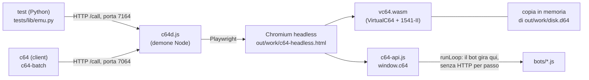
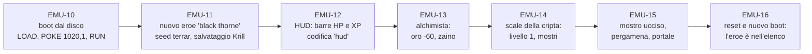

# Il secondo emulatore: vc64web (`containers/vc64web` di Lab64)

Copyright © 2026 - Simone Caporale

Dal 13/11/2026 il progetto include **vc64web** (VirtualC64 compilato in WebAssembly) con il suo controllo da riga di comando
(pacchetto `c64-tools`, build 32 / API 25). **VICE resta l'unico riferimento autorevole** (decisione del committente del
13/11): ciò che dice VICE è giusto per definizione. Il nuovo emulatore serve per due cose:

1. **garantire che il gioco giri anche su un altro core** (un'altra emulazione della CPU, del VIC, del CIA e soprattutto del
   drive 1541-II): il caricatore (Krill), il salvataggio con il plugin, la divisione raster dell'HUD, l'input;
2. fare ciò che con VICE è scomodo: **un bot che gioca dal disco vero**, video con audio e comandi a schermo, lettura del testo
   a schermo, misure ripetibili dalla riga di comando.

**Dump della memoria** (17/11, Lab64 1.15): nella pagina portabile, sezione della memoria, **Memory dump** salva
`c64-memdump-<data>.bin` (64 KB di RAM, color RAM, registri del VIC, banco VIC; formato in Lab64 `docs/viewer.md`). Un dump
fatto durante un problema (un glitch grafico, un valore sbagliato) si legge con le etichette del gioco (`out/work/game.lbl`
della stessa versione): passarlo insieme al numero di versione del disco.

I numeri ottenuti qui (cicli, durate) **non sono misure del gioco**: si confermano in VICE prima di prendere una decisione.
La precisione di questo core rispetto a VICE non è stata confrontata ciclo per ciclo [NON VERIFICATO]: l'unica prova è che il
gioco parte e si gioca (test `EMU-10..16`).

Provenienza, cosa è versionato e cosa no (le ROM Commodore no: la build le prende da `roms/` di Lab64), come aggiornare il pacchetto:
containers/vc64web/docs/INCLUSION.md di Lab64 (`containers/vc64web/docs/INCLUSION.md` di Lab64).

## Architettura



Il disco è una **copia in memoria** nel browser: il file `out/work/disk.d64` non viene mai scritto (gli eroi salvati vivono nella
copia finché il demone resta acceso).

## Cosa sa fare (con i riferimenti ai file del pacchetto)

Tutto il pacchetto è in `containers/vc64web/` di Lab64. Documenti: `README.md` (build, registrazioni), `docs/CHANGELOG.md`, `docs/c64-cli.md`
(**ogni comando**, con output reali e «What is not verified»), `docs/C64-API.md` (API JavaScript `window.c64`, «Limits
found»), `docs/scripting.md` (script di testo), `docs/getting-started.md` (prime prove), `docs/C64-TODO.md` (limiti del core),
`examples/` (script, cicli, shell). Nel seguito «cli §N» = `docs/c64-cli.md` sezione N. Dal 14/11 il pacchetto (documenti,
messaggi, esempi) è **in inglese** come tutto Lab64: gli errori del client sono `ERROR CODE: messaggio`, la schermata del test
tasti dice `KEY AND JOYSTICK TEST`; i titoli citati qui (es. «Limits found») sono quelli inglesi.

| Capacità | Comando / API | Dove è documentata | Usata nel progetto |
|---|---|---|---|
| Avviare il demone, più istanze in parallelo (porte diverse) | `node c64d.js [--port N]`, `c64 --port N` | cli §2 | sì (test: porta 7164) |
| Montare un disco, avvio come da utente | `loadFile NOME @disk.d64 '{"autoload":false}'`, `sendText 'LOAD"*",8\n'` | cli §10 | `EMU-10` |
| Tempo esatto: avanzare N fotogrammi e fermarsi | `runFrames N`, `runUntil {pc,mem,text}` | cli §6 | sì |
| Saltare fotogrammi (caricamenti) | `runFrames N '{"fast":true}'` (warp) | cli §6, getting-started §6 | solo per i caricamenti |
| Joystick e tastiera come un giocatore | `joy`, `keyDown/keyUp`, `sendText`, script `0 JOY2-FIRE 3` | cli §7, `scripting.md` §2 | sì |
| **Bot in pagina** (decide ogni 2 fotogrammi leggendo la RAM) | `runLoop 'CODICE' {frames,every}` | cli §14 | `EMU-13..15` |
| Esito ripetibile: stesso stato + stesso bot = stesso hash | `stateHash`, `retriesTotal`, `_forceRetry` | cli §14, getting-started §7 | [vedi trappole] |
| Etichette del gioco | `loadLabels @@out/work/game.lbl`, poi `peek cur_level`, `runUntil {pc:"main_loop"}` | cli §8 | sì |
| **Testo del gioco a schermo** (anche con codifica propria) | `loadEncoding hud @@out/work/gfx_consts.inc`, `findText 'XP' '{"enc":"hud","addr":"$8400"}'`, `wait text`/`assert text` negli script | cli §9, `scripting.md` §3 | `EMU-12` (solo `loadEncoding` dal 23/11: l'HUD non ha più testo) |
| Cicli esatti tra due indirizzi (min/max/media) | `measure DA A '{"n":20}'` | cli §11 | no (non sono misure del gioco) |
| Stati salvati, esportati su file, confronto | `saveState`, `loadState @file`, `regress save/check`, `ramSnap`/`ramDiff` | cli §12 | no |
| Screenshot, video muto deterministico | `screenshot`, `video file.js` | cli §9, §13 | screenshot nei test |
| **Video + audio dal browser** con tastiera/joystick a schermo | `grabBrowserVideoAndAudio {action,keyboard,joy1,joy2,scale,audioGain}` | cli §13, API 16 | video del 12/11 |
| Molte esecuzioni in parallelo (bot con `RUN=k`) | `node headless/c64-batch --runs N -j J` | cli §14 | no ancora |
| Disassemblato, breakpoint, watch, registri | `disasm`, `breakpoint`, `watch`, `regs`, `call` | cli §11 | poco: per questo c'è VICE |

### Cosa NON sa fare (misurato dal team o da noi; per questo c'è VICE)
- **Niente più veloce del tempo reale** su una istanza: il core non espone un calcolo sincrono dei fotogrammi (il team: `SPEED_BOOST`
  500 % senza effetto, 500 fotogrammi in 10,03 s come al 100 %). Il warp avanza a salti di ~26 fotogrammi: va bene per i
  caricamenti, **mai** per un bot. Un test di 600 fotogrammi di bot dura 12–24 s.
- **Niente profilatore per routine**, niente stato di RAM e CPU del drive, `whenRegs` lento (~0,2 s per stop): il core non ha un
  aggancio per istruzione. VICE ha breakpoint condizionali, `chis`, drive, audio WAV: per questi lavori si usa VICE.
- Solo la famiglia 1541 (1541, 1541-II): niente 1570/71/81.
- **Hardware reale**: nessuno dei due emulatori lo sostituisce (voce `I1` del TODO).
- Docker, `--headed` su un desktop reale, `.prg/.t64/.crt`: non provati.

## Quando conviene usarlo in questo progetto

| Lavoro | Strumento | Perché |
|---|---|---|
| Test di regola, cicli, tempi, prestazioni, drive, loader a basso livello, debug | **VICE** | riferimento; monitor remoto, breakpoint, `chis`, warp molto più veloce [non misurato qui] |
| Controllare che una modifica al loader, al salvataggio, alla divisione raster o all'avvio non rompa il gioco su un altro core | **`EMU-10..16`** | il drive 1541-II e il core sono diversi: un codice sensibile ai tempi fallisce su uno solo dei due |
| Scenario completo dal disco vero, solo joystick e tastiera (creare l'eroe, comprare, scendere, uccidere, portale) | **`EMU-11..15`** | gli smoke di VICE usano scorciatoie (memoria scritta dal monitor, teletrasporto); qui no |
| Leggere un testo a schermo con la codifica dell'HUD | `findText` con `enc` | controlla che la codifica generata dalla build (`out/work/gfx_consts.inc`) sia quella disegnata |
| Video dimostrativo con audio e comandi a schermo | `grabBrowserVideoAndAudio` | in VICE servirebbero strumenti esterni (non provato) |
| Esplorare molte varianti di un combattimento con un bot | `c64-batch` (+ `arena.py` di VICE per confermare) | più istanze in parallelo; il bilancio si decide con simulatore e arena |

Regola pratica: **se una modifica tocca loader, salvataggi, avvio, HUD o input, lanciare `lab64 test regression -k EMU`
oltre ai test di VICE** (2 minuti). Un fallimento qui con VICE verde non dice che il gioco è sbagliato: dice che il gioco
dipende da un comportamento che i due emulatori non hanno in comune, da capire (e, se è un difetto dell'emulatore, da
segnalare al team: sezione «Trappole»).

## Come si usa

Dal 13/11 il demone gira nel container **`lab64-vc64web`** (immagine costruita dal `Dockerfile` del pacchetto, con le pagine
già pronte dentro: `lab64 images vc64web` le genera nel builder con `build.py --no-docker --out out/cache/vc64web` e poi fa la
`docker build` con il contesto `pages=out/cache/vc64web`). Il pacchetto è autonomo e parametrizzato: `--vice-roms`, `--open-roms`, `--out`,
`--tag` (README e `docs/INCLUSION.md` del pacchetto); le ROM le prende dalla sua `roms/` (`containers/vc64web/roms/` di Lab64), identica a `roms/` di Lab64 del progetto.

```sh
./build.sh --emu                                          # build + smoke/sanity con il demone acceso (EMU-* sono in regression)
lab64 test -k EMU        # solo i test EMU-*, con il demone acceso a mano:
docker network create c64 2>/dev/null; docker run -d --rm --init --shm-size 1g --name lab64-vc64web --network c64 lab64-vc64web
EMU_URL=http://lab64-vc64web:7064 C64_DOCKER_ARGS="--network c64" lab64 test -k EMU

# a mano, dentro il container del demone (client node del pacchetto)
docker exec -it lab64-vc64web node headless/c64 start
docker cp out/work/disk.d64 lab64-vc64web:/games/disk.d64
docker exec lab64-vc64web node headless/c64 game disk.d64
docker rm -f lab64-vc64web                        # spegnere
```

**Nei test** si usa `tests/lib/emu.py` (classe `Emu`): parla con il demone all'indirizzo `EMU_URL` (HTTP), manda il disco in base64
(nessuna cartella condivisa), ogni test parte da una macchina nuova (`start`); senza `EMU_URL` o senza risposta i test sono SKIP con
il motivo.

```python
e = Emu(); ok, frames = e.boot()                  # disco vero -> LOBBY (warp solo per i caricamenti)
e.load_labels("game.lbl"); e.load_labels("lobby.lbl", set="lobby"); e.run_script('0 JOY2-FIRE 3\nwait 90')
r = e.run_loop(js, frames=3000)                    # bot in pagina: r["state"] è lo `state` del bot
e.peek("cur_level"); e.word("c_gold"); e.peek("lobby:nvalid"); e.call("findText", "XP", {"enc": "hud", "addr": "$8400"})
e.close()
```

I bot (`tests/regression/emu/bots/`): `lib.js` (percorso a larghezza su `MAP`/`solidtab`, un passo di joystick verso il centro di
una casella), `walk.js` (va a `(GX,GY)`), `hunt_portal.js` (caccia il mostro più vicino, tasto 5, portale). Leggono la RAM con le
etichette di `out/work/game.lbl` e si muovono **solo con il joystick della porta 2**, come prevede la regola del movimento (CLAUDE.md).

### I test `EMU-*` (`tests/regression/emu/cases.py`, ~2 minuti, in catena)



| ID | Cosa verifica | Misure del 13/11 (disco v1.225) |
|---|---|---|
| `EMU-10` | START (con Krill), GAME e LOBBY in RAM uguali ai PRG di `out/`, bordo non rosso | ~23 s di orologio (warp per i caricamenti) |
| `EMU-11` | creazione dal menu con joystick e tastiera, salvataggio sul 1541-II emulato, villaggio: livello 0, PV > 0, oro 100, nome in RAM = «black thorne» | ~28 s |
| `EMU-12` | codifica `hud` letta da `out/work/gfx_consts.inc` (`loadEncoding`); dal 23/11 l'HUD non ha più testo: le righe 22 e 23 (colonne 1-18) della matrice `$8400` sono glifi delle barre (`G_BAR0`..`G_BAR8`) e la barra HP non è vuota | < 1 s |
| `EMU-13` | cammina alla porta dell'alchimista (tile `DALCH`, trovata nella mappa), compra la pergamena (qualunque sia l'ordine della scorta): oro −60, pergamena nello zaino | ~12 s |
| `EMU-14` | cammina alle scale (`TSTAIRS`) ed entra: `cur_level` = 1, mostri presenti | ~25 s |
| `EMU-15` | caccia un mostro, lo uccide, legge la pergamena (tasto 5), entra nel portale: villaggio, PV > 0 | ~18 s |
| `EMU-16` | reset, nuovo avvio dalla stessa copia del disco: la lobby elenca 1 eroe con il nome salvato (controllo negativo fatto: su un disco nuovo `nvalid` = 0) | ~18 s |

## Trappole misurate (leggere prima di scrivere un test)
- **Le etichette dei moduli sovrapposti vanno in insiemi separati**: LOBBY sta a `$C000` come `MAP` del gioco. Caricate nello
  stesso insieme (quello predefinito) si sovrappongono: dopo `loadLabels game.lbl`, `runUntil {pc:"menu_main"}` si è fermato a
  un indirizzo sbagliato [MISURATO]. Si usa `loadLabels @@out/work/lobby.lbl '{"set":"lobby"}'` e poi `lobby:nvalid`,
  `lobby:slot_name` (cli §8; in `Emu.load_labels(name, set=...)`).
- **`pc == $C00C` non basta per dire «sono nel menu»**: START carica codice in quella zona. `Emu.boot` aspetta che i byte di
  `menu_main` in RAM siano quelli di `out/work/lobby.prg`.
- **L'assortimento dell'alchimista cambia a ogni visita** (`enter_shop` lo estrae con `frame ^ rnd`): le due merci (pergamena
  del portale, minor healing) escono in ordine casuale [MISURATO: 9 visite, 5 con la pergamena per seconda]. `EMU-13` legge gli id
  in `l8_id`, porta il cursore sulla pergamena (`ui_lc` = 12 + indice) e rientra se manca. Un test che assume «la prima voce» è
  intermittente: lo era la prima versione.
- **Le parti in tempo reale non sono ripetibili**: `resume` seguito da un `runUntil`/attesa e il warp lasciano `frame` e `rnd` diversi
  a ogni esecuzione. Gli esiti casuali del gioco (scorta, tiri) cambiano; solo `runFrames`, `runScript` e `runLoop` esatti
  partendo dallo stesso stato sono ripetibili.
- **`findText` con la codifica `hud`**: i numeri sono allineati a destra, quindi «LV 1» non esiste (c'è «LV  1»): cercare «LV» e
  il numero a parte. La codifica `hud` cambia a ogni build del gioco: si rilegge sempre da `out/work/gfx_consts.inc`
  (`loadEncoding` accetta direttamente quel file: simboli `G_*` e blocco `.enc "hud"` risolti dall'emulatore).
- **Tempo reale**: `runLoop` e `runScript` girano a 50 fotogrammi al secondo (in modalità esatta il team misura 82 ms contro 44 ms
  per un passo di 2 fotogrammi; sul bot del boss 24 s contro 12 s per 600 fotogrammi, misura del 13/11 con la build 31). Il warp
  (`runFrames N '{"fast":true}'`) si usa solo dove l'esattezza non serve (caricamenti).
- **`runLoop` non esatto con un caricamento da disco dentro il ciclo** [MISURATO una volta]: nel passo in cui il portale
  riporta al villaggio (cambio livello = lettura del disco con Krill) il risultato è `framesActual` 490 invece di 480,
  `exact:false`, `retriesTotal:0`. L'esito del gioco è corretto. Non è un difetto del gioco; è il caso che il CHANGELOG del
  pacchetto dichiara non verificato («ripristino durante un caricamento da disco»). Per questo `EMU-13` e `EMU-15` non
  controllano `exact`. Da segnalare al team.
- **Il ripristino dello snapshot perde gli input** nelle build 30 e precedenti; corretto dalla 31 (verificato il 13/11 sul bot del
  boss: stesso hash con 0, 1 reale, forzate a ogni passo). Se si aggiorna il pacchetto, rifare quella verifica con `_forceRetry`
  (getting-started §7).
- **Un demone per run di test**: `./build.sh` accende il container `lab64-vc64web` e lo spegne alla fine; i test lo usano
  uno alla volta (il lock dei test, `out/tmp/.test.lock`, vale anche per questi). Dopo un'interruzione controllare con `docker ps` che
  non sia rimasto acceso.

## Cosa non è verificato
`--headed` su un desktop reale; il ripristino durante un caricamento da disco (vedi sopra); `sendText` lungo a cavallo di
un ripristino; la licenza di vc64web e delle ROM (voce `I7` del TODO); la precisione del core rispetto a VICE sul codice del gioco
oltre ai test `EMU-*`; il numero massimo utile di istanze di `c64-batch` (ognuna è un Chromium); i test su un computer diverso da
quello di sviluppo.
