# Flussi del codice

Copyright © 2026 - Simone Caporale

Come **gira** il codice (stato dell'11/11, v1.223): sequenze, stati e flussi di ogni parte del gioco, con i nomi delle
routine come stanno nei sorgenti. La struttura statica (programmi, moduli, memoria, regole) è in
[Architettura](architettura.md); le regole di gioco nelle pagine dedicate ([Combattimento](combattimento.md),
[Mostri](mostri.md), [Bottino](bottino.md), [Oggetti](oggetti.md)).

Indice: [1 Avvio](#1-avvio-dal-disco-al-gioco) · [2 Partita](#2-inizio-di-una-partita-game_start-e-lobby) ·
[3 Ciclo](#3-ciclo-principale-un-fotogramma) · [4 Interrupt](#4-interrupt-raster) · [5 Input](#5-input-e-tasti) ·
[6 Cambio di luogo](#6-cambio-di-luogo) · [7 Generazione](#7-generazione-di-un-piano) ·
[8 Precaricamento (tolto)](#8-precaricamento-del-tema-tolto) · [9 Disco](#9-lettura-dal-disco) · [10 Salvataggi](#10-salvataggi) ·
[11 Combattimento](#11-attacco-del-pg) · [12 Mostri](#12-mostri-ia-a-ogni-fotogramma) ·
[13 Morte e portale](#13-morte-portale-scale) · [14 Schermate](#14-schermate-motore-dei-menu) ·
[15 Menu del villaggio](#15-menu-del-villaggio-modulo-menu) · [16 Musica](#16-musica-ed-effetti) ·
[17 Sala del trono](#17-sala-del-trono-e-vittoria)

## 1. Avvio: dal disco al gioco

Sorgenti: `src/barbarian.asm`, `src/common/tramp.inc`, `src/common/boot.asm`, `src/game.asm` (`start`). Dettagli in
[Avvio e storia](intro.md).

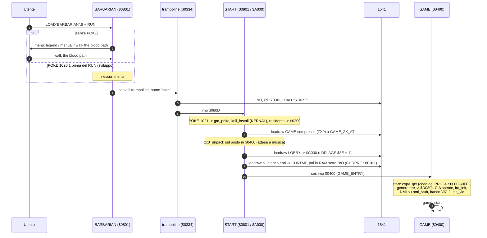

## 2. Inizio di una partita: `game_start` e LOBBY

Sorgenti: `src/game/levels.asm` (`game_start`), `src/game/disk.asm` (`menu_run`, `load_menu`), `src/lobby.asm`.

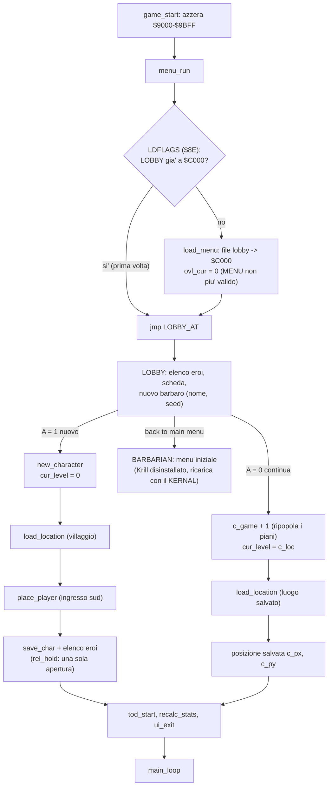

Dal gioco si torna a `game_start` dal menu di gioco (*quit*: dissolvenza della musica, poi di nuovo LOBBY). Musica (15/11; 16/11: dopo aver disegnato l'elenco, `mp_done`; `START` non suona): `ui_menu` avvia Demon's Eye (`mus_place` con `SND_MENU`), l'uscita verso il gioco (`lb_leave`) la dissolve prima di `music_town` ([Musica](musica.md)).

## 3. Ciclo principale: un fotogramma

Sorgente: `src/game.asm` (`main_loop`). Il ciclo è agganciato al vblank: dura al massimo un fotogramma PAL (19 656 cicli);
se sfora si perde un fotogramma ([Prestazioni](prestazioni.md)).

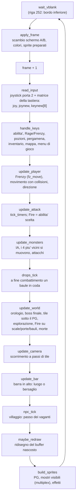

(19/11) `update_bar` e `npc_tick` vengono **dopo** `update_camera`: con `redraw_due` (C=1 se in questo fotogramma
`maybe_redraw` cambia cella o ridisegna tutto) il lavoro che può aspettare un fotogramma salta: il passo degli NPC, il
ricalcolo dell'etichetta del luogo (`loc_check`), il pezzo del testo della barra (`bt_step`); e nel fotogramma di un
ridisegno completo (`rd_sync`) gli NPC tengono gli sprite del fotogramma prima (`npc_draw`). Vicino ai vaganti del villaggio
il ridisegno più questi lavori sforava il fotogramma (persi 3-4% camminando fra gli NPC, test `PERF-24`).

Le schermate (inventario, mappa, menu, negozi...) si aprono **dentro** uno di questi passi (`handle_keys`, `act_tick`)
e girano il loro ciclo finché non si chiudono ([14](#14-schermate-motore-dei-menu)); poi il ciclo principale riprende.

## 4. Interrupt raster

Sorgente: `src/game/hud.asm` (`irq_h`), `src/game/bar.asm`. Un solo IRQ raster che cambia riga a ogni fase
(`irq_ph`); CIA spente. Nelle schermate l'IRQ è spento (`irq_off`).

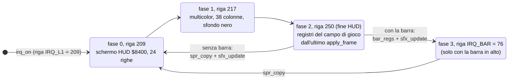

`sfx_update` (effetti e musica) gira una volta per fotogramma nella fase 2 anche se il ciclo principale sfora.
`spr_copy` copia le ombre degli sprite preparate da `build_sprites` (pubblicate tutte insieme, mai a metà).

## 5. Input e tasti

Sorgenti: `src/game.asm` (`read_input`), `src/game/game.asm` (`handle_keys`, `act_tick`). Movimento **solo WASD o
joystick** (regola di `CLAUDE.md`).

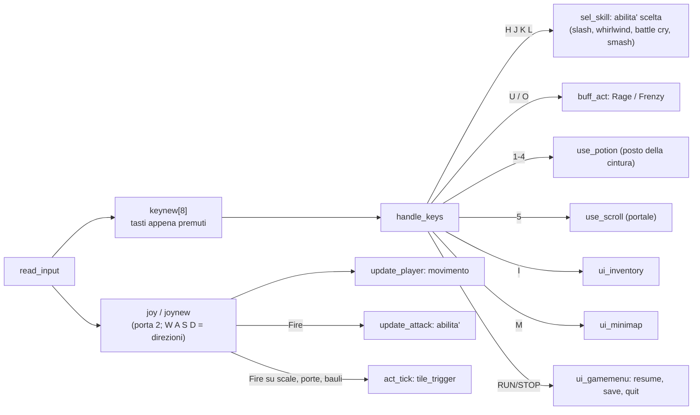

## 6. Cambio di luogo

Sorgente: `src/game/levels.asm`. Ogni passaggio (scale, portale, morte, nuova partita) passa da `change_level`
(A = piano nuovo, X = `spawn_mode`: 0 scale su, 1 scale giù, 2 portale, 3 morte, 4 ingresso sud del villaggio).

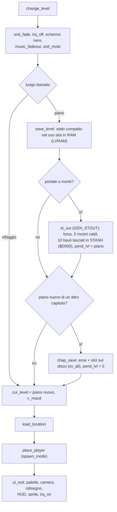

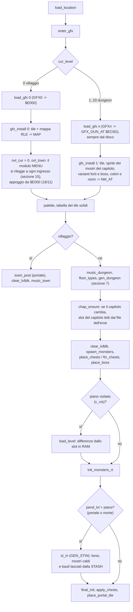

## 7. Generazione di un piano

Sorgenti: `src/game/dungeon.asm` (`gen_dungeon`, `gen_call`, `seed_level`), `src/game/gen_io.asm` (sotto l'I/O).
Regole e parametri in [Dungeon](dungeon.md).

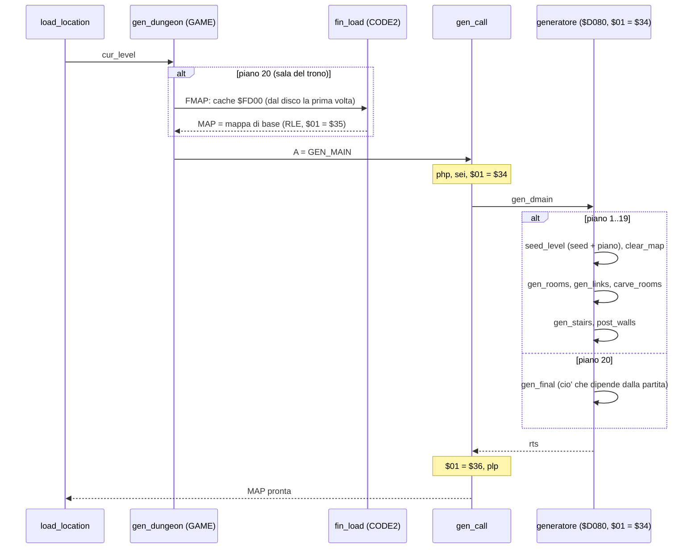

Tutto ciò che sta prima di `init_monsters_rt` è deterministico (seed + piano): stessa mappa, stessi mostri, stessi bauli.

## 8. Precaricamento del tema (tolto)

**Tolto l'11/11 nel ramo `fast-loader`** (richiesta del committente: provare il caricatore veloce senza trucchi di
cache). Il modulo `prefetch.asm` (lettura in sottofondo del tema, `pf_*`) non esiste più (resta `theme.asm` con
`lvl_theme` e `vis_bit`). Con lui sono state tolte le cache `gfx_town`, `gfx_theme` e `fin_ok`, la residenza del modulo
MENU fra un ingresso e l'altro nel villaggio e il salto del brano già nel buffer: ogni ingresso in un luogo rilegge i suoi
file. Cosa reintrodurre dopo le misure con Krill's Loader lo decide il committente ([FastLoader](FastLoader.md)). La storia
(macchina a stati, `pf_use`, `pf_pause`) è in git (commit prima di `fast-loader`).

## 9. Lettura dal disco

Sorgenti: `src/game/disk.asm` (CODE2), `src/game/music.asm` (`snd_io`), `src/game/ui.asm` (`io_screen`). Dall'11/11
tutte le letture passano da **Krill's Loader** ([FastLoader](FastLoader.md)): `load_raw` (destinazione `ptr0`,
`LOAD_TO`) o `load_file` (indirizzo del file).

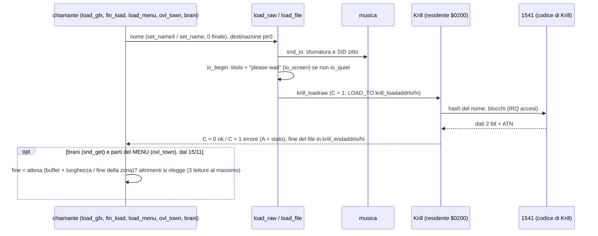

(15/11, ex TODO A2) Krill non segnala una lettura di lunghezza sbagliata: dove il gioco conosce la fine esatta del file la controlla
(`snd_get`: buffer + `snd_llo/hi`; `ovl_town`: `ml_end`) e rilegge; dopo 3 letture sbagliate il brano manca (`snd_cur` = 0,
niente musica) o `ovl_town` esce con C = 1. Causa e correzione del difetto che lo rendeva possibile: [FastLoader](FastLoader.md) 4.1.

Velocità: il modulo MENU (3,3 KB in 3 file) 2,3 s, un tema (2 KB) ~1 s (VICE, 1541 emulata; misure in
[FastLoader](FastLoader.md)). Con il KERNAL erano ~333–390 B/s.

## 10. Salvataggi

Sorgente: `src/game/rel.asm`. Dall'11/11 un file per eroe `save-0N` (eroe + 20 stati dei piani) e l'elenco `hl`,
scritti dal **plugin di save di Krill** (file preallocati, riscritti interi). Formato in [FORMATO_DATI](FORMATO_DATI.md),
quando in [Salvataggi](salvataggi.md).

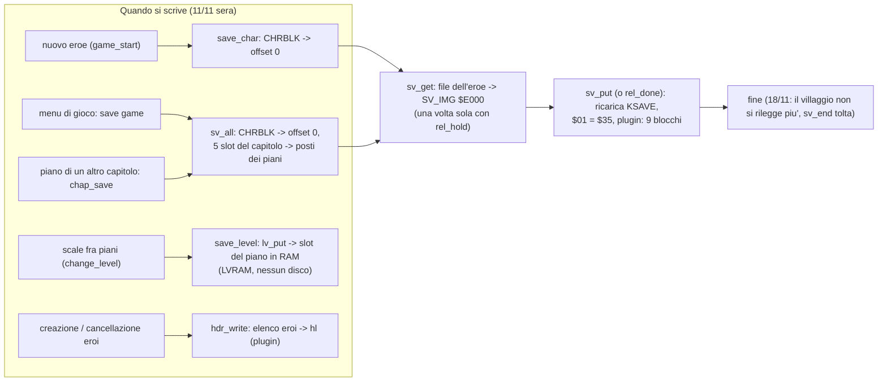

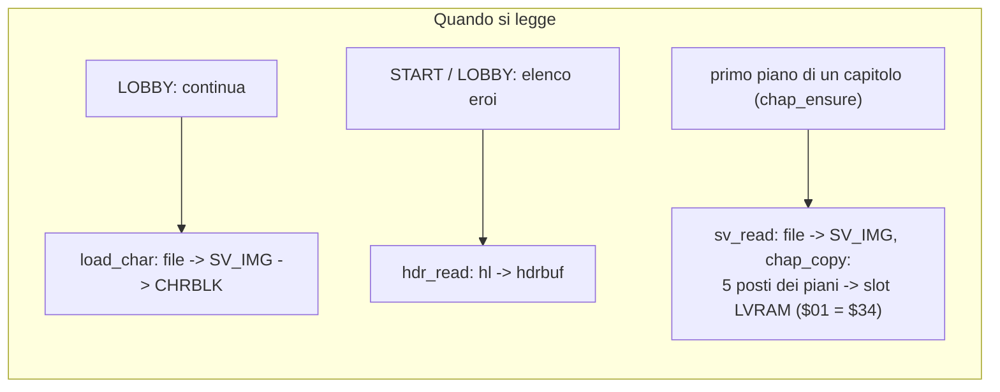

## 11. Attacco del PG

Sorgenti: `src/game/game.asm` (`update_attack`, `perform_skill`, `hit_area`, `kill_monster`, `drops_tick`),
`src/game/combat.asm` (`hit_one`, `add_xp`). Regole in [Combattimento](combattimento.md).

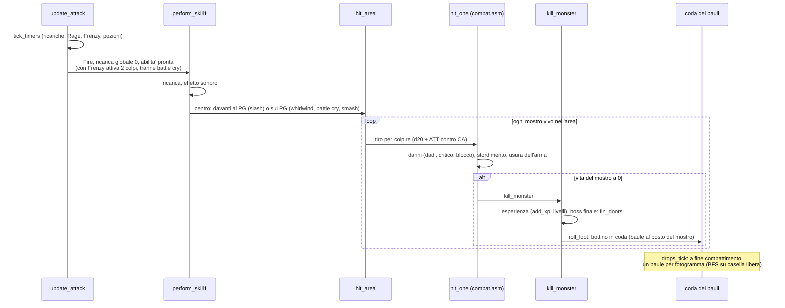

## 12. Mostri: IA a ogni fotogramma

Sorgente: `src/game/game.asm` (`update_monsters`, `sel_begin`/`sel_commit`, `mon_step`), `src/game/combat.asm`
(`mon_attack`, `hurt_player`). Regole in [Mostri](mostri.md).

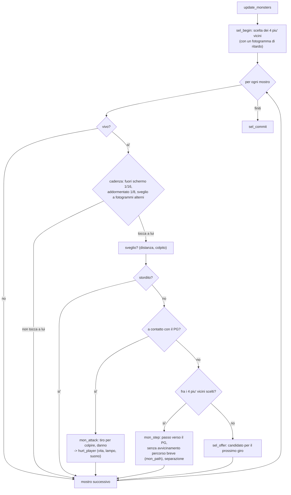

## 13. Morte, portale, scale

Sorgenti: `src/game/game.asm` (`tile_trigger`, `player_die`, `go_down`, `go_up`, `go_portal`), `src/game/levels.asm`.

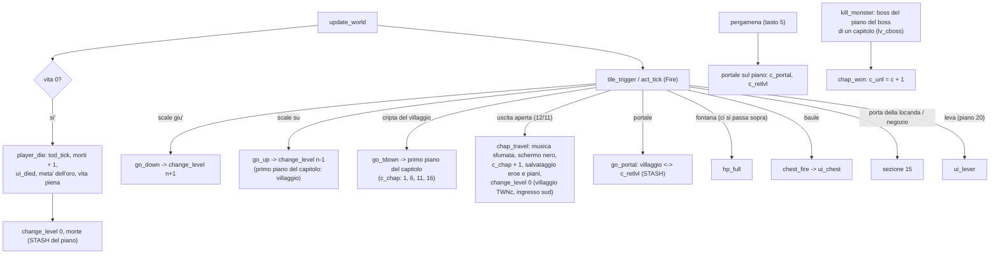

## 14. Schermate: motore dei menu

Sorgente: `src/game/ui.asm` (`ui_begin`, `ui_nav`, `ui_exit`). Tutte le schermate di testo (inventario, minimappa, baule,
menu di gioco, negozi, locanda...) usano lo stesso schema ([Interfaccia](interfaccia.md)).

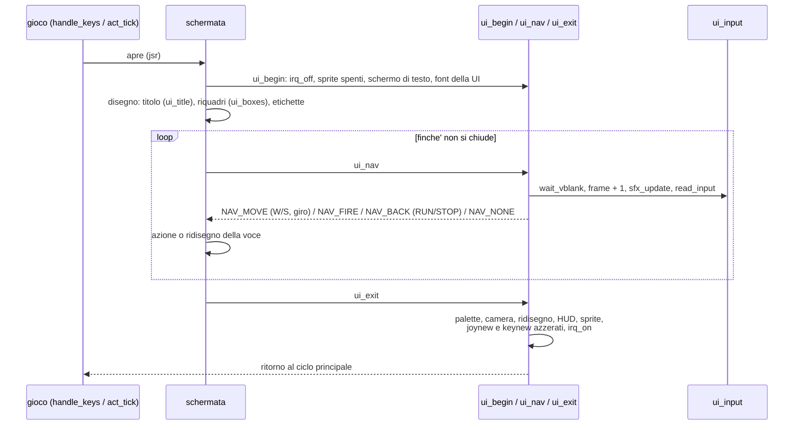

## 15. Menu del villaggio: modulo MENU

Sorgenti: `src/game/stash.asm` (`ovl_town`), `src/menu.asm`, `src/menu/`. Il modulo si carica all'ingresso nel
villaggio e poi resta ([Tecnica](tecnica.md#moduli-su-disco)).

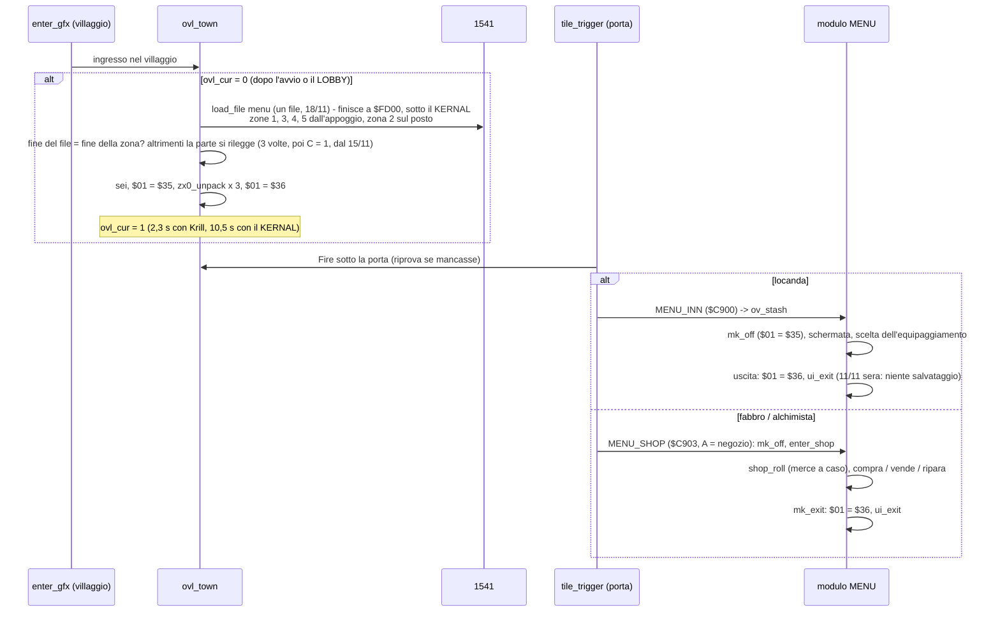

## 16. Musica ed effetti

Sorgenti: `src/game/music.asm`, `src/common/sid_player.inc`, `src/common/sfx.inc`. Dettagli in [Musica](musica.md).

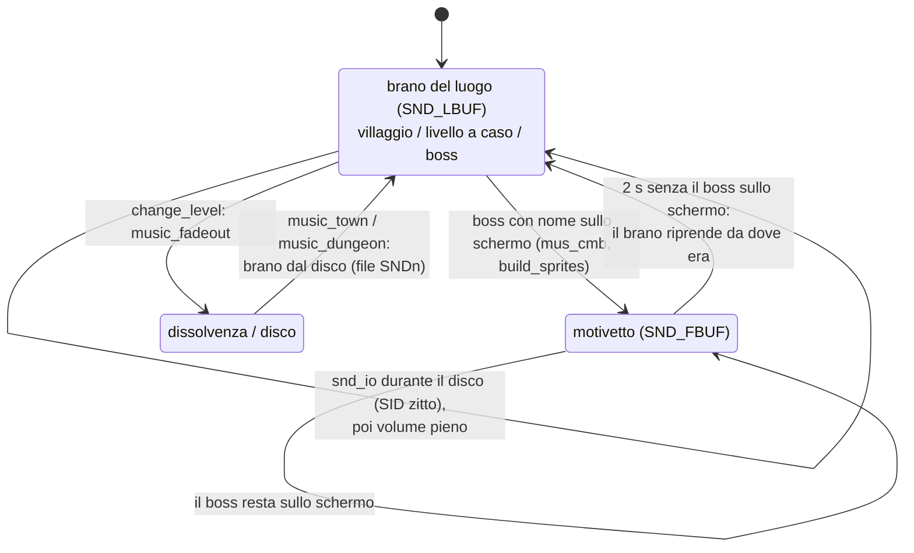

`sfx_play` (effetto sulla voce 1, che il brano lascia libera mentre suona) e `music_update` girano da `sfx_update`: in
gioco nell'IRQ di fine HUD, nelle schermate da `ui_input`.

## 17. Sala del trono e vittoria

Sorgenti: `src/game/dungeon.asm` (`fin_doors`, `fin_chests`), `src/game/gen_io.asm` (`gen_final`), `src/game/game.asm`
(`final_tick`, `kill_monster`), `src/game/ui.asm` (`ui_lever`). Regole in [Mostri](mostri.md).

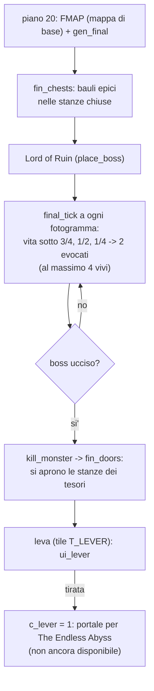
