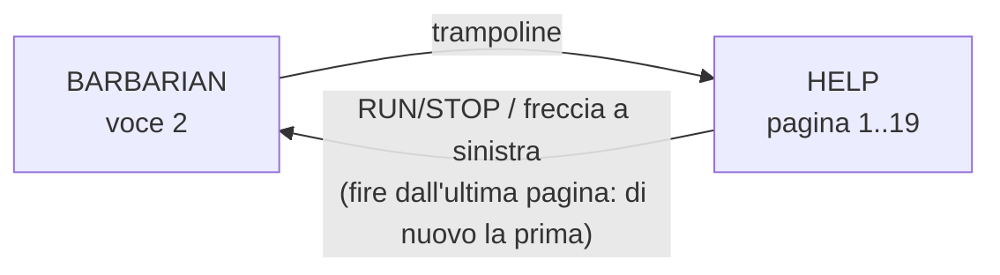

# Help (il manuale nel loader)

Copyright © 2026 - Simone Caporale

Sorgenti: `src/help.asm` (programma), `data/help.txt` (testo delle pagine), `data/help_hud.json` (fotografia
dell'HUD), `tools/build/gen_help.py` (genera `out/work/help.inc` e l'anteprima `out/work/atlas/help.png`). Test: `tests/regression/boot/test_lore.py`
(pagine e ritorno al menu in VICE), `tools/build/gen_help.py --check` (il ritaglio dell'HUD è ancora uguale al gioco).

## Dove sta e cosa costa

- File **`HELP`** sul disco di **release** (38 blocchi, 9,4 KB dal 15/11, con la musica), caricato dalla voce **read the game manual** del loader
  `BARBARIAN` con il trampoline, come `LORE`. Alla fine si torna a `BARBARIAN` (ricaricato dal disco).
- **Sul disco è compresso** (12/11): il file `HELP` è `out/work/helpz.prg` (20 blocchi invece di 38: il player e il brano pesano ~1,6 KB e si comprimono poco): un decompressore in testa
  (`src/help/zx0sfx.asm`) si copia a `$8000` con i dati ZX0 (`out/work/help.zx0`, `tools/build/pack.py`), decomprime `out/work/help.prg` a
  `$0801` e salta al suo `$080D`. `BARBARIAN` lo legge con il KERNAL: nell'emulatore web vc64web il manuale compare
  ~11 s dopo la scelta invece di ~20 s (misura a schermo, risoluzione 1 s). Test: `HELP-Z-10/11` (dati e disco), `LORE-10`
  (release: pagine dal disco).
- È un programma a sé: **non tocca il gioco**. `GAME`, `LOBBY` e gli altri moduli non hanno codice né dati dell'help,
  quindi nessun byte di RAM e nessun ciclo di CPU durante la partita (decisione del committente, 07/11). Il loader è
  sceso da 15 a 13 blocchi (la pagina dei tasti che conteneva è stata tolta).
- Nel disco di debug non c'è (il loader di debug non ha il menu).

## Pagine

(18/11, committente: "il testo è troppo compatto e si capisce poco") **19 pagine** invece di 5: sezioni con il titolo in verde
(`<...>` in `data/help.txt`) e una riga vuota fra l'una e l'altra, **elenchi dei tasti** in due colonne (tasto in giallo, che
cosa fa dalla colonna 21: un TAB in `data/help.txt`), **una pagina per ogni abilità e potere** (memoria: dal 18/11 le pagine
stanno dopo il charset, vedi Tecnica), la scheda del personaggio **C** (punti e tasti) e il **respec** su pagine loro, le
quest **Q**.

| # | Titolo | Contenuto |
|---|---|---|
| 1 | all the keys | tutti i tasti del gioco in elenco: movimento, fire, H J K L, U O, 1-4, 5, I, M, C, Q, RUN/STOP |
| 2 | moving and fighting | camminare, colpire (fire tenuto = colpi di seguito), cadenza: arma e DES bassa più lenta, DES 18 = cadenza dell'arma |
| 3 | skills and powers | che cosa sono, tasti e livelli (H 1, J 3, K 6, L 12, U 9, O 15), ricariche, critico 19-20 dal livello 17 |
| 4-7 | skill: slash / whirlwind / battle cry / smash | una pagina per abilità: livello, che cosa fa, ricarica, consiglio |
| 8-9 | power: rage / frenzy | livello, effetto e durata, ricarica, colori nell'HUD |
| 10 | fire on places | scale, cripta, portale, porte dei negozi e della locanda, baule; la fontana cura |
| 11 | people of the village | Hilde nella piazza della fontana, i vaganti che si fermano vicino al PG, il "quest giver" con il "!" |
| 12 | your quests (q) | elenco (scegliere, aprire, uscire), dettaglio (titolo, capitolo, stato giallo, storia, premio; W/S scorre) |
| 13 | your character (c) | 1 punto per livello dal 2 al 20, a che cosa servono FOR/DES/COS, i tasti della scheda, nulla si spende senza conferma |
| 14 | respec | che cosa fa il gettone, dove si trova (boss finale), come si usa |
| 15 | inventory (i) | regola comune delle schermate, inventario (fire, DEL, I), oggetti rotti, mappa (M) |
| 16 | chests and shops | baule del piano, fabbro e alchimista (comprare, vendere, riparare, R), baule della locanda |
| 17 | menus and saving | menu di gioco, salvataggi automatici, domande sì/no, menu principale |
| 18 | new barbarian, death | nuovo barbaro (RETURN, F1, W/S, fire, DEL, RUN/STOP), morte, oro addosso (10000 al massimo) |
| 19 | the hud | **ritaglio dell'HUD vero** con 8 marcatori numerati e la legenda (come prima) |

Anteprima delle pagine (generata da ogni build): 

## Tasti dell'help

| Tasto | Effetto |
|---|---|
| fire, spazio, RETURN, joystick destra, D | pagina seguente; dall'ultima si torna al loader |
| joystick sinistra, A, DEL | pagina precedente |
| RUN/STOP, freccia a sinistra | di nuovo il loader (unico modo di uscire: dal 16/11 fire, spazio, RETURN, D e destra dall'ultima pagina tornano alla prima) |

Riga 0: titolo della pagina in giallo e "n/19" in ciano; riga 24: "fire: next  left: back  run/stop: menu".

## Tecnica

- Banco VIC 0, schermo `$0400`, charset a `$3000` (`$D018` = `$1C`): codici 0–63 = font della UI
  (`out/work/gfx/uifont.bin`, lo stesso del gioco), codici 64.. = i glifi dell'HUD usati nel ritaglio. Il codice (con il player
  e Demon's Eye) sta sotto `$3000`; (18/11) **glifi e pagine dopo il charset, da `$3800`** (fino a `$8000`, dove il decompressore
  di `src/help/zx0sfx.asm` tiene i dati compressi: due `.cerror`). Nel file il buco `$3000-$37FF` è fatto di zeri, che ZX0
  comprime quasi a niente. Variabili del player a `$C000` (170 B, `SP_VARS`).
- Schermo in **modo testo multicolore** (`$D016` = `$18`): il testo ha colori < 8 (alta risoluzione: bianco testo,
  giallo tasti e titoli, ciano note), il ritaglio dell'HUD i suoi colori, con `$D022`/`$D023` del tema fotografato.
  È lo stesso trucco del loader con il logo.
- Pagine: schermo (1000 byte) e colori (1000 byte) in **RLE** (18/11: byte di controllo 1..127 = ripetizione del byte dopo,
  129..255 = 1..127 byte copiati così come sono, 0 = fine; prima solo coppie conteggio-valore, che raddoppiavano il testo):
  ~9,1 KB per 19 pagine. Il disegno spegne lo schermo (`$D011`), decomprime in `$0400` e `$D800`, aspetta un fotogramma e lo
  riaccende. La tastiera passa dall'IRQ del KERNAL (`GETIN`), il joystick dalla porta 2 (`$DC00`, solo le nuove pressioni).
- **Musica** (15/11, ex TODO E4): suona **Demon's Eye** (lo stesso brano del titolo e del menu principale, non piu' la Tavern of Dawn
  immaginata nel TODO: decisione del committente, un solo brano ovunque) con il player unico (`src/common/sid_player.inc`, senza
  `sp_resume` / `sp_release`) tramite `src/common/title_music.inc`, in comune con BARBARIAN. **Clock**: non l'IRQ del KERNAL com'e' (timer
  a ~60 Hz, non verificato a 50 Hz PAL) ma il **CIA1 timer A con latch a 19656 cicli** (312 righe x 63 = un fotogramma PAL): `tm_start`
  mette il vettore `$0314` su `tm_irq` (suona e prosegue in `$EA31`, cosi' `GETIN` funziona come prima) e ricarica il timer; nessun IRQ
  del VIC. **Uscita** (RUN/STOP o freccia a sinistra; dal 16/11 non più fire dall'ultima pagina, che torna alla prima): `tm_stop` (`sei`, `sp_stop`, SID tutto a 0 volume compreso, vettore
  `$EA31`, latch del KERNAL `$4025`, IRQ del timer in sospeso confermato) **prima** del `LOAD` del KERNAL che ricarica BARBARIAN
  (il trampolino fa anche IOINIT e RESTOR). Test: `TITLEMUSIC-10` (vettore, 1 chiamata ogni 19656 cicli, ripristino).
  Voci come in START (lead sulla voce 1 del SID), non come nel gioco e in LOBBY (lead sulla 2).

## Il ritaglio dell'HUD

Non è disegnato a mano: `tools/build/gen_help.py --snap` assembla la variante di test **`TESTUI=28`** (livello 15, piano 2,
equipaggiamento e cintura di `test_ui_fill`, arma quasi rotta, 2 chiavi, vita a 40 punti dal massimo, esperienza a metà
del livello), la avvia in VICE, lascia girare **40 giri del ciclo principale** (sempre lo stesso istante: fotografia
ripetibile) e legge dalla memoria le righe 20–23 dello schermo HUD (`SCR_H` + 800), la color RAM, i glifi usati dal
charset del gioco (`$A800`) e `$D022`/`$D023`. Le icone dell'usura, che lampeggiano rosso/giallo, si salvano rosse.
Nell'help si vedono le colonne 1–38 (l'HUD del gioco è a 38 colonne).

**Quando rifarlo**: se cambia la grafica o la disposizione dell'HUD (`src/game/hud.asm`, glifi in `tools/build/gen_gfx.py`).
Il test della release (`tools/build/gen_help.py --check`) rifà la fotografia e la confronta con `data/help_hud.json`: se
differisce fallisce con "rifare tools/build/gen_help.py --snap".

## Come si aggiorna il testo

`data/help.txt`: una pagina per sezione `=== titolo`; ogni riga del file è una riga dello schermo (dalla 2, colonne
1–38: il generatore si ferma se una riga è più lunga o se la pagina supera la riga 23). `[testo]` = giallo (tasti),
`{testo}` = ciano (note), `@hud` = il ritaglio (4 righe). **Ogni tasto o schermata cambiata nel gioco va riportata
qui nello stesso lavoro** (regola in `CLAUDE.md`).

## Tasti del gioco che si sovrappongono (segnalati il 07/11, non cambiati)

Con la tastiera W A S D fanno anche da joystick, quindi in alcune schermate un tasto ha due significati:
- **inventario**: `D` (destra) apre la cancellazione dell'oggetto (che chiede comunque Y/N);
- **baule**: `A` (sinistra) prende tutto;
- **negozi**: `S` (giù) passa da compra a vendi invece di scendere; anche `Q` esce dal negozio (non scritto nell'help).
