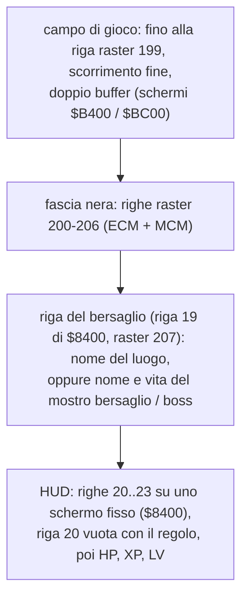

# Interfaccia

Sorgenti: `src/game.asm` (`read_input`), `src/game/game.asm` (`handle_keys`, `act_tick`), `src/game/hud.asm` (HUD),
`src/game/bar.asm` (bersaglio: riga 19 dell'HUD), `src/game/ui.asm` (schermate a tutto schermo), `src/lobby.asm` (menu iniziale).
Tutti i testi del gioco sono in inglese; i nomi di oggetti, mostri e abilità non si traducono.

## Comandi

| Comando | Effetto |
|---|---|
| Joystick porta 2 | movimento (8 direzioni) |
| Fire tenuto | abilità scelta (si ripete appena pronta) |
| Fire su scale, portale, porte, baule | usa il luogo / apre il baule (fermi, nessun mostro entro 2 caselle) |
| H / J / K / L | sceglie Slash / Whirlwind / Battle Cry / Smash (se il livello basta) — mano destra sulla riga centrale |
| U / O | attiva Rage / Frenzy (sopra J e L) |
| 1 2 3 4 | beve la pozione del posto 1..4 della cintura |
| 5 | legge una pergamena di portale |
| I | inventario |
| M | mappa del piano (solo le parti esplorate) |
| C | (11/11, branch `feature/stat-points`) schermata del personaggio: punti statistica e respec (`ui_charsheet`) |
| Q | (22/11) elenco delle quest prese (titolo, "n/N" o "done"); Fire = dettaglio: titolo, obiettivo giallo con il contatore, testo che scorre con W/S, premio; senza quest "talk to the villagers" (`ui_quest` → modulo `QGIV`, [Quest](quests.md) 4.5) |
| Fire accanto a un NPC fisso | (22/11, villaggio) modulo `QGIV`: consegna con il premio, oppure la quest presa e il suo testo, oppure "nothing for you now" (i luoghi hanno la precedenza) |
| RUN/STOP | menu di gioco: resume, save game (salva e torna al gioco, senza schermata di conferma: basta l'attesa di `io_screen`, 08/11 sera), quit game (torna al menu dei barbari **senza salvare**, 11/11 sera) |

Scelta dei tasti (06/11): chi gioca di tastiera ha la sinistra su W A S D + spazio e la destra sulla riga
centrale H J K L (quattro abilità in fila) con U e O subito sopra per Rage e Frenzy; le pozioni 1–4 e la
pergamena 5 restano sulla riga dei numeri. I tasti funzione sono stati abbandonati (lontani e solo quattro).
Alternativa non implementata per chi usa il joystick con la destra: Q E R F + T G con la sinistra.

Lettura della tastiera: `keynew[riga]` contiene i tasti appena premuti per riga della matrice CIA (H = riga 3
bit 5, J = riga 4 bit 2, K = riga 4 bit 5, L = riga 5 bit 2, U = riga 3 bit 6, O = riga 4 bit 6).

## Schermate: un solo modo di muoversi (07/11 sera)

Tutte le schermate a tutto schermo usano lo stesso motore, `ui_nav` (`src/game/ui.asm`; progetto e storia in
[Refactor dei tasti](refactor-tasti.md)):
- **su/giù** (joystick 2 o **W/S**) spostano il cursore `>`; **fire / spazio / RETURN** confermano; **RUN/STOP**
  torna indietro (chiude la schermata). **Sinistra/destra e A/D non fanno nulla**; nessuna lettera di scorciatoia
  (tolte D, A, S, Q, DEL, cursore ←→). Eccezioni volute: **I** chiude ancora inventario e locanda, **M** la mappa.
- Il cursore scorre la lista dall'alto in basso, con giro. **Linguette tolte l'11/11** (ottimizzazione O1): nessuna
  schermata le usava più (`ui_tabs` mai chiamata, `tb_n` sempre 0); con la lista vuota `ui_lc` = $FF e Fire dà
  `NAV_TAB`, che le schermate senza voci ignorano, come prima.
- **Domande** (`ui_yesno`): fire o Y = sì, RUN/STOP o N = no.
- Riga 24: sempre `fire:select  run/stop:back` (`nav_help`; 08/11 tolto `w/s:move`, implicito).
- **Colori** (08/11, scelti dal committente su prove in VICE): cornici dei riquadri **grigio scuro** (`UC_BOX` = 11),
  titoli sulle cornici **grigio chiaro** (`UC_BTTL` = 15: `ui_at` riconosce il titolo perché il testo parte sopra un
  `BOX_H`), etichette ciano, **tutti i numeri gialli** (statistiche, quantità, prezzi, oro: `UC_VALUE` = 7, 08/11, prima
  bianchi), **nomi degli oggetti bianchi** (`UC_ITEM`; magici azzurri, maledetti grigi, unici gialli, rotti rossi), titolo della schermata giallo, riga dei tasti grigio medio.
- **Oro** (08/11, regola del committente): mai la parola, sempre la **moneta** (un glifo, `CH_COIN` = 92, gialla).
  Possesso: moneta e poi il valore (`ui_gold`: `o 2350` in purse, inventario, locanda, scheda). Prezzi e valori: numero e
  poi moneta, attaccati (`ui_coin`: `buy 25o`, `sell 600o`, `fix 45o`, `val 1200o`, `64o` nel baule, `buy for 1200o?`,
  `not enough o.`). Il danno delle armi (`1d8+2`) e' tutto giallo, `d` e `+` compresi (`ui_dice`).
- **Titolo** (08/11): ogni schermata ha un titolo, scritto da una sola routine `ui_title` (A/X = testo, Y = icona ai
  due lati o 0; riga `ti_row`, 0 di base): centrato, giallo. Negozi (martello, scudo, ampolla), bauli (moneta),
  backpack, inn (con il boccale `CH_INN` = 101 ai lati, 09/11), game menu, saved game.
- **Componenti comuni** (21/11, branch `liste-menu`; prima, dall'08/11, `list8`, `eq_draw`, `draw_entries`, `purse_draw`):
  `ui_boxes` (riquadri da tabella) e le **liste a scorrimento** di `src/game/slist.asm` (segmento CORE): una voce per riga
  (colonna 1 cursore, 2 segno: spunta `CH_EQ` gialla per l'indossato, cintura `CH_BELT` azzurra, zaino `CH_PACK` grigio
  chiaro; 4 icona della categoria; nome dalla colonna 5; prezzo a destra nei negozi), posti liberi `-`, riga sottile
  `CH_SEP` fra i blocchi, barra di scorrimento `CH_THUMB` sulla cornice destra e posizione " n/N " nel titolo; due liste per
  schermata al massimo. (22/11, committente) **Le due liste si percorrono come una sola**: giù oltre l'ultima voce di una si
  passa alla prima dell'altra, su dalla prima all'ultima dell'altra (dalla fine della seconda si torna all'inizio della
  prima); **A/D saltano alla prima voce dell'altra lista** (`sl_oth`, `sl_nav`). Con una lista sola, o con l'altra vuota, il
  cursore fa il giro nella stessa lista come prima. (22/11, committente) **Il cursore salta i posti vuoti** (`-`) oltre alle
  righe separatrici (`sl_ok`, `sl_fwd` in `src/game/ui.asm`, in GAME perché CORE è pieno); all'apertura e dopo un acquisto,
  una vendita o uno spostamento va sulla prima voce con un oggetto. In liste senza oggetti si ferma su un posto vuoto dopo
  64 tentativi (`SL_NTRY`). Test `UI-LIST-10`, `UI-LIST-11`. (22/11, correzione chiesta dal committente) L'**inventario si apre con
  il cursore sull'arma** (prima voce della lista) e la finestra dall'inizio: prima il cursore partiva dal primo posto dello zaino
  con la finestra dalla seconda riga, e spesso il `>` non si vedeva. Voci da segmenti (`SK_EQ`, `SK_PACK`, `SK_BELT`, `SK_CHEST`, `SK_WARE`). Le
  schermate a due liste (negozi, locanda, baule del piano) usano `ls2_frame`, `ls2_init`, `ls2_draw` (righe 2-7 e 10-16) e
  il riquadro dell'oggetto `iv_sel` (righe 18-22: icona e nome nel titolo; la riga 3 la sceglie la schermata, `iv_l3`).
- **Icona della categoria** (08/11 sera, `ui_cic`): in ogni lista di oggetti (pack, wares, contents, zaino e baule
  della locanda) e nel riquadro selected item, la colonna fra il cursore e il nome mostra l'icona della categoria al
  posto dello spazio: spada (`CH_SWORD` 70, bianca), armatura (`CH_ARMOR` 71, grigio chiaro), scudo (`CH_SHLD` 35,
  marrone), anello (`CH_RING` 72, giallo), pozione (`CH_POT` 68, nel colore della pozione), pergamena (`CH_SCR` 69,
  grigio chiaro); spazio sui posti vuoti e sulla riga dell'oro del baule. I nomi ("prefisso nome of suffisso" dal 21/11 sera) stanno interi dove c'è
  spazio (22/11, committente; prima 16 colonne fisse): **33 colonne** (fino alla 37) in inventario, locanda e baule, **27** nei negozi, dove
  dalla colonna 32 c'è il prezzo (`sl_wd`, scelto in `sl_row` da `sl_rv`; `ui_item` usa sempre le colonne `ui_w` del chiamante: righe
  `sl_wd`, titolo del riquadro 34, messaggio "replaced" 16). Nella voce del cursore un nome più lungo **scorre** (fase 5 degli affissi, decisione del committente ex B4: un carattere
  ogni 8 fotogrammi, pausa all'inizio e alla fine); colore del nome secondo la qualità (bianco, azzurro magico, grigio maledetto, giallo unico `UC_UNIQUE`: 22/11, con il suo nome);
  nel titolo del riquadro dell'oggetto il nome completo (fino a 34 colonne) e nella riga sotto i poteri degli affissi che non stanno
  nei numeri ([Oggetti](oggetti.md)). La colonna in più non sposta
  nulla. Le etichette weapon/armor/shield/ring non compaiono più in nessuna schermata.
- Variabili `ui_cur`, `ui_n`, `ui_lc` (e `tb_n`/`tb_i`, contatori di `ui_boxes`); `nav_init` legge una volta la tastiera
  all'apertura, così un tasto già premuto (fire, I) non conta. Nelle build `NOKEYS` (screenshot) `ui_nav` non legge
  nulla: in VICE, prima del ciclo di gioco, compariva un RUN/STOP fantasma (causa non trovata, **da verificare**).

**Help** (07/11 sera, terza versione): programma **`HELP`** sul disco di release, caricato dalla voce **read the game
manual** del loader `BARBARIAN`: 5 pagine con tutti i tasti del gioco e delle schermate e il **ritaglio dell'HUD** con
la legenda. Non sta nel gioco (nessun byte di RAM né tempo di CPU di `GAME`). Pagina [Help](help.md).

## Schermo di gioco

**Riga del bersaglio** (23/11, decisione del committente; prima una barra di 8 sprite in cima allo schermo, che copriva il PG
in cima alla mappa e su cui passavano gli sprite): riga 19 dello schermo HUD (`bt_row`, `src/game/hud.asm`), nome del mostro
alle colonne 1-24 nei glifi dell'HUD (lettere, cifre, "/", "."; il resto spazio: tradotto da `nbuf`, codici schermo) e la sua
vita in 12 caratteri `G_BAR` viola alle colonne 26-37 (da `cellf`); oppure l'etichetta del luogo o il messaggio delle quest.
Ogni 4 fotogrammi, ogni cella scritta una volta (niente riga cancellata e riscritta: niente lampeggi); spegnendosi, il testo
resta 1 s (`BTH_FR`); a barra spenta la riga si riscrive vuota ogni 16 fotogrammi (altre schermate usano `SCR_H`). Gli
sprite `BARSPR` ($8800/$B000) e `bt_step` restano solo per il testo della minimappa.

**Bersaglio: quale mostro** (`src/game/bar.asm`, `bar_target` / `update_bar`, 06/11 sera): ogni colpo a segno del
PG la sposta sul mostro colpito (`hit_one`); se non c'è un bersaglio (`bar_t` = 0) la prende il mostro che attacca
il PG (`mon_attack`) o quello che si sveglia (aggro, `mwake` 0 → 1); il boss del piano con nome è mostrato solo
quando la barra è libera. Ogni nuovo bersaglio la tiene per 250 fotogrammi (`bar_t`), rinnovati a ogni colpo.
Senza mostri: il nome del luogo sotto i piedi del PG (nel villaggio anche 1-2 caselle davanti alla porta di un
negozio o della locanda: `pl_tile`).

### HUD (`src/game/hud.asm`)

| Riga | Contenuto |
|---|---|
| bersaglio (19) | (23/11) nome e vita del mostro bersaglio (viola), o etichetta del luogo / messaggio delle quest: sopra |
| regolo (20) | vuota (spazio nero) con il regolo nell'ultima linea di pixel |
| HP | vita attuale / massima (16 bit) e barra rossa (24 caratteri, `scale`) |
| XP | esperienza / soglia del livello successivo e barra gialla della frazione (16 bit bassi). Da 10000 in su ogni numero (ciascuno per conto suo: `9999/27K`) è in **migliaia senza decimali** (`10K`, `11K` … `65K`, `hput_k`; 07/11 sera): `65K/30K` sta sempre negli 11 caratteri fra la colonna 4 e la barra. Al livello massimo: `MAX`. Test: `tests/regression/hud/test_hudxp.py` |
| LV | livello; H J K L alle colonne 9, 11, 13, 15 (12/11: due colonne più a destra, richiesta del committente; il nome dell'abilità scelta dalla colonna 8) (giallo la scelta, bianco le altre); U e O (giallo attiva, bianco pronta, ciano in ricarica). Una lettera compare **solo se l'abilità è disponibile** (livello raggiunto; 07/11: prima grigio 11, che è un colore ≥ 8 e rendeva il carattere multicolore e illeggibile); chiavi; cintura (4 pozioni, **blu durante la ricarica delle pozioni**) |

**Avvisi** (`hud_warn`, chiamata da `bs_body` una volta ogni 16 fotogrammi, 06/11 pomeriggio):
- **vita bassa** (`c_hp` ≤ `hpmax` / 4): le celle "HP nnn/nnn" della riga 21 (colonne 1–11, color RAM `$DB49`…)
  alternano rosso (2) e giallo (7) a ogni chiamata (bit 4 di `frame`); al passaggio sotto la soglia un suono
  (`SFX_LOWHP`), una volta (`hw_low`). Quando la vita risale la riga HP si ridisegna (`hud_pend` bit 0);
- **oggetto che si sta per rompere** (`hw_icons`): per arma, armatura e scudo indossati che si usurano, se la
  durabilità è ≤ `WARN_PC` = 20% del massimo (`rules.yaml durability.warn_percent`; nel codice durabilità ×
  `WARN_MUL` (5) ≤ massimo, a 8 bit con riporto: un pugnale nuovo 15/15 non si accende, 3/15 sì), la sua icona (`G_WSWORD`,
  `G_WARMOR`, `G_WSHIELD`: 3 glifi nei codici liberi del charset, `HUD_WARN` in `tools/build/gen_gfx.py`) lampeggia
  rossa/gialla in riga 21, colonne 29–31 (sopra la cintura); a durabilità 0 (arma rotta, 07/11) resta **fissa** in rosso. Restano accese anche nel villaggio. `hud_p3` le
  ridisegna subito dopo aver pulito la riga, così non sfarfallano.
Costo: ~160 B di codice, 1 byte di RAM, 24 B di glifi. Test: `tests/regression/items/test_items.py`; screenshot `TESTUI=27`.
- **punti statistica** (11/11, branch `feature/stat-points`): se `pts_avail` > 0, in riga 23 **accanto al numero del
  livello** (colonna 6) una **freccia verde in su** (colore 5, `G_LVUP`, quarto glifo di `HUD_WARN`; scelta del committente l'11/11, **glifo ancora da confermare**:
  proposte in `lab/concept/hud_glyphs/`): c'è un punto da spendere, il tasto C apre la schermata del personaggio.
  Disegnato da `hud_p2` (riga del livello). Test `STAT-11`.

Scegliendo un'abilità il suo nome compare per qualche istante al posto di "H J K L" (`SK_SHOW`, `hud_nm`);
lo stesso posto mostra "broken" quando un oggetto indossato si rompe (07/11: resta indossato, senza effetto). L'HUD si
ridisegna solo quando serve (`hud_dirty`). I caratteri hires nell'HUD multicolor accettano solo i colori 0–7
(per questo le pozioni in ricarica sono blu e non grigie).

## Schermate a tutto schermo (`src/game/ui.asm`)

Tutte spengono lo split raster (`ui_begin`), usano il font della UI (`$B800`) e tornano al gioco con
`ui_exit`.

| Schermata | Routine | Contenuto |
|---|---|---|
| Inventario | `ui_inventory` → `iv_main` (segmento CORE, `src/game/inv.asm`) | 21/11 (branch `liste-menu`, prototipi approvati dal committente): titolo "backpack" (riga 0). **Statistiche** (righe 1-5, titolo = nome del PG): lvl/xp/oro/chiavi, hp/att/ac/dmg, str/dex/con. **Lista "items"** a scorrimento (righe 7-16, `slist.asm`): una voce per riga, prima l'equipaggiamento (arma, armatura, scudo, due anelli; segno ✓ giallo `CH_EQ`), poi la cintura (4 posti, segno `CH_BELT`), poi lo zaino (8 posti, segno `CH_PACK`), separati da una riga sottile (`CH_SEP`); posto libero = "-"; barra di scorrimento sul bordo destro (`CH_THUMB`) e posizione " n/N " nel titolo. **Oggetto selezionato** (righe 18-22): icona e nome nel titolo, poi proprietà (`it_prim`, `it_sec`: requisito di FOR "str N" se non raggiunto), valore e durabilità, provenienza ("equipped", "in belt") o, per lo zaino, il confronto "you: ..." con l'oggetto indossato della stessa categoria. Fire usa o indossa (la cintura si guarda soltanto: posizione delle pozioni in futuro), DEL getta, I o RUN/STOP chiudono |
| Oggetto selezionato | `iv_sel` (segmento CORE) | 21/11: in tutte le schermate di oggetti (inventario, negozi, locanda, baule del piano), righe 18-22: icona e nome nel titolo, caratteristiche principale e secondaria (`dmg 2d6+3`, `2h pen 1`, requisito "str N" se manca la FOR), valore e durabilità (negozi: solo la durabilità), riga 3 della schermata (`iv_l3`) |
| Baule del piano | `ui_chest` | 21/11 (liste a scorrimento): titolo "o golden chest o" (moneta ai lati; chest / key chest / golden chest / epic chest); lista **contents** (righe 2-7, gli oggetti del baule; nel titolo l'oro trovato aprendolo), lista **yours** (righe 10-16, come l'inventario: indossati, cintura, zaino), riquadro dell'oggetto con il confronto "you: ...". Fire nella lista contents prende l'oggetto; nell'altra lista si guarda soltanto. Riga 23 i messaggi ("the belt is full.": la pozione resta nel baule; "pack is full.", "max 10 scrolls."); un baule vuoto sparisce. Chiuso: "it is locked. you need a key." |
| Negozio | `enter_shop`, `sh_draw` (modulo MENU) | 21/11 (liste a scorrimento): liste **wares** (prezzo pieno a destra) e **gear** (fabbro) / **yours** (alchimista) con il prezzo di vendita e l'oro totale nel titolo, riquadro dell'oggetto con `buy` / `sell` / `repair`; fire = buy (merce), sell (zaino, cintura); R = repair (fabbro); l'indossato non si vende; pozione comprata: scelta del posto della cintura. Dettagli: [Villaggio](villaggio.md#negozi-enter_shop-sh_draw-modulo-menu-dall1111) |
| Locanda | `ov_stash` (modulo MENU) | 09/11: titolo "inn" fra due boccali (`CH_INN` = 101). 21/11 (liste a scorrimento): liste **yours** (indossati, zaino; oro addosso nel titolo) e **chest** (24 posti; oro del baule nel titolo), riquadro dell'oggetto; fire sposta fra zaino e baule o toglie l'indossato, E indossa; entrando l'oro addosso va nel baule. Dettagli: [Villaggio](villaggio.md#baule-della-locanda-ov_stash-modulo-menu) |
| Mappa | `ui_minimap` | si chiude con fire, M o RUN/STOP (`mm_close`); mappa esplorata del piano; in basso "chapter 3 level 4" (12/11; nel villaggio, dal 23/11, il **nome del villaggio** del capitolo, es. "aldric's hollow": tabelle `vil_nm`/`vil_lo`/`vil_hi` generate da `tools/build/gen_maps.py` in `town_places.inc` dal `NAME` di `villages.py`, al massimo 21 caratteri, indice `c_chap` - 1; non nell'intestazione TWNc perche' il file del villaggio 1 e' gia' a `TOWN_MAX`. Dal 23/11 niente seed e coordinate del PG, decisione del committente: le coordinate sono nel menu dei trucchi, il seed nel menu di gioco); nel villaggio tutta visibile: strade e piazze in ciano, **fiume in blu** (celle con sola acqua: `mm_wat`), 3 icone (incudine, ampolla, boccale della locanda `CH_INN`; `MI_N`, 09/11: tolto lo scudo dell'armaiolo e la casetta) sopra le porte e la cripta segnata come scala |
| Menu di gioco | `ui_gamemenu` | resume, save game, **quit game**; (15/11) nelle build con `CHEATS=1` (debug e test, non la release: [build](build.md)) una quarta voce **cheats** apre il menu dei trucchi (`cheat_menu`, `src/game/cheats.asm`: titolo "cheats" in riga 4, 5 voci a x=15 nelle righe 8-16, stato del god mode dopo la prima, conferme in riga 23, RUN/STOP torna al menu di gioco; screenshot `docs/screens/trucchi.png`, variante `TESTUI=41`) (09/11: voci a x=15 come il titolo "game menu", cursore a x=13; versione centrata, in ciano; 23/11, committente: **"seed XXXXXX"** della partita in riga 18 e la versione in riga 20 (una riga vuota fra i due), centrati e staccati dalle voci, che finiscono in riga 14) (07/11 sera: prima "quit to main menu"; domanda "quit game?", salvataggio, `game_start` → menu iniziale; fino al 06/11 la voce quit tornava al menu di gioco: un `bne +` saltava al `+` della voce help, tolta il 07/11). Domanda "quit game?" (09/11): **vecchio stile** (testo centrato senza riquadro), riga dei tasti "y:yes  n:no" in riga 24 come tutte le domande; dall'11/11 sera il testo è "unsaved progress will be lost" e Y/fire esce **senza salvare**, N/RUN-STOP torna al menu di gioco (`ui_yesno`) |
| Morte | `ui_died` | 09/11: titolo **rosso** con il teschio (`CH_SKULL` = 100 nel font UI) in riga 3 (`ti_row`/`ti_col`), riquadro (2,6,36,9) con "you lose half of the o you carry." (riga 8), "the o in your inn chest is safe." (riga 10; moneta gialla `ui_coin`), "you wake up in town." in bianco (riga 13), riga 24 "fire:continue"; fire o RUN/STOP continuano (`ui_wait_fire`) |
| Salvataggi di un'altra versione | `ui_badsave` | 09/11, **vecchio stile** senza riga dei tasti: "bad save file version", "found    : n" (primo byte del record `REC_HDR`, `hdrbuf`) e "expected : n" (`SAVE_VER`), in **decimale** (`ui_b3l`); voci "destroy all data" (cancella tutti i salvataggi, "deleting saved games") e "quit" (`bb_quit`, `$C009`), cursore su quit |
| Caricamento / salvataggio | `io_screen`, `io_screen_scan` | 09/11: titolo ("saving barbarian", "loading level n" (12/11: n = piano del capitolo), "reading barbarians", "loading" (locanda); dal 09/11 **senza "..."** (risparmio di byte) e **centrato**: "reading barbarians" da x=11, "saving/loading barbarian" e "... level n" da x=12 (mezza colonna di scarto per la parità), "loading" da x=16) in riga 9, poi "please wait" in riga 15; **niente barra** (11/11 sera, regola del committente; prima una barra verde in un riquadro). |
| Attese senza caricamento | `ui_pwait` | 09/11: "deleting barbarian" (LOBBY, dopo il sì nella scheda; riga 9 da x=11, centrato) e "deleting saved games" (badsave; riga 9 da x=10, centrato), senza "...", poi "please wait" centrato in riga 15 come `io_screen`, **senza riquadro né barra**: è una sola scrittura del record `REC_HDR` (`hdr_write`, silenziosa). Regola: la barra solo se c'è un caricamento con un avanzamento da mostrare |
| Personaggio (tasto C) | `ui_charsheet` (`src/csheet/charsheet.asm`, 11/11; **rifatta il 15/11**, TODO Z5, richiesta del committente; **dal 21/11 sera modulo su disco `csheet`** a `$EC00`, letto da `cs_load` se un caricamento o un salvataggio l'hanno coperto: fino a ~1,4 s, soglia del committente 2 s) | titolo "character". **Riquadro col nome** (righe 1-7): lvl; hp (vita massima), att, ac, dmg, ciascuno con il valore attuale e, **solo se i punti in attesa lo cambiano**, `→ nuovo` in verde (`UC_PEND`; freccia `CH_ARROW`, glifo 67 del font della UI): es. `hp 89 → 98`, `dmg 1d8+4 → 1d8+5`; a destra `respec tokens N` **solo se ci sono gettoni**. **Riquadro stats** (righe 8-15): str/dex/con con valore e modificatore, ognuno con `→ nuovo` in verde se cambia (un punto dispari non cambia il modificatore: si vede subito); riga 13 `points to spend N` e, se ce ne sono, `pending N` (numero verde); riga 14 a che cosa serve la caratteristica sotto il cursore ("attack, damage, battle cry", "armor class (armor may cap it)", "hit points, for every level": da `recalc_stats`). **Riquadro actions** (righe 16-20): confirm, undo, e respec **solo con gettoni**. **Assegnazione**: sulle caratteristiche **A/D** (joystick sinistra/destra), **-/+** o Fire tolgono/aggiungono un punto **in attesa** (`cs_pend`; "no points." se non ce ne sono); i punti in attesa si spostano liberamente fra le tre caratteristiche fino alla conferma, i punti già spesi no (solo il respec li rimette in gioco). **undo** (prima "reset") li toglie tutti. **confirm** chiede `spend N points for good?` (`ui_yesno`): sì = spesi (`c_sadd`) e la schermata si ridisegna da capo (se i punti sono finiti passa a "no points to spend."), no = si continua a cambiare; senza punti in attesa "no points.". **RUN/STOP**, o di nuovo **C** (17/11, committente: C non è scritto in riga 24), senza punti in attesa esce; con punti in attesa chiede `spend N points before leaving?`: sì = spesi ed esce, **no (o di nuovo RUN/STOP) = esce senza spendere e i punti tornano da spendere** (il 15/11 il committente ha chiesto che nulla si spenda senza una conferma esplicita: prima l'uscita confermava in silenzio). Nessun salvataggio (lo fa "save game"). **respec** (solo con gettoni): "use a respec token?", sì = un gettone in meno, tutti i punti spesi (e quelli in attesa) tornano da spendere. Riga 24 `a/d -/+:points fire:ok run/stop:back`. **Senza punti da spendere** (12/11, committente): nessuna voce, riquadro actions assente, riga 13 "no points to spend.", riga 14 `next point at level N` (primo livello in cui `pl_pts` cresce; niente dal livello 20 in su), riga 24 `run/stop:back`; **con gettoni** resta la sola voce **respec** (riga 17, `fire:ok run/stop:back`; eccezione mia, da confermare: altrimenti il respec non si userebbe mai a punti finiti), e dopo il respec tornano tutte le voci. **Con 0 gettoni la schermata non mostra nulla del respec** (né conteggio, né voce, né messaggi, né tasti). Screenshot `personaggio` (`TESTUI=39`, `TESTCL=9`: 2 punti in attesa su str e 1 su con, 2 gettoni) e `personaggio_vuoto` (`TESTUI=40`, `TESTCL=7`: punti spesi, nessun gettone). Test `CS-10..16`, `STAT-10..16` |
| Leva | `ui_lever` | piano 20 (la vittoria sul boss finale non ha menu dall'08/11 sera: tornera' col quest system, [quests](quests.md), menu di vittoria). Ancora nel vecchio stile: si rifà con l'Abisso (scelta normal/nightmare, TODO H3) |

**Domande sì/no** (09/11, decisione del committente): una sola routine `ui_yesno` per tutte (inventario "drop this
item?", negozi "buy/sell/repair for N●?", scheda "delete this barbarian?", "quit game?"). La domanda la scrive il
chiamante (riga 23, o al centro per quit); `ui_yesno` salva la riga 24 (i tasti della schermata) in `YN_SAV` ($0200,
40 B del buffer di input del BASIC), ci scrive **"y:yes  n:no"** e alla risposta la rimette. Sì = Y, fire, spazio o
RETURN; no = N o RUN/STOP (fire e RUN/STOP non sono scritti: sinonimi).

Titoli: `ui_title` (riga `ti_row`, colore `ti_col`; `ui_begin` li rimette a 0 e `UC_TITLE`), centrato, con un'icona ai
due lati. Screenshot di **tutte** le schermate (09/11): `docs/screens/` (un PNG per schermata, mosaico
`tutti_i_menu.png` e pagina offline `index.html`), rifatti con `tools/vice/shots_menus.sh` (varianti `TESTUI` 2-36 in
`src/game/levels.asm`; nella build degli screenshot le schermate restano ferme perché VICE dà tasti fantasma).

## Menu d'avvio (loader `BARBARIAN`, solo build di release)

Primo programma del disco (`BARBARIAN`, `src/barbarian.asm`): il logo della copertina e quattro voci, **hear the legend**
(la storia, programma `LORE`), **read the game manual** (il programma `HELP`: [Help](help.md)) e
**walk the blood path** (`START`: schermata di attesa, poi il menu del gioco) e (16/11, committente) **exit game** (voce 4: torna al BASIC: IOINIT, RESTOR, CINT e avvio a caldo `jmp ($a002)`, `READY.`). Joystick 2 su/giù e fire, `1` `2` `3` `4`,
`W`/`S` o joystick (niente tasti cursore, 09/11), spazio, RETURN. Nella storia lo spazio non fa nulla fino alla fine; **fire del joystick 2 tenuto = scorrimento a velocità x6 (16/11, prima doppia)** (15/11); a fine storia fire o spazio: di nuovo il menu;
RUN/STOP torna al menu in qualunque momento, anche durante il caricamento. **Tornando al menu** (16/11, committente) anche LORE ("the legend falls silent"), HELP ("the old scroll rolls up") e la lobby ("the crypt door closes") mostrano una pagina uguale (frase in riga 10, "please wait" in riga 13: `wm_show`, `src/common/waitmsg.inc`, banco VIC 0, test `BOOT-16`, `SAVE-17`); prima lo schermo restava nero. **Durante il caricamento** (16/11, committente) lo schermo nero porta la frase della voce (storia, manuale, gioco) centrata in **riga 10**, gialla, e **"please wait"** in riga 13, bianco: identico alla schermata di attesa di `START` (`txt_init`), così il passaggio BARBARIAN → START non cambia lo schermo (prima la frase stava in riga 12 e "please wait" compariva solo con START: sembravano due caricamenti diversi; sono due programmi caricati uno dopo l'altro, `BARBARIAN` carica `START` con il KERNAL e `START` poi carica il resto con Krill). Test `BOOT-13`, `BOOT-14`. Dettagli in [Avvio e storia](intro.md).

## Menu iniziale (modulo `LOBBY`)

Testi del gioco in inglese con "barbarian" al posto di "hero" (06/11 sera): "create new barbarian", "new barbarian",
"barbarian:" nella scheda, "loading barbarian", "reading barbarians".
Impaginazione (09/11, standard dei menu): titolo `ui_title` "barbarian: the blood path" con le spade (`CH_SWORD`) in
riga 0, "the blood path" **rosso** (colonne 18-31, colore 2); riquadro (7,2,26,7) con etichetta " barbarians " e i
barbari salvati nelle righe 3–7 a x=9 (un "-" per ogni posto vuoto); secondo riquadro (7,9,26,4) con "create new
barbarian" in riga 10 e "back to main menu" in riga 11 (`MR_HERO`/`MR_NEW`/`MR_QUIT`/`MR_X`; fino al 15/11 "quit the game"); (16/11: **niente "version" né "loader by krill"** nella lobby: stanno solo nel menu iniziale, riga unica `version x.y - loader by krill v194` centrata; il "version" resta anche nel menu di gioco RUN/STOP) e
copyright (riga 21) centrati in grigio; "fire:select" in riga 24; "all 5 slots are used." in riga 14. "back to main menu" (16/11, committente; `bb_menu` in `src/lobby.asm`) mostra prima una pagina di attesa (`wm_show`, `src/common/waitmsg.inc`, codice in GAME, `src/game/backmenu.asm`: frase "the crypt door closes" in riga 10, gialla, e "please wait" in riga 13, bianco, in banco VIC 0 con font a `$3800`: la pagina del gioco, in banco 2, sparirebbe con IOINIT del trampolino; test `SAVE-17`), poi disinstalla Krill, azzera le pagine 2-3 e con il trampoline (`tramp.inc`, incluso in LOBBY) ricarica `BARBARIAN` con il KERNAL: riappare il menu iniziale (test `SAVE-17`); **"quit the game"** esiste ancora solo per i salvataggi di un'altra versione (`ui_badsave` → `bb_quit`, `$C009`: reset del KERNAL, BASIC). Fino all'11/11 `bb_quit` copiava `$0400-$07FF` in `$CC00` e `$0800-$0802` in LOBBY, quindi **`SYS 49158`** rientra nel gioco: [Cheat](cheats.md#ritorno-al-basic-e-rientro-sys-49158)). Il
cursore passa solo su barbari, create e quit. Niente help (è nel menu del loader).
**Nuovo barbaro** (`name_entry`, 09/11): titolo "new barbarian" con le spade; tre riquadri name (4,2,32,4), seed
(4,6,32,4) e start (4,10,32,3) con etichette " name " e " seed "; il riquadro del campo attivo ha la cornice **verde**
(`ne_boxes`, `UC_CURSOR`), gli altri grigi; freccia a x=6, testo a x=8 (nome in 12 celle, `NAME_LEN`); "a-z 1-9" in grigio
nel riquadro seed; righe 23-24 "f1:random seed" e "enter:confirm  run/stop:exit". F1 seed casuale (sempre),
RUN/STOP esce.
(16/11) Cornici e titoli (`ne_boxes`, circa 16000 cicli) si ridisegnano **solo quando cambia il campo attivo** (`ne_last`), non a
ogni tasto: prima ogni ridisegno cancellava i titoli " name " e " seed " per un fotogramma intero (le cornici si rifanno per prime,
i titoli tornano quando il raggio ha gia' passato le righe 2 e 6), e con un tasto tenuto sparivano. Test: SAVE-8 (`PG-NEW-10`).
**Flusso (09/11, decisione del committente)**: all'ingresso si **scrive il nome** (cursore a blocco nel campo);
ENTER lo valida (non vuoto né di soli spazi, non già usato da un altro barbaro: altrimenti "name already in use." in
riga 14 e si resta sul nome) e passa al **seed**, che si può riscrivere (il primo tasto lo fa ripartire, le altre
celle diventano punti, `sfresh`) o tenere; ENTER lo valida (6 caratteri) e porta il cursore su **start**. Mentre si
scrive nessun tasto sposta il cursore (W, S, A, D sono lettere; DEL cancella). Su start si è in **scelta**
(`nedit` = 0, nessun cursore a blocco): **joystick o W/S** spostano il `>` fra nome, seed e start in fila, senza
giro; fire / spazio / RETURN su start crea il barbaro (nome e seed sono già stati validati: nessun altro
controllo), su nome o seed riapre quel campo e la logica riparte da lì (ENTER valida e passa al campo dopo).
I tasti cursore non si usano (regola: ci si muove solo con WASD o joystick). Test: `tests/regression/saves/test_saves.py 8`.

Elenco dei 5 eroi (slot), creazione (nome, seed casuale o scritto), scheda dell'eroe salvato (`detail_screen`,
"saved game", rifatta l'08/11 con il committente: riquadri attaccati, **senza equipaggiamento**): **barbarian** (righe
3-6: `name` e `seed` con due spazi prima del valore; a destra `sessions` = numero della partita, 9 bit di `c_game`,
1..511 poi ricomincia, e `time` = ore in 3 cifre e minuti in 2), **progress** (righe 7-14 a sinistra: level, exp,
gold = oro totale, deaths, kills, abyss depth) e **stats** (a destra: max hp, attack, armor class, str, dex, con),
**quests** (righe 15-18: `active quests:` = quante quest sono prese, 18/11, e `completed quests:`, **segnaposto** `0 / -`
finché le quest non si completano); etichette in ciano, valori in giallo allineati a destra fino alla colonna 17 o 37 (oro totale a 6 cifre,
`ui_num6`, dal 10/11: il baule conta le decine). Nel riquadro delle righe 19-23 tre voci in colonna,
**start game**, **delete** + nome del PG e **back** (`ui_nav`: su/giù scelgono, la scelta è gialla con la freccia); fire su
start game entra in partita, su delete chiede "delete this barbarian?" in riga 23 (tasti "y:yes  n:no" in riga 24): fire o Y cancella (`hero_delete`:
byte "eroe presente" a 0 e nome a spazi nel record `REC_HDR`, scritto subito; l'elenco si ricostruisce da `hdrbuf` senza
leggere il disco), RUN/STOP o N tornano alla scheda. back o RUN/STOP tornano all'elenco. **Domande** (elimina oggetto, quit game, cancella barbaro, conferma del negozio; `ui_yesno`, `shop_ask`): fire o Y conferma, N o **RUN/STOP** annulla (07/11 sera). L'avviso dei salvataggi di un'altra versione (`ui_badsave`, tabella sopra) è una lista di 2 voci, **destroy all data** e **quit**, con il cursore su quit (fire per abitudine non cancella nulla); quit = `bb_quit` del modulo LOBBY (`$C009`), come nel menu. **Con musica** (Demon's Eye dal 15/11, [Musica](musica.md): prima, dal 06/11, il menu era muto per un glitch al passaggio dal loader). Se i salvataggi sono di un'altra versione (`SAVE_VER`) propone di cancellarli.

## Piano mostrato: capitolo e piano del capitolo (12/11, committente)

Internamente i piani vanno da 1 a 20 (profondità globale: difficoltà, generazione, salvataggi). Al giocatore si mostra
il **piano del capitolo** (1–5):

| Dove | Testo | Codice |
|---|---|---|
| HUD, riga 21 a destra (colonne 34–38) | `C3 L4` (nel villaggio solo `C3`) | `hud_cl` (`hud.asm`) |
| Etichette di scale, cripta, portale | "stairs down to level 4" | `loc_cl` (`bar.asm`) |
| Schermata di caricamento | "loading level 4" | `io_screen` (`ui.asm`) |
| Minimappa del villaggio (22/11, committente) | un **"!" giallo** (quest da dare) o un **"?" giallo** (da ritirare, dal 22/11: prima "!" verde) sopra la casella di ogni NPC fisso (il segno D12 di `npc_q`; "?" nel blocco `MG_B+4`, glifo `mq_gq`): glifo largo 2 pixel `mq_gl` nel blocco `MG_B+3` ($B0C0), sprite 3..5 (NPC fisso k = 1..3) a doppia grandezza come le icone dei negozi, x = 82 + 4 colonna, y = 34 + 4 riga (sopra la casella); niente segni finché gli NPC non sono piazzati (`npc_pend`). Il "!" del font della UI era largo 1 pixel e non si vedeva. (22/11) `mm_qmark` sta nel modulo MENU (zona 1, `src/menu/npc_fix.asm`, `MENU_QMMK`): `mm_icons` la chiama solo con il modulo in memoria (`ovl_cur`) | `mm_qmark` |
| Minimappa | "chapter 3 level 4" per intero (17 caratteri); nel villaggio il nome del villaggio (23/11, `vil_nm`); dal 23/11 niente seed e coordinate del PG | `mm_sprites` |
| Dettagli del barbaro (menu iniziale) | "abyss depth": profondità raggiunta nell'Abisso (capitolo 5, piani oltre il 20); "-" finché non ci si entra | `lobby.asm` |
