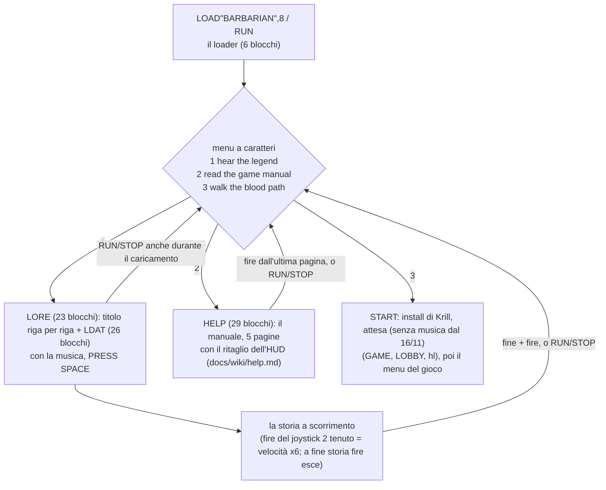

# Avvio: il loader BARBARIAN, START e la storia (LORE)

Copyright © 2026 - Simone Caporale

Sorgenti: `src/barbarian.asm` (il loader, file `BARBARIAN`), `src/common/tramp.inc` (trampoline), `src/start.asm` (avvio del
gioco, file `START`), `src/lore.asm` (file `LORE`), entrambi su `src/common/boot.asm`; `src/lore/scroll.asm`, `tools/build/gen_lore.py`, `data/lore.txt`,
`tests/regression/boot/test_start.py`, `tests/regression/boot/test_lore.py`.

## Un solo disco (11/11 sera, regola del committente)

Una sola build e **un solo disco** (`out/work/disk.d64` → `blood_path_vX.Y_1541.d64`): `BARBARIAN` (loader con il menu), `START`
con schermata di attesa e musica (`TITLE=0`), il gioco, `LORE`, `LDAT`, `TITLE`, `HELP`, `JUKEBOX`. Per lo sviluppo:
`LOAD"*",8`, **`POKE 1020,1`**, `RUN` → `BARBARIAN` non mostra il menu e carica subito `START` ([cheats](cheats.md)); prima
c'era un secondo disco con il byte `DEVBOOT` di `BARBARIAN` a 1. Le varianti `MENU=0` / `INTRO=0` non si assemblano più (il codice di
`INTRO=0` resta in `boot.asm`, non usato). Prima: debug con loader senza menu (119 B), `START` senza titolo, niente
`LORE`/`LDAT`/`TITLE`/`HELP`; release senza `JUKEBOX`.

Tempi (VICE, 1541 emulata, 11/11 sera, con Krill's Loader): avvio con `POKE 1020,1` fino alla fine dei caricamenti di
`START` 34,5 s (prima, con il KERNAL, 105 s); dal tasto `1` del menu a PRESS SPACE della storia 38 s (prima 70 s). I test
caricano `START` dal monitor (`Game.to_menu()`, [test](test.md)).

## `LORE` con Krill's Loader (11/11 sera)

`LORE` (lo stesso `boot.asm` di `START`, `LORE=1`) installa Krill come `START`, poi legge con `loadraw` `TITLE` (10000 B)
in un buffer a `$6000` (`TBUF`; fino al 15/11 `$5600`) e `LDAT` al suo indirizzo (decompresso sul posto in `$2000`). Il titolo compare poi **riga per riga
dal buffer**, un blocco di 40 byte per fotogramma (~5 s, `title_unit`), con la musica; prima compariva mentre il KERNAL
leggeva i due file (~60 s). Uscita verso `BARBARIAN` (fine della storia o RUN/STOP, anche durante i caricamenti):
`lore_exit` disinstalla Krill (il drive torna alla sua ROM), azzera le pagine 2-3 (il residente le ha sporcate: con le
variabili RS-232 sporche il KERNAL si blocca) e il trampoline ricarica `BARBARIAN` con il KERNAL. `HELP` e `JUKEBOX`
restano sul KERNAL: il jukebox ha i brani dentro il suo file e non legge il disco ([FastLoader](FastLoader.md)).

## Flusso (release)

I programmi non convivono: ognuno si carica sopra l'altro con il **trampoline** (`src/common/tramp.inc`): una ventina di
istruzioni copiate nel buffer della cassetta (`$0334`) che chiamano IOINIT e RESTOR del KERNAL (CIA, banco VIC 0,
vettori come all'accensione), caricano il file all'indirizzo del PRG (`$0801`) con `LOAD` e saltano a `$080D`
(dopo lo stub BASIC `SYS 2061`). Un file mancante dà il bordo rosso fisso.

## Il loader (`BARBARIAN`), release

- In alto il **logo della copertina** (lo stesso della storia: `out/work/logo.inc` da `tools/build/gen_lore.py`, 27 × 6
  caratteri, 140 forme ai codici 64–203, colori multicolore `$D022`/`$D023` del logo): lo schermo è in modo testo
  multicolore, i testi hanno colori < 8 (alta risoluzione). Il file passa da 6 a 14 blocchi.
- La voce 2 carica il programma **HELP** (07/11 sera): il manuale del gioco, [Help](help.md). Il loader non ha più la
  pagina dei tasti (13 blocchi invece di 15).

- Schermo a caratteri ad alta risoluzione, banco VIC 0, schermo `$0400`, font del gioco (codici 0–63 di
  `out/work/gfx/uifont.bin`, 512 byte) e forme del logo copiati a **`$3800`** (12/11: a `$2000` i programmi caricati dal
  trampoline, LORE fino a `$2B3D` e START fino a `$262C`, coprivano il font e lo schermo diventava illeggibile). Gira con l'IRQ del KERNAL (tastiera) e dal 15/11 **suona Demon's Eye** (TODO E3/E4: stesso brano di START, LORE, LOBBY e HELP) con il player unico,
  incorporato (`src/common/title_music.inc`, variabili a `$C000`; programma `$0801`-`$1A7D`, 7,5 KB sotto il font a `$3800`): clock = CIA1 timer A a
  19656 cicli (50 Hz PAL esatti, non il passo del KERNAL), vettore `$0314` proprio. **Ogni voce** scelta ferma tutto (`tm_stop`: SID a 0, vettore
  `$EA31`, latch del KERNAL) prima del `LOAD` del trampolino, che sovrascrive il programma; tornando da LORE o HELP il brano riparte da capo
  ([Musica](musica.md), TODO E10). Il cursore lampeggiante è spento (`$CC`).
- **Un fotogramma del menu** (19/11, ex TODO I6): il ciclo aspetta il prossimo IRQ della musica (`tm_wait`: contatore `tm_fc`,
  +1 in `tm_irq`). Prima aspettava la riga raster 250 (`lda $d012 / cmp #250`): il timer del CIA ha lo stesso periodo del
  fotogramma, quindi il suo IRQ (~39 righe, player + `$EA31`) cade sempre alla stessa riga, e se copriva la 250 la riga non
  si vedeva mai: menu fermo per sempre con la musica che suonava (all'avvio e al ritorno da LORE o HELP, a seconda della fase
  del timer: ~12% in teoria, 5 volte su 9 nel test `LORE-10`, che era il sintomo). Test `BOOT-17` (8 fasi dell'IRQ, comprese
  le righe 241-249 che bloccavano il ciclo vecchio).
- Voci: **hear the legend** (LORE), **read the game manual** (programma `HELP`, [Help](help.md)), **walk the blood path** (START) e (16/11, committente) **4 exit game**: `tm_stop`, poi IOINIT/RESTOR/CINT e `jmp ($a002)` (avvio a caldo del BASIC, `READY.`); test `BOOT-14`. Sotto: aiuto,
  versione, copyright. La riga d'aiuto dice solo **"fire to choose"** (12/11, committente).
- Tasti: joystick 2 su/giù e fire; `1` `2` `3`; `W`/`S` o cursore; spazio o RETURN. La voce scelta è gialla con la
  freccia. Scelta una voce, una frase resta sullo schermo durante il caricamento ("the old ones begin to speak",
  "the old scroll unrolls", "the crypt door creaks open"; dal 09/11 senza "...", centrate nelle 32 colonne). Qualunque voce
  (12/11 la storia, 15/11 anche manuale e gioco, committente) fa diventare **subito** nero lo schermo, poi la frase compare al
  centro (dal 16/11 riga 10, gialla, con **"please wait"** in riga 13, come la schermata di attesa di START: `BARBARIAN` carica `START` con il KERNAL e `START` carica il resto con Krill, due caricamenti in sequenza che ora hanno lo stesso aspetto; prima la frase era in riga 12): prima manuale e gioco scrivevano la frase sulla riga 17 sopra il menu, e il nero arrivava solo col programma caricato.
- **Tornando al menu** (16/11, committente): LORE ("the legend falls silent"), HELP ("the old scroll rolls up") e la lobby ("the crypt door closes") mostrano una pagina di attesa (frase in riga 10, gialla, "please wait" in riga 13, bianco) prima del trampolino: `wm_show` in `src/common/waitmsg.inc` (banco VIC 0, schermo `$0400`, charset `$3800` copiato dal font della UI; la lobby usa il codice in GAME, `src/game/backmenu.asm`); prima lo schermo restava nero. Test `BOOT-16`, `SAVE-17`.
- **RUN/STOP durante il caricamento** del programma scelto (LOAD del KERNAL nel trampoline, `tramp.inc`): il LOAD
  torna con C=1, A=0 (`$F633`) e il trampoline carica di nuovo BARBARIAN (il menu). Prima del 12/11 restava il bordo
  rosso fisso (riprodotto nell'emulatore web del committente; test `BOOT-12` in VICE). Gli altri errori di disco
  (file mancante) danno ancora il bordo rosso.
- ~1,5 KB (6 blocchi): dal `RUN` al menu pochi secondi (non misurato su un 1541 vero).

## LORE

Il programma (`src/lore.asm` → `out/work/lore.prg`) è l'avvio di START (`src/common/boot.asm`) con `LORE=1`: titolo
riga per riga con la musica (*Demon's Eye*) mentre legge `LDAT` invece di `GAME`/`LOBBY`/`GFX0`, decompressione ZX0
sul posto di `LDAT` (stesso decompressore del gioco), PRESS SPACE con le lettere a onda; poi `lore_start`
(`src/lore/scroll.asm`). Tempo dal tasto `1` a PRESS SPACE: **70 s** (07/11, VICE con il 1541 emulato, KERNAL standard: `LORE` 5,6 KB +
`TITLE` 10 KB + `LDAT` 6,5 KB); lo stampa `tests/regression/boot/test_lore.py`. Su un 1541 vero non misurato.

### La storia sullo schermo

1. Il logo **BARBARIAN — THE BLOOD PATH** (ritagliato dalla copertina e ridotto a caratteri) fermo al centro per
   5 s, poi sale insieme al testo.
2. Capitoli *the blood path*, *saint aldric*, *the red hand*, *the last of them*, *walk the path*, con il testo di
   `data/lore.txt` (inglese, a capo automatico nelle colonne 2–37, `[parole]` in giallo).
3. Immagini: il logo; la **cripta** del cimitero (scena vera della mappa del villaggio); il **Lord of Ruin**
   (copertina); la fila dei **razziatori** (sprite di fallen, skeleton, zombie, demon raddoppiati, animati a due
   fotogrammi); la **fontana** di Saint Aldric (mappa del villaggio); due **torce** ai lati del titolo *the red hand*
   (copertina, una specchiata); il **barbaro** (copertina); una sala del **dungeon rosso** con il barbaro di spalle
   (sprite del PG raddoppiato) davanti al baule d'oro e alle scale.
4. Fine: *walk the path* / *press fire* si ferma a metà schermo; fire o spazio (nuova pressione) tornano al menu di
   `BARBARIAN` (07/11: prima della fine fire e spazio non fanno nulla). RUN/STOP torna al menu in qualunque momento.

Velocità (07/11, era 2): un pixel ogni 6 fotogrammi (`LR_SPEED`, ~8 pixel al secondo, una riga ogni 48 fotogrammi,
~1 s). **Fire del joystick 2 tenuto = velocità x6** (15/11 doppia, 3 fotogrammi per pixel; 16/11 su richiesta del committente "almeno il doppio di adesso": `LR_FAST` = 1, un pixel per fotogramma, una
riga ogni 8 fotogrammi); al rilascio torna normale. Vale solo durante lo scorrimento (state 2), non nella pausa
iniziale (`LR_HOLD`, 250 fotogrammi: il tempo non cambia) e non fa mai saltare o uscire dalla fine: l'uscita resta la
**nuova pressione** (`lfedge`) di fire **o spazio** a storia ferma (state 3), quindi un fire già tenuto non esce.
Lo **spazio non accelera** (solo il fire del joystick 2: seconda lettura di `$DC00` nell'IRQ, variabile `lfast`); un fire già
premuto a PRESS SPACE conta solo dopo un primo rilascio (`ljarm`). Gli eventi della storia restano in righe e passi
(un passo = 8 pixel) e la RAM colore, gli sprite (salgono di un pixel per pixel) e i cambi di colore del raster seguono
il pixel; solo l'animazione degli sprite (ogni 16 fotogrammi) resta in fotogrammi. Con il fire il ciclo
principale ha 8 fotogrammi per preparare lo schermo nascosto (con 24 ne bastavano ~3, stima: `lready` comunque fa aspettare il passo e `LORE-10` misura 8 fotogrammi per riga).
Durata (calcolata da 292 righe: 264 passi di 48 o 24 fotogrammi, PAL 50,12 Hz; in VICE il tratto di storia a velocità
doppia è stato misurato dal test `LORE-10`): pausa 5 s + **4 min 13 s** a velocità normale (circa 4 min 18 s in tutto),
**circa 42 s** con il fire sempre tenuto (264 passi x 8 fotogrammi, calcolato). Prima dell'interlinea: 220 righe, 192 passi, 3 min 4 s + 5 s.

### Interlinea (15/11, committente)

Per leggere meglio, il generatore (`tools/build/gen_lore.py`, funzione `build`) mette **`LINE_GAP` = 1 riga vuota fra le righe
di testo di un paragrafo** (le righe che escono dall'a capo automatico, colonne 2–37) e **`PARA_GAP` = 2 righe vuote fra
due paragrafi** (una riga vuota in `data/lore.txt`; era 1). Titoli (`@title`), `@center`, `@img`, `@spr` e `@gap n` non
hanno interlinea e restano com'erano; il vuoto prima e dopo le immagini è quello del paragrafo (2 righe, dove il file ha
una riga vuota; il titolo sopra un'immagine ha 1 riga di `@gap`). L'unica riga vuota prima del logo resta di 1 riga: il
logo non si sposta. `data/lore.txt` non è cambiato. Effetto: da 220 a 292 righe (+72: 49 interlinee di paragrafo + 1 riga in
più per ogni stacco tra paragrafi). Verificato da `LORE-11` (`tests/regression/boot/test_lore_stream.py`) sul flusso
generato.

Limiti con la storia più lunga: il flusso si legge con il puntatore a 16 bit `lp` e **nessun contatore di righe a 8 bit**
in `scroll.asm` (`LR_NROWS` non è usato dal C64): 292 righe vanno bene; i contatori a 8 bit sono per passo (`lstopc` =
24 − riga dello schermo di STOP, 10; `lcnt` 25 del riempimento). Il vincolo vero è la memoria: LDAT decompresso arriva a
`$57E3` e il compresso a `$57E6`, sopra il vecchio `TBUF` (`$5600`): **`TBUF` è passato a `$6000`** (`src/common/boot.asm`,
TITLE `$6000`–`$870F`, sotto il corpo a `$A000`); margine per la storia 2074 B (il generatore e `LORE-11` lo controllano).
RUN/STOP torna al menu anche mentre `LORE` carica (l'IRQ della musica legge il tasto, il ciclo del caricamento
chiude i file e chiama il trampoline) e a PRESS SPACE.

Anteprima completa (generata a ogni build, decodificata dal file vero): [grafica/lore.png](../../out/work/atlas/lore.png), anche
nell'[atlante grafico](../../out/work/atlas/index.html#lore). I colori dell'anteprima sono quelli della palette "colodore" del
generatore: in VICE (palette di default) il rosso appare più rosato.

### Tecnica

- **Modo testo multicolore a 24 righe**, banco VIC 0. Due schermi (`$0400` e `$0800`) che si alternano: lo scroll
  fine usa `$D011` (s = 7 … 0); ogni 8 pixel l'IRQ del bordo basso (riga 251) mostra l'altro schermo, già preparato
  dal ciclo principale (righe 1–24 di quello visibile copiate nelle righe 0–23 + la riga nuova del flusso nella riga
  24), e rimette s = 7.
- **RAM colore**: non ha doppio buffer. Al passo il ciclo principale la sposta di una riga (`colshift`: righe
  1–24 → 0–23, poi i colori della riga nuova), riga per riga dall'alto: parte nel bordo basso e ogni riga è finita
  prima che il pennello la raggiunga (~9 righe raster per riga di caratteri contro 8, con ~110 righe di vantaggio).
- **Colori multicolore per immagine**: ogni immagine ha i suoi due colori comuni (`$D022`/`$D023`, scelti dal
  generatore). Una coda di al massimo 4 "cambi" (riga dello schermo k, mc1, mc2): l'IRQ del bordo basso mette in
  vigore la testa (l'immagine più in alto) e programma un raster IRQ 3 righe prima di ogni immagine sotto
  (riga 48 + s + 8k − 3). Fra due immagini c'è sempre almeno una riga di testo, che è in alta risoluzione e non usa
  quei registri.
- **Caratteri**: charset a `$2000`, codici 0–63 = font, 64–254 = forme delle immagini, 255 escluso (escape dell'RLE).
  Le forme si caricano mentre la storia scorre (evento SHAPES, nella riga in cui l'immagine comincia) nei codici che
  nessuna riga visibile sta usando: il generatore assegna a ogni immagine un blocco di codici libero dalla sua
  prima riga fino a 26 righe dopo la sua ultima (quando è uscita dallo schermo), quindi immagini lontane riusano gli
  stessi codici. Le celle vuote delle immagini usano lo spazio del font.
- **Sprite**: raddoppiati in X e Y, multicolore con `$D025`/`$D026` come nel gioco (marrone 9, grigio chiaro 15).
  Accesi nell'IRQ del passo in cui la loro riga entra in fondo (Y = 247 + dy), salgono di un pixel per pixel di
  scorrimento, spenti quando escono in alto; cambio di fotogramma ogni 16 fotogrammi. Il generatore assegna gli 8
  sprite hardware (al massimo 8 sullo schermo insieme: lo controlla).
- **Pausa** (`LR_HOLD`), **fine** (evento STOP: lo scorrimento si ferma quando la riga arriva alla riga indicata).

### Memoria (dopo PRESS SPACE)

| Zona | Contenuto |
|---|---|
| `$0060`–`$0067` | puntatori di LORE (pagina zero; `$50`–`$5E` = ZX0) |
| `$0334`–`$0374` | trampoline (65 byte, all'uscita) |
| `$0400`–`$07FF` | schermo A (puntatori degli sprite a `$07F8`) |
| `$0800`–`$0BFF` | schermo B (`$0BF8`) |
| `$0C00`–`$0C4F` | riga decodificata (40 caratteri + 40 colori) |
| `$2000`–`$27FF` | charset (font + forme) |
| `$2800`–`$2BFF` | sprite (fino a 16; oggi 10: 5 figure × 2 fotogrammi) |
| `$2C00`–… | forme delle immagini, poi le righe (`LR_ROWS`); fine dei dati `$57E3` (15/11; margine 2074 B fino a `TBUF`) |
| `$6000`–`$870F` | `TBUF`: il file TITLE letto qui e mostrato riga per riga (solo prima di PRESS SPACE) |
| `$A000`–`$B5FF` | corpo di START + LORE + musica (`body_end` nel listato `out/work/lore.lst`) |
| `$BE00` | variabili del player SID |
| `$CC00`, `$D800`, `$E000` | schermo, colori e bitmap del titolo (banco VIC 3, prima di PRESS SPACE) |

Durante il caricamento `LDAT` compresso sta alla fine della propria zona decompressa (`LD_AT` in `out/work/lore.inc`,
`$3E1F` oggi) e si decomprime sul posto in `$2000` (verifica in Python in `tools/build/gen_lore.py`, in VICE in
`tests/regression/boot/test_lore.py`).

### Formato di `LDAT`

PRG con indirizzo `LD_AT`; dopo il PRG, flusso ZX0 dell'immagine che va a `$2000`:

| Indirizzo | Contenuto |
|---|---|
| `$2000` | charset: 512 byte di font (codici 0–63), poi zeri |
| `$2800` | sprite: 64 byte l'uno, due fotogrammi consecutivi per figura |
| `$2C00` | forme delle immagini (8 byte per carattere, un blocco per immagine) |
| `LR_ROWS` | righe |

Una riga: `nev` (numero di eventi), gli eventi, poi 80 byte in **RLE** (40 codici carattere + 40 colori;
`$FF n v` = `v` ripetuto `n` volte, ogni altro byte è letterale). `nev = $FE`: fine del flusso (da lì righe vuote).
Colori: < 8 carattere ad alta risoluzione (testo: 1 bianco, 7 giallo), ≥ 8 multicolore (immagini: 8 + colore
proprio della cella 0–7).

| Evento | Byte | Effetto |
|---|---|---|
| SHAPES | `0 idx cnt lo hi` | copia `cnt` × 8 byte da `hi:lo` nel charset dal codice `idx` |
| SPRITE | `1 hw ptr xlo xhi col dy anim` | al passo: sprite `hw` con puntatore `ptr` (e `ptr+1`), X, colore, Y = 247 + `dy` |
| SPLIT | `2 mc1 mc2` | al passo: colori multicolore dell'immagine che comincia in questa riga |
| STOP | `3 riga` | lo scorrimento si ferma quando questa riga arriva alla riga dello schermo indicata |

### Il generatore (`tools/build/gen_lore.py`) e lo script (`data/lore.txt`)

Comandi dello script: `@img nome [testo]`, `@title testo`, `@center testo`, `@spr nomi…`, `@gap n`, `@hold`,
`@stop riga`; paragrafi separati da una riga vuota (che diventa `PARA_GAP` righe, [interlinea](#interlinea-1511-committente)). Le immagini sono definite in `IMAGES` del generatore:

| Nome | Sorgente | Dimensioni (caratteri) |
|---|---|---|
| `logo` | copertina (`data/title_src.png`) con maschera: niente artigli e corna del demone sopra le lettere, niente spade ai lati, niente pietre viola; colori propri solo nero, bianco, rosso, giallo | 27 × 6 |
| `crypt` | mappa del villaggio (`data/town_map.txt`, tile di `GFX0`, palette 0), cimitero | 36 × 10 |
| `lord` | copertina, il demone | 15 × 8 |
| `fountain` | mappa del villaggio, piazza della fontana | 20 × 12 |
| `torches` | copertina, torcia a sinistra (e la stessa specchiata), titolo in mezzo | 36 × 5 |
| `hero` | copertina, il barbaro | 11 × 11 |
| `stairs` | dungeon di esempio dell'atlante (`data/atlas_dungeon.txt`, `GFX1`, palette 4 rossa) + sprite del PG | 32 × 12 |

Conversione: per ogni immagine la coppia di colori multicolore comuni che rende meglio (ricerca su tutte le
coppie, distanza "redmean" come `tools/build/gen_title.py`) e per ogni cella il colore proprio 0–7 migliore; se le forme
diverse superano il massimo dell'immagine si fondono quelle che costano meno in resa. Il generatore si ferma con un
errore se due immagini troppo vicine non trovano codici liberi, o se più di 8 sprite sono sullo schermo insieme.

Dimensioni oggi (stampate a ogni build, 15/11): 292 righe, 14307 B di dati (14,0 KB), 6599 B compressi = **26 blocchi** (prima 220 righe, 13803 B, 6565 B); con
`LORE` (23 blocchi, quasi tutto START, PRESS SPACE e musica) sono 49 blocchi, più `TITLE` (40, lo stesso file del gioco).

## Test

- `tests/regression/boot/test_start.py dev` (build di debug): dal `RUN` di `BARBARIAN` (loader senza menu) a `START` caricato dal
  disco, `GAME` decompresso uguale a `out/work/game.prg`, fino al menu del gioco con il villaggio in cache.
- Solo con `./build.sh --release`: `tests/regression/boot/test_start.py` (START fino al menu del gioco) e
  `tests/regression/boot/test_lore.py`: il menu mostra le voci; tasto `1` → LORE caricato dal disco, `LDAT` decompresso in VICE
  uguale byte per byte a `out/work/ldat_raw.bin`; PRESS SPACE; la storia parte dopo la pausa, il flusso avanza e arriva
  alla fine; RUN/STOP riporta al menu; tasto `3` avvia START. Con `--shot prefisso` salva gli screenshot
  (fermandosi sull'IRQ del bordo basso: uno screenshot preso a metà fotogramma mescola due fotogrammi e mostra
  righe "doppie" che sullo schermo non ci sono).
