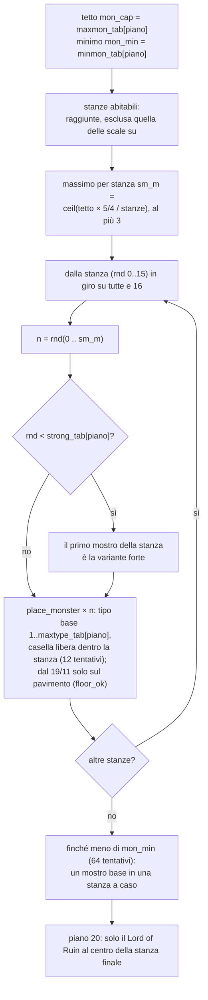
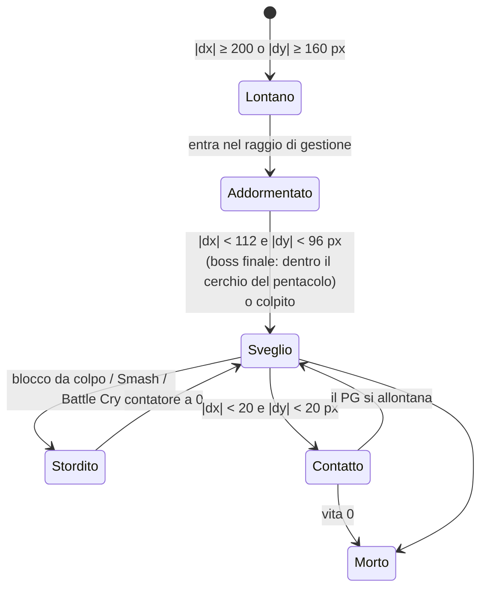

# Mostri

Sorgenti: `src/game/game.asm` (`spawn_monsters`, `place_monster`, `init_monsters_rt`, `update_monsters`,
`kill_monster`, `final_tick`), `src/game/bar.asm` (`place_boss`, nomi), `src/game/combat.asm` (`floor_types`,
`mon_hp_init`, `mon_attack`). Dati: il **bestiario** `data/monsters/bestiary.tsv`
(11/11: tier, colore, velocità, bonus del bottino; dal 24/11 le statistiche sono **formule** per piano,
[bestiario](bestiario.md#statistiche-formule-del-bestiario-2411-toolsbuildmon_statspy), righe `implemented = yes`),
`data/rules.yaml` (`growth.curve_dmg`, `boss`, `final_summons`) e `data/balance.yaml` (`spawn`, `boss`) → `out/work/db.asm`.

## Tipi

Quattro famiglie (base → variante forte, stessa grafica con un'aggiunta e altro colore) più il boss finale. **Dal 15/11 ogni
capitolo ha le sue famiglie** (grafica, colore e nome dal file del tema del capitolo, [bestiario](bestiario.md#nel-gioco-i-mostri-dei-capitoli-1511)):
la tabella sotto è quella del **capitolo 1** (anche nei capitoli 3–4); il capitolo 2 ha le sue righe (dal 24/11,
[bestiario](bestiario.md#statistiche-formule-del-bestiario-2411-toolsbuildmon_statspy)). Numero del tipo
(`mtype`): 1–4 base, 5–8 forti (`base + N_BASE`), 9 = `T_FINAL`.

| # | Tipo | Famiglia | Primo piano | Vita | CA | ATT | Danno | Salv. | XP | Velocità (px/fot.) | +liv. bottino |
|---|---|---|---|---|---|---|---|---|---|---|---|
| 1 | fallen | fallen | 1 | `9 + 2.56*P` | `12 + P` | `2 + 0.75*P` | `1d4 + 1 + P` | `0.3*P` | `9 + 2.56*P` | 0,75 | 0 |
| 2 | skeleton | skeleton | 1 | `14 + 3.4*P` | `13 + P` | `3 + 0.75*P` | `1d6 + 2 + P` | `1 + 0.3*P` | `20 + 5*P` | 0,75 | 0 |
| 3 | zombie | zombie | 4 | `38 + 3.25*P` | `11 + P` | `3 + 0.75*P` | `1d8 + 2 + P` | `2 + 0.3*P` | `50 + 12.44*P` | 0,5 | 0 |
| 4 | demon | demon | 8 | `66 + 4.06*P` | `15 + P` | `6 + 0.75*P` | `2d6 + 3 + P` | `4 + 0.3*P` | `120 + 30*P` | 0,75 | 1 |
| 5 | fallen warchief | fallen | 1 | `25 + 2.6*P` | `14 + P` | `4 + 0.75*P` | `1d8 + 2 + P` | `2 + 0.3*P` | `40 + 10*P` | 0,875 | 1 |
| 6 | skeleton king | skeleton | 2 | `47 + 3.25*P` | `15 + P` | `5 + 0.75*P` | `1d10 + 3 + P` | `3 + 0.3*P` | `69 + 17.56*P` | 0,75 | 1 |
| 7 | lich | zombie | 5 | `67 + 3.3*P` | `15 + P` | `6 + 0.75*P` | `2d6 + 4 + P` | `5 + 0.3*P` | `150 + 37.44*P` | 0,75 | 1 |
| 8 | balrog | demon | 9 | `113 + 3.8*P` | `17 + P` | `8 + 0.75*P` | `2d8 + 5 + P` | `6 + 0.25*P` | `400 + 100*P` | 0,875 | 2 |
| 9 | Lord of Ruin | — | 20 | `507` | 22 | +13 | `4d8 + 32` | 10 | 3000 | 0,75 | 3 |

P = piano − primo piano (mai sotto 0; per il boss finale sempre 0). Vita = vita **media** del tipo al piano. Velocità =
`mon_spd` / 8 (da `speed` del bestiario × `monster_speed_percent` 80%). Il PG si muove a passi più rapidi. Formule del 24/11
ricavate dal gioco di prima senza ritarare (scarti ≤ 3 punti vita, ≤ 1 su ATT, salvezza, esperienza).

## Statistiche al piano (`floor_types`)

Entrando in un piano si calcolano una volta le statistiche di ogni tipo (`ft_*`, 10 voci): per vita, CA, ATT, danno fisso K,
salvezza ed esperienza `valore = A + ((B × P + 8) >> 4)`, con `A` (valore al primo piano) e `B` (crescita per piano × 16) dalle
tabelle di `mt_ch` (dal 24/11; prima: scheda + crescita comune `gr_*` e curva `cv_hp`). Il moltiplicatore del danno
`cv_dmg[piano]` / 32 resta uguale per tutti i tipi: ×0,5 piani 1–4, ×0,75 piani 5–14, ×1 piani 15–20 (`rules.yaml
growth.curve_dmg`). Il colpo del mostro: dadi (`mt_dn`, `mt_ds`) + K, × `cv_dmg`.

### Vita del singolo mostro (`mon_hp_init`)
Alla nascita: vita media del tipo × (96 + rnd 0..64) / 128, cioè **±25%**; il boss con nome × 2,5
(`BOSS_HPH`/2); minimo 1. Vita a 16 bit (`mhp`/`mhph`) con il massimo in `mhm`/`mhmh` (serve alla barra).

## Piazzamento (`spawn_monsters`)

- `maxtype_tab`: tipi base disponibili (piano ≥ piano minimo): 2 ai piani 1–3, 3 ai piani 4–7, 4 dal piano 8.
- `strong_tab`: probabilità di una stanza "forte": 0 ai piani 1–2 (`strong_min_floor` 3), poi da 12% a 66%
  (piano 20) a gradini. Inizio graduale (06/11): la variante forte di una famiglia esce solo se il suo piano
  minimo è ≤ piano + 1 (`STRONG_EARLY`): skeleton king dal piano 1 (ma le stanze forti partono dal 3), lich dal 4,
  balrog dall'8; altrimenti al suo posto resta il tipo base.
- `maxmon_tab` / `minmon_tab`: da 10/5 (piano 1) a 22/11 (piano 19); piano 20 = 0 (solo il boss finale).
  Le tabelle di `balance.yaml spawn` sono scritte per 10 gradini: il piano L usa il gradino
  max(1, round(L × 9 / 19)) (piani 1–3 gradino 1, 4–5 gradino 2 … 18–19 gradino 9; piano 20 gradino 10 = 0).
- Una variante forte uscita un piano prima del suo piano minimo ha P = 0 (statistiche base della scheda).
- Massimo 32 mostri per piano (tabelle `MRT` da 32), comprese evocazioni e boss.

### Boss del piano (`place_boss`)
Piani 1–19: un mostro in più al centro della stanza delle scale giù, **variante forte di una famiglia a caso**
fra quelle del piano (con la stessa regola del piano minimo − 1; se la famiglia estratta è troppo presto, il
boss è un fallen warchief). È il "boss con nome": nome = uno di 8 nomi + uno di 8 epiteti (es. *Duriel the Burning*),
scelti da un hash del seed e del piano (`boss_name_idx`). Rispetto alla variante: vita × 2,5, CA + 2, ATT + 2,
esperienza × 4, **immune al blocco da colpo**; lampeggia in bianco; la riga del bersaglio mostra nome e vita (quando
non segue un altro mostro: la barra va all'ultimo mostro colpito, [Interfaccia](interfaccia.md)). Alla
morte lascia una chiave e un tesoro con 4 oggetti a livello bottino + 3 ([Bottino](bottino.md)).

## Intelligenza (`update_monsters`)

- **Lontano** (fuori schermo): riesaminato 1 fotogramma su 16. **Addormentato** fuori dal raggio di risveglio:
  1 su 8. Svegli: elaborati a **fotogrammi alterni** (metà dei mostri per fotogramma).
- Movimento: solo i **4 mostri più vicini** fra quelli svegli si muovono (scelta con un fotogramma di ritardo,
  `sel_offer`/`sel_has`); passi da 2 px verso il PG (`mon_step`, prima l'asse più lontano), collisioni con muri,
  altri mostri e PG (`sep_check`, `occ_check`). Un mostro bloccato aspetta 16 fotogrammi.
- **Muri, angoli e sacche** (17/11, al posto dello scorrimento lungo i muri del 06/11, che lasciava i mostri negli angoli):
  il passo verso il PG vale solo se **avvicina** il mostro (distanza di Manhattan, `no_progress`): prima lo scivolamento di
  1 px sugli spigoli lo faceva oscillare avanti e indietro sul bordo di un muro, senza mai risultare bloccato. Senza
  avvicinamento parte una **ricerca di percorso** sulle caselle (`mon_path`, BFS in una finestra 13x13 attorno al mostro,
  tabelle a `$A500`): verso la casella del PG o, se non è nella finestra, la casella della finestra più vicina a lui. Il mostro
  segue le prime **5 mosse** del percorso casella per casella (`mon_follow`, in `src/game/monpath.asm`: prima allinea l'altro
  asse al centro della casella, così passa dalle porte), poi torna a inseguire. Se il PG non era raggiungibile nella finestra
  il percorso è "esplora": alla fine si fa subito un'altra ricerca; in una sacca (nessuna casella più vicina al PG della
  partenza) va alla casella del bordo della finestra più vicina a lui. La ricerca è **a rate** (PERF-21: fatta tutta insieme
  costava fino a ~2 frame e un piano superava il tetto di 3 frame): 14 caselle per giro (`PZ_STEP`), 120 in tutto (`PZ_MAXC`),
  un mostro alla volta (`pz_own`; un altro aspetta, o la riprende se quella è ferma da 8 giri); intanto il mostro aspetta un
  turno solo invece dei 16 fotogrammi di un mostro bloccato. Stato in `mslide` / `mslc` (mosse a 2 bit), coda di 32 caselle.
  Misura con un simulatore Python del movimento (stesso algoritmo, mappe vere di 8 piani, 7456 coppie mostro-PG a ≤ 7 caselle):
  bloccati dall'1,7% (vecchio) allo 0,7%; restano i percorsi lunghi (≥ 17 caselle, giri attorno a un muro più grandi della
  finestra). `tests/regression/monsters/test_path.py` (MON-AI-11: 3 casi in cui il vecchio inseguimento restava fermo; dal 18/11 senza i 2 dei piani 6 e 7, diventati palude).
- **Spigoli** (anche per il PG): `try_step_x` / `try_step_y` controllano due sonde sul bordo (±5 px); se ne è
  bloccata una sola (spigolo), l'essere scivola di 1 px dalla parte libera invece di fermarsi, così si entra nei
  varchi anche non allineati. `tests/regression/monsters/test_ai.py`.
- I mostri **non entrano nella casella del PG**: si fermano sulla casella adiacente e da lì colpiscono.
- **Attacco** a contatto (`mon_attack`) ogni 45 fotogrammi (`MON_ATK_T`): regole in
  [Combattimento](combattimento.md). Il tema musicale di combattimento suona solo mentre un boss con nome è sullo schermo ([Musica](musica.md)).
- Stordimento (`mstun`) e ricarica dell'attacco (`mcd`) scendono di 2 a fotogrammi alterni.

## Morte di un mostro (`kill_monster`)

1. `malive` = 0; casella del corpo → `loot_x`/`loot_y`.
2. Esperienza: `ft_xp` del tipo; boss con nome × 4. Livello del mostro = piano (+2 se forte, +1 ancora se boss).
   Se il PG è sopra di d livelli: 75% (d = 1), 50% (2), 25% (3), **niente esperienza e niente bottino** da d ≥ 4.
   Il chestLevel del tesoro si calcola qui, dalla vita massima del mostro ([Bottino](bottino.md#chestlevel)).
3. Contatore uccisioni (`c_kills`, 16 bit); la barra si libera se era il bersaglio.
4. Boss finale: `c_won` = 1, si aprono le stanze dei tesori (`fin_doors`), schermata di vittoria.
5. Bottino (`roll_loot`), tranne al piano 20 e con d ≥ 4.

## Boss finale: Lord of Ruin

- Piano 20, centro della sala del trono; si sveglia quando il PG entra nel cerchio del pentacolo (`FIN_R_PX`).
- Immune al blocco da colpo (Smash e Battle Cry lo stordiscono comunque).
- **Evocazioni** (`final_tick`): quando la vita scende sotto 3/4, 1/2 e 1/4 del massimo (`fb_th`) parte
  un'ondata, se i mostri vivi (boss compreso) sono al più 2 (`SUM_MAXALIVE`): 2 mostri (`SUM_WAVE`) di tipo base
  a caso fra i quattro (`SUM_FLOOR` 20), con le statistiche del piano 20, sulle punte della stella (mai due
  vicine), già svegli. Rientrando nel piano le ondate già superate non si ripetono (`final_init`). Ritaratura
  06/11 sera: vita della scheda ×0,75 e al massimo 2 vivi per ondata → ~75% di vittorie nel simulatore con il PG
  di riferimento di livello 20 e 4 pozioni (con 4 vivi per ondata era sotto il 25%).
- Né il boss né le evocazioni lasciano bottino; i premi sono i 4 bauli epici.
