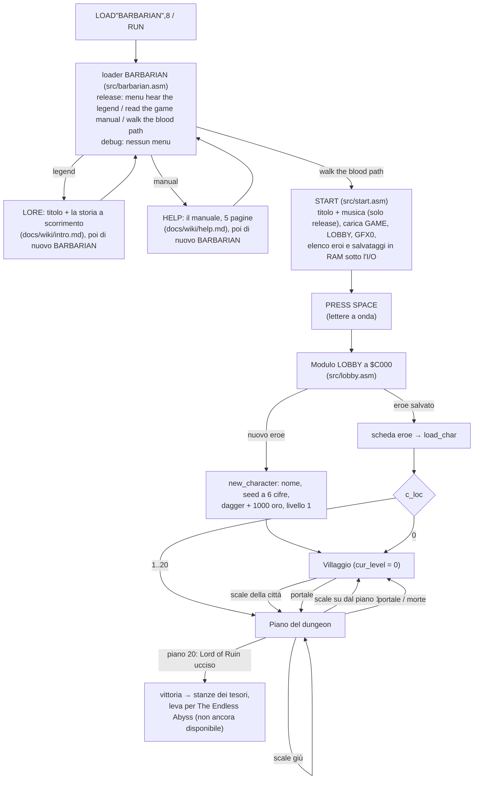
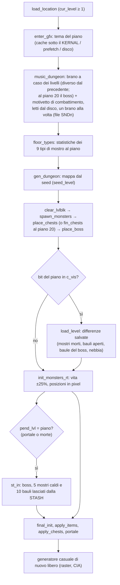

# Panoramica

Action RPG a schermata scorrevole per Commodore 64: un barbaro scende 19 piani generati dal seed fino alla sala
del trono (piano 20) dove lo aspetta il **Lord of Ruin**. Sorgenti principali: `src/game.asm` (ciclo, rendering),
`src/game/game.asm` (mondo, mostri, bottino), `src/game/combat.asm` (regole d20), `src/game/levels.asm` (cambio di luogo,
avvio), `src/game/ui.asm` (schermate), `src/game/hud.asm`, `src/game/bar.asm` (bersaglio: riga 19 dell'HUD), `src/game/rel.asm` + `src/game/disk.asm`
(disco), `src/lobby.asm` (modulo LOBBY), `src/menu.asm` (modulo MENU: locanda e negozi), `src/barbarian.asm` (loader con musica).
Struttura del codice: [Architettura](architettura.md); flussi del codice: [Flussi](flussi.md); build: [Build e strumenti](build.md).

## Dal caricamento alla partita

Un cambio di luogo passa sempre da `change_level` (`src/game/levels.asm`): schermo spento, musica in dissolvenza,
salvataggio o STASH del piano lasciato ([Salvataggi](salvataggi.md)), poi `load_location` (grafica del tema,
generazione dal seed, differenze salvate, mostri) e `place_player` secondo `spawn_mode` (0 scale su, 1 scale
giù, 2 portale, 3 morte, 4 ingresso sud del villaggio).

## Caricamento di un piano

Fino a `init_monsters_rt` tutto è deterministico (dipende solo da seed e piano); dopo, il generatore viene
mescolato con il raster e il timer della CIA.

## Ciclo di gioco (un fotogramma, `main_loop` in `src/game.asm`)

| Passo | Routine | Cosa fa |
|---|---|---|
| 1 | `wait_vblank` | attende la riga 252 (inizio del bordo inferiore) |
| 2 | `pf_tick` | precarica alcuni byte del tema del prossimo piano (solo nel bordo) |
| 3 | `apply_frame` | scambia lo schermo (doppio buffer A/B), aggiorna colori e sprite preparati |
| 4 | `read_input` | joystick porta 2 + matrice della tastiera (`joy`, `joynew`, `keynew[8]`) |
| 5 | `handle_keys` | H J K L abilità, U Rage, O Frenzy, 1–4 pozioni, 5 pergamena, I inventario, M mappa, RUN/STOP menu |
| 6 | `update_player` | Frenzy (`fz_move`), movimento con collisioni, direzione |
| 7 | `update_attack` | ricariche e durate (`tick_timers`), Fire = abilità scelta |
| 8 | `update_monsters` | IA a fotogrammi alterni, attacchi a contatto |
| 9 | `drops_tick` | a fine combattimento piazza un tesoro in coda |
| 10 | `update_world` | tile sotto il PG (oggetti, fontana), Fire su scale/porte/bauli, nebbia, boss finale |
| 11 | `update_camera` | scorrimento a passi di tile |
| 12 | `update_bar`, `npc_tick` | riga del bersaglio nell'HUD (nome del luogo o del mostro bersaglio, `bt_row`); villaggio: passo dei vaganti. (19/11) Nei fotogrammi di ridisegno aspettano (`redraw_due`, [Flussi](flussi.md)) |
| 12b | `maybe_redraw` | ridisegno del buffer nascosto |
| 13 | `build_sprites` | PG, mostri visibili (multiplex), effetti delle abilità |

Il ciclo dura al massimo un fotogramma PAL (19 656 cicli): i mostri lontani sono riesaminati 1 fotogramma su 16
(fuori schermo) o 1 su 8 (addormentati), quelli svegli a fotogrammi alterni e solo i 4 più vicini si muovono
(dettagli in [Mostri](mostri.md)).

## Moduli caricati da disco

| Modulo | Dove | Quando |
|---|---|---|
| `GAME` | `$0400` … | sempre in memoria (il generatore dei piani, in coda al PRG, si copia sotto l'I/O a `$D080`) |
| `LOBBY` | `$C000` (RAM della mappa) | menu iniziale, scheda dell'eroe |
| `MENU` | zone `$C900`, `$F4E0`, `$A700` (11/11) | locanda e negozi: all'ingresso nel villaggio se manca (dopo l'avvio o il LOBBY), poi resta ([Tecnica](tecnica.md#moduli-su-disco)) |
| `GFX0` | cache `$E000` | grafica del villaggio |
| `GFX1`…`GFX8` | cache da `GFX_DUN_AT` (`$EC6D`) a `$F4DF` | temi dei piani: due per capitolo (dungeon, piano del boss), con sprite, colori e nomi dei mostri del capitolo (15/11) |
| `FMAP` | cache `$FD00` (fondo della cache sotto il KERNAL, dal 10/11) | mappa della sala del trono (piano 20), letta una volta per sessione |
| `HL`, `SAVE-01..05` | file preallocati (plugin di save di Krill) | elenco eroi; un file per eroe con i suoi piani ([Salvataggi](salvataggi.md)) |
