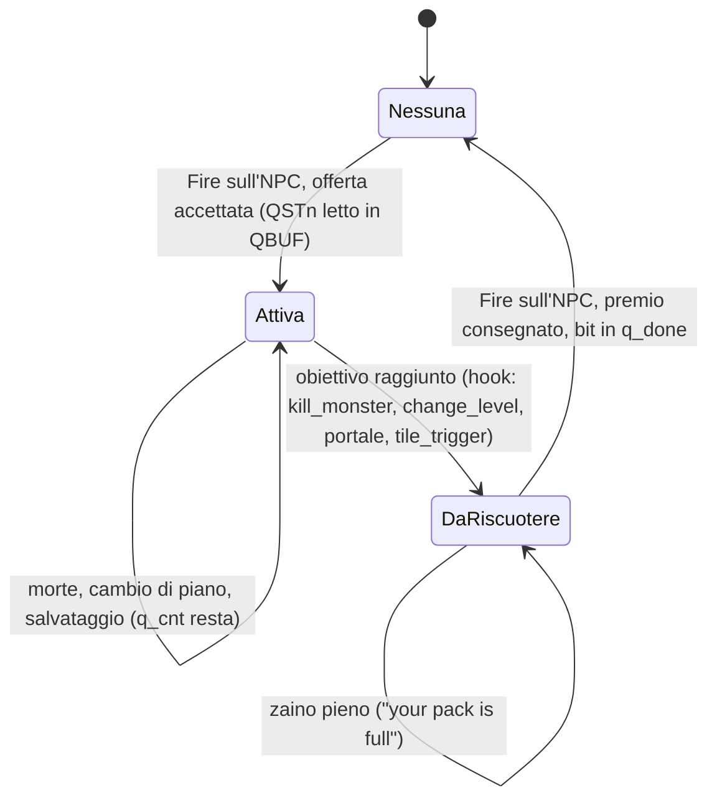
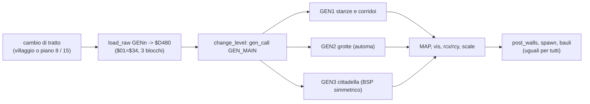
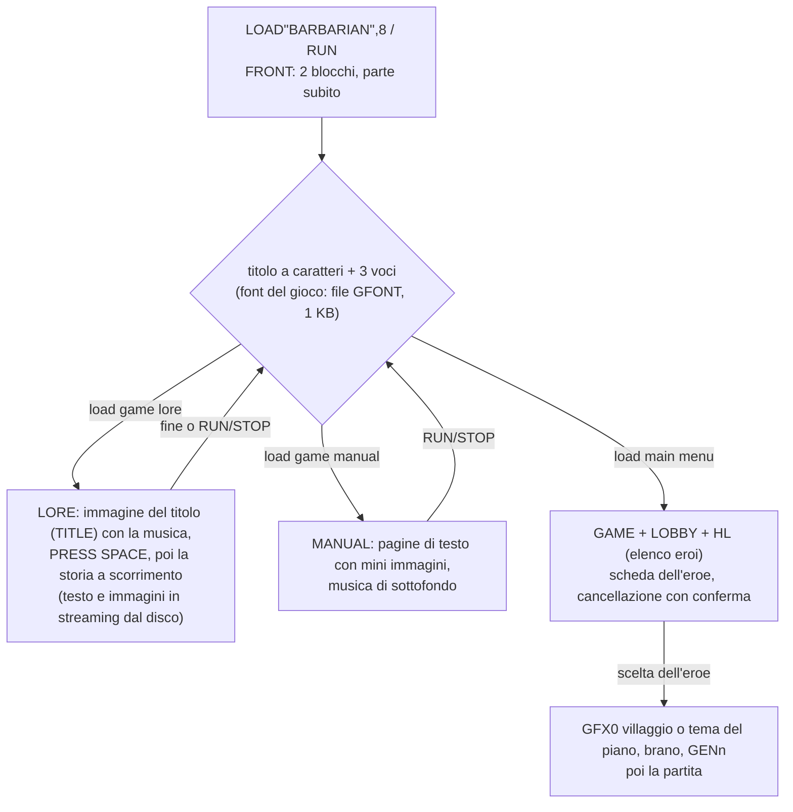

# Quest system — analisi di progetto (07/11)

Copyright © 2026 - Simone Caporale

**Stato: proposta, niente di questo è nel codice.** Analisi richiesta dal committente il 07/11: un sistema di quest
semplificato, villaggi o livelli statici in più, trama principale e sottotrama del titolo. Nessun codice, nessuna
simulazione: in fondo l'elenco degli open point da verificare (sezione 6, "per Opus").

Fonti lette per il contesto: `docs/wiki/villaggio.md`, `docs/wiki/dungeon.md`, `docs/wiki/mostri.md`, `docs/wiki/oggetti.md`,
`docs/wiki/combattimento.md`, `docs/wiki/FORMATO_DATI.md`, `docs/wiki/tecnica.md`, `out/work/memory-map/program-game.html`, `src/lobby.asm`
(`menu_help`), `src/ovlt.asm`, `src/game/prefetch.asm`, `tools/build/gen_gfx.py`.

Regole fissate dal committente: le quest possono comportare caricamenti; **una quest attiva per volta**; un tasto
(proposto `Q`) mostra una pagina breve con riassunto e premio; massimo riuso del codice dei menu; uso intenso del
disco, in background dove si può; elenco dei premi; almeno una decina di quest; testi di gioco in inglese.

---

## Indice

  - [Parte 1 — Il quest system visto dal giocatore](#parte-1--il-quest-system-visto-dal-giocatore)
    - [In due righe](#in-due-righe)
    - [Cosa cambia nel gioco](#cosa-cambia-nel-gioco)
    - [Il tasto `Q`](#il-tasto-q)
  - [Parte 2 — Trama, luoghi e quest](#parte-2--trama-luoghi-e-quest)
    - [La trama principale](#la-trama-principale)
    - [La sottotrama: perché il barbaro, perché "The Blood Path"](#la-sottotrama-perché-il-barbaro-perché-the-blood-path)
    - [I luoghi da implementare](#i-luoghi-da-implementare)
    - [Le quest](#le-quest)
    - [Elenco dei premi (per il bilanciamento e per la pagina `Q`)](#elenco-dei-premi-per-il-bilanciamento-e-per-la-pagina-q)
  - [Parte 3 — Implicazioni tecniche nel codice](#parte-3--implicazioni-tecniche-nel-codice)
    - [3.1 Stato della quest (salvataggio)](#31-stato-della-quest-salvataggio)
    - [3.2 I testi: su disco, in un buffer fisso](#32-i-testi-su-disco-in-un-buffer-fisso)
    - [3.3 Il motore (residente, stima 700–900 B)](#33-il-motore-residente-stima-700900-b)
    - [3.4 Grafica](#34-grafica)
    - [3.5 Generatore e salvataggi dei piani](#35-generatore-e-salvataggi-dei-piani)
    - [3.6 Villaggi multipli](#36-villaggi-multipli)
    - [3.7 Bilanciamento, simulatori, test](#37-bilanciamento-simulatori-test)
  - [Parte 4 — Elementi da implementare e costi](#parte-4--elementi-da-implementare-e-costi)
  - [5. Decisioni da prendere (committente)](#5-decisioni-da-prendere-committente)
  - [6. Open point da verificare con prove o simulazioni (per Opus)](#6-open-point-da-verificare-con-prove-o-simulazioni-per-opus)
- **[Seconda parte dell'analisi (07/11, pomeriggio): decisioni del committente e nuove richieste](#seconda-parte-dellanalisi-0711-pomeriggio-decisioni-del-committente-e-nuove-richieste)**
  - [7. Abilità solo da quest e il compagno](#7-abilità-solo-da-quest-e-il-compagno)
  - [8. Revisione dei tile dei dungeon](#8-revisione-dei-tile-dei-dungeon)
    - [Com'è oggi (numeri da `tools/build/gen_gfx.py` e `src/game.asm`)](#comè-oggi-numeri-da-toolsgen_gfxpy-e-srcmainasm)
    - [Mirroring e rotazione](#mirroring-e-rotazione)
    - [Proposta](#proposta)
  - [9. Generatori di mappe diversi, su disco](#9-generatori-di-mappe-diversi-su-disco)
  - [10. Avvio: menu leggero, lore, manuale, menu principale](#10-avvio-menu-leggero-lore-manuale-menu-principale)
    - [Flusso](#flusso)
    - [Mappa della RAM dei tre programmi (non si sovrappongono fra loro perché non convivono: ognuno riparte da `FRONT`)](#mappa-della-ram-dei-tre-programmi-non-si-sovrappongono-fra-loro-perché-non-convivono-ognuno-riparte-da-front)
    - [LORE: la storia a scorrimento](#lore-la-storia-a-scorrimento)
    - [MANUAL: le pagine](#manual-le-pagine)
    - [Struttura dei sorgenti proposta](#struttura-dei-sorgenti-proposta)
  - [11. Decisioni da prendere (aggiornate)](#11-decisioni-da-prendere-aggiornate)
  - [12. Open point aggiunti (per Opus)](#12-open-point-aggiunti-per-opus)
  - [13. Decisioni del 07/11 (fine mattina)](#13-decisioni-del-0711-fine-mattina)
  - [14. LORE con più grafica (decisione del 07/11, mezzogiorno)](#14-lore-con-più-grafica-decisione-del-0711-mezzogiorno)
    - [14.1 Il logo a caratteri (misura fatta, non è codice)](#141-il-logo-a-caratteri-misura-fatta-non-è-codice)
    - [14.2 Charset a "slot" che si scambiano mentre la storia scorre](#142-charset-a-slot-che-si-scambiano-mentre-la-storia-scorre)
    - [14.3 Le immagini (elenco ampliato)](#143-le-immagini-elenco-ampliato)
    - [14.4 Costo su disco (stima, entro i 30 blocchi)](#144-costo-su-disco-stima-entro-i-30-blocchi)
    - [14.5 Alternativa scartata e perché](#145-alternativa-scartata-e-perché)
    - [14.6 Decisioni da prendere e open point](#146-decisioni-da-prendere-e-open-point)

---


## Concept del 17/11 (implementato, testi segnaposto)

Prima versione giocabile, da sistemare (richiesta del committente del 17/11):
- **Pagina della quest**: tasto **Q** (libero nel gioco) ovunque, o **Fire** accanto a chi dà la quest. Menu classico come quelli
  dei negozi, riquadri con l'etichetta sulla cornice: **from** (chi l'ha data), il **titolo** sulla cornice del testo, il **testo**
  (fino a 11 righe da 36 colonne), **reward**, **status** (oggi sempre "active"). Senza quest letta: "no quest: talk to the villagers".
  La pergamena disegnata resta un'idea per dopo (costa grafica e memoria): si parte dal menu classico.
- **Un file per quest**, `QSTn` (`data/quests.yaml` → `tools/build/gen_quests.py`): il **codice della pagina** (`src/qpage.asm`,
  ~410 B, assemblato con le etichette del gioco come il LOBBY) **più il testo** della quest; `QST0` = solo la pagina ("no quest").
  Si legge a ogni apertura in `$BC00` (lo schermo B del gioco, ridisegnato all'uscita) e si esegue: in GAME restano ~40 B
  (`ui_quest`). Ogni quest ha quindi il suo spazio (fino a ~590 B di testo) e il testo nuovo si carica con la quest. Costo:
  la schermata di attesa a ogni apertura (~0,5 s, non misurato con precisione).
- **NPC nel villaggio** (`src/game/quest.asm`): figure dell'eroe in altri colori (sprite 3-7, liberi nel villaggio: verificato a
  runtime, nel villaggio `sh_en` ha solo lo sprite 0 e i 3-7; gli sprite 1 e 2, fendente ed effetto, restano spenti).
  **Chi dà la quest** (oggi *hilde*, quest 1) sta **fermo** vicino all'ingresso (a caso entro 7 caselle dal PG): avvicinandosi
  da qualunque lato compare il suo nome nella barra; **Fire** = quest letta (`c_qst`, salvato con l'eroe: SAVE_VER $C8) e la
  sua pagina. Dopo la prima volta la pagina si riapre con **Q** o con Fire accanto a lui. I luoghi hanno la precedenza (su una
  porta o una scala vale il luogo).
- **NPC che vagano** (fino a otto per villaggio, 17/11): ogni villaggio ha i SUOI **settori** (`SECTORS` in
  `tools/build/villages.py`, scelti secondo la forma del villaggio: griglia 3×3 senza il centro nel 1, piattaforme nel 2, tre
  terrazze nel 3, anello attorno al cratere nel 4, isole nel 5; rettangoli x, y, larghezza, altezza, di 10-20 caselle per lato,
  nell'intestazione del file `TWNc`, 4 B l'uno, copiati in `tk_sec`). Il walker *n* vive nel settore *n*: **nasce con
  probabilità 3/4** (numero casuale di NPC: 0-8, in media 6; era 1/2, in media 4, fino al 17/11 sera) su una casella libera presa a caso nel settore (16 tentativi, poi
  assente) e **non ne esce mai** (`npc_in`: il passo che uscirebbe viene scartato). Si muovono **solo se il PG è a meno di 10
  caselle**, a fotogrammi alterni, e solo quando lo decide il caso (1 volta su 64 per NPC fermo): una casella in una direzione a
  caso, 2 px per passo; si fermano su un muro e non entrano nella casella del PG. Il PG per ora li attraversa (nessuna
  collisione). **Sprite:** i visibili prendono gli sprite 3..7 uno dopo l'altro (`npc_draw`, al massimo 5, il sesto non si
  disegna); la build (`gen_maps.py`) controlla che in nessuna finestra di gioco (21×13 caselle) cadano più di 5 settori, quindi
  il limite non scatta mai. Aspetto: tutti hanno la figura dell'eroe; il pool è la tabella di 9 colori `npc_col` (uno per NPC).
- **Lobby**: nella pagina del barbaro, "current quest:" mostra il titolo della quest letta (`quests.inc`).
- Test: `tests/sanity/quest/cases.py` (QUEST-10..14).
- **Memoria**: GAME passa a ~505 B di margine sotto `$8720` (avviso della build sotto 1 KB; con le varianti di test, es.
  `TESTUI=28`, restano ~56 B). Con i settori (17/11) il margine scende a **671 B** (debug) e l'intestazione residente `town_k`
  cresce di 32 B. Il piazzamento degli NPC (`npc_init`) sta nel modulo MENU (zona 1, `src/menu/npc.asm`, chiamato con
  `MENU_NPC`): la zona 1 resta con **36 B** liberi. Il resto degli NPC (~500 B) va spostato fuori da GAME prima delle quest vere.
- **Da fare dopo** (TODO H1): stati veri (offerta, attiva, da riscuotere, fatta), obiettivi e premi, nomi e frasi degli NPC
  (per ora sono solo figure), testi veri.

### Mini quest degli altri NPC (richiesta del 17/11, da progettare)
Oltre alle quest della trama, **mini quest** date da NPC minori dei villaggi, brevi e ripetibili: per esempio "uccidi 5 mostri di
un certo tipo" (contatore sui tipi in `kill_monster`), "porta un oggetto", "raggiungi il piano N". Premi piccoli (oro, pozioni,
un oggetto). Da decidere: quante per villaggio, se una alla volta o più insieme (byte nell'eroe: tipo, parametro, contatore),
dove si vedono (la stessa pagina Q, con una lista). Usano lo stesso formato di file (`QSTn`) e la stessa pagina.

## Parte 1 — Il quest system visto dal giocatore

### In due righe
Nei villaggi ci sono **persone** (NPC) con cui parlare premendo Fire davanti a loro, come oggi si fa con le porte
dei negozi. Ognuna può dare **una quest**: una pagina di testo con la storia, l'obiettivo e il premio. Si accetta
con Fire, si rifiuta con RUN/STOP. Da quel momento `Q` mostra in ogni istante **dove si è** con la quest: titolo,
obiettivo in poche parole, contatore (es. `fallen slain 3/5`), premio. Finito l'obiettivo, si torna dall'NPC e si
riscuote.

### Cosa cambia nel gioco
- **Una sola quest attiva.** Un NPC con una quest nuova ha un segno sopra la testa (un `!` nella barra in alto quando
  gli si è davanti, non uno sprite in più: costa zero). Finché una quest è attiva gli altri NPC dicono una riga
  sola e non ne danno altre.
- **Catena principale** (11 quest): è la trama. Porta dal cimitero di Aldric's Crossing fino al Lord of Ruin e
  **sblocca le abilità del barbaro**: oggi arrivano con il livello (Whirlwind 3, Battle Cry 6, Rage 9, Smash 12,
  Frenzy 15); con le quest servono **entrambe** le cose, il livello e la quest che la insegna. Chi fa solo la catena
  principale al ritmo normale le trova nello stesso ordine di oggi; chi corre nei piani senza fare le quest si
  ritrova senza abilità e deve tornare su (è voluto: le quest non sono opzionali, la trama è il gioco).
- **Il dungeon è in tre tratti**, con tre ingressi:
  | Tratto | Piani | Ingresso | Villaggio |
  |---|---|---|---|
  | The Crypt | 1–7 | porta della cripta nel cimitero | Aldric's Crossing (il villaggio attuale) |
  | The Iron Deep | 8–14 | il pozzo della miniera | Blackwater Mill |
  | The Red Stair | 15–20 | la breccia nelle mura | The Last Camp |
  Le scale in fondo al piano 7 e al piano 14 sono **chiuse da un cancello** finché la quest del tratto non è compiuta;
  poi si apre e, in più, si sblocca l'ingresso diretto dal villaggio seguente. I tre villaggi sono **tre mappe
  separate** da un caricamento (circa 3 s, con la schermata "loading" di oggi): ci si sposta con la strada che esce
  dal villaggio (un tile di uscita, come oggi l'arrivo a sud) o con la pergamena del portale, che riporta sempre al
  villaggio del tratto in cui si è. Ogni villaggio ha i suoi negozi (merce più alta nei villaggi successivi, con il
  filtro `shop_minl` di oggi) e la **locanda con il baule** in **ogni** villaggio: il baule è **sempre lo stesso** (decisione del committente, 09/11; sta nel record dell'eroe).
- **Quest secondarie** (3): facoltative, da NPC minori davanti alle case; danno oggetti e oro, non abilità.
- **Dungeon più vivi**, senza quest: ogni piano può avere una o due "stanze con qualcosa" scelte **dal seed** (altare
  di sangue, santuario, ossario, crollo): sono riconoscibili, danno un piccolo vantaggio o una trappola, e sono le
  stesse per lo stesso seed (nessun costo nei salvataggi). Pochi elementi **fissi** solo per le quest: la sala delle
  torture al piano 5, la grotta nascosta al piano 10, la forgia al piano 12, la sala della breccia al piano 15.
- **Morte**: la quest attiva resta attiva (contatore compreso), come tutto il resto dello stato dell'eroe.
- **Dopo il Lord of Ruin**: una quest ripetibile nell'Abisso (contatore di balrog), per avere un motivo per scendere.

### Il tasto `Q`
Una pagina a tutto schermo, nello stile dell'help e del baule (stesso font, stesso `ui_begin`), con 5–6 righe:

```
                 the widow's son

 find torvald, hilde's son, below the crypt.
 he was taken to the torture room on floor 5.

 progress: floor 5 not reached
 reward:   battle cry (skill) + 120 gold

              [fire] back
```

Senza quest attiva: `no quest. talk to the people in the villages.` Il testo viene dal disco (sezione 3), la pagina
è disegnata dalla stessa routine dell'help.

---

## Parte 2 — Trama, luoghi e quest

### La trama principale

> Nota (09/11): l'intro (LORE) attuale va adattata a questa trama a fine sviluppo delle quest (vedi sez. 10, LORE, e TODO H4).
Da secoli sotto il cimitero di Aldric's Crossing si scende verso una sala del trono dove siede il **Lord of Ruin**.
Non è un re: è un demone che si nutre del sangue dei clan delle montagne. I suoi razziatori (fallen, skeleton,
zombie, demon: le quattro famiglie dei mostri) salgono dalla cripta, prendono prigionieri e li portano giù, un piano
alla volta, lungo quello che i villaggi chiamano **The Blood Path**, il sentiero di sangue: le scale che
collegano i venti piani, macchiate dal sangue di chi è stato trascinato giù. Saint Aldric, il santo della fontana,
secoli fa sigillò il sentiero con due cancelli di ferro (ai piani 7 e 14) e con il proprio sangue. I sigilli si stanno
rompendo. Uccidere il Lord of Ruin chiude il sentiero per sempre; non ucciderlo significa che il prossimo villaggio
a finire laggiù è Aldric's Crossing.

### La sottotrama: perché il barbaro, perché "The Blood Path"
Il barbaro è l'ultimo del **clan della Mano Rossa** (Red Hand), un clan delle montagne che il Lord of Ruin ha
preso quasi per intero una generazione fa: i prigionieri sono stati portati giù per il sentiero. Il barbaro era un
bambino, nascosto in un pozzo. Nel suo clan "the blood path" ha un secondo significato: il **giuramento di sangue**,
la strada che un guerriero deve percorrere fino in fondo per vendicare i suoi. Il titolo è tutte e due le cose: il
sentiero fisico (le scale) e il giuramento. La sottotrama si scopre a pezzi: a Blackwater Mill il capitano
riconosce il marchio del clan sul braccio del barbaro; nella grotta nascosta al piano 10 c'è il vessillo della Mano
Rossa, lasciato dai prigionieri; al Last Camp, la monaca dell'ordine di Aldric rivela che il sangue del clan era il
cibo preferito del demone e che il barbaro è **l'ultimo pasto che gli manca**: il demone lo aspetta, e la via per il
trono si apre solo a lui ("the path is paved with your blood: walk it").

Le abilità del barbaro sono le **tecniche del clan**, perdute con il clan: le quest le fanno "ricordare" (Whirlwind
dal teschio del primo capo nemico, Battle Cry dal canto di guerra che lo scout Torvald ha sentito dai prigionieri,
Rage dal vessillo, Smash dalla forgia, Frenzy dalla rivelazione dell'ultima quest).

### I luoghi da implementare

**Villaggi** (ognuno una mappa 48 × 48 come l'attuale, un file `GFXn` proprio con i suoi tile, un brano: il
villaggio attuale resta com'è).

**Audio (decisione del 12/11, committente)**: **un tema per villaggio** (brani da scegliere, *tbd*) e **un tema audio per
capitolo**, che suona in tutti i piani del dungeon di quel capitolo (5 piani, `docs/wiki/capitoli.md`); **fa eccezione il piano
finale** (il 20 e, per i capitoli futuri, l'ultimo piano di ciascuno), che ha un **tema suo, fatto apposta** (il boss).
Nel codice dal 12/11 ([musica](musica.md)): il brano non cambia fra un piano e l'altro dello stesso capitolo (anche il piano del
boss del capitolo usa il tema del capitolo) e non si rilegge: scale da 2,80 a 2,24 s (misurato in VICE). Si legge al
villaggio, al piano finale e cambiando capitolo.

| Villaggio | Aspetto | Contenuto | NPC |
|---|---|---|---|
| **Aldric's Crossing** (c'è già) | il villaggio di oggi (mappa del 10/11): torrente con due ponti e un laghetto, cimitero con la cripta a nord-ovest, chiesa con il campanile | fabbro, alchimista, locanda con il baule (sud-est, opposta alla cripta), fontana, portale (l'armaiolo è stato tolto il 09/11) | Father Osric (prete, davanti alla chiesa o alla fontana), Hilde (vedova, davanti a una casa a ovest), Grom (fabbro, davanti alla bottega: dal 09/11 a est del ponte nord) |
| **Blackwater Mill** | villaggio di mugnai sul fiume: ruota del mulino, moli di legno, magazzini; palette scura (notte o pioggia: stessi 4 colori, tonalità diverse) | fabbro, alchimista, il **pozzo della miniera** (ingresso del tratto 2, tile `T_TSTAIRS` ridisegnato come bocca di pozzo con argano), portale, fontana; niente casa | Captain Rook (comandante della guarnigione, sulla piazza), the Hermit (eremita, in una capanna fuori dal villaggio), Mirra (alchimista, davanti alla bottega) |
| **The Last Camp** | accampamento assediato davanti alle mura della cittadella sotterranea: palizzata, tende, fuochi, carri; palette rossa (tema 4, quello della copertina) | fabbro da campo, alchimista da campo (merce alta), la **breccia nelle mura** (ingresso del tratto 3), portale, fontana (un altare dell'ordine); niente casa | Sister Ingrid (ordine di Saint Aldric, all'altare), the Dying Knight (cavaliere ferito davanti a una tenda) |

Costruzione: stessi 45 tile del set villaggio **rinumerati per file**: i tile con un ruolo nel codice (porte `S L H`,
`T_TSTAIRS`, fontana, portale, erba, strade, acqua, ponte) tengono il numero; i tile decorativi (lapidi, croce,
cripta, fieno, botti, bancarelle) in Blackwater Mill diventano ruota, moli, casse, reti; nel Last Camp tende,
palizzata, fuoco, carri. Niente charset nuovo: il set del villaggio è pieno e ogni villaggio ha il suo file, quindi
si ridisegnano gli stessi codici. Le mappe si generano come l'attuale (`tools/build/gen_maps.py` con uno script di strade
per villaggio) con i controlli di raggiungibilità che ci sono già.

**Stanze fisse nel dungeon** (una per quest, un modello 8 × 8 caselle inserito in una cella del reticolo 4 × 4 del
generatore al posto di una stanza, vedi parte 3):

| Piano | Stanza | Aspetto | Elemento fisso |
|---|---|---|---|
| 5 | **The Torture Room** | sala stretta con gabbie lungo i muri, tavolo, catene; i mostri del piano la presidiano (2 skeleton + la variante forte, piazzati dalla stanza) | gabbia con Torvald (tile fisso, non uno sprite: un prigioniero dietro le sbarre); Fire sulla gabbia con la quest attiva lo libera |
| 10 | **The Hidden Cave** | dietro un muro crepato in una stanza normale: una grotta irregolare (pavimento di roccia, pozza), un altare | il muro crepato (tile) si apre con Fire se la quest è attiva; il vessillo della Mano Rossa è un baule speciale (contenuto fisso: l'anello premio) |
| 12 | **The Demon's Forge** | sala con forgia, incudine, lava nei canali; il boss del piano è **forzato** demone (famiglia demon) e si chiama sempre "Khargul the Smith" | nessun tile nuovo oltre forgia e lava; alla morte del boss cade il cuore (contatore della quest) |
| 15 | **The Breach Hall** | sala d'ingresso del tratto 3: colonne spezzate, macerie, il sangue sulle scale (tile "scalino insanguinato", solo decorativo) | nessuno: è il luogo dove la monaca racconta la rivelazione (dialogo all'ingresso, una volta) |

Tile nuovi nel set dei dungeon: gabbia, muro crepato, forgia, lava, scalino insanguinato, altare, ossa, santuario:
**8**, e nel set dei dungeon oggi ci sono **4 posti liberi** (`FREE8`–`FREE11`). Quindi o si tagliano a 4 (gabbia,
muro crepato, altare, santuario; forgia e lava come variazioni di colore di tile esistenti), oppure i tile di quest
vivono **solo nel tema del piano** (ogni tema ha il suo file `GFXn` e il piano 5 ha un tema fisso: il tema può
ridisegnare un tile decorativo). Da decidere con i numeri (open point 3).

**Stanze dal seed** (nessuna quest, nessun salvataggio: si rigenerano uguali): nel generatore, dopo le stanze, con
probabilità 1/4 per piano una stanza riceve un "arredo":
- **Blood altar**: un altare al centro; Fire = +1 chiave e due mostri in più si svegliano (già nel piano: si
  spostano lì). Nessun codice di spawn nuovo.
- **Shrine of Aldric**: una fontana piccola: cura una volta per visita (come la fontana del villaggio, bit nella
  stanza).
- **Ossuary**: ossa sul pavimento (tile decorativo) e un baule in più (entro il limite di 4 bauli generati).
- **Collapse**: la stanza è mezza piena di macerie (tile solido), il corridoio passa da un'altra parte: varia la
  forma senza codice di generazione nuovo (è un rettangolo di tile solidi).

### Le quest

Numerazione `Q1`…`Q11` catena principale, `S1`…`S3` secondarie, `A1` Abisso. Per ogni quest: NPC, lore (quello che
dice), obiettivo, cosa fare in pratica, premio, quest seguente. I testi tra virgolette sono in inglese (bozza).

**Q1 — Blood on the Steps** (Father Osric, Aldric's Crossing)
- Lore: "They took the gravedigger last night. The crypt door was open. You carry a sword: go down and show me the
  steps are not ours anymore."
- Obiettivo: uccidere 5 fallen nel piano 1.
- Cosa fare: entrare nella cripta, combattere, tornare dal prete (con le scale o la pergamena non ancora
  disponibile: con le scale).
- Premio: 60 oro, 2 minor healing (red).
- Insegna: scendere, tornare, il contatore di `Q`. Seguente: Q2.

**Q2 — The Warchief's Skull** (Father Osric)
- Lore: "The fallen follow a warchief. Bring me his skull and I will bless it; your clan's whirlwind dance was
  learned from such skulls, they say."
- Obiettivo: uccidere il boss con nome del piano 1 o 2 (il primo boss di piano: la quest conta il primo
  `mon_named` ucciso).
- Premio: **Whirlwind** (sblocco) + 100 oro.
- Seguente: Q3.

**Q3 — Words of Return** (Grom il fabbro, che manda dall'alchimista: Aldric's Crossing)
- Lore (Grom): "You come back up the stairs every time? Mirra's cousin sells a scroll that tears a hole in the
  world. Learn to use it, or the stairs will bury you."
- Obiettivo: ricevere una portal scroll (data dall'alchimista alla prima visita con la quest attiva) e **usarla dal
  piano 3 o più in basso**; poi tornare dall'alchimista attraverso il portale del villaggio.
- Cosa fare: scendere al piano 3, tasto 5, riaprire il portale dal villaggio per tornare al piano (è il flusso di
  oggi) e poi salire o usare un'altra pergamena. La quest si completa quando il PG arriva nel villaggio **via
  portale** con la quest attiva e il piano di partenza ≥ 3.
- Premio: 3 portal scroll; l'alchimista da ora vende le pergamene (oggi `shop_minl`: la soglia diventa "quest Q3
  fatta").
- Seguente: Q4.

**Q4 — The Widow's Son** (Hilde, Aldric's Crossing)
- Lore: "Torvald scouts for the garrison. He went down to count them. That was nine days ago. The priest says the
  fifth floor is where they keep the ones they don't eat."
- Obiettivo: raggiungere la sala delle torture al piano 5 e liberare Torvald (Fire sulla gabbia).
- Premio: **Battle Cry** (Torvald: "They sang it over the prisoners. I know every word. Your clan's war-cry.") +
  120 oro; Torvald compare a Aldric's Crossing da ora (NPC in più davanti alla casa di Hilde).
- Seguente: Q5.

**Q5 — The Iron Gate** (Torvald)
- Lore: "The stairs below the seventh floor end in Aldric's iron gate. The skeleton king wears the key on his
  ribs. I saw it."
- Obiettivo: uccidere il boss del piano 7 (**forzato** skeleton king) e prendere la chiave del cancello (oggetto
  di quest: non entra nello zaino, è un flag).
- Premio: il cancello del piano 7 si apre; **Blackwater Mill** raggiungibile (strada a est di Aldric's Crossing, e
  il pozzo della miniera porta al piano 8); 200 oro.
- Seguente: Q6 (a Blackwater Mill).

**Q6 — Ashes of the Red Hand** (Captain Rook, Blackwater Mill)
- Lore: "That mark on your arm. Red Hand. We buried what was left of them, thirty winters ago, a day's march from
  here. The ones they took went down the path. Some scratched their names on the walls of the tenth floor."
- Obiettivo: trovare la grotta nascosta al piano 10 (muro crepato in una stanza: con la quest attiva, Fire lo apre)
  e prendere il vessillo (baule speciale).
- Premio: **Rage** ("the fury of the Red Hand") + copper ring.
- Seguente: Q7.

**Q7 — Bone Harvest** (the Hermit, Blackwater Mill)
- Lore: "The dead walk because something below keeps calling. Put twenty of them down and the calling gets
  quieter. I can hear it, you know."
- Obiettivo: uccidere 20 mostri della famiglia zombie (zombie e lich) in qualunque piano.
- Premio: 3 healing potion (yellow) + 250 oro; l'eremita da ora cura gratis (sua capanna = fontana).
- Seguente: Q8.

**Q8 — The Demon's Forge** (Grom, che è venuto a Blackwater Mill con il PG; oppure il fabbro locale)
- Lore: "Below the twelfth floor a demon keeps a forge. The clan's hammers came from down there, before. Bring me
  his heart and I'll make the blade that goes with your smash."
- Obiettivo: uccidere Khargul the Smith (boss forzato del piano 12, famiglia demon).
- Premio: **Smash** + viking sword con bonus +2 (oggetto del catalogo con `c_packb`), che diventa l'arma di
  riferimento del tratto.
- Seguente: Q9.

**Q9 — The Second Seal** (Captain Rook)
- Lore: "Aldric's second gate holds the fourteenth floor. What holds the key down there is not a skeleton."
- Obiettivo: uccidere il boss del piano 14 (forzato balrog) e prendere la seconda chiave (flag).
- Premio: cancello del piano 14 aperto; **The Last Camp** raggiungibile (dal pozzo della miniera, strada a sud);
  silver ring.
- Seguente: Q10.

**Q10 — The Blood Path** (Sister Ingrid, The Last Camp)
- Lore: la rivelazione (sottotrama): "Aldric sealed the path with his blood because the demon feeds on blood that
  swore an oath. Your clan swore the oldest one. He has eaten them all but you. The last floors open only to the
  last of the Red Hand: the path is paved with your blood. Walk it."
- Obiettivo: uccidere 3 balrog nei piani 15–19.
- Premio: **Frenzy** ("the blood remembers") + greater healing (violet) × 2.
- Seguente: Q11.

**Q11 — Lord of Ruin** (Sister Ingrid)
- Lore: "The throne is on the twentieth floor. He will wake when you step on the star. Do not let him finish the
  meal."
- Obiettivo: uccidere il Lord of Ruin (è la vittoria di oggi).
- Premio: titolo di fine partita, la leva e i 4 bauli epici come oggi, accesso all'Endless Abyss. Il menu di
  vittoria (sezione 6ter) chiude la trama con una riga della sottotrama ("the path is closed. the Red Hand is avenged.").
- Seguente: A1.
- **Da sistemare (09/11, decisione del committente)**: la **schermata della leva** (`ui_lever`, piano 20) è ancora
  nel vecchio stile (testo senza riquadri) e parla di "demon lord" invece di **Lord of Ruin**. Va rifatta nello
  standard dei menu insieme a questa quest e all'Abisso (scelta normal/nightmare, `TODO.md` 5.2); screenshot attuale:
  `docs/screens/leva.png`.

**A1 — Into the Abyss** (the Hermit, ripetibile)
- Obiettivo: uccidere 10 balrog nell'Abisso. Premio: gold ring (la prima volta), poi 1000 oro per ripetizione.
  Motivo per continuare a scendere in attesa degli oggetti dell'Abisso (ancora da progettare, `TODO.md`).

**S1 — Saint Aldric's Relic** (Father Osric, dopo Q2)
- Obiettivo: trovare un santuario (stanza dal seed "Shrine") in un piano tra 3 e 7 e pregare (Fire).
- Premio: +2 COS permanente ("Aldric's blessing"; nel blocco eroe c'è il bonus di COS degli anelli: stessa
  meccanica, un contatore separato di 1 byte).

**S2 — Grave Robbers** (Hilde, dopo Q4)
- Obiettivo: uccidere 10 fallen warchief. Premio: medium shield +1 e 150 oro.

**S3 — The Miller's Debt** (Mirra, Blackwater Mill)
- Obiettivo: portare 500 oro (la quest toglie l'oro). Premio: chain mail +1 e l'alchimista vende greater healing
  da subito. (Quest "a pagamento": un modo di spendere l'oro, che oggi avanza: `BILANCIAMENTO.md` sez. 12.)

### Elenco dei premi (per il bilanciamento e per la pagina `Q`)
Oro (60–1000), pozioni (red, yellow, violet), portal scroll, anelli (copper, silver, gold), oggetti del catalogo
con bonus (+1, +2: viking sword, medium shield, chain mail), abilità (Whirlwind, Battle Cry, Rage, Smash, Frenzy),
accessi (cancello 7, cancello 14, villaggi 2 e 3, pergamene in vendita, greater healing in vendita), +2 COS, cura
gratis dall'eremita, titolo finale. Niente oggetti nuovi nel catalogo: tutti i premi sono oggetti che esistono già
(con bonus) o flag; **un gettone respec** (11/11, branch `feature/stat-points`: **una** quest lo regala una volta;
il boss finale ne dà un altro; nell'Abisso si trovano nei bauli, rari; [combattimento](combattimento.md)); **borsello più grande** (3 quest + boss finale, sezione 6quater, 10/11). Un premio-oggetto va nello zaino: se è pieno l'NPC dice "your pack is full" e la quest resta da
riscuotere (stato "completata, da consegnare").

---

## Parte 3 — Implicazioni tecniche nel codice

### 3.1 Stato della quest (salvataggio)
Nel blocco dell'eroe `CHRBLK` (140 B usati, record di 254 B: **114 B liberi**), 8 byte:

| Byte | Campo | Significato |
|---|---|---|
| 1 | `q_id` | quest attiva (0 nessuna) |
| 1 | `q_st` | 0 non accettata / 1 attiva / 2 obiettivo raggiunto, da riscuotere |
| 1 | `q_cnt` | contatore (uccisioni, piano raggiunto…) |
| 2 | `q_done` | bitmap delle quest completate (16 bit: Q1–Q11, S1–S3, A1, 1 di riserva). Da qui si ricavano abilità sbloccate, cancelli, villaggi, merci: **nessun flag doppio** |
| 1 | `q_misc` | bit: Torvald liberato, muro del piano 10 aperto, benedizione presa, A1 contatore ripetizioni (4 bit) |
| 1 | `c_vil` | villaggio corrente (0, 1, 2): dove riportano portale e morte |
| 1 | riserva | |

Cambia il formato dell'eroe → `SAVE_VER` sale. Il formato del piano (record compatto, 81–92 B di 254) non cambia:
la gabbia aperta e il muro crepato sono in `q_misc` perché esistono una volta sola.

### 3.2 I testi: su disco, in un buffer fisso
- Un file per quest, `QST0`…`QSTF` (16 nomi), sequenziale, 1–2 blocchi: tre pagine nel **formato dell'help**
  (`x, y, testo, 0 … $ff`, con `[`/`]` per il giallo): **offerta** (dialogo dell'NPC + obiettivo + premio),
  **riassunto** (pagina `Q`), **chiusura** (dialogo alla consegna). Più le righe brevi per lo stato "attiva" e
  "da riscuotere" dette dall'NPC. Stima 400–700 B per quest, 1–3 blocchi.
- Segnaposto nel testo: `%n` nome dell'eroe, `%c` contatore (`3/5`), `%r` nome del premio: 3 casi in più nella
  routine di stampa (oggi riconosce solo `[` e `]`).
- **Buffer `QBUF` di 768 B a `$CD00`–`$CFFF`**: nel dungeon tutta la zona `$C900`–`$CFFF` è libera; nel villaggio
  (**11/11: superato**: `$C900`–`$CFFF` è la zona 1 del modulo MENU, locanda e negozi, con ~170 B liberi; il buffer va
  ripensato) il modulo OVLT finisce a `$CCEF` (1007 B) e i 785 B dopo sono liberi; il `LOBBY` arriva a `$CBFF`. Quindi il buffer
  **sopravvive a tutto** (cambi di piano, menu, villaggi) e non costa RAM altrove. Vincolo: OVLT non deve crescere
  oltre `$CCFF` (oggi ha 16 B di margine rispetto a `$CD00`: se le parti di quest del villaggio vanno in OVLT, il
  buffer scende a 512 B a `$CE00`; da decidere con le misure, open point 4).
- `QBUF` porta in testa l'id della quest che contiene: se `q_id` ≠ id nel buffer (dopo un caricamento, o un
  cambio di quest) si rilegge il file. Letture: all'accettazione (nel villaggio, con la schermata "loading": ~1,5 s
  misurati per 1–2 blocchi) e una volta per sessione dopo un "continue" con quest attiva (in `load_location`, dove
  già si legge il brano). **In background**: il canale del precaricamento (`src/game/prefetch.asm`, un byte per
  fotogramma nel dungeon) può leggere `QSTn` invece del tema quando non ha un tema da precaricare (nel villaggio
  non precarica nulla: è il momento giusto). Da verificare che il meccanismo regga un secondo file (open point 5).
- Nomi degli NPC, posizioni e quest che danno: una **tabella per villaggio** (6 B per NPC × 3–4 NPC) nel file del
  villaggio (`GFXn`, in coda alla mappa) o nel modulo OVLT: letta con il villaggio, zero RAM residente.

### 3.3 Il motore (residente, stima 700–900 B)
| Pezzo | Dove | Stima |
|---|---|---|
| Stampa della pagina (oggi in `menu_help` e, fino a ieri, in `ov_page`): una copia residente con i segnaposto | GAME (ui.asm) | 130 B (la copia nel LOBBY sparisce: −100 B lì) |
| Tasto `Q` + pagina senza quest | GAME | 60 B |
| Hook: `kill_monster` (tipo/famiglia/boss con nome, contatore), `change_level` (piano raggiunto, cancelli 7/14), portale usato, Fire su gabbia / muro / altare / santuario (`tile_trigger`) | GAME | 200 B |
| Tabella delle quest (16 × 6 B: tipo obiettivo, parametro, quantità, tipo premio, parametro premio, flag) | GAME (db.asm, da `data/quests.yaml`) | 96 B |
| Consegna del premio (oro, oggetto con bonus nello zaino, abilità = solo `q_done`, flag) | GAME | 150 B |
| NPC nel villaggio: sprite (slot dei mostri, liberi nel villaggio), disegno a scorrimento (riuso di `draw_monsters` con velocità 0), Fire davanti (`pl_tile` di `bar.asm` come per le porte), dialogo | OVLT (solo villaggio; 785 B liberi) | 300 B |
| Cambio di villaggio: `cur_level` 0 / 21 / 22 → file `GFX0` / `GFXA` / `GFXB` in cache a `$E000` (uno alla volta: ogni cambio di villaggio rilegge, ~3 s), `place_player` per villaggio, nomi della minimappa, `town_places` per villaggio | GAME + CODE2 | 150 B |
| Stanze fisse: 4 modelli 8 × 8 (64 B l'uno) + inserimento nel reticolo + boss forzato (famiglia e nome) | **gen_io.asm** (sotto l'I/O, 1830 B liberi) | 350 B |
| Stanze dal seed (4 arredi) | gen_io.asm | 200 B |
| Abilità: `sel_skill` / `buff_act` controllano anche il bit di `q_done` | GAME | 20 B |

Totale residente in GAME ≈ **800 B** (margine oggi 1898 B), in OVLT ≈ 300 B (785 liberi), sotto l'I/O ≈ 550 B
(1830 liberi). Lo zaino a 8 posti (fatto il 07/11 sera) non ha liberato codice; con i negozi in overlay (da fare) il margine resta sopra 1 KB.
Sono stime per analogia con il codice esistente (`ov_stash` 407 B, `menu_help` 100 B + testo): da verificare.

### 3.4 Grafica
- **Sprite degli NPC**: nel villaggio non ci sono mostri, quindi gli 7 sprite hardware dei mostri sono liberi; 4
  sprite NPC (64 B l'uno, un fotogramma, senza animazione: l'NPC sta fermo) = 256 B **nel file del villaggio**
  (`GFXn`), caricati negli slot dei mostri (`$8C00` o gli slot 20–23 liberi a `$A500`). Costo: GFX0 passa da 2728 a
  ~2984 B. **Aggiornamento 10/11**: `FMAP` è stata spostata in fondo alla cache (`$FD00`): dopo la mappa del villaggio
  (GFX0 oggi 3150 B con il villaggio nuovo) restano 178 B fino a `$ECFF`, **non bastano** per 256 B di sprite: servono
  altro posto o un villaggio più corto (la mappa usa 1710 dei 1792 B).
- **Tile del villaggio**: nessuno nuovo (set pieno): ridisegno per file.
- **Tile del dungeon**: 4 posti liberi contro 8 desiderati (sezione "luoghi"). La gabbia e il muro crepato sono
  **necessari** (sono i trigger); altare e santuario per le stanze dal seed; forgia/lava/ossa/scalino possono essere
  variazioni di tile esistenti nel tema del piano, perché ogni tema ha il suo file e il tema del piano 5, 10, 12 e 15
  è fisso (oggi i temi vanno a rotazione: la rotazione va cambiata per quei quattro piani, o i modelli delle
  stanze fisse usano solo tile presenti in tutti i temi).
- **Minimappa**: i nomi dei luoghi (512 B a `$B200`) per tre villaggi: tre tabelle, una per file del villaggio.

### 3.5 Generatore e salvataggi dei piani
- I modelli 8 × 8 si inseriscono **al posto di una stanza** in una cella del reticolo 4 × 4 (il generatore già toglie
  celle a caso: la cella della stanza fissa è quella con `vis = 0` più vicina al centro, scavata dal modello
  invece che da `carve_rooms`; i corridoi la raggiungono come una stanza normale). Il generatore **cambia** per i
  piani 5, 10, 12, 14 e 15: i piani salvati di quei livelli diventano diversi → `c_gver` sale, `tests/regression/gen/test_gen.py`
  da aggiornare (`--update`), e la sequenza del caso cambia da quel punto del piano in poi (come per le figure
  della sala del trono: i marcatori `$80|tile` servono anche qui).
- Boss forzato ai piani 7, 12, 14: `place_boss` sceglie la famiglia a caso: per quei piani la famiglia è fissa
  (tabella di 3 voci) e il nome del boss del piano 12 è fisso ("Khargul the Smith": una voce in più nelle tabelle
  dei nomi, o un nome di quest a parte).
- I cancelli ai piani 7 e 14: le scale giù del piano sono un tile "cancello chiuso" finché il bit di `q_done` non c'è
  (controllo in `tile_trigger` sulle scale: un confronto, non un tile nuovo: la scala si disegna come cancello
  nel tema del piano, oppure il messaggio "the iron gate is sealed" sulla barra e il PG non scende).

### 3.6 Villaggi multipli
- `cur_level` 0 = Aldric's Crossing, 21 = Blackwater Mill, 22 = The Last Camp (oltre `MAXLEVEL`, prima dell'Abisso
  se l'Abisso userà 21+: da coordinare con quel progetto). `c_loc` salva il luogo, `c_vil` il villaggio "di casa"
  del tratto (dove riportano il portale e la morte).
- La cache a `$E000` ospita **un villaggio alla volta**: cambiare villaggio = rileggere `GFXn` (11 blocchi, ~3 s).
  Con i 1830 B sotto l'I/O e i 794 B in fondo alla cache non c'è spazio per due villaggi in cache (2,7 KB l'uno).
- **Locanda e baule in ogni villaggio** (decisione del committente, 09/11): ogni villaggio ha una locanda e in ognuna c'è
  **lo stesso baule** (24 posti e l'oro, nel record dell'eroe: il modulo MENU e il formato non cambiano). Prima il progetto lo
  prevedeva solo ad Aldric's Crossing. Da verificare quando si fanno i villaggi: `ovl_town` carica il modulo MENU (zona 1 a
  `$C900`) in ogni villaggio (la mappa del villaggio nuovo non deve usare quella zona) e il tile `DHOME` deve esserci in ogni mappa.
- **Regole per ogni villaggio (09/11, regola del committente: da non dimenticare)**:
  1. **Una locanda** in ogni villaggio (tile `DHOME`; in inglese *inn*; ex "casa del PG").
  2. ~~N del villaggio~~ (09/11, **superata l'11/11**): locanda e negozi stanno nel modulo MENU, caricato all'ingresso nel
     villaggio e poi residente; il precaricamento scrive nella cache del tema: niente più conflitto, niente N né audit delle
     distanze ([Villaggio](villaggio.md#menu-del-villaggio-modulo-menu-1111)).
  3. **Per ogni villaggio nuovo**: la mappa non usa `$C900-$CFFF` (zona 1 del MENU).
  4. Misura finale: `lab64 test regression -k VIL-MENU` (il file MENU non si rilegge mai nel villaggio).
- Le scale del piano 1 portano ad Aldric's Crossing; le scale su del piano 8 al pozzo di Blackwater Mill; quelle
  del piano 15 alla breccia del Last Camp. Dal piano 7 al piano 8 e dal 14 al 15 si continua con le scale normali
  (il dungeon resta contiguo; i tre ingressi sono scorciatoie).

### 3.7 Bilanciamento, simulatori, test
- Le abilità arrivano con la quest **e** il livello: il simulatore (`tools/simulators/rules.py`) oggi le dà al livello; va
  aggiunto il ritardo medio (quest fatta al piano in cui si arriva al livello: con la catena ben scalata il ritardo
  è zero per un giocatore che segue la trama, da verificare).
- I contatori (5 fallen, 20 zombie, 3 balrog, 10 balrog) vanno tarati sulle densità dei piani (`spawn_monsters`:
  quanti mostri di una famiglia ci sono in media fra il piano 8 e il 14, ecc.): un calcolo sul simulatore o sui dati
  del generatore.
- Test nuovo `tests/test_quests.py` (VICE): percorre la catena con poke dello stato e dei trigger (accetta, uccidi,
  raggiungi, consegna), verifica `q_done`, i premi nello zaino, il cancello, il cambio di villaggio, la pagina `Q`.
- Manuale: un capitolo "Quests" e le schermate (NPC, pagina `Q`); wiki: questa pagina diventa la pagina di
  riferimento, con `FORMATO_DATI.md` (file `QSTn`, campi di `CHRBLK`), `villaggio.md` (tre villaggi),
  `dungeon.md` (stanze fisse e dal seed), `mostri.md` (boss forzati), `combattimento.md` (abilità).

---

### 3.8 Capitoli: numero del piano locale e profondità globale (decisione del committente, 11/11)

- Il gioco si divide in **capitoli** ([capitoli](capitoli.md)), ognuno con un **villaggio**, **pochi piani** e una **mappa
  finale** con il boss del capitolo ([bestiario](bestiario.md)). **Regola del committente (11/11 sera): ogni capitolo ha
  esattamente 5 piani** (l'ultimo è la mappa finale; l'Abisso è a parte). Motivo: il gioco tiene in RAM gli stati dei
  piani del capitolo corrente (5 slot da 93 B, `CH_LV` in `src/game/rel.asm`) e scrive il disco solo con "save game" e al
  cambio di capitolo ([salvataggi](salvataggi.md)): un capitolo più lungo non ci starebbe senza cambiare quella memoria.
- **Due contatori**:
  - **piano del capitolo** (locale): **riparte da 1** a ogni capitolo; è quello che il giocatore vede ("floor 1" sotto il
    villaggio del capitolo 2) e che dà senso alla storia;
  - **profondità globale** 1..255: la somma dei piani dei capitoli precedenti + il piano locale. **Regola la difficoltà**
    (mostri, `chestLevel`, oro, bottino, simulatori). Esempio: con capitoli da 5 piani, il piano 3 del capitolo 4 è la
    profondità 18; il primo piano sotto il villaggio del capitolo 2 è il **piano 1** ma ha la **difficoltà del piano 6**.
- L'**Abisso** è l'ultimo capitolo: i suoi piani locali vanno da 1 fino a 255 − (piani dei capitoli precedenti), così la
  profondità globale non supera mai 255 (un byte).
- Dove vale: `data/chapters.yaml` (piani per capitolo; la profondità si calcola), `tools/simulators/chapters.py` (simula ogni piano alla
  sua profondità globale), l'atlante, i bestiari (`floor` del bestiario = profondità globale), il TODO M9 (codice: `c_chap`,
  piano locale mostrato, profondità globale per spawn e bottino, seed per (capitolo, piano)). **Il gioco di oggi** ha ancora
  un solo villaggio e 20 piani numerati 1..20 (= profondità globale 1..20); per i salvataggi i piani sono già in gruppi
  da 5 (1–5, 6–10, 11–15, 16–20), che fanno da capitoli.
- Con il quest system: le quest si legano al **piano locale del capitolo** (es. "il cancello del piano 3 del capitolo 2"),
  la difficoltà dei premi alla profondità globale.

## Parte 4 — Elementi da implementare e costi

| # | Elemento | Codice (RAM) | Disco | Lavoro | Dipende da |
|---|---|---|---|---|---|
| 1 | Stato della quest in `CHRBLK` + `SAVE_VER` + tabella delle quest da `data/quests.yaml` (`gen_db.py`) | 8 B var + ~100 B | — | piccolo | — |
| 2 | Routine di pagina residente con segnaposto; tasto `Q`; buffer `QBUF`; file `QSTn` + `tools/gen_quests.py` (testi → file) | ~200 B (−100 nel LOBBY) | 16 file, ~30 blocchi | medio | 1 |
| 3 | Hook degli obiettivi e consegna dei premi | ~350 B | — | medio | 1 |
| 4 | NPC nel villaggio (sprite nel file, tabella, Fire, dialogo) | ~300 B in OVLT + 256 B in `GFX0` | +1 blocco | medio | 2 |
| 5 | Abilità condizionate dalle quest + simulatore | ~20 B | — | piccolo | 1 |
| 6 | Cancelli ai piani 7 e 14, boss forzati (7, 12, 14) | ~80 B | — | piccolo | 1 |
| 7 | Stanze fisse (4 modelli) in `gen_io` + 2–4 tile + `c_gver` + `test_gen` | ~350 B sotto l'I/O | — | medio-grande | 6 |
| 8 | Stanze dal seed (4 arredi) | ~200 B sotto l'I/O | — | medio | 7 |
| 9 | Villaggio 2 Blackwater Mill: mappa, tile ridisegnati, NPC, brano | ~150 B (cambio villaggio) | 11 blocchi + brano 2 | grande (grafica e mappa) | 4 |
| 10 | Villaggio 3 The Last Camp | — (stesso codice) | 11 blocchi + brano 2 | grande (grafica) | 9 |
| 11 | ~~Spostamento di `FMAP`~~ fatto il 10/11 (`$FD00`); lo spazio per gli sprite NPC resta da trovare (178 B liberi dopo GFX0) | 0 | — | piccolo | 4 |
| 12 | Testi delle 15 quest (inglese), manuale, wiki | — | — | medio | tutto |
| 13 | `tests/test_quests.py`, aggiornamento di `test_gen`, `test_saves` | — | — | medio | tutto |

Totali stimati: **~1,1 KB** di codice residente in GAME (margine 1898 B → ~800 B: sotto la soglia di avviso di 1 KB;
con i negozi in overlay si risale; lo zaino a 8 posti non ha liberato codice), ~300 B in OVLT, ~550 B sotto l'I/O, ~60 blocchi su disco
(347 liberi). Zero RAM per i testi (buffer in una zona già libera).

Ordine proposto (ogni tappa lascia il gioco funzionante e consegnabile):
1. Passi 1 → 4 → 2 → 3 → 5: stato, NPC (senza NPC non c'è chi parla), pagine e tasto `Q`, hook e premi, abilità.
   Con **le quest fattibili nel villaggio attuale**: Q1, Q2, Q3, S2 e una Q4 provvisoria senza la stanza fissa
   (Torvald in una stanza normale del piano 5 scelta dal seed). Il sistema si vede in gioco presto.
2. Passi 6, 7 (cancelli, boss forzati, stanze fisse: Q4 definitiva, Q6, Q8) e 8 (stanze dal seed, S1).
3. Passi 9 e 11 (Blackwater Mill: Q5–Q9), poi 10 (The Last Camp: Q10, Q11, A1).
4. Passi 12 e 13 dentro ogni tappa (regola della wiki); il manuale alla fine.

---

## 5. Decisioni da prendere (committente)
1. Abilità **solo** via quest (con il livello come minimo) o quest facoltativa con l'abilità che arriva comunque al
   livello (più permissivo, trama meno obbligata)? La proposta è "solo via quest".
2. Tre villaggi (proposta) o due? Con due: tratti 1–10 e 11–20, Blackwater Mill diventa il campo; si risparmia un
   villaggio (grafica, 11 blocchi, un brano) e due quest si fondono.
3. Numero delle quest: 11 + 3 + 1. Si può scendere a 10 togliendo S3 e fondendo Q7 in Q6.
4. Q3 (la pergamena): la quest dà le prime pergamene e **sblocca la vendita**; oggi la pergamena è in vendita dal
   livello 1 (`shop_minl`). Va bene toglierla dalla vendita prima della quest?
5. I nomi (villaggi, NPC, quest) sono bozze: si cambiano nei file di testo senza toccare il codice.
6. Il tasto `Q`: libero oggi? (I tasti usati: WASD, HJKLUO, 1–5, I, M, RUN/STOP, spazio.) Sì, `Q` è libero.

## 6. Open point da verificare con prove o simulazioni (per Opus)
1. **Spazio in cache per gli sprite NPC**: `FMAP` è già in fondo alla cache (`$FD00`–`$FE95`, 10/11). Dopo `GFX0`
   (3150 B col villaggio nuovo) restano 178 B fino a `$ECFF`: 256 B di sprite non ci stanno. Posti possibili: dopo `FMAP`
   (`$FE96`–`$FFF9`, 356 B, ma fuori dal file del villaggio: un secondo file o una lettura a parte), `$FCE0`–`$FCFF` (32 B),
   oppure accorciare la mappa del villaggio o compattare la cache (analisi del 07/11 in chat). Da decidere con le quest.
2. **Sprite hardware nel villaggio**: verificare quali sprite usa oggi il villaggio (PG, barra?) e che gli slot dei
   mostri siano davvero liberi lì (`draw_monsters` nel villaggio, multiplexing della barra in alto).
3. **Tile del dungeon**: confermare che `FREE8`–`FREE11` sono liberi in tutti i temi e nell'atlante, e provare la
   variante "tile di quest ridisegnati nel tema del piano fisso" (rotazione dei temi per i piani 5, 10, 12, 15).
4. **Misurare** le routine stimate (pagina con segnaposto, hook, NPC, cambio di villaggio) assemblandone una bozza
   senza collegarla: confrontare con le stime della parte 3.3 e decidere la taglia di `QBUF` (768 o 512 B) e se le
   parti del villaggio stanno in OVLT (785 B liberi, con `$CD00` come limite).
5. **Lettura in background** dei file `QSTn` con il canale del precaricamento (`prefetch.asm`): nel villaggio il
   canale è libero? Misurare in VICE il tempo per 2 blocchi a un byte per fotogramma (stima: 512 B ≈ 10 s di
   gioco: accettabile se la pagina `Q` dice "reading..." finché non è completa) e il costo nel ciclo del villaggio
   (già il più pesante da scorrere, `musica.md`).
6. **Stanza fissa nel reticolo**: prototipo in `gen_io` di un modello 8 × 8 in una cella, con i corridoi che la
   raggiungono; verificare raggiungibilità su 100 seed per ciascuno dei piani 5, 10, 12, 15 (lo script di controllo
   della raggiungibilità esiste per il villaggio: adattarlo alle mappe lette da VICE come fa `test_gen.py`).
7. **Densità dei mostri per famiglia** per piano (dal generatore o dal simulatore): tarare 5 fallen (piano 1),
   20 zombie/lich (piani 8–14), 3 balrog (15–19), 10 balrog (Abisso): quanti piani servono in media.
8. **Simulatore**: abilità con ritardo di quest: rifare `test_balance.py` con le abilità al livello della quest e
   verificare che gli obiettivi di `balancing-guide.md` reggano.
9. **Cambio di villaggio**: misurare il tempo (lettura `GFXn` 11 blocchi + brano) e verificare che `c_loc` 21/22 non
   confligga con `c_vis` (24 piani) e con il progetto dell'Abisso.
10. **Boss forzati**: verificare che `place_boss` con famiglia fissa non rompa la regola "piano minimo − 1" ai
    piani 7 (skeleton king: min 2, ok), 12 (demon: min 8, ok), 14 (balrog: min 9, ok).
11. **Salvataggio**: `SAVE_VER` nuovo, `test_saves.py` con il campo `q_*`, e che un eroe con quest attiva ricarichi
    `QBUF` al "continue" (una lettura, ~1,5 s) senza blocchi.
12. **Disco**: conteggio finale dei blocchi (16 file `QSTn` + 2 `GFX` + 2 brani) sul disco di release.

---

# Seconda parte dell'analisi (07/11, pomeriggio): decisioni del committente e nuove richieste

Decisioni prese: **abilità solo da quest** (il livello resta il minimo); quest secondarie da un **NPC dedicato che
segue il barbaro** (se sta nei costi); revisione dei tile dei dungeon; **generatori di mappe diversi** per area,
su disco, con un tetto di memoria; **menu iniziale leggero** con tre voci (lore, manuale, menu principale), ognuna
un programma a sé che non si sovrappone in RAM agli altri; l'help sparisce dal menu principale e diventa il
manuale; niente precaricamento del villaggio prima della scelta del personaggio.

## 6quater. Premio: borsello più grande (decisione del committente, 10/11) — **da implementare**

- L'oro **addosso** (`c_gold`) non ha più un tetto fisso di 10 000 (`GOLD_MAX`): il tetto cresce con i premi.
  **Tre quest** allargano il borsello, **l'uccisione del boss finale** sblocca il borsello da **10 000 monete**.
- Gradini (esempio del committente, valori da confermare): **500 → 1000 → 3000 → 5000** con le tre quest, **10 000**
  con il boss finale. Quali tre quest: da decidere (D11/D14).
- **Simulazione dell'oro** (`python3 tools/simulators/sim_gold.py --floors 100`, 10/11; media con tutto raccolto, nessuna spesa):
  cumulato 682 al piano 3, 1021 al 4, 3114 all'8, 4704 al 10, 10 528 al 15, 18 799 con i bauli epici del piano 20;
  nell'Abisso 2000–3100 monete per piano (ipotesi). Con il gradino da 500 il borsello si riempie già al piano 3:
  le quest che lo allargano devono arrivare presto, oppure il giocatore deposita nella locanda a ogni ritorno.
  Dopo il boss, nell'Abisso, 10 000 addosso bastano per 3–5 piani: il resto va nel baule (fino a 655 350 dal 10/11).
- **Cosa serve nel codice** (stima, non misurata): il gradino del borsello nell'eroe (2–3 bit, insieme a 3.3: un solo
  `SAVE_VER`), una tabella dei tetti (5 word), `add_gold16` e `purse_room` (vendita nei negozi) con il tetto letto dalla
  tabella invece che da `GOLD_MAX` (tutti i gradini multipli di 10; dal 10/11 il baule non ha più il prelievo, quindi
  non serve altro); il premio nella consegna delle quest e nella morte del boss finale; HUD, inventario e manuale; `sim_gold.py`
  con i gradini; `tests/sanity/gold/cases.py` con un tetto per gradino.

---

## 6bis. Premio: cintura a 8 posti (decisione del committente, 08/11)

- Una quest sblocca la **cintura a 8 posti** (quale quest: da decidere). Senza la quest la cintura resta di 4 posti.
- 8 posti = **4 slot da 2 pozioni** (slot 1: 2 posti, slot 2: 2 posti, ...): i tasti restano **1–4**, la pergamena
  resta sul 5. Ogni tasto beve una pozione del suo slot.
- Visualizzazione: **2 file da 4 icone** (colonna = slot = tasto 1–4; fila 1 = prima pozione dello slot, fila 2 = seconda),
  nel riquadro purse dei negozi; HUD e inventario allo stesso modo (da progettare). Senza la quest: una sola fila da 4.
- Acquisto dall'alchimista (08/11): Fire su una pozione mette un `>` sul primo posto libero della cintura, W/S
  sceglie il posto, Fire conferma e **solo allora paga**; RUN/STOP annulla senza pagare e torna sulla merce: la disposizione la decide il giocatore.
- Da studiare bene: la **disposizione automatica delle pozioni** negli slot (raccolta e acquisto: stesso tipo
  nello stesso slot? riempire prima lo slot con un posto libero? cosa succede bevendo la prima delle due?).
- **Bere (decisione 08/11)**: il tasto dello slot beve la pozione della **prima fila**; se la prima fila è vuota, quella
  della seconda **sale** di posizione. A riposo non esiste mai una pozione in seconda fila con la prima vuota.
  Nel **menu dell'alchimista le pozioni mantengono la posizione** (si può scegliere con il `>` qualunque posto libero,
  anche con buchi) e si **auto-allineano all'uscita dal menu** (la seconda fila sale dove la prima è vuota, senza cambiare
  colonna). Il baule del dungeon usa la stessa logica e lo stesso codice (assunzione: allineamento all'uscita dal baule).
- **Quando mettere la quest (08/11)**: usare il **simulatore** (`tools/simulators/sim_rules.py`, con il numero di pozioni portate come
  parametro) per capire **a che livello/piano 4 posti diventano pochi** — dove la probabilità di vittoria del PG di
  riferimento cala in modo netto senza più di 4 pozioni — e inserire la quest un po' **prima** di quel punto, cosi' il
  premio arriva quando comincia a servire e non e' ne' inutile ne' tardivo.
- Implicazioni: `c_beltt` da 4 a 8 byte (formato dell'eroe, `SAVE_VER`), flag della quest, bilanciamento (oggi il
  PG di riferimento porta 4 pozioni: con 8 la cura disponibile raddoppia dopo la quest) e simulatore.

## 6ter. Menu di vittoria: la fine della quest finale (decisione del committente, 08/11 sera)

- **Quando**: alla fine della quest finale (Q11, Lord of Ruin), **appena ucciso il boss**, compare un **menu dedicato**
  che annuncia la vittoria. Il testo del menu **chiude la lore**: e' l'epilogo della trama e della sottotrama (vedi la
  riga di chiusura di Q11: "the path is closed. the Red Hand is avenged."). Il menu segue lo standard dei menu
  (titolo con icone, riquadro, riga dei tasti in riga 24).
- **Oggi** (`ui_victory`, GAME): tre righe fisse residenti, 138 B. Il menu di oggi **non si ridisegna** (decisione 08/11:
  niente concept per la vittoria): resta com'e' finche' non arriva il quest system, che lo sostituisce.
- **Dove tenere testo e menu (ragionamento, 08/11)**:
  1. **Nel salvataggio del livello: no.** Il record del piano e' di 254 B, di cui 81-92 usati dal piano compatto: il
     testo, centinaia di byte, non ci sta e verrebbe riscritto a ogni salvataggio. Nel livello e nell'eroe va solo il
     **segno** "vittoria ottenuta" (stato di Q11: gia' previsto in `q_state`, parte 3.1).
  2. **Residente in GAME: no.** Il testo di chiusura e' lungo (stima 300-500 B) e si vede una volta per partita.
  3. **Nel file della quest su disco (consigliato).** Il file `QSTB` (Q11) ha oltre a offerta, riassunto e chiusura una
     **quarta pagina "vittoria"**, nello stesso formato dell'help (`x, y, testo, 0 ... $ff`, segnaposto `%n`). Il menu
     usa la **stessa routine di pagina del tasto `Q`**: nessun codice nuovo per il testo, solo una chiamata con
     l'indice di pagina e il titolo. **Lettura gratis**: durante lo scontro finale Q11 e' la quest attiva, quindi
     `QBUF` (768 B a `$CD00`) contiene gia' `QSTB` (letto all'accettazione o al "continue", parte 3.2): alla morte del
     boss non c'e' accesso al disco.
  4. **Alternativa scartata: pagina in LORE** (la storia a scorrimento, solo release): nel disco di sviluppo non c'e',
     richiede il ritorno al loader e rompe il flusso della partita. Si potrebbe riusare come epilogo dopo il menu: da valutare
     solo se la lore vuole una grafica a parte.
- **Costo atteso** (stima, non misurata): ~20-30 B residenti (chiamata + titolo) al posto dei 138 B di `ui_victory`: il
  menu **rende** circa 110 B in GAME; il testo (~300-500 B) sta nel file `QSTB` (+1 blocco, parte 4). Il resto
  della sequenza (leva, premio del titolo di fine partita, 4 bauli epici, accesso all'Endless Abyss) segue il menu come oggi.
- **Da definire**: la posizione del gancio (`final_tick`, oggi in GAME; con 6.2 nel modulo `OVLF` del piano 20), se
  il menu e' preceduto da una breve pausa o da un jingle (`SFX`/brano), il testo esatto (inglese, nel file) e se il
  nome dell'eroe compare (`%n`).

---

## 7. Abilità solo da quest e il compagno

- Nel codice la sola differenza rispetto alla parte 3 è che `sel_skill`/`buff_act` controllano **prima** il bit di
  `q_done` e poi il livello: senza la quest l'abilità non compare nell'HUD (icona spenta con un lucchetto: un
  glifo dell'HUD esiste già per le ricariche; il manuale lo spiega). Il simulatore (`tools/simulators/rules.py`) prende le
  abilità al **piano della quest** invece che al livello: tabella `skill_floor` in `data/quests.yaml`.
- **Il compagno** (quest secondarie): Torvald, lo scout liberato in Q4. Non cammina dietro al barbaro (un
  mostro in più da muovere e da disegnare in ogni piano costa codice, un posto nella tabella dei mostri e tempo
  nel ciclo di gioco, il bene più scarso: è la via sconsigliata). Invece **"segue" il barbaro come un accampamento**:
  è sempre sulle scale di arrivo del piano in cui ci si trova (uno sprite fermo a un tile dalle scale su, nel
  posto 11 della tabella dei mostri, con velocità zero e senza combattimento) e nel villaggio del tratto corrente.
  Parlargli con Fire dà le quest secondarie (S1–S3, A1 e quelle future), un consiglio sul piano ("I counted
  eleven of them. Two were not walking.") e, finita la trama, le quest ripetibili. Costo: lo stesso codice degli
  NPC del villaggio più un piazzamento nel piano (~60 B) e uno sprite nel tema (64 B: va in `GFX_STRONG`, che
  oggi ha 640 B per le varianti forti e il boss finale; da misurare se c'è un posto libero, open point 13).
- Le quest secondarie restano quelle della parte 2 ma le dà tutte Torvald (non più Osric, Hilde, Mirra): un
  solo NPC da trovare, sempre nello stesso posto.



## 8. Revisione dei tile dei dungeon

### Com'è oggi (numeri da `tools/build/gen_gfx.py` e `src/game.asm`)
- Il charset del gioco (`$A800`, 2 KB) è in **4 quarti da 64 caratteri**: un tile 16 × 16 multicolor è il carattere
  `t` di ogni quarto (`q·64 + t`), quindi al massimo **45 tile** per set (gli altri codici del quarto, 64 − `GFX_NT`, sono i
  caratteri fissi dell'HUD). Il villaggio usa tutti i 45 posti (10/11: tolti barile e fieno, aggiunti finestra, comignolo,
  steccato verticale e guglia; dal 09/11 al 10/11 erano 43).
- Il file di un **tema del dungeon** porta solo **27 tile** (`DUN_NT`, 864 B) ma il codice dei dungeon ne usa
  **11** (`DUN_USED`: muro, facciata, 3 pavimenti, 2 scale, portale, 3 bauli) più 3 nella sala del trono (leva,
  stella, cerchio). Gli altri **12 posti sono grafica del villaggio rimasta nel file** (erba, strade, tetti,
  insegne dei negozi, fontana, albero…) che nei dungeon non si vede mai, e **4 sono vuoti** (`FREE8`–`FREE11`).
- Quindi **senza cambiare né il formato del file né la cache ci sono 16 posti per tile nuovi dei dungeon** (le 8
  richieste della parte 2 ci stanno due volte). Il limite di 27 per tema non è il charset (che ne terrebbe 45): è la
  somma nella cache sotto il KERNAL (tema 2016 B + precaricamento 2016 B + villaggio + FMAP).

### Mirroring e rotazione
- Il VIC-II **non specchia né ruota** i caratteri: ogni variante specchiata è un carattere in più. Specchiare in
  fase di build (`gen_gfx.py` disegna una metà e genera l'altra) risparmia **lavoro di disegno**, non memoria.
- Memoria si risparmia **condividendo i caratteri** fra tile: un tile è 4 caratteri; se la mappa tile → caratteri
  diventa una tabella (4 byte per tile, 180 B per 45 tile) invece della regola fissa `q·64 + t`, due tile possono
  avere caratteri in comune, un tile simmetrico sinistra/destra costa 2 caratteri (specchiati in build) invece di 4,
  e i quarti smettono di esistere: un pool di 256 caratteri dove entrano anche i 19 dell'HUD. Stima: con i tile
  attuali (muri e facciate ripetitivi, pavimenti, acqua e sponde speculari, cripta) si scende da 180 a ~130
  caratteri per set, cioè posto per ~30 tile in più nel charset. **Costo**: il disegno della mappa a scorrimento
  (`draw_map`, `tile_patch`, la minimappa) fa oggi `ora #$40/$80/$c0` per i quarti; con la tabella fa 4 letture
  indicizzate per tile: il villaggio è già la schermata più lenta da scorrere (`musica.md`), quindi va misurato
  (open point 14). Non lo farei nella prima tappa: i 16 posti liberi bastano.
- Rotazione: utile solo per sponde, angoli di muro e corridoi (4 orientamenti): stessa regola, in build.

### Proposta
1. **Libreria unica dei tile** in `gen_gfx.py` (è già così) + **per ogni tema una lista dei 27 tile** che vanno nel
   file: i posti 0–6 e 21–26 fissi (ruolo nel codice), i posti 7–20 scelti dal tema: tile delle quest nei temi dei
   piani 5, 10, 12, 15; arredi delle stanze dal seed in tutti; i 12 avanzi del villaggio spariscono dai file.
2. Specchiature e rotazioni generate in build dove servono (sponde, angoli).
3. La tabella tile → caratteri (pool) come **seconda fase**, se i 27 posti stringono: porterebbe i temi a 35–40 tile
   senza allargare i file.

## 9. Generatori di mappe diversi, su disco

Idea: il generatore è già un modulo copiato sotto l'I/O ed eseguito con `gen_call` attraverso una tabella di salti
(`GEN_MAIN`, `GEN_WALLS`). Basta che sia **un file per generatore** (`GEN1`, `GEN2`, `GEN3`), letto quando si entra
nel tratto, con lo stesso **contratto**:

| Contratto del generatore | |
|---|---|
| Ingresso | `cur_level`, `seed_level` già fatto (generatore casuale deterministico), `MAP` da riempire, mappa di base già in `MAP` per i piani fissi (`fin_load`) |
| Uscita | `MAP` 48 × 48 (muro/pavimenti/scale/porte), `vis` (stanze presenti), `rcx`/`rcy` (16 centri: lo spawn dei mostri e dei bauli piazza per stanza), `st_up_*`, `st_dn_*`, poi `post_walls` |
| Vincoli | gira con `$01=$34` e interrupt spenti; niente VIC/SID/CIA/disco; usa solo `rand`/`rndrange`/`set_tile`/`clear_map` residenti |
| Tetto | **`GEN_MAX` = 2944 B** (`$D480`–`$DFFF`): la build ferma (`.cerror`) chi lo supera; i modelli delle stanze fisse e gli arredi dal seed sono dentro il tetto |

Tre generatori, uno per tratto, con un carattere diverso:

| File | Tratto | Algoritmo | Aspetto |
|---|---|---|---|
| `GEN1` | The Crypt (1–7) | quello di oggi: 16 celle, stanze rettangolari, corridoi ad albero + anelli (1,1 KB) | cripte e sale |
| `GEN2` | The Iron Deep (8–14) | **grotte**: automa cellulare (riempimento casuale 45%, 4 passi di "nascita/morte" su 48 × 48, poi le 16 "stanze" sono i centri delle zone aperte per cella e i corridoi scavati solo dove due zone non si toccano) | gallerie irregolari, miniere |
| `GEN3` | The Red Stair (15–20) | **cittadella**: suddivisione binaria (BSP) in sale grandi con colonne e porte allineate, **simmetria sinistra/destra** (si genera metà mappa e si specchia: metà costo) | sale del palazzo, corridoi dritti |

- Il tratto decide il file: cambia con il villaggio (il generatore del tratto si legge **insieme al villaggio**,
  3 blocchi, ~1 s in più sul caricamento del villaggio); scendendo dal piano 7 all'8 senza passare dal villaggio
  serve la lettura al cambio di piano (`change_level` legge già il brano e il tema).
- I piani salvati dipendono dal generatore: la versione del generatore (`c_gver`) diventa **una per file**.
- Test: `tests/regression/gen/test_gen.py` con riferimenti per tratto; raggiungibilità delle scale su 100 seed per generatore
  (lo script esiste per il villaggio: `tools/vice/check_pos.py`, da estendere).
- Il contratto permette di scrivere un generatore in Python prima (`tools/gen_preview.py`, come già esiste per la
  sala del trono) e di vedere le mappe nell'atlante prima dell'assembly.



## 10. Avvio: menu leggero, lore, manuale, menu principale

> **Implementato in parte il 07/11 (v1.27)**, descrizione di com'è nel codice in [Avvio e storia](intro.md): il FRONT
> qui proposto è diventato il **loader** `BARBARIAN` (`src/barbarian.asm`; nella build di debug senza menu) con tre voci, LORE con titolo, PRESS SPACE e la storia a scorrimento. Differenze da questa
> proposta: i dati della storia (`LDAT`) si caricano tutti durante il titolo invece che in streaming durante lo
> scorrimento (gli sprite accesi bloccano il caricamento del KERNAL); il font è dentro FRONT e `LDAT` (niente file
> `GFONT`); la voce del gioco carica `START` (l'avvio del gioco di prima, con il titolo); MANUAL non c'è ancora (la voce
> mostra un messaggio). Il testo della storia sta in `data/lore.txt`.

### Flusso



- `FRONT` è piccolissimo (schermo a caratteri, nessuna immagine, nessuna musica: 1–2 blocchi oltre al font): il
  tempo dal `RUN` al menu è il tempo di leggere `GFONT` + `FRONT`, **~2 s**. È il posto per un fast loader futuro.
- Ogni voce **ricarica `FRONT`** quando finisce (è su disco, 2 blocchi): i tre programmi non devono convivere.
- **Load main menu** carica `GAME` e `LOBBY` come oggi e legge il record dell'elenco eroi; **non** carica `GFX0`: il
  villaggio (o il tema del piano salvato) si legge dopo la scelta dell'eroe, dentro `load_location`, che lo fa già
  quando la cache non è valida (`LDFLAGS`). Il menu principale resta il modulo `LOBBY` di oggi meno l'help
  (−610 B: torna spazio per la scheda dell'eroe più ricca).
- **La scheda dell'eroe nel menu**: oggi mostra livello, esperienza, oro, piano, tempo, morti (`detail_screen`).
  Da aggiungere: FOR/DES/COS, arma e armatura indossate, uccisioni (contatore già previsto nel `TODO`). Tutto
  dal record dell'eroe (140 B): nessuna lettura in più.
- **Cancellazione del salvataggio**: voce nella scheda ("delete this barbarian? y:yes n:no", con `ui_yesno` che ora
  esiste): azzera il byte "eroe presente" nel record `REC_HDR` e il record dell'eroe; i record dei piani di quello
  slot restano (sono sovrascritti dalla partita seguente, `c_game` li invalida: è la regola di oggi).
- **RUN/STOP nel menu**: bug del 07/11 risolto (v1.34): nella scheda dell'eroe RUN/STOP non usciva.

### Mappa della RAM dei tre programmi (non si sovrappongono fra loro perché non convivono: ognuno riparte da `FRONT`)

| Zona | FRONT | LORE | MANUAL | main menu (oggi) |
|---|---|---|---|---|
| `$0400`–`$07FF` | schermo | — | — | `GAME` |
| `$0801`–`$0FFF` | codice `FRONT` | codice `LORE` (dopo PRESS SPACE: il loader attuale sta a `$A000`) | codice `MANUAL` | `GAME` |
| `$B800`–`$BBFF` | font `GFONT` | font `GFONT` (+ tile per le immagini a `$A800`) | font `GFONT` + tile | font (da `GAME`) |
| `$C000`–`$CFFF` | — | schermo del titolo `$CC00`, poi schermo del testo | schermo | `LOBBY`, mappa |
| `$D000`–`$DFFF` | — | sprite PRESS SPACE (come oggi), poi sprite dei mostri per la lore | — | eroi letti |
| `$E000`–`$FFFF` | — | bitmap del titolo (come oggi), poi buffer del testo in streaming | pagine lette dal disco | cache della grafica |

I file `GFONT` e il tileset per le immagini (`GFX0`/`GFXn`: le immagini della lore e del manuale sono **composte
con i tile del gioco**, non disegnate a parte) sono condivisi; nessuna grafica nuova.

### LORE: la storia a scorrimento

> **Da rivedere (09/11, decisione del committente; TODO H4)**: la trama dell'intro va rivista tutta **a fine sviluppo
> delle quest**, con gli sprite e i tile aggiornati del gioco e, se possibile, caricando le grafiche dai file del gioco.
> Il testo non deve parlare di 20 piani (c'è l'Abisso), deve tener conto che ci saranno più città, e non deve citare le
> 1000 monete iniziali (la cifra è cambiata: nessuna dipendenza dai numeri del bilanciamento). Proposta di due build
> ENG/ITA per intro e quest: TODO H5.

Tecnica (da demo, ma semplice): **modo testo multicolor** con un solo charset: i caratteri del font (colore < 8:
alta risoluzione) e i tile del gioco (colore ≥ 8: multicolor, perché nel modo testo multicolor il bit 3 del colore
sceglie per carattere). Il testo e le immagini scorrono **dal basso verso l'alto** con lo scroll fine verticale
(`$D011`, 8 fotogrammi per riga) e, ogni 8 fotogrammi, una riga nuova in fondo allo schermo copiata dal **buffer in
streaming**: il file `LORE` è una sequenza di righe da 40 caratteri (+ 40 colori, RLE), letta dal disco a 5 byte
per fotogramma come fa già il loader con il titolo (`NPER`), con la musica nell'IRQ. Una riga ogni 8 fotogrammi
sono 10 byte per fotogramma con i colori: nel budget. Le immagini sono **blocchi di tile** (2 × 2 … 6 × 3) dentro la
sequenza, descritti con gli id dei tile (un byte per casella: 4 caratteri), e gli sprite (mostri, il barbaro) che
scorrono con il testo (Y che sale di 1 px per fotogramma). Velocità: un fotogramma per pixel ≈ 8 righe in 1,3 s;
Fire/spazio tenuto **raddoppia**, RUN/STOP esce. Ogni capitolo è un riquadro con titolo in giallo.

Immagini (tutte dai tile e dagli sprite esistenti): la cripta del cimitero (`CRYPTA/B/C` + `CRYPTL/R`, lapidi e
croce: 5 × 2); la fontana di Saint Aldric (`FOUNT0–3`, 2 × 2 con il bordo); le scale giù con il sangue (`STAIRSD`
su `FLOORB`); il cancello di ferro (`FENCE` + `WALL`, 3 × 2); il vessillo (sprite nuovo? no: `PORTAL` + `HAY` fanno
un fuoco da campo: il vessillo si dice, non si mostra); il trono (`CHEST` fra due `WALLFACE` e il `PORTAL`; 10/11: il baule d'oro non ha più un tile suo);
mostri come sprite (fallen, skeleton, zombie, demon, balrog, Lord of Ruin) e il barbaro (sprite del PG).

**Testo della lore** (inglese; minuscolo come tutto il gioco; `[…]` = giallo; `{img:…}` = immagine, `{spr:…}` =
sprite a lato). È la bozza di `data/lore.txt`, da cui `tools/build/gen_lore.py` farà il file `LORE`.

```
                 [the blood path]

   {img:crypt 5x2}

   under the graves of aldric's crossing
   there is a door. under the door, a stair.
   nobody built it. it was always there.

   twenty floors down the stair ends in a
   hall, and in the hall there is a throne,
   and on the throne sits the [lord of ruin].

   {spr:lord}

   he is not a king. he is hungry.

   every winter his raiders climb the stair:
   the [fallen], the walking [skeletons], the
   [zombies] that were people, and the [demons]
   that drive them. they take who they find
   and they drag them down, one floor a night,
   bleeding on every step.

   {spr:fallen} {spr:skeleton} {spr:zombie} {spr:demon}

   the villages have a name for that stair.
   they call it [the blood path].

                 [saint aldric]

   {img:fountain 2x2}

   four hundred years ago a monk named aldric
   walked down the stair with a hammer and
   two iron gates. he built one on the
   seventh floor and one on the fourteenth,
   and he sealed them with his own blood,
   because the lord of ruin feeds on blood
   that swore an oath, and aldric had sworn
   never to come back up.

   {img:gate 3x2}

   he never did. the raiders stopped for a
   while. the village built a fountain over
   the well where he drew his last water.
   it still heals. nobody knows why.

   the gates are four hundred years old.
   they are rusting.

                 [the red hand]

   in the mountains east of the mill there
   was a clan that painted their right hand
   red before a fight. the red hand swore
   the oldest oath there is: blood for blood,
   to the last of us.

   {spr:barbarian}

   thirty winters ago the raiders came up
   through the mine instead of the crypt.
   they took the red hand in one night,
   warriors and children, and dragged them
   down the path. a boy hid in a well. he
   was the only one.

   the oath does not die with the clan.
   it waits for the last one to grow up.

                 [the last of them]

   {img:stairs 3x2}

   he grew up. he has a sword, a dagger
   really, and a thousand gold pieces from
   selling everything his clan left behind.
   he has walked to aldric's crossing because
   the priest wrote that the crypt door was
   open again.

   he does not know the war-dances of his
   people. nobody taught him. but the blood
   remembers, they say, if you walk the path
   far enough.

   {img:throne 4x2}

   the lord of ruin knows he is coming.
   he has eaten every red hand but one.
   he is waiting for the last meal.

                 [walk the path]

              press fire to begin
```

Lunghezza: ~110 righe di testo + 6 immagini ≈ **4,5 KB** su disco (18 blocchi) nel formato riga per riga con i
colori in RLE; dura 2,5–3 minuti a velocità normale. Musica: **Demon's Eye** (il brano del titolo, già in
`BARBARIAN`: la lore è lo stesso programma che continua dopo PRESS SPACE).

### MANUAL: le pagine

> **Implementato in altra forma il 07/11 sera**: programma `HELP` con 5 pagine sui tasti e sull'HUD, senza le parti
> non ancora nel gioco (quest, villaggi nuovi, tasto Q). Vedi [Help](help.md).

Programma più semplice: pagine fisse nel formato dell'help (`x, y, testo, 0 … $ff`) lette dal disco una alla volta
(file `MANP0`…, 1 blocco l'una) in un buffer, con una mini immagine di tile in alto a destra dove serve; Fire
pagina seguente, cursore/W-S pagina precedente, RUN/STOP esce; musica **Tavern of Dawn** (il brano del villaggio).
Font e tile da `GFONT` e `GFX0`. Bozza delle pagine (inglese):

```
page 1/9           [controls]
 move     joystick 2 / w a s d
 attack   fire / space (hold to keep attacking)
 skills   h slash  j whirlwind  k battle cry
          l smash  u rage  o frenzy
 potions  1 2 3 4 (belt)      scroll  5
 i inventory   m map   q quest   run/stop menu
 fire also opens doors, chests, stairs and
 portals, and talks to people.

page 2/9           [your barbarian]
 str  strength: hit harder, carry heavy arms
 dex  dexterity: hit more often, armor class
 con  constitution: hit points per level
 each level raises one of them; rings add +1..+3.
 armor class (ac): what the monster must beat
 on a d20. your weapon rolls dice: 1d8, 2d6...
 a natural 20 is a critical hit: double dice.

page 3/9           [skills]
 skills are the war-dances of the red hand.
 you learn them from quests, and each needs
 a level: whirlwind 3, battle cry 6, rage 9,
 smash 12, frenzy 15.
 slash      one blow in front of you
 whirlwind  hits every monster around you
 battle cry stuns all monsters near (save)
 smash      double dice, stuns, never misses twice
 rage       6 seconds: damage taken halved
 frenzy     5 seconds: two blows per fire, run
 each skill recharges: the hud shows the bar.

page 4/9           [potions and the belt]
 red     heals 20       recharge 5 s
 yellow  heals 50       recharge 7 s
 violet  heals 40 + 4 x level   recharge 10 s
 potions go on the belt (keys 1-4). drinking
 blocks every potion for a while: the icons
 turn blue. the portal scroll (key 5) opens
 a portal to the village; the village portal
 brings you back to the same floor.

page 5/9           [gear and durability]
 weapons, armor and shields wear out. the hud
 warns you at 20%. a broken weapon fights like
 fists. the smith repairs for gold.
 two-handed weapons leave no room for a shield.
 heavy armor ignores dexterity, light armor
 uses all of it. keys open locked chests.

page 6/9           [villages]
 aldric's crossing: smith, alchemist,
 your inn (the chest keeps 48 items),
 the fountain heals, the crypt leads down.
 later villages open as the story goes on.
 talk to people: they give quests (key q
 shows the one you are on).

page 7/9           [the dungeon]
 twenty floors in three parts: the crypt
 (1-7), the iron deep (8-14), the red stair
 (15-20). every floor has a named boss near
 the stairs down: he drops a key and a
 treasure. the map (m) shows what you saw.
 going down the stairs saves the floor.

page 8/9           [death and saving]
 when you die you wake at the village portal
 with everything you carried; the floor you
 were on remembers what you did there.
 run/stop: save game, or quit to the main
 menu (the game is saved first).

page 9/9           [the blood path]
 the lord of ruin waits on floor 20.
 walk the path.                  fire: close
```

Costo: `MANUAL` 1,5–2 KB di codice (riuso della stampa delle pagine e del player), 9 file da 1 blocco.

### Struttura dei sorgenti proposta

```
src/
  game/        main.asm, game.asm, combat.asm, levels.asm, ui.asm, hud.asm, bar.asm, music.asm, rel.asm, disk.asm,
               prefetch.asm, quests.asm (nuovo: motore delle quest), ovl_town.asm, ovl_menu.asm
  gen/         gen_io.asm (contratto + GEN1 stanze), gen_caves.asm (GEN2), gen_citadel.asm (GEN3): un file -> un GENn
  front/       front.asm (menu leggero: titolo a caratteri, 3 voci, carica il programma scelto)
  lore/        lore.asm (titolo + PRESS SPACE: l'attuale loader.asm meno il caricamento del gioco + lo scroller)
  manual/      manual.asm (pagine, musica)
  shared/      sid_player.inc, sfx.inc, macros.inc, page.inc (stampa delle pagine con [ ] e segnaposto: una copia
               sola, inclusa da game, front, manual, lore), gfx_consts.inc, music_tab.inc, db.inc
  jukebox.asm, arena.asm (strumenti, solo disco di sviluppo)
data/
  quests.yaml (tabella delle quest: obiettivo, premio, NPC, tratto), quests_text/q01.txt ... (testi)
  lore.txt, manual/p1.txt ... p9.txt, town_map.txt, town2_map.txt, town3_map.txt
tools/
  gen_quests.py (quests.yaml + testi -> src/quests_tab.inc + out/work/qstN.prg), gen_lore.py (lore.txt -> out/work/lore.prg),
  gen_manual.py (-> out/work/manpN.prg), gen_maps.py (tre villaggi), gen_gfx.py (libreria dei tile + liste per tema),
  gen_preview.py (anteprima in Python dei generatori), asm.sh (un target per programma), mkdisk.sh
```

Disco (file in più): `FRONT`, `GFONT`, `LORE` (immagine + programma, 10 KB come l'attuale `TITLE` + 1 KB), `LORED`
(testo, ~18 blocchi), `MANUAL`, `MANP0`–`MANP8`, `GEN1`–`GEN3`, `QST0`–`QSTF`, `GFXA`, `GFXB`, due brani: ~110
blocchi, su 347 liberi.

## 11. Decisioni da prendere (aggiornate)
1. Tre villaggi o due (sezione 5, punto 2): resta aperta.
2. Il compagno Torvald "accampato" (sulle scale di ogni piano) va bene al posto di un compagno che cammina?
3. I generatori: tre algoritmi diversi (stanze / grotte / cittadella) o due (stanze e grotte) con la cittadella
   fatta dal generatore delle stanze con stanze più grandi?
4. La lore: la bozza di testo e la scaletta delle immagini sopra; da approvare o riscrivere prima di farne il file.
5. Il manuale su disco: 9 pagine come sopra; il manuale PDF resta per chi vuole leggerlo fuori dal gioco.
6. `FRONT`: titolo a caratteri (subito) o con l'immagine (come oggi, +10 KB da leggere a ogni avvio: ~8 s)?
   Proposta: a caratteri, perché la richiesta è "caricamento particolarmente veloce"; l'immagine resta nella lore.

## 12. Open point aggiunti (per Opus)
13. Un posto libero in `GFX_STRONG` (640 B) per lo sprite di Torvald in ogni tema, o un tema senza varianti forti
    da usare al piano 5.
14. Misurare il costo nel ciclo del villaggio di `draw_map`/`tile_patch` con la tabella tile → caratteri (sezione 8)
    rispetto alla regola fissa `q·64 + t`.
15. Prototipo in Python (`tools/gen_preview.py`) dei generatori GEN2 (automa) e GEN3 (BSP simmetrico): dimensione
    stimata in 6502, raggiungibilità delle scale, numero di "stanze" per lo spawn; confronto con il tetto di 2944 B.
16. Streaming della lore: misurare in VICE che 10 byte per fotogramma con `CHRIN` e la musica nell'IRQ non perdano
    byte (il loader oggi legge 40 byte per blocco senza sprite: la lore ha sprite in movimento: il problema delle
    badline + sprite descritto in `loader.asm` va riverificato; se perde byte, le immagini dei mostri diventano
    tile invece di sprite).
17. Modo testo multicolor con font hires + tile multicolor sulla stessa schermata: provare in VICE che i colori
    del font (< 8) e dei tile (≥ 8) convivano con i colori di sfondo `$D022`/`$D023` del villaggio.
18. Il bug di RUN/STOP nel menu (segnalato il 07/11): **risolto** nella v1.34 (scheda dell'eroe: RUN/STOP non usciva).
19. Tempo dal `RUN` al menu `FRONT` (obiettivo ~2 s) e dal menu alla partita (`GAME` + `LOBBY` + eroi + `GFX0` dopo la
    scelta: stimato 12–14 s con il KERNAL: è il motivo del fast loader futuro).

## 13. Decisioni del 07/11 (fine mattina)

- **Tre villaggi** (Aldric's Crossing, Blackwater Mill, The Last Camp). **Tre generatori** (`GEN1` stanze, `GEN2`
  grotte, `GEN3` cittadella).
- **Il compagno (Torvald) non cammina** durante il gioco: posizione fissa (accanto alle scale di arrivo del piano e
  in un punto fisso del villaggio del tratto).
- **Eccezione 1, sala del trono (piano 20)**: Torvald cammina, solo nel **corridoio principale** (dalle scale di
  arrivo, colonna 24, fino al bordo del cerchio del pentacolo), e **tutto il codice che lo muove esiste solo in
  quel piano**. Proposta:
  - un modulo **`OVLF`** (overlay del piano finale) caricato a `$C900` entrando nel piano 20: nel dungeon la zona
    `$C900`–`$CFFF` è libera (OVLT serve solo nel villaggio; `QBUF` a `$CD00` resta sopra, quindi `OVLF` ≤ 1 KB). È
    il "modulo throne" che il `TODO` prevedeva già: può prendere anche `final_tick` (evocazioni), il risveglio del
    boss e la leva, togliendo codice da GAME.
  - Torvald usa un posto della tabella dei mostri (12 posti: boss + al massimo 2 evocazioni vivi): tipo "alleato",
    non colpisce e non è colpito; percorso = un elenco di 3–4 punti nel corridoio; segue il PG restando 2 caselle
    dietro e si ferma al cerchio con una riga sulla barra ("this is where they took my father. finish it.").
  - Costo stimato: 150–250 B in `OVLF`, 0 B in GAME (l'hook è un `jsr` nel ciclo del piano che esiste solo se
    `OVLF` è caricato: il salto passa dalla tabella del modulo, come `OVL_AT`). Un sprite di Torvald nel tema 8.
- **Eccezione 2, villaggio**: sì, Torvald (e gli altri NPC) possono camminare o essere animati nel villaggio, a
  costo basso, perché nel villaggio **non ci sono mostri**: il ciclo dei mostri è fermo, i loro sprite e i loro
  posti nella tabella sono liberi. Due livelli, da scegliere:
  1. **Animato fermo** (consigliato per tutti gli NPC): 2 fotogrammi alternati (respiro, voltarsi verso il PG
     quando è vicino) = 1 sprite in più per NPC (64 B) nel file del villaggio; codice ~40 B in OVLT.
  2. **Camminante su un giro fisso** (solo Torvald, o un NPC per villaggio): va avanti e indietro fra 2–3 punti
     della strada, si ferma quando il PG gli è accanto; riuso del movimento dei mostri con velocità bassa e del
     controllo dei tile solidi; codice ~100–150 B in OVLT (785 B liberi), 2 fotogrammi di camminata (128 B) nel
     file del villaggio.
  Limite: lo spazio in cache per gli sprite degli NPC (open point 1: `GFX0` oggi 3150 B, 178 B liberi dopo; `FMAP` a `$FD00` dal 10/11).
  Ogni villaggio ha il suo file, quindi lo spazio è per villaggio, non cumulativo.

Open point aggiunti (per Opus):
20. Modulo `OVLF` per il piano 20: misurare quanto codice del piano finale (oggi in GAME: `final_tick`,
    `final_init`, risveglio, leva, vittoria) entra in `$C900`–`$CCFF` insieme a Torvald, e il tempo di lettura
    all'ingresso del piano (1–3 blocchi).
21. Torvald come "alleato" nella tabella dei mostri: verificare che `update_monsters`, il bersaglio della barra,
    `hit_area` e il conteggio dei vivi per le evocazioni (`SUM_MAXALIVE`) lo ignorino con un solo controllo sul tipo.
22. Sprite in più nel villaggio: con il multiplexing della barra in alto, quanti sprite liberi restano per gli NPC
    in una riga di schermo (il PG ne usa uno, la barra quelli della riga in alto).

## 14. LORE con più grafica (decisione del 07/11, mezzogiorno)

> **Implementato il 07/11 (v1.27)** con la grafica "migliore" (decisione del committente): [Avvio e storia](intro.md).
> Rispetto alla stima qui sotto: il logo è ritagliato dalla copertina (non ridisegnato) e ridotto a 140 forme; le
> immagini sono ritagli della copertina (logo, Lord of Ruin, barbaro, torce) e scene vere del gioco (cimitero,
> fontana, sala del dungeon rosso) più sprite raddoppiati; i colori multicolore cambiano per immagine con un raster
> IRQ (qui scritto "non previsto"). Disco: `LDAT` 26 blocchi, `LORE` 23 (loader e musica), totale 49 contro i ~30
> stimati: il programma LORE porta con sé il loader del titolo.

Richiesta del committente: il titolo "Barbarian — The Blood Path" **come grafica** all'inizio della lore, poi scorre
verso l'alto insieme al testo; più immagini in generale; budget su disco **fino a circa 30 blocchi** per la lore.
Risposta: **fattibile**, con un vincolo da rispettare sul numero di caratteri (sotto).

### 14.1 Il logo a caratteri (misura fatta, non è codice)

Prova eseguita (fuori dal progetto, solo misura): ritaglio del logo da `data/title_src.png` (circa 29 colonne × 6
righe di caratteri = 174 celle), ridotto a 4 colori come impone il modo testo multicolore. Risultato: **173 caratteri
diversi su 174 celle**, cioè la conversione automatica **non** riusa quasi niente (la grana dell'immagine
fotografica rende ogni cella unica). Con un solo charset da 256 caratteri, di cui ~64 sono il font, **non entra**.

Per questo il logo si **ridisegna per la griglia** (script `tools/build/gen_lore.py` da un sorgente `data/lore_logo.png`
fatto per il caso: lettere piatte, a 3–4 colori, allineate ai caratteri):

- le lettere uguali sono la **stessa matrice di celle** incollata più volte: in "BARBARIAN" le lettere diverse sono 5
  (B, A, R, I, N), 9 istanze → circa 5 lettere × 3 colonne × 6 righe ≈ **90 caratteri unici**;
- "THE BLOOD PATH" su 2 righe con lettere da 2 × 2 celle: lettere diverse T,H,E,B,L,O,D,P,A,T = 9 → circa **36**;
- totale stimato **~126 caratteri unici**, 8 B l'uno = ~1 KB di forme + mappa (174 B) + colori (174 B): **~1,4 KB
  su disco (6 blocchi)**.

**Stima, non misurata: il numero 126 dipende dal disegno**; va verificato disegnando il logo (open point 23).

### 14.2 Charset a "slot" che si scambiano mentre la storia scorre

- Charset da 256 caratteri: **0–63 font** (fisso) e **64–255 = 192 caratteri di grafica**, divisi in **due slot da
  96** (A e B).
- All'inizio il logo occupa circa 126 caratteri (fino all'inizio dello slot B, quindi parte nello slot A e parte nel B:
  si compila sapendolo). Quando il logo è uscito dallo schermo (dopo ~25 righe di scroll), i suoi caratteri sono
  liberi.
- Ogni immagine del flusso porta con sé le **sue forme** (8 B per carattere unico) e dice in quale slot vanno: il
  codice le copia dal buffer nello slot **non visibile**; l'immagine seguente userà l'altro slot (ping-pong). Così il
  numero di immagini è **illimitato dal charset** e limitato solo dallo spazio su disco; ogni immagine può avere fino a
  96 caratteri (es. 8 × 12 celle).
- Colori: nel modo testo multicolore ogni carattere ha **un colore proprio (0–7)** più i due colori comuni
  (`$D022`, `$D023`) e lo sfondo. I colori comuni si scelgono **per capitolo**: cambiano solo quando sullo schermo non
  c'è più un'immagine del capitolo precedente. Cambiarli a metà schermo (raster IRQ) è possibile ma non lo prevedo
  (**non verificato**: può farlo solo una prova in VICE).

### 14.3 Le immagini (elenco ampliato)

Tutte composte con tile esistenti, caratteri disegnati apposta o sprite ingranditi (ogni sprite si può **raddoppiare
in X e Y** con `$D017`/`$D01D`: costo 0 B, un mostro diventa 48 × 42 px):

| # | Immagine | Dove nella storia | Come |
|---|---|---|---|
| 1 | **Logo "Barbarian — The Blood Path"** | apertura, poi scorre | caratteri ridisegnati (14.1) |
| 2 | Cripta con lapidi e croce | "under the graves of aldric's crossing" | tile `CRYPTA/B/C`, `CRYPTL/R` (5 × 2) |
| 3 | Il trono con il Lord of Ruin | "on the throne sits…" | sprite del boss ×2 su 3 caratteri di trono |
| 4 | I razziatori che scendono | "every winter his raiders climb the stair" | 4 sprite (fallen, skeleton, zombie, demon) in fila |
| 5 | La fontana di Saint Aldric | capitolo del santo | tile `FOUNT0–3` (2 × 2) |
| 6 | Il cancello di ferro | "two iron gates" | `FENCE` + `WALL` (3 × 2), disegno più grande |
| 7 | **La mano rossa** | capitolo "the red hand" | forma nuova, 5 × 5 celle, colore rosso |
| 8 | Il bambino nel pozzo | "a boy hid in a well" | pozzo (tile `FOUNT` senza acqua) + sprite piccolo |
| 9 | Il mulino di Blackwater | secondo villaggio | caratteri nuovi (4 × 4) |
| 10 | L'ingresso della miniera | "through the mine" | caratteri nuovi (4 × 3) |
| 11 | Le scale con il sangue | "the last of them" | `STAIRSD` su `FLOORB` (3 × 2) |
| 12 | Il barbaro, di spalle, davanti alla porta | chiusura | sprite del PG ×2 + porta in caratteri |
| 13 | Il fuoco da campo di The Last Camp | terzo villaggio | `PORTAL` + `HAY` (2 × 2) |
| 14 | Torvald | capitolo del compagno | sprite ×2 |

Le immagini 7, 9, 10 e il logo sono **grafica nuova**: vanno nell'atlante (regola del progetto) e in
`data/atlas_dungeon.txt` / `LEGEND` solo se diventano tile del gioco; se restano solo nella lore vivono in
`data/lore_gfx/` e in una pagina dedicata dell'atlante (`out/work/atlas/`).

### 14.4 Costo su disco (stima, entro i 30 blocchi)

| Parte | Byte | Blocchi |
|---|---|---|
| Logo (forme + mappa + colori) | ~1400 | 6 |
| 13 immagini, in media 30 celle: forme ~15 caratteri unici (120 B) + mappa (30 B) + colori (30 B) | ~2400 | 10 |
| Testo della lore (circa 3300 caratteri + colori a RLE) | ~3600 | 14 |
| **Totale senza compressione** | **~7400** | **30** |
| Totale con il testo compresso ZX0 (stima 50%) | ~5600 | ~22 |

Cioè: **senza compressione si arriva a circa 30 blocchi, al limite indicato**; con la compressione del solo testo
(`zx0.inc` esiste già nel loader) si scende a circa 22 e resta margine per 4–5 immagini in più o più testo. Stime
fatte sul testo attuale (sezione 10): **non certe al 100%**, dipendono dalla lunghezza finale e dal disegno.

### 14.5 Alternativa scartata e perché

**Usare il bitmap `TITLE` già esistente come apertura e poi scorrerlo.** Scartata: il bitmap non si scorre in modo
economico (spostare 8000 B ogni 8 pixel di scroll ≈ 9000 cicli per fotogramma solo di copia, più il flusso del disco
e la musica; **non verificato in VICE**, ma a prima vista è troppo) e il caricamento di `TITLE` (10000 B) richiede
alcune decine di secondi sul disco reale (nella tabella dei tempi di `tecnica.md` il caricamento di `TITLE` + `GAME`
+ `LOBBY` + `GFX0` è 154 s). Si può invece **mostrare `TITLE` come schermata fissa prima della lore**, se il caricamento
lungo è accettabile: lo decide il committente (punto 23 sotto).

### 14.6 Decisioni da prendere e open point

Da decidere:
- Apertura della lore: solo logo a caratteri (**proposta**, 6 blocchi, parte subito) oppure anche `TITLE` fisso prima.
- Quali delle 14 immagini tenere (se si vuole stare sotto 22 blocchi: togliere 8–10 e 13).
- Se il testo va compresso (ZX0) o no.

Open point per Opus:
23. Disegnare il logo per la griglia e **contare i caratteri unici** (stima 126; limite 192 con gli slot; se supera, ridurre
    "The Blood Path" a una riga con il font).
24. Verificare in VICE che il ping-pong degli slot e lo scambio di `$D022`/`$D023` per capitolo non producano
    sfarfallii; verificare lo sprite raddoppiato che scorre (Y ≥ 255 non serve: lo schermo ha 25 righe).
25. Misurare il flusso: testo + forme in streaming a 10–14 B per fotogramma (con compressione: decompressione per
    capitolo durante il capitolo precedente) senza perdere la musica.
26. Misura reale dei blocchi di `LORE` e del tempo di caricamento a freddo.
