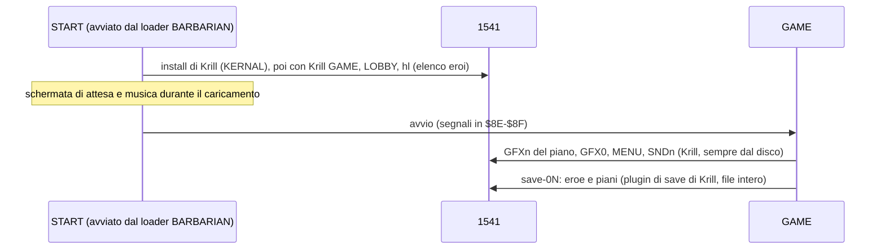

# Tecnica: memoria, disco, build, strumenti

Mappe dettagliate e sempre aggiornate (rigenerate a ogni build, Lab64): [indice](../../out/work/memory-map/index.html),
[GAME](../../out/work/memory-map/program-game.html) ([build.md](build.md) sezione 4a). Formato dei file: [FORMATO_DATI.md](FORMATO_DATI.md).

## Memoria (sintesi)

| Area | Contenuto |
|---|---|
| `$0002`–`$0040` | pagina zero del gioco (temporanei, puntatori, `rnd`, posizione del PG, camera; dall'11/11 anche `ui_cur`, `ui_n`, `ui_col`, `ui_ib`, `ui_sel`, `ui_lc`); `$41`–`$4F` libera; `$50`–`$5B` ZX0, `$5C`–`$64` caricamento del MENU (`ml_*`), `$65`–`$8C` variabili del modulo MENU (locanda e negozi); `$8D`–`$8F` libera |
| `$0400`–`$8720` | codice e dati del gioco (`GAME_ENTRY` $0400: lo schermo del BASIC è libero perché il VIC usa il banco 2 e il BASIC non gira; il loader salta a $0400, nessuno stub BASIC) (`main`, `db`, `dungeon`, `data`, `game`, `combat`, `levels`, `ui`, `hud`, `bar`, `music`, `prefetch`, `rel`) + grafica fissa copiata una volta all'avvio |
| `$8400` | schermo fisso della fascia HUD (VIC banco 2) |
| `$8A40`– | brano del luogo (`SND_LBUF`, grande quanto il brano più lungo, [Musica](musica.md)) |
| `$8C00` | sprite delle varianti forti e del boss finale |
| `$8E80`– | motivetto di combattimento (`SND_FBUF`) |
| `NM_AT`–`$8FFF` | (15/11) colori e nomi dei mostri del capitolo (blocco info del file del tema, `GFX_INFO` = 147 B da `$8F6D`) |
| `$9000`–`$9BFF` | variabili (il VIC qui vede la ROM dei caratteri): generatore e stanze `$9000`, gioco `$9100`, barra `$91A8`, `solidtab` `$9200`, coda dei tesori `$9240`, **combattimento `$9318`**, musica `$93A0`, eroe `CHRBLK` `$9500` (206 B, con il baule della locanda), tabelle dei mostri `MRT` `$9600` (12 × 32), stato del piano `LVLBLK` `$9800`–`$9AFF`, salvataggi `$9B00`, player SID `$9B4E`–`$9BF7` |
| `$9C00`–`$9FFF` | `CODE2`: disco, caricamenti, salvataggio del piano, caricamento dei moduli |
| `$A000`–`$BFFF` | VIC banco 2: sprite, charset del gioco `$A800`, schermi A `$B400` e B `$BC00`, font della UI `$B800`; negli slot sprite 28–31 (`$A700`–`$A7FF`) la **zona 3 del modulo MENU** |
| `$C000`–`$C8FF` | `MAP` 48 × 48 (nel menu: modulo `LOBBY`, fino a `$CBFF`) |
| `$C900`–`$CFFF` | **modulo MENU, zona 1** (locanda e negozi, caricato all'ingresso nel villaggio, resta fino al LOBBY); arena: modulo a `$C900` |
| `$D000`–`$DFFF` | sotto l'I/O: STASH del piano lasciato (portale/morte: boss, 5 mostri, 10 bauli) `$D000`–`$D07F`; **generatore dei piani** `$D080`–`$DD04` (`src/game/gen_io.asm`, ~3,2 KB, copiato all'avvio, eseguito con `$01=$34` da `gen_call`: [Dungeon](dungeon.md)); il resto libero |
| `$E000`–`$FFFF` | sotto il KERNAL: cache della grafica (villaggio `$E000`, tema da `GFX_DUN_AT` = `$EC6D` a `$F4DF`: 15/11, comincia nella coda del villaggio), **modulo MENU, zona 2** `$F4E0`–`$FCFF`, mappa della sala del trono `FMAP` in fondo (`$FD00`, dal 10/11) |

Margine del codice: controllato a ogni build (`.cerror`, avviso sotto 1 KB sotto `$8720`). Al 07/11: **~1,9 KB** sotto
`$8720` (da 509 B: sala del trono pregenerata su file +300 B, generatore sotto l'I/O +1,1 KB, codice di debug tolto,
conferma dell'eliminazione −70 B) + ~450 B in `CODE2`. Altre idee in `TODO.md` (negozi in overlay). Lo zaino a 8 posti
(07/11 sera) non ha liberato codice: toglie 32 B dal blocco dell'eroe, non dal margine.

### Moduli su disco
Oltre a `LOBBY` ($C000, solo nel menu iniziale), il gioco ha un modulo su disco: **MENU** (`src/menu.asm`, parti in
`src/menu/`, assemblato con le etichette del gioco), i **menu del villaggio: locanda e negozi** (11/11, TODO D13). Sta in
tre zone di RAM (zona 1 `$C900`–`$CFFF`, zona 2 `$F4E0`–`$FCFF` sotto il KERNAL, zona 3 `$A700`–`$A7FF`; formato e
contenuto in [FORMATO_DATI](FORMATO_DATI.md#menu--menu-del-villaggio-locanda-e-negozi)), compresso zona per zona con ZX0,
dal 18/11 un file solo (`MENU`, cinque zone, letto con Krill: 3,1 s con la decompressione).
- **Quando si carica**: all'ingresso nel villaggio (`enter_gfx` → `ovl_town`, `src/game/stash.asm`) (dal 11/11, ramo `fast-loader`,
  **a ogni ingresso**: `enter_gfx` azzera `ovl_cur`; niente più residenza fra una visita e l'altra). Dentro una visita al
  villaggio **resta**. Le porte richiamano `ovl_town` (riprova se il primo
  caricamento era fallito) e saltano alla tabella dei salti: `MENU_INN` (`$C900`, locanda), `MENU_SHOP` (`$C903`,
  negozio A).
- **Come gira**: tutti i menu del villaggio con `$01 = $35` (KERNAL escluso, interruzioni spente, vettore NMI in RAM su
  `nmi_stub`: `mk_off` nella zona 1, chiamato **solo dalla zona 1** perché con `$01 = $36` a `$F4E0`– si eseguirebbe la ROM);
  escono con `$01 = $36` prima di `ui_exit` (`mk_exit`; dall'11/11 sera la locanda non salva più uscendo). Niente
  KERNAL nei menu; la musica gira con `sfx_update` in `ui_input`.
- **Cosa resta in GAME** dei negozi: le routine usate anche da inventario, baule dei dungeon e locanda (`ui_title`,
  `shop_gold`, `ui_gold`, `ui_coin`, `ui_mark`, `sh_cur1`, `msg23`, `cat_bit`) e il riquadro dell'oggetto del baule dei
  dungeon (`ch_item`, la versione ridotta di `sh_item`). L'oro del baule della locanda (`st_gold`) è in `stash_io.asm`
  (coda di CODE2); il baule si legge e si scrive con l'eroe (`load_char`/`save_char`), ordinamento e messaggi in `stash.asm`.
- **Variabili** in pagina zero (`$65`–`$8C`): niente byte nel file e istruzioni più corte.
- **Spazio**: la build stampa lo spazio libero di ogni zona (`.cerror` se si sfora). Margine di GAME: 1558 → 3501 B
  (dall'11/11, con il posto fisso del plugin di save di Krill a `$7D00`: 1998 B, di cui 609 prima del plugin).

## Disco

`BARBARIAN` (il loader con il menu), `START` (avvio del gioco con attesa e musica), `LORE` e `LDAT` (la storia, [Avvio e storia](intro.md)), `HELP` (il manuale, [Help](help.md)), `GAME` (**compresso ZX0**, decompresso sul posto dal loader: avvio da 154 a 111 s,
[FORMATO_DATI](FORMATO_DATI.md#compressione-zx0)), `LOBBY`, `MENU` (locanda, negozi, NPC: cinque zone compresse in un file), `TITLE`, `GFX0` (villaggio + mappa RLE), `FMAP`,
`GFX1` (temi 1–7), `GFX2` (tema 8), `SND0`…`SNDn` (brani, [Musica](musica.md)), `HL` e `SAVE-01`..`SAVE-05`
(salvataggi), `KSAVE` (plugin di save di Krill). Dall'11/11 il gioco legge e scrive con **Krill's Loader**
([FastLoader](FastLoader.md)): disco per la 1541 (`_1541` nel nome). **Un solo disco** (11/11 sera, regola del
committente) `out/work/disk.d64`; per lo sviluppo `POKE 1020,1` prima del `RUN` salta il menu del loader ([cheats](cheats.md)).
Comporre il disco costa ~0,1 s (`cc1541` di Krill).

Il precaricamento del tema in sottofondo (`prefetch.asm`) è **tolto** (11/11, ramo `fast-loader`): vedi
[Flussi](flussi.md#8-precaricamento-del-tema-tolto).

## Sorgenti

`src/` contiene un sorgente principale per ogni file del disco; le parti incluse stanno nelle sottocartelle delle
componenti (07/11). Assemblaggio con `-I src -I src/common -I src/game -I out` (`tools/build/asm.sh`).

| File del disco | Sorgente | Include da |
|---|---|---|
| `BARBARIAN` (loader) | `src/barbarian.asm` | `common/tramp.inc`, `out/work/version.inc` |
| `START` | `src/start.asm` | `common/boot.asm` (titolo, musica, PRESS SPACE, caricamento), `common/zx0.inc`, `common/sid_player.inc`, `out/work/start_data.inc`, `common/tramp.inc` |
| `LORE` | `src/lore.asm` | `common/boot.asm` con `LORE=1`, `lore/scroll.asm` |
| `HELP` | `src/help.asm` | `common/tramp.inc`, `out/work/help.inc` (`tools/build/gen_help.py`) |
| `HELP` (da fare) | `src/help.asm` | `help/` (vuota, `src/help/README.md`) |
| `GAME` | `src/game.asm` | `game/*.asm` (gioco, combattimento, piani, UI, HUD, barra, musica, salvataggi, disco, generatore...), `common/` |
| `LOBBY`, `MENU` | `src/lobby.asm`; `src/menu.asm` + `src/menu/` (compresso da `tools/build/pack_menu.py`) | `out/work/game.lbl` (etichette del gioco), `common/macros.inc` |
| `JUKEBOX` | `src/jukebox.asm` | `common/sid_player.inc`, `common/sfx.inc` |
| (nessuno: arena) | `src/test/arena.asm` | `out/work/arena_game.lbl` |

File sorgente generati (11/11, G1: non più in `src/` né in git, li scrivono i generatori a ogni build): `out/work/version.inc`,
`out/work/sid_freq.inc`, `out/work/start_data.inc`, `out/work/db.asm`, `out/work/gfx_consts.inc`, `out/work/final_map.inc`, `out/work/music_tab.inc`,
`out/work/town_places.inc`; l'assemblaggio li trova con `-I out`.

## Build

Tutto gira nei container Docker (13/11; panoramica, container e comandi in [Getting started](../getting-started.md)): sul PC dello
sviluppatore servono solo sh, Docker, git e curl. La build gira in `lab64-tools` (64tass, cc65, Python con
Pillow/PyYAML/NumPy/Matplotlib), i test in `lab64-tools` (+ VICE, Xvfb); VICE, zx0 e cc1541 sono compilati dentro le
immagini; le ROM stanno in `roms/` di Lab64 e VICE le riceve a mano (`-default` + tutte le ROM). Verificato il 13/11:
`./build.sh` e `./build.sh --release` completi nei container.

| Comando | Cosa fa |
|---|---|
| `./build.sh` | versioni → generatori (`gen_gfx`, `gen_font`, `gen_music`: brani da `tools/build/songs.py`, `gen_db`) → assemblaggio → dischi → mappe RAM/disco e atlante grafico (`gen_atlas.py` → `out/work/atlas/`) → test |
| `./build.sh --no-test` | come sopra senza test |
| `lab64 run <container> <comando>` | (13/11) un comando qualunque in un container (`tools` = `lab64-tools`; `pdf-gen` = `lab64-pdf-gen`; un nome completo si usa com'e') |
| `tools/build/asm_audit.py` | (11/11) analisi del codice assemblato dai listati di tutti i programmi: codice non raggiunto, ripetuto, spioncino, routine più grandi → `out/work/asm_audit/analisi_assembly.md` |
| `tools/vice/frame_prof.py` | (11/11) cicli di ogni routine del ciclo principale a ogni giro, su un piano e con una corsa di Frenzy scelti ([prestazioni](prestazioni.md)) |
| `tools/vice/menu_time.py` | (11/11) cronometro del modulo MENU: caricamento dal disco e apertura di negozi e locanda |
| `tools/build/items_db.py`, `tools/build/bestiary.py`, `tools/build/chapters_db.py` | (11/11) database di oggetti, mostri e capitoli (`data/items/`, `data/monsters/`, `data/chapters.yaml`) |
| `tools/build/cache_run.py` | (11/11) build incrementale: un passo (storia `gen_lore`, manuale `gen_help`, atlante `gen_atlas`) gira solo se cambiano i suoi ingressi (impronta in `out/cache/steps/`). Tempi misurati l'11/11: `tools/build/asm.sh` 1,0–1,3 s con le cache, 2,9 s senza; `./build.sh --no-test` ~4 s |
| `tools/build/asm.sh [test]` | solo assemblaggio (anche build ARENA, moduli LOBBY e MENU (`tools/build/pack_menu.py`), compressione di GAME con `tools/build/pack.py`); `test` = varianti con le variabili d'ambiente |
| `tools/build/release.sh` | parte finale di `./build.sh --release`: disco, mappe in `out/work/memory-map/`, zip dei sorgenti (con la versione corrente) |
| `tools/build/bump_version.py` | chiamato da `build.sh`: se i sorgenti (src senza i generati, data, tools, fonts, tests, version.yaml) sono cambiati dall'ultima build (`source_hash` in `version.yaml`), versione minore + 1. La build lascia `out/releases/latest/blood_path_vX.Y_1541.d64` |

Varianti di test (`tools/build/asm.sh test` con variabili d'ambiente): `TESTLVL` (piano di partenza), `TESTCL`
(livello dell'eroe), `TESTSP` (mostri), `TESTUI` (schermate per screenshot/test), `NOKEYS`, `TESTFIRE`, `TESTSK`,
`TSV` (camminata per le misure di scorrimento), `TMDBG` (tempi del ciclo), `TESTFZ` (1 = Frenzy permanente alla
corsa `TESTFZR` 0..100, 2 = solo contatori: fotogrammi video in `$03F8`, giri del ciclo in `$03FA`, campioni
"fotogrammi persi, px, py" ogni 32 giri in `$0340`; `TESTFZS` 0/1/2 = corsa orizzontale, verticale, diagonale
nel villaggio).

## Test

Suite, struttura, ID, velocità ed elenco completo: [Test](test.md) (ristrutturati l'11/11).

## Strumenti di bilanciamento (`tools/simulators/`)

Tutti gli script di simulazione delle partite stanno in `tools/simulators/` e vanno tenuti allineati al codice a ogni
cambio di regola (regola in `CLAUDE.md`).

- **Arena** (`tools/vice/arena.py` + `src/test/arena.asm`): il codice di combattimento vero in VICE, una stanza, PG
  configurabile (piano, livello, arma+magia, armatura, scudo, anello+caratteristica, pozioni, abilità) contro 1–8
  mostri; risultati: vittorie, durata, vita finale, danni, pozioni, xp. Esempio:
  `tools/vice/arena.py --lvl 10 --plvl 10 --weapon sword+1 --armor chain_mail --shield medium_shield --ring silver+3 --monster demon --potions red:2,yellow:2`.
  Durabilità: `--dur N` (`PAR_DUR`, `PAR+14`) dà all'arma durabilità N (= massimo) per tutta la serie; l'arma si
  usura e, se si rompe, nei combattimenti seguenti non fa danni (07/11); a fine serie
  `weapon_dur`/`weapon_end` (`RES+37`/`RES+38`). Senza `--dur` l'arma non si usura (serie ripetibili,
  `tests/regression/balance/test_arena.py`).
- **Simulatore** (`tools/simulators/sim_rules.py`, `tools/simulators/rules.py`): Monte Carlo delle regole di `rules.yaml` (combattimenti,
  progressione, boss finale con evocazioni; vita dei mostri ±25%, boss immuni al blocco, livelli dei mostri come
  nel codice); `tools/simulators/fit_rules.py` taratura automatica; `tools/simulators/cmp_rules.py` confronti.
- `tools/simulators/sim_durability.py` (durabilità e usura), `tools/simulators/sim_chest.py` (chestLevel e probabilità di ogni oggetto
  per piano), `tools/simulators/sim_gold.py` (oro raccoglibile e oro dei bauli epici).
- **Generatore del database** (`tools/build/gen_db.py`): legge `rules.yaml` + `data/items/items.tsv` (via `tools/build/items_db.py`) + `balance.yaml`, controlla limiti 8/16 bit
  e coerenze, scrive `out/work/db.asm`.
