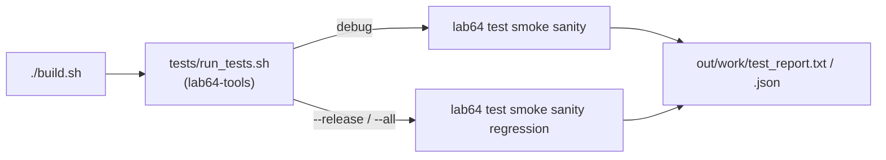

# Test

Copyright © 2026 - Simone Caporale

Ristrutturati l'11/11 (richiesta del committente). Tre suite, tre cartelle in `tests/`, un solo runner con report.
Dal 13/11 tutti i test girano nel container **`lab64-tools`** (i test `EMU-*` parlano con il demone di vc64web nel
container `lab64-vc64web`): `./build.sh`, oppure `lab64 test ...` per i comandi di questa pagina
(panoramica: [Getting started](../getting-started.md) sezione 5; regole: `tests/CLAUDE.md`).
I test sono scritti **in inglese** (ID, descrizioni, motivi dei fallimenti, commenti dei file nuovi; gli script storici
spostati in `regression/` hanno ancora commenti e messaggi in italiano, da tradurre: TODO).

## Le tre suite

| Suite | Cosa contiene | Come | Quando gira |
|---|---|---|---|
| `smoke/` | pochi test **veloci** sull'**happy path** delle funzioni principali | VICE con scorciatoie (memoria scritta dal monitor, teletrasporto del PG, tasti scritti all'uscita di `read_input`, routine chiamate direttamente) | ogni build |
| `sanity/` | i test della **feature appena implementata** | come smoke o regression, secondo la feature | ogni build |
| `regression/` | **tutti i casi particolari** di ogni funzione | il più vicino possibile al gioco vero (disco, menu, tasti), anche lenti | release o `--all` |

**Regola dei sanity** (CLAUDE.md): quando si passa a una feature nuova, i test della feature precedente si spostano da
`sanity/` in `smoke/` (se sono happy path veloci) o in `regression/` (casi particolari, test lenti); poi in `sanity/`
si scrivono quelli della feature nuova.

## Struttura

- Una cartella per feature in ogni suite (`tests/<suite>/<feature>/`). Il file **`cases.py`** registra i test
  (`@test("ID", "description")`); gli altri file della cartella sono script e dati di quella feature (es.
  `regression/gen/gen_ref.json`).
- **ID**: maiuscoli, `AREA-NN` (`SHOP-01`, `INN-CHEST-01`, `DUNG-CHEST-01`). Numerazione: `01`–`09` smoke, `10`+
  sanity e regression (un test che passa da una suite all'altra conserva il suo ID). Il runner rifiuta ID duplicati.
- (14/11) **motore e libreria VICE stanno in Lab64**: `containers/tools/test/run.py` di Lab64 (motore), `containers/tools/py/c64test.py` di Lab64 (registro),
  `containers/tools/py/vicemon.py` di Lab64 (`Vice`). Nel gioco resta solo cio' che e' del gioco; i `cases.py` importano `c64test` e `vicemon` di Lab64 direttamente.
- `tests/lib/c64.py`: libreria del gioco. `Vice` (di Lab64: x64sc in warp con monitor remoto: **nessun tempo fisso**, ogni
  comando aspetta il prompt, `go` aspetta la fermata e ne legge il contatore di cicli), `Game` (il disco, menu,
  partita, `frames(n, joy, fire, keys)` con l'input scritto all'`rts` di `read_input`, `in_game()` dal ritorno nello
  stack, `teleport`), `sync`/`settle` per gli script storici con il loro socket.
- `c64test` di Lab64 (`from c64test import test, check, Skip, script`): registro, `check(cond, reason)`, `Skip`, `script(id, desc, argv)` per gli script esterni.
  Un `cases.py` può avere `setup`/`teardown` (una sessione di VICE per tutti i suoi test) e `CHAIN = True` (sequenza:
  dopo un fallimento i test seguenti sono SKIP con il motivo).
- `lab64 test [smoke|sanity|regression|all] [-k ID|prefisso] [--list]` (o `lab64 test ...`, che con `lab64 up` passa anche il demone vc64web); report a schermo e in
  `out/work/test_report.txt` / `out/work/test_report.json`: ID, suite, esito (PASS/FAIL/SKIP), tempo, motivo.
  (15/11, Lab64 1.3) Le suite girano sempre nell'ordine smoke, sanity, regression; `-k` senza suite cerca in **tutte** le suite;
  un argomento sconosciuto o una selezione senza test (es. `-k` che non trova nulla, o `sanity/` vuota) esce con **2** senza toccare
  i report (con la 1.2 era un giro verde): `tests/run_tests.sh` lo tratta come un fallimento, quindi `sanity/` non deve restare vuota.
  Motivo dei FAIL degli `script()`: le righe con FAIL/rror/ERROR, altrimenti le ultime 3 righe (le parole in piu' starebbero in
  `C64_TEST_REASON_WORDS`; il gioco non ne ha bisogno: nessuno script stampa "ATTENZ" come esito).
  Stato dal vivo (14/11): `out/tmp/tests.json`, riscritto dopo ogni test (stato, test in corso, esiti fin qui): lo legge il centro di
  controllo del viewer ([getting-started](../getting-started.md) sezione 6).

## Tetti di durata (12/11, committente)

`lab64 test` fallisce (exit 1, righe `TIME CAP`; 14/11: i valori stanno in `lab64.env`, `C64_TEST_CAPS`) se: la suite **smoke** da sola supera **20 s**; **smoke + sanity** supera
**35 s** (somma dei tempi dei test, setup compreso); un **singolo** test di smoke o sanity supera **10 s**. Regression senza
tetto. I tetti di somma si controllano solo senza `-k`. `TEST_CAP_SCALE=0.2` li riduce per provare il controllo. Misura
del 12/11: smoke + sanity 35 test in ~21 s (tetto 35 s); il test più lento `CHAP-SAVE-10` 4,7 s.

## Velocità (misure dell'11/11)

- smoke + sanity (la build di debug): **32 test in ~25 s** (prima della ristrutturazione la suite di debug richiedeva
  ~5 min); 8 s sono l'avvio fino al menu dal disco, i 29 smoke del gioco ~8 s in tutto.
- regression: **~80 test**, ~6–7 min; 3 sono solo di release (in debug SKIP; con `RELEASE=1` dopo `RELEASE=1 tools/build/asm.sh`).
- Un solo run alla volta (`out/tmp/.test.lock`): la porta del monitor di VICE (6510) è unica, due run in parallelo si
  parlerebbero addosso (successo durante la ristrutturazione: fallimenti a caso).
- Monitor a prompt invece dei tempi fissi negli script storici (`test_saves`, `test_rel`, `test_music`, `test_hudxp`,
  `tools/vice/arena.py`): `test_saves.py 1 5` da 70 s a 25 s. `test_start.py` e `test_lore.py` (avvio dal disco, release)
  hanno ancora tempi fissi.
- I test lenti stanno in regression; lo smoke usa le scorciatoie di VICE.

## Aiuti per scrivere i test (11/11)

- `tests/lib/play.py`: nuova partita (`new_game`), tasti della matrice (`K_I`, `K_M`, `BELT_KEYS`, ...), `key`, `find`,
  `alive`, `mpos`, `floor_next`, `clear_around`, `go_level`/`go_village`, `fire_to`, `minimap` (marcatore).
- `Game.watch(*addr, until=...)`: conta i passaggi su un indirizzo mentre `frames()` gira (es. quante volte
  `ml_read` o `perform_skill1`), `until` ferma `frames()` su un indirizzo (`g.stopped`); `unwatch()`.
- `Game.to_menu()` (11/11, ramo `fast-loader`): carica `START` dal monitor e lo avvia: installa Krill's Loader (senza,
  GAME non legge il disco) e carica GAME, LOBBY ed elenco eroi in ~1 s reali. Il modulo MENU lo scrive il monitor
  (`menu_return`, `C64_REALMENU=1` per leggerlo dal disco). Mai far partire GAME da `$0400` senza `START`.
- `tests/lib/emu.py` (13/11): il secondo emulatore (vc64web), vedi sopra e [emulatore.md](emulatore.md).
- `Game.call_keep(addr)`: chiama una routine del gioco fra due letture dell'input e torna dov'era (registri
  ripristinati); `regs()` legge pc/a/x/y/sp.
- `tests/lib/loads.py` (15/11, ex TODO A2, [FastLoader.md](FastLoader.md) 4.1): `directory(d64)` (file nell'ordine della directory,
  con i byte), `ram()` (RAM anche sotto le ROM), `load_to()` (un `krill_loadraw` diretto) e **`LoadCheck`**: come `call_keep`, ma
  ferma ogni `krill_loadraw` della routine e, al ritorno, confronta byte e indirizzo di fine con il file sul disco (`KRILL-24`).
  Per controllare che un percorso nuovo del gioco legga i file giusti basta chiamarlo con `LoadCheck.call`.
- Prestazioni (`regression/perf`): durata di ogni fotogramma = cicli fra due letture dell'input; perso = più di 1,5
  fotogrammi PAL. Le soglie sono le misure dell'11/11 più un margine ([prestazioni](prestazioni.md)).
- **Sonda della memoria** (14/11, `C64_MEMPROBE=1`, `./build.sh --probe`): ogni `Vice()` avviato senza `-autostart` riempie la RAM
  con lo schema di `memmap/probe.py` di Lab64 subito dopo il boot e `close()` la salva in `out/work/memprobe/<suite.area>_<pid>_<n>.bin`
  (lo scenario è il modulo dei test, `C64_MEMPROBE_TAG` messo da `lab64 test`). Serve alla mappa automatica ([build.md](build.md)).
  Un test che fallisce solo con la sonda sta leggendo memoria mai inizializzata (il C64 vero all'accensione non ha la RAM a zero).
  (15/11) La sonda gira anche in `./build.sh --release` (tutte le suite). Un dump va al programma il cui file principale e' in
  RAM alla fine della sessione: i test `PROBE-10..14` (`regression/memprobe`) finiscono apposta in BARBARIAN, LORE, HELP, START e
  JUKEBOX, che prima non avevano sessioni (GAME ne ha gia' moltissime).

## Il secondo emulatore (13/11)

`tests/regression/emu/` (`EMU-10..16`, ~2 minuti, in catena) controlla che il gioco giri anche su **vc64web** (un altro core e
un'altra emulazione del 1541-II): avvio dal disco vero, nuovo eroe con salvataggio Krill, HUD letto a schermo, alchimista,
cripta, mostro ucciso, portale, ritorno e nuovo avvio con l'eroe salvato. **VICE resta l'unico riferimento**: questi test
non stabiliscono cosa è giusto, dicono che il gioco funziona anche lì. Libreria `tests/lib/emu.py` (classe `Emu`: demone nel
container `lab64-vc64web` all'indirizzo `EMU_URL`, `boot`, `run_script`, `run_loop`, `peek`, `findText`); bot in
`tests/regression/emu/bots/`. Senza il demone (`./build.sh --emu` o `--release` lo accendono) i test sono **SKIP** con il motivo. (14/11: prima erano FAIL, perche' il runner contava come fallimento ogni eccezione del `setup` del modulo; ora un `Skip` nel `setup` da' SKIP a tutti i test del modulo.) Guida e trappole: [emulatore.md](emulatore.md).

## Elenco

Generato con `lab64 test all --md` (rifarlo quando si aggiunge un test).

### smoke (31)

| ID | Test |
|---|---|
| `BUILD-01` | memory margin positive (code below $8720 >= 128 B, total >= 256 B) |
| `BUILD-02` | SAVE_VER in the PRG = save_version in version.yaml |
| `BUILD-03` | "version x.y" centred in the loader, start menu and game menu |
| `BUILD-04` | manual: images and placeholders of the source |
| `BUILD-05` | graphics atlas: names, ids, sample dungeon, groups |
| `PG-NEW-01` | new barbarian: name, seed, game starts in the village |
| `VIL-MOVE-01` | village: walk without glitches (tiles, VIC registers, frames) |
| `MAP-01` | minimap in the village: hero marker on the hero's position |
| `SHOP-BUY-01` | smith: buy the first ware (gold carried + inn chest) |
| `SHOP-SELL-01` | smith: sell the bought item at price >> SELL_SHIFT (a quarter since 20/11) |
| `SHOP-REPAIR-01` | smith: repair the worn weapon (durability back to max - 1, gold paid) |
| `INN-CHEST-01` | inn: an item from the pack to the chest |
| `INN-CHEST-02` | inn: the item from the chest back to the pack |
| `INN-GOLD-01` | inn: entering, the carried gold goes into the chest (in tens) |
| `LVL-IN-01` | crypt: enter level 1 |
| `FIGHT-01` | combat: a monster killed, experience gained |
| `PG-LEVEL-01` | level up: experience over the threshold -> level + 1, more hp, Whirlwind selectable at level 3 |
| `MAP-02` | minimap on level 1: hero marker on the hero's position |
| `POTION-01` | potion: key 1 drinks the first belt slot, hp grows, slot freed |
| `DUNG-CHEST-01` | level chest: opens, gold and item taken |
| `EQUIP-01` | inventory: change weapon |
| `LVL-DOWN-01` | stairs down to level 2 and up again to level 1 |
| `SCROLL-01` | a portal scroll taken from a level chest goes to the pack (stack) |
| `PORTAL-01` | scroll: portal on the level, back to the village |
| `PORTAL-02` | village: the portal leads back to the level |
| `LVL-OUT-01` | stairs up: back to the village |
| `DEATH-01` | death: screen, village, half gold, full hp |
| `PG-SAVE-01` | game menu 'save game': back in the game; the hero on disk equals the one in RAM |
| `PG-LOAD-01` | save game, change the gold, quit (no save): the barbarian loads back as saved |
| `KRILL-01` | load_gfx 1 (Krill, LOAD_TO): the theme at GFX_DUN_AT (under the KERNAL, $EC6D since 15/11) equals out/work/gfx/gfx1.prg |
| `KRILL-02` | snd_get (Krill): the song in its buffer equals out/work/snd/snd0.prg |

### sanity (3)

| ID | Test |
|---|---|
| `RING-10` | inventory: with one ring on, a second ring goes to the free ring slot; both rings add their stat (recalc_stats) |
| `RING-11` | inventory: with both rings on, a new ring replaces the one of lower value (it goes to the pack, message 'replaced') |
| `RING-12` | alchemist: a ring among the wares has its stat (1..3) and the bought ring keeps it |

### regression (242)

| ID | Test |
|---|---|
| `ASM-10` | tools/build/asm_audit.py: GAME code all reachable (but jump tables), no fill_rect / chst_hold any more |
| `ASM-11` | generated sources commented: every T_ tile constant with its description, item ids and monster types listed in db.asm |
| `BAL-10` | d20 rules in the simulator: reference hero, weak hero, curves |
| `ARENA-10` | arena: short repeatable series, sensible results |
| `BEST-10` | every chapter of chapters.yaml (but the Abyss) has base monsters, their strong variants and one boss = its final map boss |
| `BEST-11` | the game = the table: monster types of out/work/db.asm are the rows implemented = yes, in order |
| `BEST-12` | the checker refuses a wrong bestiary: strong_of of another chapter, unknown tier, duplicate id |
| `BOOT-10` | POKE 1020,1: BARBARIAN -> START from disk without the menu (Krill installed), GAME, LOBBY and hero list loaded |
| `BOOT-11` | START from the monitor (wait screen, no bar) up to the game menu |
| `LORE-10` | release: BARBARIAN menu, HELP (all the pages of data/help.txt), LORE (identical LDAT), joystick fire held = double scroll speed (released: normal; held at the end: no exit), return, START |
| `LORE-11` | LORE story stream: one blank row between the text rows of a paragraph, two between paragraphs, size limits (15/11) |
| `HELP-10` | release: the HUD crop in the help equals the game HUD |
| `BOOT-12` | RUN/STOP while the KERNAL loads LORE (from the BARBARIAN menu): back to the menu, no red border (12/11) |
| `BOOT-13` | BARBARIAN menu: every choice (1 2 3) blanks the screen BEFORE loading; only its phrase (row 10, yellow) and 'please wait' (row 13), as the START wait screen (16/11) |
| `BOOT-14` | BARBARIAN menu: item 4 'exit game' -> BASIC (READY.), keyboard and screen as at power-on (16/11) |
| `BOOT-15` | START is silent (no SID player): the menu music stops when the game is chosen and restarts only in the lobby (16/11) |
| `BOOT-16` | HELP and LORE exits: wait page (phrase on row 10, 'please wait' on row 13, VIC bank 0, screen on) before the reload of BARBARIAN (16/11) |
| `TITLEMUSIC-10` | HELP: Demon's Eye with its own IRQ clock (CIA1 timer A, 19656 cycles), IRQ/SID/CIA restored before the KERNAL LOAD |
| `TITLEMUSIC-11` | BARBARIAN: Demon's Eye with its own IRQ clock (CIA1 timer A, 19656 cycles), IRQ/SID/CIA restored before the KERNAL LOAD |
| `BOOT-17` | BARBARIAN menu: one loop per frame whatever the phase of the music IRQ (CIA1 timer locked to the frame; before 19/11 an IRQ over raster line 250 froze the menu for ever, TODO I6, LORE-10 hangs) |
| `BOSS1-10` | level 5: over 30% of its life the Abbot does not rage; under 30% it rages (red border, attack recharge <= AB_RCD) |
| `BOSS1-11` | raging Abbot: the censer warns (white blinking) and then the cloud takes hpmax/8 from the hero next to it (far away: not checked, the boss walks) |
| `BOSSMAP-10` | boss levels 5, 10, 15: the map of data/maps/bosschapN.txt (after post_walls), the furniture of the chapter, stairs up to the boss walkable, no stairs down, its own palette (final.palette), the tiles of GFX(2c) from boss_gfx.py |
| `BUILD-10` | variant: saved hero details (TESTUI=2) |
| `BUILD-11` | variant: game menu (TESTUI=25) |
| `BUILD-12` | variant: Fire on stairs (TESTFIRE) |
| `BUILD-13` | variant: skill change (TESTSK) |
| `CHAP-SAVE-10` | stairs inside a chapter: no disk read or write; a dead monster of level 2 stays dead (RAM slot) |
| `CHAP-SAVE-11` | level 5 -> 6 (chapter 2): hero + chapter 1 written once; back to level 2 its state comes from the disk |
| `CHAP-SAVE-12` | save game, then changes, then quit (no save): continue gives the saved hero and the saved fog of level 2 |
| `CHAP-SAVE-13` | listing: the hero file is written only by gm_save and chap_save (sv_all) and by the new hero (save_char) |
| `CHAP-10` | chapters.yaml: local levels restart at 1, global depth = previous levels + local, the Abyss fills up to 255 |
| `CHAP-11` | tools/simulators/chapters.py: every generated level of a chapter at its global depth with the chapter's bestiary, the chapter boss |
| `CHAP-SEQ-10` | new hero in chapter 1 (c_chap = c_unl = 1); the village exit is closed: no label, the edge stops the hero |
| `CHAP-SEQ-11` | level 5 = boss level of chapter 1: map BOSSCH1 (stairs up, no stairs down), boss drawn as the final boss |
| `CHAP-SEQ-12` | killing the boss of chapter 1 unlocks chapter 2 (c_unl = 2) |
| `CHAP-SEQ-13` | village exit open: label 'travel to next chapter'; fire: chapter 2, village TWN2 at the south entry, hero saved |
| `CHAP-SEQ-14` | chapter 2: the crypt leads to level 6 (first of the chapter); its stairs up lead back to the village |
| `CS-10` | no points, no token: nothing about respec on the screen, no entries, 'no points to spend.', next point at level 5 |
| `CS-11` | no points, 1 token: token count shown, only 'respec' (row 17); yes: points back, full menu without respec |
| `CS-12` | points, no token: entries str/dex/con/confirm/undo only, 'points to spend 3', no respec anywhere |
| `CS-13` | before confirming, points move freely: D/+ add, A/- take back, between str/dex/con; undo takes all back |
| `CS-14` | preview: con +1 shows 'hp N -> N+6' and 'mod +2 -> +3' (new values green); hint of the stat under the cursor |
| `CS-15` | confirm asks 'spend 2 points for good?': no = keep editing, yes = spent and 'no points to spend.' if none left |
| `CS-16` | RUN/STOP with pending points asks 'spend 1 point before leaving?': no = points given back, yes = spent |
| `CHEAT-10` | game menu: 4th entry 'cheats'; the cheat menu lists god mode (off), level up, respec token, next level, next chapter |
| `CHEAT-11` | god mode on: no damage (hurt_player); god mode off: damage again |
| `CHEAT-12` | level up: level + 1, xp = threshold of that level, stat points of pl_pts, hp max up and full; message 'level N' |
| `CHEAT-13` | respec token: +1, message 'tokens N' |
| `CHEAT-23` | gold +1000: 1000 coins on the hero at every Fire (GOLD_MAX at most), message 'gold N' |
| `CHEAT-14` | level up at the maximum level (PL_MAXLVL): nothing changes, message 'limit reached' |
| `CHEAT-15` | next level in the village: the first level of the chapter (as the crypt) |
| `CHEAT-16` | next level in a level of the chapter: the next level (as the stairs down) |
| `CHEAT-17` | next level on level 4 -> boss level 5; there: boss killed (c_unl = 2, exit open), back to village 1 at the crypt |
| `CHEAT-18` | next chapter from a level (village 1 -> level 1 -> village 2): unlocked, saved in village 2, no portal back |
| `CHEAT-19` | next chapter in a village (village 2 -> 3, then 4): c_unl follows, hero saved there |
| `CHEAT-20` | next level in the throne room (level 20): as the final boss killed (c_won, c_unl 5, respec gift), village 4 |
| `CHEAT-21` | village 5 (last): next chapter and next level do nothing, message 'limit reached' |
| `CHEAT-22` | GAME assembled with the release flags (tools/build/asm.sh release-game): no cheat code |
| `DECOR-10` | levels 2, 7, 12, 17 (chapters 1-4), 3 seeds: solid and walkable furniture on every level; every walkable tile still reachable from the stairs; no monster on a solid tile; the same map when the level is entered again; chapter 4: the furniture is mirrored like the citadel (but where the mirrored tile is a stair or a chest) |
| `DISK-10` | the disk has every file (loader, START, game, LORE, LDAT, TITLE, HELP, JUKEBOX, saves, ...) |
| `DISK-12` | entry of the tests (11/11, Krill): the real START from the monitor (Krill installed), new game in the village |
| `DUNG-CHEST-10` | key chest: without a key 'it is locked' (stays closed); with a key it opens, one key used |
| `DUNG-CHEST-11` | monster within 2 tiles: Fire refused, label 'monster too close!' (id 15); monster gone: it opens |
| `LOOT-10` | full pack: a weapon in a chest stays there ('pack is full'); one free slot: taken |
| `LOOT-11` | full belt: a potion in a chest stays there; one free belt slot: it goes to the belt, not the pack |
| `DUNG-CHEST-12` | golden chest: needs a key like the key chest (ch_keyr), one key used |
| `LOOT-12` | 10 scrolls on the hero: a scroll in a chest stays there (max 10); with 9 it is taken (stack of 10) |
| `MAP-10` | minimap fog: nothing explored -> nothing far from the hero; all explored -> the level; half -> top half only |
| `PORTAL-10` | portal on level 1, then a new portal on level 2: the old one on level 1 is gone, the village one leads to 2 |
| `PORTAL-11` | portal out of level 2 and back: a wounded monster keeps HP and tile, a dropped chest is still there; stairs away and back: the monster is healed (STASH only for portal and death) |
| `SKILL-10` | Frenzy (O): level 15 needed; 5 s; two attacks per Fire; run +100% = 4 px per frame; normal run after |
| `SKILL-11` | Rage (U): level 9 needed; 6 s; damage taken halved (min 1), full damage without Rage |
| `DEATH-10` | death on level 20 (throne room): village, half gold, deepest level 20 kept |
| `THRONE-10` | throne room: north wall closed, boss killed -> wall open, epic chest without key, lever -> portal |
| `EMU-10` | vc64web: real boot from the disk (LOAD, POKE 1020,1, RUN): START with Krill, GAME and LOBBY loaded, menu shown |
| `EMU-11` | vc64web: new barbarian from the menu (joystick + keyboard), saved to disk by the Krill plugin, village reached |
| `EMU-12` | vc64web: the HUD text (HP, XP, LV) is on screen in the encoding 'hud' generated by the build |
| `EMU-13` | vc64web: walk to the alchemist, buy the portal scroll (60 gold): gold and pack change |
| `EMU-14` | vc64web: walk to the crypt stairs and go down: level 1 (generator, GFX and monsters loaded) |
| `EMU-15` | vc64web: kill a monster in the crypt, read the portal scroll, take the portal back to the village |
| `EMU-16` | vc64web: reset and boot again from the same disk copy: the hero saved at creation is in the LOBBY list |
| `GEN-10` | reference maps, throne room from FMAP and from the cache |
| `GEN-11` | caves of chapter 3 (levels 11-14, 6 seeds): connected, border of wall, enough floor, generation under 1.2 s, palettes 9/11/10 |
| `GEN-12` | swamp of chapter 2 (levels 6-9, 8 seeds + 2 anagram seeds with different gates): entry and exit gates on two sides of the border, the exit of a level facing the entry of the next one (random path, at least 3 sides used), gates of a level at least 34 tiles apart, all reachable, generation under 1.2 s, palette 12 |
| `GEN-13` | citadel of chapter 4 (levels 16-19, 6 seeds): connected, symmetric left/right (but the stairs), columns, big halls, generation under 1.0 s; no monster born in a wall or in the water on levels 1-19 |
| `INN-GOLD-10` | inn chest: deposit in tens (remainder kept, chest full, purse full) |
| `GOLD-CAP-10` | gold picked up: GOLD_MAX cap on the hero (add_gold16) |
| `SHOP-PAY-10` | payment: carried gold first, then the chest in tens, change back on the hero (gold_need/gold_pay) |
| `SHOP-BUY-10` | buy: 3 prices x different gold x pack full/empty (gold, chest, pack) |
| `SHOP-SELL-10` | sell: price >> SELL_SHIFT, GOLD_MAX cap (no sale), category not bought, empty entry |
| `SHOP-FIX-10` | smith repair (shop_repair, confirmation simulated): sword 200, durability 10/100, 1000 gold -> 950, 99/99 |
| `HELP-Z-10` | out/work/help.zx0 unpacks to out/work/help.prg byte by byte; the packed file is under 55% of the blocks |
| `HELP-Z-11` | the disk holds the packed HELP (file 'help' equals out/work/helpz.prg) |
| `HUD-XP-10` | XP line: thousands from 10000 (10K ... 65K) |
| `INV-DROP-10` | DEL on a pack item: N keeps it, Y drops it; DEL on an empty slot asks nothing |
| `INV-2H-10` | two-handed weapon with a shield on: the shield goes back to the pack; full pack: refused |
| `INV-2H-11` | shield with a two-handed weapon on: refused |
| `INV-UNEQ-10` | take off the armor (to the pack); full pack: refused; the weapon cannot be taken off |
| `ITEMDB-10` | items.tsv: valid table, consumable = potion/scroll, equipment = weapon/armor/shield/ring, weapons 1 or 2 hands |
| `ITEMDB-11` | the checker refuses a wrong table: shield with hands, duplicate id, missing price, unknown type |
| `ITEMDB-12` | game data = table: item ids in table order, category, price and the two-handed flag (itfl bit 0) |
| `INN-2H-10` | inn: shield with a two-handed weapon on: refused (the shield stays in the pack) |
| `INN-2H-11` | inn: two-handed weapon with a shield on: equipped, the shield and the old weapon go to the pack |
| `ITEMDB-NEXT-10` | next item database (data/items/next, proposal of 20/11): full names <= 37, unique names <= 16, affix values fit a byte, ids fit the record |
| `REQ-10` | inventory: a weapon whose STR requirement is above s_str stays in the pack ('str N' in its box); with enough STR it is equipped |
| `ITEM-10` | 255 generated items, broken weapon, HUD warnings, TOD clock (repair: SHOP-FIX-10) |
| `BELT-10` | belt (4 potions, the fifth refused), scroll stack, portal |
| `KRILL-10` | START installs Krill: resident code at $0200 as out/work/krill/loader.prg (but its variables), LDFLAGS used |
| `KRILL-11` | disk: hl (1 block), ksave, save-01..05 with SV_LEN + 2 bytes (9 blocks), barbarian first |
| `KRILL-12` | new hero: hl rewritten by the plugin (version, present, name); hero file: save_char then load_char gives the same hero |
| `KRILL-13` | no KERNAL disk call left in GAME, LOBBY, MENU and START (listing scan: after the install the drive does not answer the KERNAL) |
| `KRILL-20` | village entry order: MENU (load_file, one file since 18/11) then SND0 (load_raw): each one read whole at the first read (end address and bytes) |
| `KRILL-21` | snd_get checks the end address: every song read once into both buffers; with a wrong expected length 3 reads, then no music in that buffer (snd_cur = 0) |
| `KRILL-22` | ovl_town checks the end of the MENU file (= end of zone 2, ml_end): a file that does not end there is read 3 times, then C = 1 |
| `KRILL-23` | every file of the disk loaded right after its predecessor in the directory (served from the drive's next-file cache) equals its file: bytes and end address |
| `KRILL-17` | 1541-II (VICE 1542): START with Krill, menu, new hero (save plugin), village read |
| `KRILL-18` | 1570 / 1571 in 1541 mode: as KRILL-17 (ROMs dos1570 / dos1571 of Lab64) |
| `KRILL-14` | Krill install fails (simulated: from the install straight to kr_fail): message, a key, BARBARIAN loaded again |
| `KRILL-24` | walk through chapters 1-4 to village 5 (levels, boss levels, villages, saves, travels, LOBBY): every load equals its file |
| `LOBBY-10` | both disks have the file LOBBY (start menu) and START loads it by the 5-character name |
| `LOBBY-11` | GAME load_menu reads LOBBY from the disk into $C000: same bytes as out/work/lobby.prg |
| `LOBBY-12` | main menu plays Demon's Eye (file SND_MENU in the buffer of the place, player running); leaving it fades to silence, then music_town loads the village song |
| `PROBE-10` | BARBARIAN: the loader menu with its three entries; the session ends in BARBARIAN (memory probe) |
| `PROBE-11` | LORE from the BARBARIAN menu: title, PRESS SPACE, the story scrolls; the session ends in LORE (memory probe) |
| `PROBE-12` | HELP from the BARBARIAN menu: all the pages (data/help.txt); the session ends in HELP on the last page (memory probe) |
| `PROBE-13` | START: Krill installed, GAME loaded; the session ends in START just before GAME is unpacked (memory probe) |
| `PROBE-14` | JUKEBOX: two tunes played and stopped; the session ends in JUKEBOX (memory probe) |
| `PG-NEW-11` | new barbarian typed with keys: DEL, WASD as letters, ENTER to seed, ENTER to start, fire = start |
| `PG-NEW-12` | new barbarian: empty name refused by ENTER, RUN/STOP leaves with A=0 |
| `MON-AI-10` | awake monster reaches the hero along the wall (ANOANO level 2); hero on corners |
| `MON-AI-11` | short path (mon_path): monsters that stayed in a corner or shook on a wall edge reach the hero (3 cases, ANOANO) |
| `MON-CHAP-11` | chapter 1: a dungeon level and the boss level give the sprites, colours and names of the chapter; a monster of the chapter has its name drawn in the top bar |
| `MON-CHAP-12` | chapter 2: a dungeon level and the boss level give the sprites, colours and names of the chapter; a monster of the chapter has its name drawn in the top bar |
| `MON-CHAP-13` | chapter 3: a dungeon level and the boss level give the sprites, colours and names of the chapter; a monster of the chapter has its name drawn in the top bar |
| `MON-CHAP-14` | chapter 4: a dungeon level and the boss level give the sprites, colours and names of the chapter; a monster of the chapter has its name drawn in the top bar |
| `MON-CHAP-20` | back to chapter 1 after chapter 4: the chapter 1 set (fallen ... balrog, lord of ruin) is restored |
| `MUSIC-10` | songs per level, buffer = SNDn files, combat and resume, copy under I/O |
| `MUSIC-11` | .sid files: one per song, PSID header, init + 50 frames of play write gate and frequency of the SID voices |
| `NPCFIX-10` | village 1: the fixed NPCs are on their tiles (header tk_fix), with their design, still, no quest; nobody else in their sectors |
| `NPCFIX-11` | next to each fixed NPC the bar shows its name; Fire next to one without a quest opens nothing |
| `OPT-11` | bar_far (sabs): monster off screen at |dx| >= 176 or |dy| >= 112, both signs |
| `OPT-12` | neg16 / sabs: -tmp0:1 and |tmp0:1| saturated at 255 |
| `OPT-02` | gold_total: c_gold + 10 x c_sgold (24 bit) at the limits |
| `OPT-05` | pot_heal: itval + itdn x level for the three potions at levels 1 and 20, Abyss values (pab_*) at level 99 |
| `OPT-03` | set_name4 / set_name: every name of nm_tab in cmdbuf+3.., nlen = length, io_dir = 1, A = 1, X kept |
| `OPT-12B` | put_hero: the hero on tile (A, X) -> px/py = tile x 16 + 8 (centre) |
| `OVP-10` | level 20: the code of the throne room is copied from the tail of GFX8 to $C900 (ovp_ok = 1); the boss below 3/4 of its life calls a wave of SUM_WAVE monsters; level 19: the decor code of chapter 4 (with the citadel); village: the MENU module is read again at $C900 |
| `OVP-11` | level 5, The Hollow Abbot (code in the tail of GFX2): under 2/3 of its life it stops 1 s (green) and raises 2 Skeletons next to itself; while one of them lives it regenerates (1 hp every 25 frames) |
| `OVP-12` | level 10, Mother Stitch (GFX4): awake, a rite (1 s still) plants 2 fetishes (type 8, still, life = her max / 16); while one stands the hero's hits are halved and she regenerates; the last one down leaves her open (hits x2); under 2/3 a second rite; a fetish killed gives no loot |
| `OVP-13` | level 15, Varok the Oathbreaker (GFX6): aligned with the hero he stops (warning) and charges along the row; his shield halves the hero's hits, not when stunned |
| `PERF-10` | village: walking in 8 directions, lost frames <= 2%, worst frame <= 2 |
| `PERF-11` | inventory open within 0.3 s, minimap within 0.5 s; back in the game within 0.3 s |
| `PERF-19` | village screens with the module MENU in memory (loaded at the village entry, 11/11): smith, inn, inn again <= 0.5 s, back <= 0.5 s |
| `PERF-12` | change of level (stairs, Krill): village -> 1 <= 5 s, 1 -> 2 <= 13 s, 2 -> 1 <= 13 s (the level left is saved: whole hero file) |
| `PERF-13` | dungeon level 1: walking (corridors, rooms), lost frames <= 6%, worst frame <= 2.5 |
| `PERF-14` | dungeon level 1: walking among the monsters (they wake up and follow), lost <= 10%, worst <= 2.5 |
| `PERF-15` | Frenzy run (+100%) among the monsters: lost frames <= 40%, worst frame <= 3 |
| `PERF-16` | combat in a crowd: attacking with 4+ monsters awake around, lost <= 15%, worst <= 3 |
| `PERF-17` | game menu 'save game' within 10 s (Krill: read + rewrite of the whole hero file, 9 blocks) |
| `PERF-18` | levels 5, 10, 15, 20 (other themes, throne room): walking, lost <= 5/6/10/5%, worst <= 2.5 (20: 4) |
| `PERF-20` | final boss fight in the throne room (boss + summons around): lost <= 25%, worst <= 4 |
| `PERF-21` | every dungeon level 1..19 (change_level): walking, lost <= 20%, worst <= 3 |
| `PERF-22` | Abyss levels 21..255: walking (when the Abyss exists) |
| `PERF-23` | level generator on EVERY level 1..19 and on every Abyss level 21..255: <= 1.5 s each, up stairs present |
| `PERF-24` | every village 1..5: walking from next to each wandering NPC (they walk too), lost <= 1.5%, worst <= 2.1 (19/11: before 3-4% near the NPCs) |
| `PERF-DISK-10` | START from the monitor to the barbarian menu (Krill install, GAME, LOBBY, hl) <= its limit |
| `PERF-DISK-11` | loads with Krill (MENU, village, theme, song, hero list, hero file) <= their limits |
| `PERF-DISK-13` | stairs inside a chapter (change_level 1 -> 2: theme, generation, level state from RAM) <= its limit |
| `PERF-DISK-14` | full village entry from level 1 (change_level: fade, GFX0, MENU module, gfx_install, song) <= its limit |
| `PERF-DISK-12` | saves with the Krill plugin (hero file in the village, hero list) <= their limits |
| `PERF-DISK-21` | village 1: file alone, full entry (from level 1), theme, stairs, boss level <= their limits |
| `PERF-DISK-22` | village 2: file alone, full entry (from level 6), theme, stairs, boss level <= their limits |
| `PERF-DISK-23` | village 3: file alone, full entry (from level 11), theme, stairs, boss level <= their limits |
| `PERF-DISK-24` | village 4: file alone, full entry (from level 16), theme, stairs <= their limits |
| `PERF-DISK-25` | village 5: file alone, full entry <= their limits |
| `PERF-OPT-10` | mark_explored: the explored map equals the reference (9 x 7 cells around the hero) at the edges and inside |
| `PERF-OPT-11` | HUD: a hit taken redraws only the HP panel, experience only the XP panel (hud_pend), not the whole HUD |
| `POTION-10` | minor healing (red): +20, 5 s cooldown, red in the belt, capped at max hp |
| `POTION-11` | healing potion (yellow): +50, 7 s cooldown, yellow in the belt, capped at max hp |
| `POTION-12` | greater healing (violet): +40 + 4 x level at levels 1, 10 and +28 + 5 x level (Abyss) at 50, 99; 10 s cooldown, violet |
| `BELT-11` | every belt slot: its key drinks only that slot; the key of an empty slot does nothing |
| `BELT-12` | full hp: the potion is not drunk (stays in the belt, no cooldown) |
| `SHOP-BELT-10` | alchemist: potion with a full belt refused (gold kept); one free slot: chosen, the potion goes there |
| `SHOP-SELL-11` | alchemist: sell a belt potion (slot freed) and one scroll of a stack, at price >> SELL_SHIFT |
| `BELT-13` | save from the game menu, belt wiped in RAM, hero loaded from disk: same belt |
| `BELT-14` | death keeps the belt (no potion lost) |
| `POT-10` | pot_heal: dungeon column up to level 20, Abyss column (heal_abyss) from level 21, all potions, Y kept |
| `QUEST-10` | village: the NPCs are placed (quest giver + at most one walker per sector, each inside its sector, on free tiles) |
| `QUEST-11` | Q with no quest taken: the list (file QST0) says 'talk to the villagers', RUN/STOP goes back to the game |
| `QUEST-12` | Hilde: '!' over her head, name in the bar; Fire = quest 1 taken and its detail (title, chapter, yellow status, text, reward); back: the list; the '!' is gone |
| `QUEST-13` | the walkers move (slowly, the hero 4 tiles away), stay inside their sector, never stand on the hero's tile; with the hero next to them they stop |
| `QUEST-14` | the visible NPCs get the free sprites 3..7 (never the hero's, never more than 5) |
| `QUEST-15` | a walker with a quest ('quest giver' in the bar, '!'): Fire = quest taken, the walker gives it no more; long text scrolls with S; the list has 2 quests |
| `QUEST-16` | attack cadence (s_rate): weapon + max(0, slow - per_dex x mod DEX): new hero (dagger, DEX 13) slower, DEX 18 = the weapon's |
| `SAVE-10` | new disk: menu without error, no heroes |
| `SAVE-11` | hl (hero list) missing: menu without error, the game starts |
| `SAVE-12` | hero list zeroed / random / never written: no error, no heroes |
| `SAVE-13` | list from another version: offer to delete |
| `SAVE-14` | cycles new game -> level -> quit -> continue: the hero stays |
| `SAVE-15` | quit the game -> BASIC (READY.), no re-entry; Krill uninstalled: KERNAL LOAD from the disk works again |
| `SAVE-16` | details screen: delete the barbarian (cancel, confirm, new session) |
| `SAVE-17` | lobby: back to main menu -> Krill uninstalled, BARBARIAN reloaded (menu items 1-4) |
| `PG-NEW-10` | new barbarian through the UI: name, seed, joystick, F1, DEL |
| `SAVE-REL-10` | saved level state (REL): monsters, chests, fog, return, repopulation |
| `SHOP-SLOT-10` | potion: belt slot choice (W/S wrap, RUN/STOP cancels, fire pays) |
| `SKILL-12` | skill keys: J/K/L refused below levels 3/6/12, accepted at the level (c_skill) |
| `SKILL-13` | Whirlwind: one attack roll on each of the 3 monsters around, 2 s cooldown |
| `SKILL-14` | Battle Cry: one saving throw per monster in its area (hit_one), the failed ones stunned; 15 s cooldown |
| `SKILL-15` | Smash: one attack roll on each monster within 44 px, 6 s cooldown |
| `STAT-10` | level up: the stats stay the base ones, the points grow by pl_pts (1 per level, 2..20) |
| `STAT-11` | HUD: glyph next to the level number (row 23, col 6) while there are points to spend, blank without |
| `STAT-12` | C screen: D (+) on str, confirm + yes: c_sadd str 1, str 17, no points left; RUN/STOP goes back without saving |
| `STAT-13` | C screen: '-' takes a pending point back, undo clears them, exit without changes does not save |
| `STAT-14` | exit with pending points (15/11): question, yes = confirmed (dex +2); hp max follows con |
| `STAT-15` | respec: no entry without tokens; with 2 tokens: yes -> all the points back, 1 token left, not saved on exit |
| `STAT-16` | respec tokens: resp_add stops at RESP_MAX; resp_roll never above ground nor in levels 1-20, ~2% in the Abyss |
| `UI-INV-10` | inventory: RUN/STOP closes it and returns to the game (no game menu) |
| `UI-MAP-10` | minimap: RUN/STOP closes it and returns to the game (no game menu) |
| `UI-SHOP-10` | shop closed with RUN/STOP: back in the game, no game menu |
| `UI-MENU-10` | game menu 'resume' with Fire in front of a shop door: the shop does not open |
| `UI-MENU-11` | game menu 'save game' with Fire in front of the inn: the inn does not open |
| `VER-10` | branch tag: feature/stat-points -> stat, explicit branch_tags win, only lowercase letters and digits |
| `VER-11` | branch_versions written at the end of version.yaml without touching version/comments; digest ignores them |
| `VIL-MENU-10` | inn and smith right after the start, again after walking around: no read of the file MENU inside the same village visit |
| `VIL-MENU-11` | after level 1 and back (the module MENU is read again at the village entry): inn and smith without further reads |
| `FOUNT-10` | fountain: walking on it heals to full hp |
| `INN-GOLD-11` | inn: entering with less than a ten of gold nothing moves; with the chest near full only what fits (21/11) |
| `MENU-10` | out/work/menu.prg (one file since 18/11): header (parts, source and destination), parts ZX0(zone k), ends at MR2_END, above ML_LO; shops out of GAME; the disks have MENU, no MENU1/OVLT/OVL2 |
| `MENU-11` | ovl_town from the disk (as at the village entry): every zone equal to the module, ovl_cur = 1, $01 = $35 (KERNAL always out since 21/11), < 11 s |
| `MENU-13` | smith, alchemist and inn open from the module in RAM: no read of the file MENU, $01 = $35 and IRQ back after RUN/STOP |
| `VIL-TWN-11` | village 1 (Aldric's Hollow): header in town_k, solid tiles, colours, map, hero at the entry |
| `VIL-TWN-12` | village 2 (Bad Water): header in town_k, solid tiles, colours, map, hero at the entry |
| `VIL-TWN-13` | village 3 (The Last Camp): header in town_k, solid tiles, colours, map, hero at the entry |
| `VIL-TWN-14` | village 4 (Ruin's Gate): header in town_k, solid tiles, colours, map, hero at the entry |
| `VIL-TWN-15` | village 5 (The City of the Abyss): header in town_k, solid tiles, colours, map, hero at the entry |
| `VIL-TWN-20` | village 3: the healing place heals and has its own name; portal arrival below the portal tile; the way down leads to level 11 and back onto it |
| `VIL-TWN-21` | village 5 (City of the Abyss, prototype): the Maw does not lead anywhere yet |
| `VIL-BOSS-10` | boss levels of chapters 1-3: the boss is drawn with its own sprite colour (set of the chapter), in the slot of the final boss |
| `VIL-TWN-22` | villages 2-5: fire one tile below the doors opens smith, alchemist and inn; RUN/STOP closes them |
| `VIL-TWN-23` | village 4 with chapter 5 unlocked (final boss killed): the exit in the crater leads to the City of the Abyss, hero saved at its entry |
| `VIL-FERRY-10` | village 2 (Bad Water): stepping on one ferry (tile F) brings the hero onto the other one and he stays there; stepping off and on again brings him back; the ferry tile is walkable for the hero, never for the NPCs; village 1 has no ferry |

## Bug trovati dalla ristrutturazione

- **Inventario e minimappa** (11/11, trovato da `EQUIP-01`, corretto): chiudendoli con RUN/STOP si apriva subito anche il
  menu di gioco (`handle_keys` leggeva ancora lo stesso tasto dopo il ritorno); ora `jmp ui_inventory` /
  `jmp ui_minimap`. Test: `UI-INV-10`, `UI-MAP-10`.
- **Mappe di riferimento del generatore** (`GEN-10`): erano del 07/11; i piani con bauli chiave/oro (2, 9, 13, 19) e la
  sala del trono sono cambiati con il baule unico della v1.146 (tile `KCHEST`/`GCHEST` tolti) e il test, solo di release,
  non era stato rilanciato. Controllato che la sala del trono letta da `FMAP` sia la mappa di base con le sole
  trasformazioni del gioco (muri, varianti del pavimento, bauli epici), poi `--update`. `c_gver` non cambiato: il
  `SAVE_VER` `$C5` del 10/11 scarta comunque i salvataggi vecchi.
- **SAVES assente** (11/11, `SAVE-11`, corretto): con il file SAVES cancellato il menu mostrava 5 eroi fantasma. Il loader
  scartava giustamente la lettura fallita, ma `hdr_read` (`src/game/rel.asm`) non controllava lo stato del KERNAL e
  prendeva per buoni i byte letti (`$0D`). Ora con un errore di lettura (`ST` senza il bit EOI) `hdrbuf` si azzera:
  nessun eroe, nessun avviso. Il test specifico del difetto è `SAVE-11` (regression: serve il disco senza SAVES).
- **Input del menu che resta al gioco** (11/11, trovato da `BELT-13`, corretto): dopo "resume" o "save game" del menu
  di gioco il Fire della scelta valeva anche nel gioco (`act_tick` dello stesso giro leggeva ancora `joynew`): davanti a
  una porta si riapriva il negozio o la locanda. Ora `ui_exit` azzera `joynew` e `keynew` (11 B): vale per tutte le
  schermate (generalizza il `jmp` di inventario e minimappa). Test: `UI-MENU-10/11`, `UI-SHOP-10` (sanity).
- **Build di release rotta** (11/11, trovata facendo girare `BOOT-11`/`LORE-10`/`HELP-10`, mai lanciati dopo il villaggio
  nuovo): `gen_lore` non trovava codici liberi per l'immagine `crypt` (61 forme col villaggio nuovo, insieme alle 140 del
  logo): ora al massimo 50 forme (immagine controllata, `out/work/lore_preview.png`); la pagina 3 dell'help era di 23 righe
  (il massimo è 22) dopo le righe sull'oro del 10/11: accorciata. I tre test ora passano.
- **Dalla review del codice (11/11)**: test nuovi per i casi non coperti: inventario (`INV-DROP-10`, `INV-2H-10/11`,
  `INV-UNEQ-10`), abilità (`SKILL-12..15`: selezione per livello, Whirlwind, Battle Cry, Smash), baule d'oro con la
  chiave (`DUNG-CHEST-12`), 10 pergamene al massimo (`LOOT-12`), vendita dalla cintura e di una pergamena
  (`SHOP-SELL-11`). Nessun difetto nuovo trovato da questi.
- **Smoke aggiunti l'11/11**: `MAP-01`/`MAP-02` (marcatore della minimappa sulla posizione del PG: sprite 7 =
  `85 + px/4`, `48 + py/4`, e la cella sotto il centro dell'anello disegnata), `POTION-01`, `LVL-DOWN-01`.
