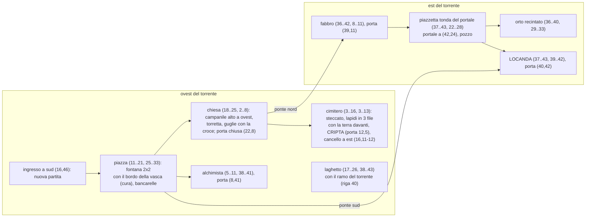
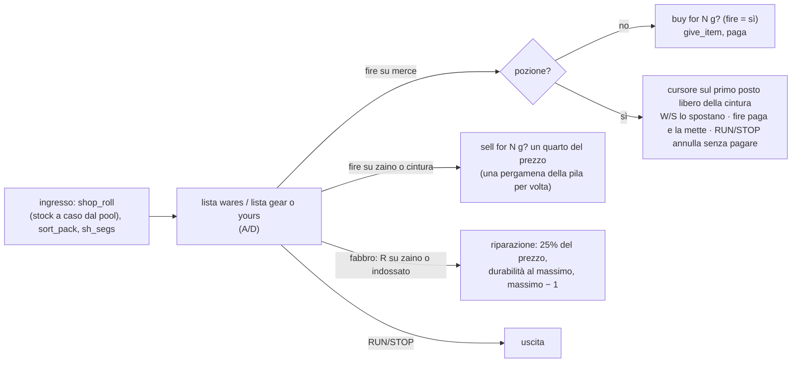

# Villaggio

**Dal 15/11 ogni capitolo ha il SUO villaggio** (TODO Z2, richiesta del committente: villaggi diversi, non lo stesso con altri
colori). Questa pagina descrive prima [i villaggi dei capitoli](#i-villaggi-dei-capitoli-1511) e il formato comune, poi il
villaggio 1 (Aldric's Hollow) in dettaglio; negozi, locanda e modulo MENU sono uguali in tutti.

## I villaggi dei capitoli (15/11)

| # | Villaggio | Struttura | Cura (`~`) | Ingresso del sotterraneo (`>`) | Entrata → uscita | Colori (sfondo, 1, 2, accento) |
|---|---|---|---|---|---|---|
| 1 | **Aldric's Hollow** | due rive di un torrente con due ponti, piazza, chiesa, cimitero | fountain of saint aldric | la **cripta** nel cimitero | strada a sud → sentiero a nord | verde, marrone, grigio chiaro, ciano |
| 2 | **Bad Water** (19/11: tema voodoo) | **palafitte su un lago nero**: piattaforme di assi su pali unite da passerelle; mangrovie, ninfee, pali con i teschi, lanterne-teschio, tamburi, rastrelliere di amuleti; **due traghetti** sotto le piattaforme (vedi sotto) | the bottle tree (un albero morto con le bottiglie appese; si guarisce sui moccoli) | il **cancello d'ossa** nel muro della casa degli spiriti (isolotto a nord-est, con il grande idolo) | riva a sud-ovest → fondo del pontile est | nero, marrone, arancio, verde |
| 3 | **The Last Camp** | **campo di guerra su tre terrazze** di una montagna innevata: pareti di roccia, scale di legno, tende, palizzata e torri | the great bonfire (ci si siede sui tronchi attorno) | la **bocca di una grotta** nella parete nord | cancello a ovest (terrazza bassa) → passo a nord-ovest (terrazza alta) | bianco, grigio scuro, marrone, rosso |
| 4 | **Ruin's Gate** | **città in rovina attorno a un cratere**: strada ad anello, quattro raggi, mura con le brecce, colonne, case sventrate | the weeping angel (una statua; le candele ai suoi piedi) | la **saracinesca delle segrete** nel corpo di guardia a nord | strada a sud → **scala di tavole che scende nel cratere** | grigio scuro, nero, grigio chiaro, rosso |
| 5 | **The City of the Abyss** (prototipo) | **isole di pietra sospese nel vuoto** unite da ponti di luce; case a cupola, cristalli, obelischi | the heart of the abyss (un cristallo che galleggia; le rune attorno) | **la Bocca**, sull'isola a nord (oggi non porta da nessuna parte) | ponte dal nulla a sud → isola a nord-est (le caselle ci sono ma non si aprono) | nero, blu, azzurro, viola |

Ogni villaggio ha fabbro, alchimista, locanda (con lo stesso baule), luogo di cura, posto del portale, ingresso e uscita. Il
villaggio 5 è un **prototipo**: ci si arriva dall'uscita del villaggio 4 dopo il boss finale (`c_unl` = 5), i piani dell'Abisso
non ci sono (TODO H3). Anteprime: `lab64 run python3 tools/build/village_preview.py` (`out/work/villages/twnN_map.png`,
`twnN_tiles.png`); atlante: set `VILLG`, `VILL2`…`VILL5`. Mappa del mondo (fan art): `tools/art/world_map.py` (v3 del 19/11: 960x600 e x2, numpy, generata da `./build.sh` in `lab64-tools` prima del manuale); dal 16/11 è nel manuale (pagina "Il mondo", `tools/manual/gen_manual.py`, nessun file in git).

### Come è fatto un villaggio

- **Tile**: 45 posti (`TOWN_TILES` in `tools/build/gen_gfx.py`), gli stessi numeri per tutti; ogni villaggio li **ridisegna e
  decide quali sono solidi** nel suo modulo `tools/build/vilN_*.py` (`PAL`, `NAME`, `HEAL`, `TILES` = posto → nome, descrizione,
  solido, griglia 8×16; attrezzi di disegno in `tools/build/tileart.py`). I posti non elencati restano quelli del villaggio 1.
  Il codice conosce solo questi **ruoli**: `DSMITH`, `DALCH`, `DHOME` (porte), `TSTAIRS` (ingresso del sotterraneo), `FOUNTAIN`
  (cura), `PORTAL`; `PATH`, `DIRT`, `BRIDGE`, `COBBLE` sono "strade" nella minimappa e `WATER`, `WATERL`, `WATERR` "acqua"; i
  posti 5, 6, 8–11, 24–26 devono essere solidi (`tools/build/villages.py`, che lo controlla).
- **Mappa**: testo 48 × 48 in `data/town_mapN.txt` con le lettere di `LEGEND` (una per posto: in ogni villaggio la stessa lettera
  disegna il tile di quel villaggio; la legenda con i nomi è in testa al file). Lettere speciali: `E` ingresso, `P` posto del
  portale (la casella sotto è l'arrivo), `=` uscita del capitolo (2 caselle), `F` (19/11) **traghetto** (0 o 2 caselle, posto
  `BRIDGE`). Le prime stesure vengono da
  `lab/villaggi/concept_maps.py`; da lì in poi la fonte è il testo.
- **Traghetto** (19/11, richiesta del committente; oggi solo Bad Water): due barche grandi (3 caselle: prua e poppa solide,
  in mezzo la casella `F` calpestabile con la tettoia e la lanterna) ai due capi del **lungo pontile che parte dalla riva**
  (colonna 12), **spezzato** (righe 31-37 acqua): appena entrato nel villaggio il PG prende la barca per arrivare alle
  palafitte (prima stesura del 19/11: barche sotto l'alchimista e sotto il portale). **Salendo su una barca si arriva sull'altra**:
  `tile_trigger` (`src/game/game.asm`) confronta la casella del PG con `tk_boat` (4 byte dell'intestazione: x1, y1, x2, y2;
  tutti 0 = nessun traghetto), mette il PG sull'altra (`put_hero`, ridisegno completo, suono del portale, lampo ciano del
  bordo) e segna la casella d'arrivo come già raggiunta (`lptx`/`lpty`): niente ritorno subito; per ripartire si scende e si
  risale. Il tile ha la **barriera per gli NPC** (`solidtab` bit 1: calpestabile per il PG, mai per chi vaga, `npc_free`;
  nel modulo del villaggio il campo "solido" vale `"npc"`). Le altre barche del villaggio sono state tolte: le uniche barche
  sono i traghetti. La raggiungibilità di `gen_maps.py` conta il salto fra le due caselle `F`. Test `VIL-FERRY-10`.
- **Settori degli NPC** (17/11): ogni villaggio ha fino a 16 rettangoli (`SECTORS` in `tools/build/villages.py`, nell'intestazione
  del file) dove vivono gli NPC che vagano; vedi [Abitanti](#abitanti-1718-11-concept). `gen_maps.py` controlla misure e caselle percorribili e stampa
  il massimo di settori in una finestra di gioco (oltre 5 NPC visibili non si disegna).
- **Controlli della build** (`tools/build/gen_maps.py`): una sola porta per negozio e locanda con **2 caselle libere davanti**;
  porte, cura, ingresso del sotterraneo, uscita, portale e il suo arrivo **raggiungibili dall'ingresso**; **nessuna casella
  percorribile isolata**; intestazione + mappa entro 1888 B.
- **File `TWNc`** ([formato](FORMATO_DATI.md)): tile, poi un'**intestazione** (posizioni, colori, porte per le icone della
  minimappa, uscita, nome del luogo di cura, tile solidi), poi la mappa RLE. `gfx_install` copia l'intestazione in `town_k`
  (`src/game/levels.asm`) e in `solidtab`, e i colori nella voce 0 delle tabelle delle palette: il gioco non ha più costanti
  del villaggio (`TOWN_*`, `solid_town` e le tabelle di `town_places.inc` non ci sono più). Costo nel gioco, misurato: il margine sotto `$8720` è sceso di 50 B in tutto (villaggi, colori dei boss, capitolo 5).
- **Passaggio di capitolo**: `chap_travel` legge subito il file del villaggio nuovo (serve il suo ingresso prima di salvare:
  "continue" riparte da lì), poi salva e lo rilegge: una lettura in più (non misurata).
- Test: `VIL-TWN-11..23`, `VIL-BOSS-10` (regression dal 15/11, `tests/regression/villages`).

**Proposta scartata** (15/11): la prima stesura dei villaggi 2–5 riusava la struttura del villaggio 1 con altri tile e colori
(il committente: "devono essere diversi, non lo stesso villaggio con temi diversi"). È conservata in
`lab/villaggi/proposta-a-temi/` (script, mappe, anteprime), fuori dalla build.

**Aperto** (TODO M1): musica propria per villaggio; minimappa (i colori di "acqua" e "strade" valgono per i ruoli, non per il
disegno: nel villaggio 4 il cratere esce blu); l'etichetta dell'ingresso dice sempre "stairs down to level N"; nel villaggio 5
la Bocca non fa nulla; hardware reale e vc64web non provati con i villaggi nuovi.

# Villaggio 1: Aldric's Hollow

Sorgenti: `data/town_map.txt` (mappa 48 × 48, una lettera per casella), `tools/build/gen_maps.py` (intestazione e RLE nel file
`TWN1`), `src/game/levels.asm` (`town_post`, `place_player`), `src/game/game.asm` (`act_tick`, `tile_trigger`),
`src/game/ui.asm` (negozi, baule della locanda), `src/game/bar.asm` (nomi dei luoghi).

Il villaggio è il luogo 0 (`cur_level` = 0): mappa fissa, nessun mostro, musica propria. La mappa sta compressa
(RLE, massimo 1792 byte) nel file `GFX0` dopo la grafica dei tile e si espande in `MAP` al caricamento.

## La mappa (10/11, concept v3 approvato dal committente)

Ristrutturata il 10/11 su richiesta del committente: **locanda e cripta ai lati opposti** (per dare tempo al precaricamento),
torrente irregolare con ponti migliori, laghetto, chiesa con il campanile, case più ricche, pozzi, sentieri tortuosi che
collegano tutto, niente zone vuote. La mappa è stata generata da uno script di concept (semi 5 e 3) e poi resta un file di
testo: `data/town_map.txt` è la fonte. Controlli fatti sulla mappa: ogni casella percorribile è raggiungibile dall'ingresso,
ogni porta ha un sentiero davanti, i sentieri (`: d + x`, 4 direzioni) sono una rete unica, nessun arredo entro 3 caselle
dalle porte di negozi e locanda (`tools/build/gen_maps.py` lo controlla a ogni build), nessun arredo entro 2 caselle dai ponti.

**Sentiero di uscita** (12/11, committente, TODO M1): dalla porta della chiesa un sentiero largo 2 (colonne 26–27) sale fino
al bordo nord, dalla parte opposta all'ingresso (strada a sud, colonna 16). Le due caselle sul bordo sono scritte `=` nel
testo della mappa: è la **casella generica di uscita del capitolo** (`ALIASES` in `tools/build/gen_maps.py`: diventa un sentiero, la
posizione va nell'intestazione del file `TWNc`, `tx_exit_x/y`, 2 caselle dal 15/11). Fuori dalla mappa è solido, quindi lì il PG si
ferma: finché il capitolo dopo è chiuso la strada "continua" ma non succede nulla; dopo l'uccisione del boss del capitolo
compare `travel to next chapter` e Fire porta al villaggio dopo ([capitoli](capitoli.md)). Intestazione + mappa RLE: 1877 B su
1888 (`TOWN_MAX`; con i 66 B dei settori NPC e della casella di chi dà la quest, 17/11: è il limite del villaggio 1).

- **Torrente**: entra dal bordo nord ed esce da quello sud (attraversa gli alberi del bordo); percorso irregolare fra le colonne
  27 e 33, dritto ai due ponti. Il 10/11 il committente ha chiesto di ammorbidire la curva fra il pozzo est e l'orto: scarti
  di una colonna alla volta, con più tratti dritti.
- **Ponti**: alti 3 caselle (righe 11–13 e 33–35), con gli accessi di sentiero larghi quanto il ponte e nessun arredo entro
  2 caselle (prima erano alti 2 e un lampione stava attaccato all'uscita del ponte nord: ipotesi sul perché ci si incastrava,
  dedotta dalla mappa, non misurata).
- **Laghetto** a sud, vicino al torrente, alimentato da un ramo lungo la riga 40. È fatto con i tile del torrente (acqua e
  sponde), quindi i bordi sopra e sotto sono squadrati.
- **Cimitero**: steccato orizzontale `|` e verticale a linea sola `v` (`FENCEV`, tile nuovo); 11 lapidi (`t` lapide, `Y` croce)
  in file, ognuna con la terra battuta davanti; il resto è erba; vialetto di terra dal cancello alla cripta.
- **Case**: finestre (`o`, `WINDOW`), comignoli (`c`, `CHIMNEY`), e le case chiuse con un giardino recintato (cespugli e fiori).
  Negozi e locanda **senza** steccato davanti alla porta. La **chiesa** ha il campanile alto 6 caselle attaccato al lato ovest
  (due finestre, guglia `A` con la croce, `SPIRE`) e una torretta centrale con la sua guglia.
- **Botti e fieno tolti** (non si capivano, richiesta del committente): i loro tile sono diventati finestra e comignolo; il
  recinto del fieno è un **orto** (terra e fiori).
- **Piazzetta del portale tonda** (7 caselle di diametro, bordo a gradini): il portale e l'arrivo restano a (42,24) e (42,25),
  (dal 15/11 la posizione è la lettera `P` della mappa).
- **Pozzi**: due, accanto a un sentiero (12,17) e (36,22). **Boschetti**, cespugli e fiori nelle zone vuote (alberi interni:
  da 23 a ~110; erba libera dal 54% al 46%).
- Mappa compressa: **1710 B** su 1792 (era 1289 B): restano 82 B per altri dettagli.

### Storia della mappa
- 06/11 pomeriggio: prima mappa a due rive (fiume dritto, colonne 29–31, ponti di 2 righe), script con seme 7.
- 09/11: tolto l'armaiolo (la sua porta divenne una porta chiusa), il fabbro si spostò nella sua casa a est, sentieri
  ritoccati, lapidi lontane dal cancello, piazzetta del portale collegata ai sentieri.
- 10/11: questa mappa.

### Tile del villaggio
Il file `GFX0` ha i suoi **45 tile** (`TOWN_TILES` in `tools/build/gen_gfx.py`, il massimo: `GFX_NT` = 45, gli altri 19 codici di
ogni quarto sono i caratteri fissi dell'HUD): i posti che nel dungeon sono muri, pavimenti, scale, i posti 8–11 (liberi nei
dungeon) e bauli ospitano i tile solo del villaggio (erba con pietra, ponte, terra battuta, porta chiusa, acqua e sponde,
lapide, croce, fianchi, tetto e fronte della cripta). I tile con un ruolo nel codice (porte, fontana, portale, cripta =
`T_TSTAIRS`, erba, strade) hanno lo stesso numero nei due set; i tile nei posti "speciali" (5, 6, 8–11, 24–26) sono tutti
solidi, così il codice di scale, raccolta e bauli non li incontra mai sotto il PG. La tabella dei tile solidi è in RAM
(`solidtab`: nei dungeon copiata da `solid_dun`, nel villaggio dall'intestazione del file `TWNc`, 15/11). 10/11: tolti `BARREL` e `HAY`, aggiunti `WINDOW`
(posto 33), `CHIMNEY` (42), `FENCEV` (43) e `SPIRE` (44), tutti solidi. Nomi e descrizioni di ogni tile: atlante grafico
(`out/work/atlas/`, `tools/atlas/atlas_names.py`).

Colori: in modo testo multicolor ogni schermata ha 3 colori condivisi (sfondo verde, marrone, grigio chiaro) più
**uno** per carattere, uguale per tutta la mappa (ciano: acqua, vetri, riflessi). Un colore diverso per tile
richiederebbe di riscrivere la color RAM a ogni passo di scorrimento (760 byte, con il doppio buffer che non la
copre): non è possibile con questo motore, quindi il villaggio resta a 4 colori.

## Luoghi

| Luogo | Tile | Azione (Fire sul tile) |
|---|---|---|
| Porta della cripta (cimitero, nord-ovest) | `T_TSTAIRS` (`>`) | primo piano del capitolo (1, 6, 11, 16), arrivo sulle scale su |
| Fabbro (blacksmith, nord-est, porta 39,11) | `T_DSMITH` (`S`) | negozio: armi, armature, scudi (08/11); **riparazioni** |
| Alchimista (alchemist, sud-ovest, porta 8,41) | `T_DALCH` (`L`) | negozio: red, yellow, violet, portal scroll, copper ring (ne mostra 4) |
| Locanda (sud-est, porta 40,42) | `T_DHOME` (`H`) | baule della locanda (24 posti più l'oro, salvato con l'eroe a "save game") |
| Fontana di Saint Aldric | `T_FOUNTAIN` (`~`, le 8 caselle del bordo della vasca attorno alla fontana 2×2 `1 2 / 3 4`, che è solida) | passandoci sopra: vita piena |
| Portale (piazzetta tonda a est del torrente, 42,24) | `T_PORTAL` | solo se aperto con una pergamena: torna al piano e alla posizione di partenza |
| Uscita del capitolo (bordo nord, 26–27,0; caselle `=`) | sentiero | dopo il boss del capitolo: `travel to next chapter`, al villaggio del capitolo dopo (12/11) |

Arrivi (`place_player`): nuova partita sulla strada sud (16,46); dal portale o dopo la morte accanto al
portale (42,25); dal piano 1 sulla porta della cripta (12,5).

**Porte dei negozi e della locanda** (06/11 sera): Fire apre anche stando **1 o 2 caselle davanti** alla porta (le porte
sono tutte sul muro sud; `pl_tile` in `src/game/bar.asm`, usata da `act_tick` e dall'etichetta della barra in alto,
solo nel villaggio). Nessun arredo (lampioni, cespugli, fiori, bancarelle, pozzi, alberi) entro 3 caselle (Chebyshev)
dalle porte `S L H`: lo controlla `tools/build/gen_maps.py` (errore di build).

**Portale**: tile ridisegnato (06/11 sera) come un arco di pietra in piedi con un ovale luminoso nel vano, perché
il vecchio (anelli concentrici grigio/ciano) si confondeva con l'acqua e la fontana; nel villaggio non c'è il
giallo (palette verde/marrone/grigio chiaro + ciano), quindi si distingue per la forma. Nel dungeon prende i colori
della palette del piano. Atlante: `out/work/atlas/` (`VILLGO`, `DUNGxO`).

## Abitanti (17–18/11, concept)

Prima versione giocabile del sistema delle quest, con testi segnaposto (17–18/11). Il progetto delle quest vere è in
[Quest](quests.md).

- **NPC nel villaggio** (`src/game/quest.asm`, modulo MENU): sprite 3–7 (liberi nel villaggio: `sh_en` ha solo lo sprite 0 e i
  3–7; gli sprite 1 e 2, fendente ed effetto nel dungeon, servono al "!"). **Disegni** (17/11): 4 figure viste di fronte, 2
  fotogrammi (fermo / passo): *villager*, *woman*, *elder*, *guard* (`tools/build/npc_gfx.py`), negli slot sprite 12–19
  (`$A300`, zona 4 del MENU). Il vestito usa il colore dello sprite. **Colore** (`npc_look`, `src/menu/npc_look.asm`): a caso, mai
  uno dei colori del villaggio (`tk_pal`) né il 9 e il 15 (multicolor degli sprite). Disegno a caso per i vaganti (`npc_g`); chi
  dà la quest è la *woman*, a partire dal giallo.
- **Chi dà la quest** (oggi *hilde*, quest 1) sta **fermo nella piazza** (casella `tk_g` dell'intestazione del villaggio, scelta da
  `gen_maps.py`: la più vicina al centro della fontana a 3 o più caselle, raggiungibile, con le 8 caselle attorno libere e lontana
  dalle porte): accanto a lei compare il suo nome nella barra; **Fire** = quest presa (bit 0 di `c_qst`) e il suo dettaglio, che
  poi si riapre con Fire accanto a lei o dall'elenco (Q). I luoghi hanno la precedenza (su una porta o una scala vale il luogo).
- **"!" sopra chi ha una quest da dare** (18/11): sprite hires a `$8C00` (puntatore `$30`, `BANG` in `npc_gfx.py`, 14 righe),
  18 righe sopra l'NPC, **ondeggia** di 2 righe e passa dal giallo al bianco ogni 16 fotogrammi. Usa gli sprite 1 e 2 (il 2 solo
  se l'effetto del colpo non c'è): al massimo due "!" sullo schermo; non sopra la riga 80 (barra in alto). Sparisce quando la
  quest è presa (`npc_offer`).
- **Vaganti con una quest** (18/11): all'ingresso ogni vagante, con probabilità **1/4**, offre una quest (`npc_q`, `npc_pick`): la
  prima fra le 2..8 non ancora presa, non già offerta da un altro NPC in quella visita, del capitolo attuale o di uno prima
  (`q_ch`). Accanto a lui la barra dice "quest giver" (`QL_GV`); Fire = quest presa e dettaglio, poi torna un NPC qualunque.
  L'etichetta del luogo si ricalcola ogni 16 fotogrammi (`lc_x` = `$ff` in `npc_tick`).
- **Vaganti** (fino a 16 per villaggio, 17/11): ogni villaggio ha i suoi **settori** (`SECTORS` in `tools/build/villages.py`:
  griglia 4×4 nel 1 e nel 4, piattaforme nel 2 (11), terrazze nel 3 (12), isole nel 5 (12); rettangoli di 8–15 caselle per lato
  con almeno 20 caselle percorribili, 4 B l'uno nell'intestazione `TWNc`, copiati in `tk_sec`). Il vagante *n* vive nel
  settore *n*: nasce con probabilità 7/8 su una casella libera a caso del settore e non ne esce mai (`npc_in`). Si muove solo
  con il PG a meno di 10 caselle, a fotogrammi alterni, 1 volta su 16 da fermo: una casella in una direzione a caso, 2 px per
  passo; si ferma su un muro e non entra nella casella del PG (che li attraversa). Con il PG a 2 caselle o meno non parte per
  un altro passo (`NPC_STOP`, 18/11: per fare Fire su di lui). **Sprite:** i visibili prendono gli sprite 3..7 in ordine
  (`npc_draw`, al massimo 5). `gen_maps.py` stampa il massimo di settori in una finestra di gioco (21×13 caselle): 9 nel
  villaggio 1, 6 nei 2–4, 7 nel 5.
- **Memoria**: tabelle degli NPC (8 byte per NPC) nella tabella della ricerca di percorso dei mostri (`BFP`, `$A500`), inutile
  nel villaggio. Zona 5 del MENU (`$8C00-$8E7F`): sprite del "!", tabella dei salti `NPC_JT` (piazzamento `npc_init` con
  `npc_pick`, sprite `npc_draw5`, Fire `npc_talk5`, `src/menu/npc.asm`). Il passo dei vaganti sta nella zona 6 (`MRT`,
  `src/menu/npc_tick.asm`, 18/11), chi è accanto al PG (`npc_here1`, `npc_offer`) nella zona 1 (`src/menu/npc_here.asm`,
  `MENU_NHERE`); in GAME restano i punti d'ingresso (`npc_tick`, `npc_ok`, `npc_here`). (19/11) Il passo tocca metà degli NPC
  per fotogramma e salta i fotogrammi di ridisegno ([prestazioni](prestazioni.md)).
- **NPC fissi** (21/11, richiesta del committente): ogni villaggio ha i suoi NPC che danno le quest **a posizione fissa**
  (`FIXED` in `tools/build/villages.py`, nomi di [Quest](quests.md) sez. 2): il primo sta nella piazza della fontana (NPC 0, la
  casella `tk_g` di prima: Hilde nel villaggio 1, Mama Sabine, Sergeant Brenna, the Penitent, the Keeper), gli altri (al massimo
  `NFIX` = 3) vicino a un punto della mappa: il baricentro di un tile (la chiesa, `SPIRE`, per father osric), la casella davanti
  a una porta (Grom al fabbro, Little Pip all'alchimista, the drummer alla locanda, the quartermaster, the scavenger), l'ingresso
  del sotterraneo (the gravedigger, Chaplain Edric, the gatewarden) o il traghetto (Corbeau). `gen_maps.py` (`fixed`) sceglie la
  casella più vicina al punto (al massimo 18 caselle) dentro un settore non usato da un altro fisso, raggiungibile, con le 8
  caselle attorno percorribili, ad almeno 3 caselle da porte, portale, sotterraneo, uscite e traghetto e ad almeno 8 dagli altri
  fissi; stampa i piazzamenti. **Ogni NPC fisso prende il posto del vagante del suo settore** (l'NPC numero *n* = settore *n*:
  meno NPC nello stesso settore). Intestazione `TWNc` (`tk_fix`, 2 byte per NPC: settore + disegno << 5, casella dentro il
  settore; `tk_fnb`, indice del primo nome): il villaggio 1 arriva a 1888 B su 1888 (`TOWN_MAX`). I nomi stanno in GAME
  (`fix_nm`, `fix_lo`, `fix_hi` in `out/work/town_places.inc`, ~190 B). Nel gioco: `npc_fix` (zona 1 del MENU,
  `src/menu/npc_here.asm`, chiamato alla fine di `npc_init`) li piazza; `npc_d` bit 7 = fisso (bit 4-5 = numero del nome):
  non si muovono (`npc_tick6`) e accanto a loro la barra mostra il loro nome (`npc_here1` punta l'etichetta `QL_ID` al nome
  giusto). Oggi solo Hilde (villaggio 1) ha una quest (la segnaposto 1); Fire accanto a un fisso senza quest non fa niente.
  Il disegno dell'NPC 0 resta la donna in ogni villaggio. Test: `NPCFIX-10`, `NPCFIX-11` (`tests/sanity/npcfix/cases.py`).
- **Pagina Q** (17–18/11, [interfaccia](interfaccia.md)): tasto **Q** ovunque = **elenco** delle quest prese (titolo e "ch. N",
  W/S per scegliere, Fire = dettaglio, RUN/STOP o Q = di nuovo nel gioco; senza quest "talk to the villagers"). **Dettaglio**:
  titolo sulla cornice, "chapter N", lo **stato** (righe gialle, oggi segnaposto: campo `status` di `data/quests.yaml`), il testo
  e il **reward**; il riquadro mostra 14 righe e un testo più lungo scorre con W/S (" up " e " more " sulla cornice). Fire accanto
  a chi dà una quest apre subito il dettaglio. **File** (`data/quests.yaml` → `tools/build/gen_quests.py`, formato in
  [FORMATO_DATI](FORMATO_DATI.md)): `QST0` = codice della pagina (`src/qpage.asm`) + **indice**, letto da `ui_quest` a `$BC00`
  (schermo B) con la schermata di attesa; **pieno** (1021 B su 1024: pagina 849 B + indice 172 B). `QSTn` (n = 1..8) = premio,
  stato e testo, letto a `QTXT` = `$B000` senza schermata di attesa. In GAME restano ~40 B (`ui_quest`). `c_qst` (salvato con
  l'eroe) è una **maschera**: bit *n*-1 = quest *n* presa, al massimo 8 quest.
- **Quest segnaposto** (18/11): la 1 di Hilde (capitolo 1) e 7 "piccole" (2..8, capitoli 1, 1, 2, 2, 3, 4, 5) dei vaganti; la 2
  ha un testo lungo per provare lo scorrimento. **Lobby**: "active quests:" = quante quest sono prese.
- **Test**: `tests/regression/quest/cases.py` (21/11: spostati da sanity; QUEST-10..16: piazzamento e quest offerte, elenco vuoto, Hilde con "!" e dettaglio,
  vaganti che si fermano, sprite, vagante "quest giver" e scorrimento del testo, cadenza dell'attacco).

## Armaiolo: tolto (09/11, decisione del committente)

L'armaiolo non c'è più: armature e scudi li vende e li compra il **fabbro** (già dall'08/11). Tolti: il negozio
(`balance.yaml shops.armorer`, `shop_*` di `db.asm`: ora 2 negozi, `shop_id` 0 fabbro, 1 alchimista), il nome e l'icona del
titolo (`sn_armor`, `shop_ic`), l'etichetta `armorer` della barra in alto (`ls_armor`; gli id delle etichette dopo il 9 sono
scesi di uno), l'icona sulla minimappa (`mi_ic`: 3 icone, `MI_N`), il tile della porta `DARMOR` e quello dell'insegna `SIGNA`
(l'insegna dell'alchimista `SIGNL` è passata nel posto 19), la variante `TESTUI=16`, lo screenshot `armaiolo` e la figura del
manuale (ora l'alchimista). Il glifo dello scudo (`CH_SHLD`, 35) resta: è l'icona della categoria scudi. Nello stesso giorno
il disegno sulla porta della locanda (tile `DHOME`) e l'icona della locanda sulla minimappa sono diventati il **boccale**
(`CH_INN`, lo stesso glifo del titolo "inn"); la casetta (glifo 37, `CH_HOME`) non c'è più.

## Negozi (`enter_shop`, `sh_draw`; modulo MENU dall'11/11)

Dal 21/11 (branch `liste-menu`, prototipi approvati dal committente) due **liste a scorrimento** (`src/game/slist.asm`, nel
segmento CORE) e il riquadro dell'oggetto, come nell'inventario; A/D passano da una lista all'altra:
- **wares** (righe 2-7): la merce, una voce per riga, prezzo pieno a destra;
- **gear** (fabbro) o **yours** (alchimista) (righe 10-16): il fabbro mostra arma, armatura e scudo indossati (spunta), poi
  armi, armature e scudi dello zaino e i posti liberi `-`; l'alchimista l'anello indossato, la cintura (una pozione per posto),
  anelli e pergamene dello zaino (la pila: "3 portal scroll") e i posti liberi. A destra il prezzo di vendita. Nel titolo
  l'**oro totale** (addosso + baule della locanda, da 100 000 in migliaia con `k`; si paga prima con l'oro addosso e il resto
  dal baule, vedi [Oggetti](oggetti.md#prezzi));
- **riquadro dell'oggetto** (righe 18-22): icona e nome nel titolo, caratteristiche, durabilità, poi a destra `buy N`,
  `sell N` o, dal fabbro sull'indossato rovinato, `repair N`; sull'indossato a sinistra "unequip to sell".

Riga 23: messaggi e domande; riga 24: i tasti, **secondo la voce sotto il cursore** (`sh_keys`). Niente più riquadri
equipped, pack, purse; le chiavi non si mostrano.

- **Chi compra cosa** (`sh_cats`, indice = `shop_id`: 0 fabbro, 1 alchimista): il fabbro armi, armature e scudi; l'alchimista
  anelli, pozioni e pergamene. La lista mostra solo cio' che il negozio compra o ripara. L'indossato **non si vende**: prima
  va tolto. Solo il fabbro ripara (R).
- Le azioni lavorano sui codici di prima in `ui_lc` (`sh_cur` dalla voce della lista): 0-7 zaino, 8-11 equipaggiamento,
  12-19 merce, 20-23 cintura.
- Merce (`balance.yaml shops`, 08/11): fabbro 6 a caso fra armi, armature e scudi; alchimista 4. **Cosa e
  quanto vende ogni negozio è da decidere** (TODO E2).

L'assortimento cambia **a ogni visita** e **cresce con il livello del PG** (06/11 sera): `shop_roll` tiene solo gli
oggetti del pool con `shop_minl` ≤ livello del PG; per armi, armature, scudi e anelli `shop_minl` = livello oggetto
− `level_ahead` (3, `balance.yaml shop_rules`), per pozioni e pergamena il `shop_level` di `rules.yaml`. Se ne
restano meno di `stock` si mostrano tutti. Gli oggetti in vendita non hanno magia; la durabilità si tira
all'acquisto. Pool e quantità: `balance.yaml shops`.

| Negozio | Livello del PG 1 | dal 2 | dal 3 | dal 4 | dal 5 | dal 6 | dal 7 | dal 8 | dal 9 | dal 11 | dal 12 | dal 13 | dal 14 | dal 15 | dal 17 |
|---|---|---|---|---|---|---|---|---|---|---|---|---|---|---|---|
| Fabbro | dagger, short sword, club, sword, hand axe, quilted armor, leather armor, hard leather, small shield | mace, ring mail, mid shield | studded armor | broad sword, chain mail |  | war axe | scale mail, tower shield | morning star | viking sword, splint mail | battle axe, plate mail |  | maul, gothic shield | field plate | great sword | gothic plate |
| Alchimista | red, portal scroll |  |  | copper ring | yellow |  |  |  |  |  | violet |  |  |  |  |

## Baule della locanda (`ov_stash`, modulo MENU)

Dal 21/11 (branch `liste-menu`, prototipi approvati dal committente) due liste a scorrimento e il riquadro dell'oggetto:
- **yours** (righe 2-7): i 5 posti indossati (spunta; due anelli dal 21/11), riga sottile, lo zaino (8 posti; niente cintura: le pozioni non vanno
  nel baule); nel titolo l'oro addosso;
- **chest** (righe 10-16): i 24 posti del baule; nel titolo l'oro del baule;
- **riquadro dell'oggetto**: caratteristiche, valore e durabilità, poi "equipped" o il confronto "you: ..." con l'indossato.

- **Fire**: zaino → baule, baule → zaino (le pergamene si accumulano fino a 10), indossato → zaino (l'arma no: si sostituisce).
  **E**: indossa l'oggetto dello zaino (o del baule, passando dallo zaino) con le stesse regole dell'inventario (requisito di
  FOR, arma a due mani e scudo). Si esce con RUN/STOP o I.
- **Oro**: entrando, l'oro addosso va nel baule a decine (le unità restano addosso; `st_gold`; confermato dal committente il 21/11). Il prelievo non c'è
  (10/11): i negozi pagano anche con l'oro del baule.
- Non c'è più la modalità di scelta dell'equipaggiamento (`h_sel`, `- remove`) né le pagine del baule.
- **Ordinamento**: zaino e baule sempre in ordine di categoria (armi, armature, scudi, anelli, pozioni, pergamene;
  `sort4`, stabile).
- **Memoria**: la locanda sta nel modulo **MENU** con i negozi (`src/menu/inn.asm` zona 1, `src/menu/inn_eq.asm` zona 2;
  [sotto](#menu-del-villaggio-modulo-menu-1111)). Per tutta la schermata interruzioni spente (il KERNAL è escluso in tutto il gioco dal 21/11)
  (dall'11/11 sera niente salvataggio uscendo: il baule va sul disco con "save game"). Apertura 0,14 s (modulo già in memoria dall'ingresso nel villaggio).
- Il baule sta nel blocco dell'eroe, sempre in RAM: va sul disco con l'eroe a "save game" o al cambio di capitolo ([Salvataggi](salvataggi.md#baule-della-locanda)).

## Menu del villaggio: modulo MENU (11/11)

**Locanda e negozi** stanno nel modulo su disco **MENU** (`src/menu.asm`; formato in
[FORMATO_DATI](FORMATO_DATI.md#menu--menu-del-villaggio-locanda-e-negozi), memoria in [Tecnica](tecnica.md#moduli-su-disco)):
- si carica **a ogni ingresso nel villaggio** (dall'11/11, ramo `fast-loader`: niente residenza fra una visita e
  l'altra), dal 18/11 in **un file** (`menu`, cinque zone; prima un file per zona) letto con Krill's Loader: **3,1 s** con la
  decompressione (VICE, 1541 emulata, `PERF-DISK-11`; con il KERNAL erano 10,5 s);
- dentro la visita **resta**: fabbro, alchimista e locanda si aprono in **0,12–0,16 s**;
- il precaricamento del tema in sottofondo non c'è più (tolto l'11/11, [Flussi](flussi.md#8-precaricamento-del-tema-tolto)).

**Storia**: dal 09/11 al 11/11 il modulo della locanda OVL2 stava nel posto del precaricamento (`$F500`) e il
precaricamento nel villaggio partiva solo dopo **N caselle** (`TOWN_PF_N` = 8 per Aldric's Hollow, con l'audit delle
distanze `tools/village_audit.py`) per non sovrascriverlo; ogni ingresso nella locanda dopo un precaricamento costava
3,0–4,8 s. Con il modulo MENU residente N, il contatore `pf_wait` e l'audit non servono più (tolti l'11/11).

### Per ogni villaggio nuovo
1. Il villaggio **ha sempre una locanda** (tile `DHOME`) con **lo stesso baule** di tutte le altre (decisione del 09/11:
   il baule è nel record dell'eroe).
2. La mappa del villaggio (`MAP`, `$C000`–`$C8FF`) non deve usare `$C900`–`$CFFF` (zona 1 del modulo MENU).
3. `lab64 test regression -k VIL-MENU` (il file MENU non si rilegge mai nel villaggio).
4. Aggiornare il `TODO.md` se resta qualcosa.
5. (15/11) Un modulo `tools/build/vilN_*.py` (tile, colori, nome della cura), la voce in `tools/build/villages.py`, la mappa
   `data/town_mapN.txt` (lettere `E`, `P`, `=`), il file `twnN` in `tools/build/asm.sh` e `tools/build/mkdisk.sh`, il brano in
   `PLAYLIST["town"]` (`tools/build/songs.py`), `data/chapters.yaml`; poi `lab64 test sanity -k VIL-TWN` (i test leggono
   l'elenco dei villaggi da `villages.py`). Vedi [Come è fatto un villaggio](#come-è-fatto-un-villaggio).

## Leva della sala del trono

Non è nel villaggio ma usa lo stesso tile della porta della locanda (`T_LEVER = T_DHOME` nel tema 8): dopo la vittoria,
nella stanza dei tesori del piano 20, Fire sulla leva apre `ui_lever` ("this lever opens the gate to the endless
abyss. are you sure?"): tirata, `c_lever` = 1 e compare il portale per *The Endless Abyss* (non ancora
implementato).
