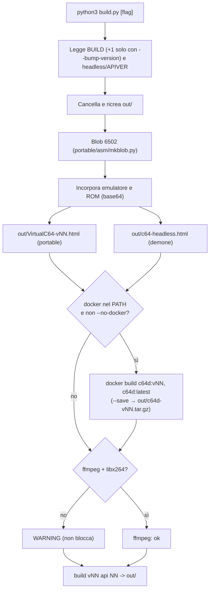
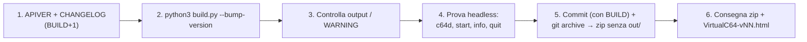
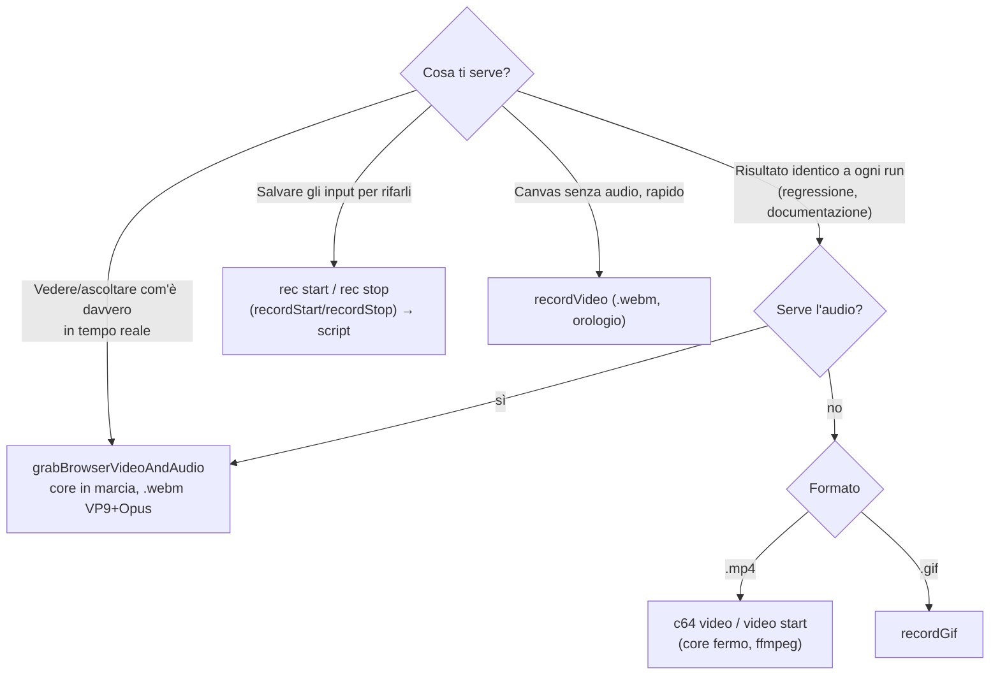

# c64-tools — VirtualC64 controllabile da riga di comando

Copyright © 2026 Simone Caporale. La versione (build e API) è in `BUILD` e `headless/APIVER`; il nome dei file in `out/` la contiene.

## Struttura del repo
```
build.py                genera tutto in out/ (o in --out DIR) e, se c'è Docker, l'immagine; ROM da --vice-roms / --open-roms
BUILD                   numero di build, incrementato da build.py solo con --bump-version
README.md  (CHANGELOG.md in docs/)
Dockerfile  docker-compose.yml  .dockerignore  .gitignore
docs/                   c64-cli.md (OGNI comando spiegato), C64-API.md (API), scripting.md (script), C64-TODO.md (limiti e cose da verificare), CHANGELOG.md, INCLUSIONE.md (come sta nel gioco)
examples/               esempi eseguibili: scripts/ (input), loops/ (cicli JS), shell/ (comandi), tools/ (D64 di prova)
headless/               SORGENTI del controllo remoto: c64d.js (demone), c64 (client), c64-batch (esecuzioni in parallelo), c64-api.js, headless.template.html, APIVER, package.json
portable/               SORGENTI della pagina standalone (shell.html, asm/): NON funziona senza build
third-party/            emulatore e documentazione dei componenti esterni, una cartella per componente con README (cos'è, origine, licenza)
roms/                   ROM: vice-roms/{C64,DRIVES}/, open-roms/; roms.md = quali file servono, SHA-256, licenze, dove trovarli
work/                   cartelle di lavoro montate in Docker: games/, roms/ (ROM aggiuntive), scripts/; il contenuto di games/ e roms/ non va nel repo
out/                    (ignorata da git) risultato della build
```

## Build

### Comando
```sh
python3 build.py                 # build con la versione attuale (file BUILD invariato)
python3 build.py --no-docker     # come sopra, senza il passo Docker
python3 build.py --bump-version  # prima incrementa BUILD di 1 (solo per una release)
python3 build.py --save          # con Docker: salva anche out/c64d-vNN.tar.gz
```
**Non usare `--bump-version` per le build normali**: è riservato alla procedura di rilascio, perché modifica il file `BUILD` (il numero di versione). Per build di sviluppo o di prova usa il comando senza flag.

I flag si combinano (es. `--bump-version --save`, solo in release). Un argomento `--xxx` sconosciuto viene **ignorato senza errore**. Si lancia dalla radice del repo o da qualunque cartella: i percorsi sono relativi alla posizione di `build.py`.

| Flag | Effetto |
|---|---|
| *(nessuno)* | usa il numero in `BUILD` così com'è; `BUILD` non viene modificato |
| `--bump-version` | `BUILD` += 1 e il file `BUILD` viene riscritto (poi va committato) |
| `--no-docker` | salta il passo Docker |
| `--vice-roms DIR` | ROM Commodore (sottocartelle `C64/`, `DRIVES/`); default `roms/vice-roms` (env `C64_VICE_ROMS`) |
| `--open-roms DIR` | ROM libere; default `roms/open-roms` (env `C64_OPEN_ROMS`) |
| `--out DIR` | cartella delle pagine generate; default `out` (env `C64_OUT`); l'immagine Docker le riceve con `--build-context pages=DIR` |
| `--tag NOME` | nome dell'immagine Docker; default `c64d` (env `C64_IMAGE`) |
| `--no-ffmpeg-check` | non controlla ffmpeg (quando le pagine si generano dove il demone non girerà) |
| `--save` | dopo `docker build`, esegue `docker save c64d:latest | gzip` → `out/c64d-vNN.tar.gz`; ha effetto solo se Docker è presente e non c'è `--no-docker` |

### Cosa fa, in ordine
1. Legge `BUILD` (e lo incrementa solo con `--bump-version`) e `headless/APIVER`; la versione è `vNN` (NN a due cifre).
2. **Cancella `out/` per intero e la ricrea**, a ogni esecuzione e con qualunque flag. Non tenere file tuoi in `out/`. La cancellazione avviene prima di qualunque controllo: se la build fallisce, `out/` resta vuota o incompleta.
3. Assembla il blob 6502 (circa 2,8 KB) che viene incorporato nelle pagine (`portable/asm/mkblob.py`, scrive un file temporaneo in `out/` che poi elimina).
4. Legge emulatore (`third-party/vc64web`) e ROM (`--vice-roms`, default `roms/vice-roms`; `--open-roms`, default `roms/open-roms`; elenco in `roms/roms.md`) e li incorpora in base64.
5. Scrive `out/VirtualC64-vNN.html` (portable: tutte le varianti ROM compatibili, selezionabili da menu; default Kernal 901227-03, chargen 901225-01, drive 1541-II).
6. Scrive `out/c64-headless.html` (solo emulatore, ROM standard e i due drive ROM 1541/1541-II; altre ROM a richiesta con `c64 rom`).
7. Se `docker` è nel PATH e non c'è `--no-docker`: `docker build` con tag `c64d:vNN` e `c64d:latest` (contesto = repo, filtrato dall'allowlist di `.dockerignore`). Se Docker manca stampa un messaggio e prosegue.
8. Controlla `ffmpeg` (nel PATH e con encoder `libx264`): se manca stampa un **WARNING**, la build **non** fallisce (vedi "ffmpeg" più sotto).

Una build riuscita termina con `build vNN api NN -> out/` e codice di uscita 0. Il warning ffmpeg non cambia il codice di uscita; un errore negli altri passi (file mancante, `docker build` fallito) interrompe la build con codice diverso da 0.

Schema:



### Risultato (`out/`, ignorata da git)
- `VirtualC64-vNN.html` — pagina **portable**: un solo file con emulatore e ROM incorporati (nessun controllo remoto). Funziona anche da telefono, senza rete.
- `c64-headless.html` — pagina minima aperta dal demone `c64d.js`.
- (con `--save` e Docker) `c64d-vNN.tar.gz` — immagine Docker esportata.
- Immagine Docker `c64d:vNN` / `c64d:latest`, nel Docker locale (non in `out/`).

`portable/` e `headless/headless.template.html` sono **sorgenti**: senza `build.py` non c'è nulla da aprire. Il codice Node dell'headless (`c64d.js`, `c64`, `c64-api.js`) non ha passo di build; serve solo `out/c64-headless.html`.

### Requisiti per buildare
Python 3 (solo libreria standard). Per il passo Docker anche Docker. ffmpeg non serve a buildare: manca → solo un warning. Dettagli e link nella tabella qui sotto.

### Versioni
- **Build** (`BUILD`): numero che compare nel nome dei file e dello zip. Cambia solo con `--bump-version`.
- **API** (`headless/APIVER`): intero della versione di `c64-api.js` (`c64.apiVersion`). **Si aggiorna a mano** quando l'API cambia; il demone lo inietta nella pagina al posto di `/*__API__*/`. `build.py` lo legge e lo stampa, non lo modifica.
- Ogni build ha una voce in `docs/CHANGELOG.md` (le più recenti in alto).

### Procedura di release


1. Aggiorna `headless/APIVER` se l'API è cambiata e scrivi la voce in `docs/CHANGELOG.md` (numero build nuovo = `BUILD`+1).
2. `python3 build.py --bump-version` (aggiungi `--save` per esportare l'immagine).
3. Controlla l'output: nessun WARNING inatteso, `build vNN api NN -> out/`.
4. Prova almeno l'headless: `cd headless && node c64d.js &`, `node c64 start`, `node c64 info`, `node c64 quit`.
5. Commit (compreso `BUILD`), poi zip del repo **senza `out/`**: `git archive --format=zip --prefix=c64-tools/ -o c64-tools-vNN-apiNN.zip HEAD`.
6. Consegna lo zip e `out/VirtualC64-vNN.html`.

### Cosa non è verificato
- Il passo Docker (`docker build`, `--save`, `docker compose`) **non è mai stato eseguito**: nell'ambiente di sviluppo non c'era un daemon Docker. Le regole dell'allowlist in `.dockerignore` sono state simulate a mano, non provate con Docker.
- Versione minima di Node non verificata (provato con la 22).
- Build non provata su Windows/macOS (percorsi gestiti con `pathlib`, ma non testato).

## Cosa serve installare (strumenti esterni, non inclusi)
| Strumento | A cosa serve | Dove deve trovarsi |
|---|---|---|
| Python 3 — https://www.python.org | `build.py` (solo libreria standard) | `python3` nel PATH |
| Node.js — https://nodejs.org (provato con la 22; versione minima non verificata) | demone `c64d.js` e client `c64` (il client usa solo moduli standard di Node) | `node` nel PATH |
| Playwright — https://playwright.dev (npm) | pilota Chromium per il demone: **unico modulo Node esterno** | `cd headless && npm install` (crea `headless/node_modules/`), oppure globale: `npm i -g playwright` con `NODE_PATH=$(npm root -g)` |
| Chromium (scaricato da Playwright) | esegue la pagina | `npx playwright install chromium` (cache di Playwright, di solito `~/.cache/ms-playwright`) |
| ffmpeg — https://ffmpeg.org/download.html | video deterministici (`c64 video`, `video start` negli script) | eseguibile `ffmpeg` nel PATH |
| Docker — https://docs.docker.com/get-docker/ | solo per costruire/usare l'immagine | `docker` nel PATH |
| git — https://git-scm.com | repo | — |
Nel container (Dockerfile) sono già installati ffmpeg, Playwright e Chromium.

### ffmpeg
`build.py` a fine build controlla che `ffmpeg` sia nel PATH e abbia l'encoder `libx264`; se manca stampa un **WARNING** e la build **non** fallisce. Senza ffmpeg tutto funziona tranne i video deterministici (`c64 video`, `video start` negli script); il video+audio dal browser (`grabBrowserVideoAndAudio`) non lo usa.
- Linux (Debian/Ubuntu): `sudo apt install ffmpeg`
- macOS: `brew install ffmpeg`
- Windows: scarica una build da https://www.gyan.dev/ffmpeg/builds/ (o https://github.com/BtbN/FFmpeg-Builds/releases), estrai e aggiungi la cartella `bin` al PATH; in alternativa `winget install ffmpeg` (id pacchetto non verificato).
- Sito ufficiale / altre piattaforme: https://ffmpeg.org/download.html
- Verifica: `ffmpeg -hide_banner -encoders | grep libx264` (Windows: `| findstr libx264`) deve stampare una riga.

## Registrazioni
Ci sono cinque modi per registrare, con garanzie diverse. Scegline in base a cosa devi ottenere.

| Cosa | Come | Emulatore | Tempo | Audio | Output | Ripetibile |
|---|---|---|---|---|---|---|
| Video deterministico da script | `c64 video`, `video start` negli script | fermo (`pause`) | emulato, esatto | no | `.mp4` (ffmpeg) | sì |
| Video + audio dal browser | `grabBrowserVideoAndAudio` | in marcia (`resume`) | orologio del computer | sì | `.webm` (VP9 + Opus) | no |
| Animazione GIF deterministica | `recordGif` | fermo | emulato | no | `.gif` | sì |
| Video del canvas, senza audio | `recordVideo` | fermo o in marcia | orologio | no | `.webm` | no |
| Input registrati come script | `rec start` / `rec stop`, `recordStart`/`recordStop` | qualsiasi | relativo all'inizio | — | script di testo | sì (rieseguibile) |

Scelta del metodo:



### Video deterministico (`c64 video`, `video start`)
Lo screenshot viene preso **dentro la pagina** ogni `every` fotogrammi emulati, e ogni frame è inviato a un `ffmpeg` del demone via pipe. Il video è a `fps = 50 / every` (default `every=2`, quindi 25 fps). Richiede emulatore fermo e `ffmpeg` nel PATH. È muto.
```sh
node c64 pause
node c64 --out intro.mp4 video ../work/scripts/esempio.txt '{"every":2,"scale":3}'   # da file di script
node c64 --out idle.mp4 video 250 '{"every":4}'                                 # N fotogrammi
```
Dentro uno script (`docs/scripting.md`, §5):
```
video start intro every=2 scale=3
...
video stop
```
Chiusura: di default il video si chiude a fine script anche in caso di errore (`video start clip` = `autostop`). Con `keep` resta aperto oltre lo script e si chiude con `c64 --out clip.mp4 videoStop`.

### Video + audio dal browser (`grabBrowserVideoAndAudio`)
Un `MediaRecorder` del browser registra il canvas e l'audio della pagina. Non sincronizzato con l'emulatore: non lo ferma e non ne fa avanzare il tempo. Va usato con l'emulatore in marcia.
```sh
node c64 resume
node c64 grabBrowserVideoAndAudio '{"action":"start","keyboard":"below","joy2":"below"}'
node c64 --outdir ../output script ../work/scripts/esempio.txt
node c64 --out clip.webm grabBrowserVideoAndAudio '{"action":"stop"}'
ffmpeg -i clip.webm clip.mp4                       # conversione opzionale
```
Opzioni: `keyboard`, `joy1`, `joy2` = `none` (default) | `below` | `overlay`; `scale` 1-4 (default 2); `fps` (50); `bitrate` (4000000); `audio` (true). Con `{"seconds":N}` registra N secondi e si ferma da sola (blocca il demone per N secondi).
`stop` restituisce `audioPeak` (0-1, ~0 = silenzio) e `warnings`: controllali.
Il pannello comandi mostra tasti premuti e joystick dal vivo. **Non è disponibile dentro gli script**: lo script non ha un comando `grab`; la combinazione va fatta a tre passi dalla CLI (vedi sopra).

### Animazione deterministica (`recordGif`)
Un fotogramma ogni `every` fotogrammi emulati, deterministico, con emulatore fermo.
```sh
node c64 pause
node c64 --out clip.gif recordGif '{"frames":60,"every":2}'
```

### Canvas senza audio (`recordVideo`)
Video del canvas in tempo reale con `MediaRecorder`, senza audio. Se l'emulatore è fermo avanza di `frames` fotogrammi; altrimenti registra per `seconds`. Opzioni: `frames` o `seconds`, `fps`, `scale` (1-4), `bitrate`, `mime`. Per il video con audio usa `grabBrowserVideoAndAudio`.

### Input registrati come script (`rec`, `recordStart`)
Registra gli eventi di input (tasti, joystick, `text`) e li esporta come script di testo rieseguibile. Non registra video.
```
rec start sessione           # sessione.txt
...
rec stop
```
Dalla CLI: `node c64 recordStart`, poi `node c64 recordStop '{"format":"text"}'`. Gli eventi non esprimibili come riga di script (per esempio `poke`) finiscono come commento `# non esportato`. Il tempo esportato è relativo all'inizio della registrazione.

### Limiti e cose non verificate
- Il video deterministico gira a tempo reale (1 s di video ≈ 1 s di orologio, anche con un bot dentro `runLoop`) e richiede `ffmpeg` nel PATH (vedi "ffmpeg" più sopra). Gli altri modi no.
- Nessun modo registra audio **e** video in modo deterministico: l'audio del core non è deterministico (`docs/C64-API.md`).
- Nel grab il `start` ritorna quando il `MediaRecorder` è stato avviato, non quando è arrivato il primo frame. Un ritardo tra avvio del recorder e `resume` non è escluso con certezza: per ora non c'è un'attesa sull'evento `onstart`.
- Sincronizzazione audio/video del grab alla fine della registrazione: non verificata (due orologi diversi).
- Durate lunghe (memoria dei blocchi del `MediaRecorder`) e video `keep` di molti minuti: non provate.
- Docker: non provato.

## Headless (demone + client)
**Non c'è un passo di build per il codice** (`c64d.js`, `c64`, `c64-api.js` sono sorgenti eseguibili così come sono); serve solo `out/c64-headless.html`, generato da `build.py`. L'unico modulo Node esterno è `playwright`.
```sh
python3 build.py --no-docker
cd headless && npm install && npx playwright install chromium
node c64d.js &                                  # porta 7064 (--port, --page, --api)
node c64d.js --headed &                         # come sopra ma con la finestra dell'emulatore visibile (serve un display; vedi docs/c64-cli.md §2)
node c64 start ; node c64 sendText 'print"ciao"\n' ; node c64 screenText ; node c64 quit
node c64 docs regress                           # documentazione (docs/C64-API.md)
```
- Script di input: `node c64 --outdir ../output script ../work/scripts/esempio.txt` — vedi `docs/scripting.md`.
- Video deterministico (muto): `node c64 pause ; node c64 --out clip.mp4 video prova.txt`.
- Video + audio del browser in tempo reale: `node c64 resume ; node c64 grabBrowserVideoAndAudio '{"action":"start","keyboard":"below","joy2":"below"}'` … `node c64 --out clip.webm grabBrowserVideoAndAudio '{"action":"stop"}'`.
- Regressione: `node c64 regress save NOME`, `regress check NOME` (exit 0/1).
- **Per cominciare**: `docs/getting-started.md`. **Riferimento di ogni comando**: `docs/c64-cli.md`. **Esempi eseguibili**: `examples/` (indice in `examples/README.md`).
- Job lunghi: `node c64 status` (job in corso, avanzamento; non attende la coda) e `node c64 abort` (interrompe il job in corso, l'emulatore resta fermo). Se un client viene chiuso o ucciso il demone interrompe da solo il suo job: non serve `pkill -9`.
- Testo a schermo in screen code (anche con charset propri): `node c64 findText "TESTO"`, `runUntil '{"text":"TESTO"}'`, nello script `wait text "TESTO" 5s`.
- Giochi: `node c64 games`, `node c64 game NOME` (cartella `games/`, o `$C64_GAMES`).

## ROM
In `roms/vice-roms/` ci sono solo ROM compatibili con il core (le altre sono state tolte, vedi README della cartella). **Predefinite**: Kernal 901227-03, Basic 901226-01, Chargen 901225-01, drive 1541-II. La pagina portable le incorpora tutte (7 Kernal, 2 chargen, 1541 e 1541-II) e le fa scegliere dal menu; il headless incorpora solo le predefinite (più la 1541) e le altre si caricano a richiesta:
```sh
node c64 roms 251104                         # elenco (third-party/, $C64_ROMS = cartelle separate da ':')
node c64 stop ; node c64 rom kernal 251104-04 ; node c64 start
node c64 clearRoms                           # torna alle predefinite
```
ROM di terzi che possiedi (es. JiffyDOS, proprietario, non incluso): `c64.loadRom(kind, data)` — non verificato che il core le accetti.

## Docker
`python3 build.py` genera `out/` e costruisce l'immagine, che contiene la pagina headless **già buildata** (`out/c64-headless.html`), `headless/` (demone, client, API), `docs/C64-API.md` e `docs/scripting.md`, le ROM (`third-party/vice-roms`, `third-party/open-roms`) più ffmpeg, Playwright e Chromium. Non contiene `portable/`, `build.py`, changelog, `.git`, il portable buildato né altro non necessario all'esecuzione (allowlist in `.dockerignore`).
```sh
docker compose up -d --build                  # (build.py deve aver già generato out/)
docker compose exec c64 node headless/c64 start
docker compose exec c64 node headless/c64 game gioco.d64
docker compose exec c64 node headless/c64 --outdir /output script /scripts/esempio.txt
```
Volumi: `./work/games` → `/games` (file di gioco: .d64 .g64 .prg .t64 .crt ...), `./work/roms` → `/roms` (ROM aggiuntive, oltre a quelle del repo), `./scripts` → `/scripts` (sola lettura), `./output` → `/output` (file prodotti). Porta 7064 pubblicata solo su 127.0.0.1: il demone non ha autenticazione e `c64.eval` esegue JavaScript. **Il Dockerfile non è mai stato costruito né provato** (nessun demone Docker nell'ambiente di sviluppo).

## Prima di pubblicare
Gli HTML incorporano vc64web e ROM Commodore; le ROM sono anche nel repo. Vedi `third-party/README.md`: diritti di ridistribuzione delle ROM e licenza di vc64web **non verificati**.
