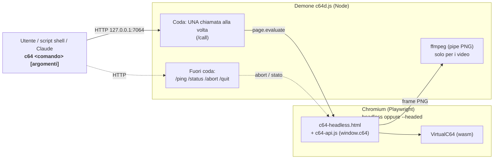
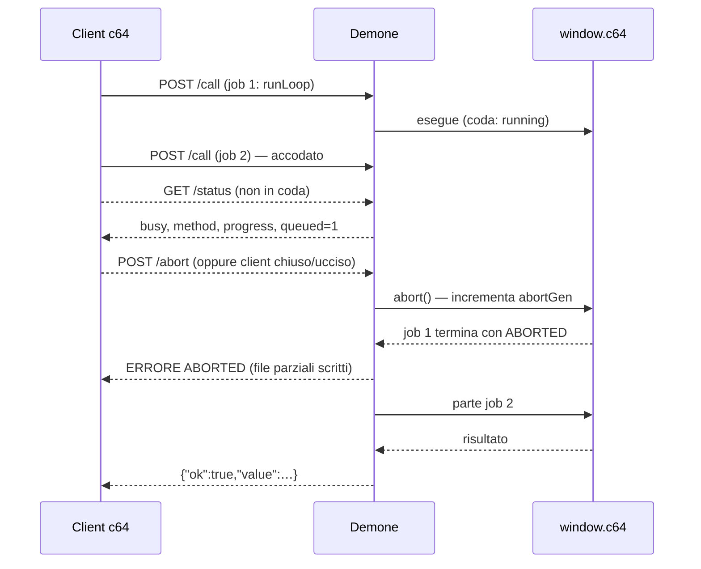

# c64 — riferimento completo dei comandi

Copyright © 2026 Simone Caporale. Vale per la build 32 / API 25.

Questo documento spiega **ogni comando** del client `c64` e del demone `c64d`. Gli output mostrati sono stati ottenuti eseguendo i comandi su un demone vero (build 25), salvo dove è scritto altrimenti. Per il modello del tempo, le proprietà dell'API JavaScript e le novità versione per versione vedi anche `C64-API.md`; per i file di script vedi `scripting.md`; esempi pronti in `../examples/`.

Indice: [1 Architettura](#1-architettura) · [2 Avvio del demone](#2-avvio-del-demone-c64dj) · [3 Opzioni del client](#3-opzioni-globali-del-client) · [4 Argomenti e output](#4-come-si-passano-gli-argomenti-e-cosa-si-ottiene) · [5 Comandi del client](#5-comandi-propri-del-client-e-del-demone) · [6 Ciclo di vita](#6-ciclo-di-vita-e-tempo) · [7 Input](#7-input-tastiera-e-joystick) · [8 Memoria](#8-memoria-e-etichette) · [9 Schermo](#9-schermo) · [10 Dischi e file](#10-dischi-file-rom) · [11 Debug](#11-debug-cpu-chip-drive) · [12 Stati e regressione](#12-stati-e-regressione) · [13 Registrazioni](#13-registrazioni) · [14 Script e cicli](#14-script-e-cicli-di-controllo) · [15 Varie](#15-varie-store-wasm-eval) · [16 Errori](#16-errori-e-codici-di-uscita) · [17 Cosa non è verificato](#17-cosa-non-è-verificato)

---

## 1. Architettura


- Il **demone** (`headless/c64d.js`) apre `out/c64-headless.html` in Chromium (headless, oppure con finestra visibile con `--headed`, §2) e ci inietta `c64-api.js`.
- Il **client** (`headless/c64`) manda al demone una richiesta HTTP per comando. Quasi tutti i comandi sono semplicemente il nome di un metodo di `window.c64` con i suoi argomenti: `c64 peek 0x0400 8` = `window.c64.peek("0x0400", 8)`.
- Le chiamate sono **serializzate**: una alla volta, in ordine di arrivo, perché l'emulatore è deterministico solo se nessuno lo tocca in parallelo. Fanno eccezione `ping`, `status` e `abort`, che non passano dalla coda e si possono usare mentre un job è in corso.
- Il core si ferma fra una chiamata e l'altra dopo i comandi deterministici (`runFrames`, `runUntil`, …): vedi «Modello del tempo» in `C64-API.md`. Un fotogramma PAL = 19656 cicli.

## 2. Avvio del demone (`c64d.js`)

```sh
cd headless
npm install && npx playwright install chromium     # una volta (vedi README)
node c64d.js [--page FILE] [--api FILE] [--port N] [--host H] [--headed]
```
| Opzione | Default | Significato |
|---|---|---|
| `--page FILE` | `headless/c64-headless.html` se esiste, altrimenti `out/c64-headless.html` | pagina da aprire (si genera con `python3 build.py`) |
| `--api FILE` | `headless/c64-api.js` | API da iniettare nella pagina. La versione (`APIVER`) viene sostituita al posto di `/*__API__*/` |
| `--port N` | `7064` | porta HTTP |
| `--headed` | assente (headless) | Chromium **con finestra visibile**: vedi l'emulatore mentre lo comandi dalla CLI. Equivale a `C64_HEADED=1`. Vedi «Modalità con finestra» sotto |
| `--host H` | `$C64_HOST` oppure `127.0.0.1` | indirizzo di ascolto. **Il demone non ha autenticazione e `eval` esegue JavaScript**: non esporlo oltre localhost (in Docker è `0.0.0.0` ma la porta è pubblicata solo su `127.0.0.1`) |

Variabili d'ambiente del demone: `C64_HEADED=1` (come `--headed`), `C64_HOST` (host di ascolto), `C64_NO_SANDBOX=1` (Chromium senza sandbox: serve in Docker/root), `NODE_PATH` (se `playwright` è installato globalmente: `export NODE_PATH=$(npm root -g)`). Stampa `c64d pronto su 127.0.0.1:7064 (c64-headless.html)` quando è pronto. Si ferma con `c64 quit`.

### Modalità con finestra (`--headed`)
```sh
node c64d.js --headed          # in un'altra shell: node c64 start; node c64 type 'PRINT 1' …
```
Il demone, la CLI e tutti i comandi sono identici: cambia solo che Chromium mostra la finestra. Cose da sapere:
- **Serve un display.** Su Linux senza `DISPLAY`/`WAYLAND_DISPLAY` il demone esce con un messaggio. Non funziona nel container Docker così com'è (nessun server grafico). Su server remoto: `xvfb-run -a node c64d.js --headed` (display virtuale, ma allora non lo vedi tu).
- La pagina è quella minima: mostra **solo il canvas dell'emulatore**, senza menu né tastiera a schermo. Con il core fermo (dopo `runFrames`, `runUntil`, …) vedi l'ultimo fotogramma congelato; si anima solo mentre il core gira (`resume`, `warp`, job in corso, video).
- **Chiudere la finestra termina il demone** (come `c64 quit`).
- Non toccare la finestra durante script, video o regressioni: tastiera/mouse reali nella pagina possono arrivare all'emulatore e rompere la ripetibilità. Gli screenshot e i video sono catturati dentro la pagina e non dipendono dalle dimensioni della finestra.
- Le prestazioni in tempo reale dipendono dalla macchina; la modalità deterministica non cambia.

Endpoint HTTP (se vuoi chiamarlo senza il client):
| Richiesta | Effetto |
|---|---|
| `POST /call` `{"method":"peek","args":["0x0400",16]}` | chiama un metodo → `{"ok":true,"value":…}` oppure `{"ok":false,"error":"…","code":"…"}` |
| `GET /ping` | `{"ok":true,"value":{"api":"c64d","port":7064,"page":"c64-headless.html"}}` |
| `GET /status` | job in corso e avanzamento (come `c64 status`) |
| `POST /abort` | interrompe il job in corso (come `c64 abort`) |
| `POST /quit` | chiude Chromium e termina il demone |

### Più istanze in parallelo
Ogni demone ha il proprio Chromium e il proprio emulatore: bastano porte diverse.
```sh
node c64d.js --port 7064 &  node c64d.js --port 7065 &
node c64 --port 7064 start ; node c64 --port 7065 start     # due emulatori indipendenti
```
Provato con due istanze (cicli indipendenti). Ogni istanza costa un Chromium (RAM); non provato con molte. I file temporanei dei video usano il PID del demone, quindi non si pestano.

## 3. Opzioni globali del client

`c64 [opzioni] comando [argomenti…]` — le opzioni possono stare ovunque nella riga.

| Opzione | Significato |
|---|---|
| `--port N` | porta del demone (default 7064) |
| `--host H` | indirizzo del demone (default `127.0.0.1`, oppure `$C64_HOST_CLIENT`) |
| `--out FILE` | se il risultato è binario (screenshot PNG, GIF, video, disco, stato esportato…) lo scrive in `FILE` invece di stamparlo; per `regress check` salva l'immagine delle differenze; per `regress save` salva la baseline JSON |
| `--outdir DIR` | cartella dove scrivere i file prodotti da uno script (screenshot, video, registrazioni). Default: cartella corrente. Viene creata se manca; di ogni file si usa solo il nome base |
| `--compact` | JSON su una riga (senza, gli oggetti lunghi più di 100 caratteri sono stampati su più righe) |
| `--quiet` | non stampa il risultato (resta il codice di uscita) |

Altre variabili del client: `C64_GAMES` (cartella dei giochi, vedi `games`), `C64_ROMS` (cartelle ROM extra, vedi `roms`).

## 4. Come si passano gli argomenti e cosa si ottiene

Ogni argomento è convertito così, nell'ordine:
1. `@@percorso` e il file esiste → il **contenuto di testo** del file (script, etichette `.lbl`, JSON, codice JS);
2. `@percorso` e il file esiste → il file **in base64** (dischi, ROM, stati, programmi);
3. altrimenti si prova `JSON.parse`: numeri (`10`), `true`/`false`, `null`, oggetti (`'{"frames":4}'`), array (`'[1,2,3]'`);
4. se non è JSON valido resta **una stringa**: per questo `0x0400`, `$C000`, `READY.` o un'etichetta (`start`) arrivano come testo e l'API li interpreta (indirizzi: `0x..`, `$..`, decimale, etichetta).

Conseguenze da conoscere:
- **Gli oggetti e gli array devono essere JSON valido**, quindi **niente `0x..` dentro** `{…}` o `[…]` come numeri: `'{"until":[0xFFFF]}'` NON è JSON, arriva come stringa e il metodo riceve un testo invece di un oggetto (provato: `trace` ha usato i default e ha girato per minuti). Scrivi `65535` oppure `"0xFFFF"` fra virgolette. Usa sempre apici singoli per racchiudere il JSON in shell.
- Un elenco di byte va dato come array JSON: `c64 poke 0x0400 '[1,2,3]'` (`poke 0x0400 1,2,3` è la stringa `1,2,3` e dà un errore di base64).
- `sendText`: la sequenza `\n` scritta in shell (due caratteri) viene trasformata in RETURN dal client.
- **Risultati**: una stringa viene stampata così com'è, il resto come JSON. Se un file binario è atteso usa `--out`.

Codici di uscita: `0` ok · `1` errore del comando (messaggio `ERRORE CODICE: testo` su stderr) · `2` uso sbagliato · `3` demone non raggiungibile.

---

## 5. Comandi propri del client e del demone

Non sono metodi dell'API: li gestisce il client o il demone.

### `ping`
Controlla che il demone risponda. `c64 ping` → `{"api":"c64d","port":7064,"page":"c64-headless.html"}`.

### `quit`
Chiude Chromium e termina il demone. Non attende job in corso.

### `status`
Stato del job in corso. **Non passa dalla coda**: funziona anche mentre un altro client attende.
```
$ c64 status
{"busy":true,"method":"runLoop","elapsedMs":3007,"queued":0,"progress":{"frozen":false,"cycles":5916456,"run":{"frames":1,"of":2},"loop":{"iterations":70,"frames":140,"of":3000}}}
```
`busy`: un job sta girando · `method`: l'ultimo metodo ricevuto · `queued`: job in attesa · `progress.run`: fotogrammi eseguiti dalla `run` corrente e totale · `progress.loop`: iterazioni, fotogrammi e massimo di un `runLoop`. A riposo: `{"busy":false,…,"progress":{"frozen":true,"cycles":…,"run":null,"loop":null}}`.

### `abort`
Flusso di un job con `status` e `abort`:



Interrompe il job in corso (`runFrames`, `runUntil`, `runLoop`, script, video…): quel job termina con `ERRORE ABORTED` (exit 1; i file già prodotti, video parziale compreso, vengono scritti); l'emulatore resta fermo; i job già in coda partono. Risposta: `{"aborted":true,"cycles":…}`. Se un client viene chiuso o ucciso mentre attende, il demone interrompe da solo il suo job.

### `help` (= `methods`)
Elenco di tutti i metodi dell'API con la firma (array di stringhe). Anche `c64 methods`.

### `docs [PAROLA]`
Stampa `C64-API.md`; con `PAROLA` solo le sezioni (`## …`) il cui titolo la contiene: `c64 docs regress`, `c64 docs 17`. Cerca il file accanto al client, in `docs/` e in `../docs/`.

### `roms [FILTRO]`
Elenca i file ROM (`.bin`, `.rom`) trovati in: `$C64_ROMS` (cartelle separate da `:`), `third-party/vice-roms/`, `third-party/open-roms/`. Con `FILTRO` solo i nomi che lo contengono. Non parla con il demone.
```
$ c64 roms 251104
kernal-251104-04.bin  (8192 byte)  ../../home/claude/repo/third-party/vice-roms/C64/kernal-251104-04.bin
```

### `rom KIND NOME`
Carica una ROM alternativa al posto di quella incorporata: `KIND` = `kernal` | `basic` | `chargen` | `floppy` (anche `drive`); `NOME` = nome del file o una sua parte (deve identificare un solo file, altrimenti «nome ambiguo»). Vale **dal prossimo `start`**: `c64 stop; c64 rom kernal 251104-04; c64 start`.
```
$ c64 rom kernal 251104-04
{"kind":"kernal","bytes":8192,"name":"kernal-251104-04.bin","needsRestart":true}
```
`c64 rom` senza argomenti mostra le ROM utente attive: `{"user":{"kernal":{"name":"kernal-251104-04.bin","bytes":8192}},"driveRom":"1541-II","builtinDriveRoms":["1541","1541-II"]}`. Per tornare alle predefinite: `c64 clearRoms`. Il core emula solo la famiglia 1541 (le ROM drive devono essere da 16 KB); vedi l'elenco delle ROM provate in `C64-API.md` (API 17).

### `games [FILTRO]`
Elenca i file di gioco (`.d64 .g64 .d71 .d81 .nib .prg .p00 .t64 .tap .crt .vsf .zip`) trovati, anche in sottocartelle, in `$C64_GAMES` (default `./games`, oppure `/games` se esiste, come in Docker).
```
$ C64_GAMES=./games c64 games
t.d64  (174848 byte)
```

### `game NOME`
Monta o carica un file di gioco, cercandolo per nome (parte del percorso relativo; deve essere unico). Le immagini disco (`.d64 .g64 .d71 .d81 .nib`) vanno nel drive 8 (`attach`); gli altri formati con `loadFile`. Risponde con lo stato (`state()`). Provato solo con `.d64`; `.prg`, `.t64`, `.crt` non sono stati provati.
```
$ c64 game t.d64
{"started":true,…,"disk":"t.d64","disk8":true,…}
```

### `regress save NOME [opzioni]` · `regress check NOME|@@file.json [opzioni]` · `regress list`
Baseline e confronto di regressione: vedi [12](#12-stati-e-regressione).

### `video FILE.txt|FILE.js|N [opzioni]`
Video **deterministico** (frame per frame, muto) con ffmpeg: vedi [13](#13-registrazioni).

### `script FILE [opzioni]` · `scriptCheck FILE`
Esegue / valida uno script di input da file di testo: vedi [14](#14-script-e-cicli-di-controllo).

---

## 6. Ciclo di vita e tempo

| Comando | Cosa fa |
|---|---|
| `start [opts]` | Avvia l'emulatore e attende il boot (core oltre 3 milioni di cicli e in marcia). `opts` JSON: `disk:{name,data}` (immagine base64), `driveRom` (`"1541"`\|`"1541-II"`), `roms:{kernal:…,basic:…,chargen:…,floppy:…}` (base64), `port` (1\|2, porta joystick), `autoload` (true/false), `program` (nome del programma da caricare), `timeout` (ms, default 30000). Ritorna lo stato. `c64 start` ≈ 5 s. Dopo `start` l'emulatore è **in marcia**. |
| `ready [timeoutMs]` | Attende che il core sia in marcia e oltre il boot; ritorna lo stato. Con il core **fermo** non può riuscire: dà `TIMEOUT` dopo 30 s. |
| `stop` | Ferma e spegne l'emulatore (`start` lo riavvia, anche con ROM nuove). |
| `reset [{"hard":true}]` | Reset (come il tasto RESET). Con `hard`: spegni/riaccendi (il contatore dei cicli riparte da 0). Dopo un reset il KERNAL ignora la tastiera per circa 140 fotogrammi (vedi `C64-API.md`). |
| `pause` | Ferma il core (`frozen=true`). Da qui `peek`/`poke`/`regs`/screenshot sono a stato congelato. |
| `resume` | Riporta il core in marcia a tempo reale (≈ 985 000 cicli/s). Se riprende meno di 260 ms dopo uno stop, attende il resto. |
| `warp true\|false` | Warp del core: gira più veloce del tempo reale (non esatto). Ritorna `true`. |
| `state` | Stato: `{started,injected,port,kbd,disk,running,frozen,warp,cycles,disk8,driveRom,roms}`. Prima di `start`: `{"started":false,…,"error":"emulatore non avviato: chiama c64.start()"}`. |
| `info` | `{"build":"v27","api":25,"core":"VirtualC64 5.x (vc64web)","driveRom":"1541-II"}`. |
| `cycles` | Cicli CPU dall'accensione. |
| `frames` | Fotogrammi interi (cicli ÷ 19656). |
| `framesExact` | Fotogrammi con la parte frazionaria. |
| `runFrames N` | Esegue **N fotogrammi esatti** e **ferma** il core. Ritorna `{reason:"frames",cycles,frames}`. Con `'{"fast":true}'` come secondo argomento usa il warp per il grosso e gli ultimi fotogrammi a velocità normale (esatto salvo `exact:false` nel risultato). Dopo `call`/`runUntil` il numero di fotogrammi può essere frazionario (es. `2.98`). **API 23: esatto anche se il browser è in ritardo**: prima di ogni avanzamento si prende uno snapshot (≈5 ms), se il core ha sforato di un fotogramma si ripristina e si ripete (campo `retries` nel risultato). `'{"exact":false}'` = comportamento precedente (nessuno snapshot; raramente +1 fotogramma). |
| `runCycles N` | Come sopra, arrotondando per eccesso a fotogrammi interi (il core non ha granularità inferiore). |
| `runUntil COND [opzioni]` | Esegue finché la condizione è vera, poi ferma. Vedi sotto. |
| `waitFor TESTO [ms]` | Attende **a tempo reale** (controlla ogni 150 ms, default 15000 ms) che `TESTO` compaia a schermo (testo KERNAL, maiuscole indifferenti): `true` se compare, `false` se scade (non è un errore). Non fa avanzare il core: con il core fermo non compare mai. Per il core fermo usa `runUntil` o `wait` negli script. |
| `sleep MS` | Pausa del demone in millisecondi (tempo reale, non emulato). Ritorna `null`. |

**`runUntil COND [opzioni]`**: `COND` è un oggetto JSON. Le condizioni su memoria e schermo (`addr`, `mem`, `screenText`, `screenRegex`, `text`, `screenMatch`, `cycles`, `when`) si combinano in OR: vale la prima che si verifica; con `{"all":true}` fra le opzioni devono valere tutte. `pc`, `pcIn` e `watch` fermano comunque l'esecuzione quando si verificano.
| Condizione | Significato |
|---|---|
| `{"pc":"$0840"}` o `{"pc":[a,b]}` | PC all'indirizzo (ferma sull'istruzione esatta); numero, stringa `$..`, etichetta o array |
| `{"pcIn":[a,b]}` | PC in un intervallo (max 64 indirizzi) |
| `{"addr":A,"value":V,"mask":M,"not":false}` | `mem[A] & M == V & M` (o `!=` con `not`) |
| `{"mem":[A,V]}` | `mem[A] == V` (terzo elemento: maschera) |
| `{"watch":A}` o `[a,b…]` | accesso all'indirizzo (watchpoint, max 16); ferma DOPO l'istruzione |
| `{"screenText":"READY."}` / `{"screenRegex":"^READY"}` | testo (KERNAL, maiuscole indifferenti) / espressione regolare sullo schermo |
| `{"text":"TESTO"}` o `{"text":[18,5,1,4,25]}` | testo in **screen code** (API 18): vale anche con charset propri. Opzioni di `findText` in `{"textOpts":{"addr":…,"map":…}}` (API 20/21) |
| `{"screenMatch":"NOME","maxDiff":0,"tolerance":0,"rect":{…}}` | lo schermo corrisponde a quello salvato con `screenSave NOME` (al massimo `maxDiff` pixel diversi) |
| `{"cycles":N}` | cicli totali raggiunti |
| `{"pc":A,"whenRegs":{"x":3}}` | (API 21) con `pc`: ferma solo se i registri `a`,`x`,`y`,`p` valgono quanto indicato; se no riprende. Ogni stop legge i registri con `regs` (≈40 cicli in più). Per ora solo con `pc`. **Lento**: ≈0,2 s di orologio per stop (misurato: 100 stop in 18 s), perché ogni stop richiede 3 halt/run del core con l'attesa che evita il recupero di fotogrammi; inutilizzabile con timeout grandi se il PC passa spesso |
| `{"when":{"addr":A,"value":V}}` | condizione sulla memoria durante l'esecuzione |
Opzioni: `{"timeoutFrames":3000}` (default 3000, **non è un limite**: si può alzare), `{"all":true}`. Ritorna `{reason:"cond"|"pc"|"watch"…,cycles,frames}`; allo scadere errore `TIMEOUT: timeout: mem[$0002]==$FF non raggiunto in 5 fotogrammi`. Le esecuzioni vanno a tempo reale (4000 fotogrammi ≈ 80 s).
```
c64 runUntil '{"text":"READY."}'
c64 runUntil '{"mem":[2,255]}' '{"timeoutFrames":5}'
```

---

## 7. Input: tastiera e joystick

L'input entra nella **matrice della tastiera** e nelle porte joystick del core. I tempi sono in fotogrammi emulati. Un tasto va tenuto almeno 1 fotogramma e rilasciato almeno 2 prima di ripremerlo (altrimenti la pressione può andare persa).

| Comando | Cosa fa |
|---|---|
| `type TASTO [opzioni]` | Preme **un tasto** (carattere o nome: `w`, `RETURN`, `F1`, `RUN/STOP`, `SHIFT+A`) o **più tasti simultanei** con un array JSON `'["w","d"]'`, aspetta il rilascio. Opzioni: `frames` (default 3, min 1), `releaseFrames` (default 3, min 2), `shift`/`ctrl`/`cbm` (true), `noWait`. Ritorna `{keys:[…],frames}`. Dopo un reset attende il boot (`{"noWait":true}` per non farlo). |
| `keyDown TASTO` | Tiene premuto (effetto al prossimo fotogramma emulato). |
| `keyUp TASTO` | Rilascia. |
| `sendText TESTO [opzioni]` | Digita una stringa nella matrice tastiera (non scrive in `$0277`); `\n` = RETURN. Token fra graffe: `{RUN/STOP}` `{F1}`…`{F8}` `{HOME}` `{CLR}` `{DEL}` `{INST}` `{UP}`… `{SHIFT+A}` `{CTRL+3}` `{C=+Q}` `{WAIT:30}` (attende 30 fotogrammi) `{{}` (la graffa). Opzioni: `framesPerKey`, `releaseFrames`, `keepCase`, `noWait`. Ritorna `{keys,frames}`. Es.: `c64 sendText 'print 6*7\n'` → `{"keys":10,"frames":61}`. |
| `keyNames` | Elenco dei tasti: `{keys:[nomi della matrice],named:[RUN/STOP, F1…],shifted:[…]}`. |
| `joy …` | Joystick, due forme: **singola direzione** `joy up 1 [porta]` (1 = premuta, 0 = rilasciata; direzioni `up down left right fire`); **stato completo** `joy PORTA '{"up":true,"fire":true}' [fotogrammi]` — con i fotogrammi tiene lo stato per quel tempo e rilascia (avanza il tempo emulato). Ritorna `true`. La porta di default è quella scelta con `start({port})` (default 2). |
| `joyPulse DIR [ms] [porta]` | Preme e rilascia dopo `ms` (default 150) **di orologio**. Con il core fermo non succede nulla di visibile (deduzione dal codice, non provato). |
| `fire [ms] [porta]` | `joyPulse fire` (default 120 ms). |
| `sendJoy "R10 UF8 W5 L3" [{"port":2}]` | Sequenza di joystick: lettere `U D L R` (direzioni) e `F` (fuoco) tenute N fotogrammi (`R10`, `UF8` = su+fuoco per 8); `Wn` = attesa di n fotogrammi. Ritorna `{frames:26}`. |

Dentro `runLoop`, `joy(porta,stato,frames)` non fa avanzare il tempo (vedi `C64-API.md`, API 18).

---

## 8. Memoria e etichette

Gli indirizzi si possono scrivere `0x0400`, `$0400`, decimale o come **etichetta** (`start`, `lobby:nome` per un insieme).

| Comando | Cosa fa |
|---|---|
| `peek A` | Un byte (la memoria come la vede la CPU: ROM e I/O visibili secondo `$01`). `c64 peek 0x0400` → `32`. |
| `peek A N [{"ram":true}]` | Array di N byte. `ram:true` = RAM pura (ignora `$01`, imposta temporaneamente la mappa). |
| `peekRange A N` | Come `peek A N`. |
| `peekWord A` | Parola a 16 bit little-endian: `c64 peekWord 0xFFFC` → `64738`. |
| `poke A V [{"ram":true}]` | Scrive un byte o un array JSON (`'[1,2,3]'`). Ritorna il numero di byte scritti. Scritture sul chip (VIC, SID…) valgono come per la CPU. |
| `pokeRange A '[…]'` | Come `poke` con array. |
| `dump A N` | Esadecimale a 16 byte per riga: `FFFC: E2 FC 48 FF …`. |
| `find BYTE\|TESTO [{"from","to","ram","screen","max"}]` | Cerca una sequenza (array di byte o stringa ASCII; con `screen:true` come codici schermo). Ritorna gli indirizzi (max 256). `c64 find READY` → `[41848]`; con `screen:true` → `[1224,1384]`. |
| `ramSnap NOME [{"from","to"}]` | Fotografa un intervallo (default `$0000–$FFFF`, vista RAM). |
| `ramDiff A B [{"max"}]` | Differenze fra due foto (`B=null` = stato attuale): `{count,changes:[{addr,a,b}]}` (max 1000). Serve a trovare l'indirizzo di vite/punteggio. |
| `loadLabels @@FILE.lbl [{"set":"nome","activate":false}]` | Carica etichette VICE (`al C:0840 .nome`) o `nome = $0840`. Ritorna quante. `set` = insieme a parte (si legge con `lobby:nome`). |
| `label NOME` | Indirizzo (numero) di un'etichetta. |
| `useLabels INSIEME` | Rende attivo un insieme: `{"set":"default","count":2}`. |
| `labelSets` | Insiemi caricati e quante etichette: `{"default":2}`. |
| `stateHash [{"only","exclude"}]` | Hash per componente (Memory, CPU, CIA1/2, VIC, SID, Drive…) + hash complessivo: per confrontare due stati. L'hash CPU è instabile. |

---

## 9. Schermo

La pagina rende lo schermo a 384×270 (area visibile PAL). Dopo un `poke` su un registro del VIC avanza almeno un fotogramma prima di fare uno screenshot (altrimenti l'immagine è quella precedente).

| Comando | Cosa fa |
|---|---|
| `screenInfo` | Dove legge il VIC: `{bank,screen,charset,charsetRom,lowercase,bitmap,ecm,multicolor,textMode}`. |
| `screenText` | Le 25 righe di testo dalla RAM schermo (conversione screen code → testo con il set caratteri standard). |
| `screenCodes` | I 1000 codici schermo grezzi (array), indipendenti dal charset. |
| `findText TESTO\|CODICI [{"raw","all","exact","addr","len","map","enc"}]` | Cerca testo **in screen code**: `{row,col,addr}` o `null`; `all:true` → elenco. Lettere indifferenti dal maiuscolo, bit 7 (inverso) ignorato salvo `exact`. `c64 findText READY.` → `{"row":5,"col":0,"addr":1224}`. `addr`: indirizzo RAM schermo alternativo (API 20). Non vede glifi grafici né testo sulla bitmap. `map` (API 21): codifica propria del gioco, es. `{"0-9":45,"/":55}` (carattere o intervallo `a-b` → codice iniziale); il testo si traduce con la mappa (carattere assente = `BAD_ARG`) e il confronto è esatto. `c64 findText '198/198' '{"addr":33792,"map":{"0-9":45,"/":55}}'`. **Attenzione**: con `addr` su un'area che non è uno schermo (es. dati del font) un testo può dare falsi positivi: usa `map` o un array di codici. **API 23**: `enc` = codifica caricata con `loadEncoding` (si possono aggiungere caratteri con `map`); `len` = ricerca lineare in `[addr, addr+len)` senza impaginare a 40 colonne, ritorna `{offset,addr}` (per buffer come il nome del mostro: `c64 findText 'LORD OF RUIN' '{"addr":"nbuf","len":24}'`); `addr` accetta etichette (`"nbuf"`, `"$8400"`). Con `map`/`enc` maiuscole e minuscole si equivalgono se la mappa ha solo una delle due. La mappa può essere carattere per carattere (lettere non contigue). |
| `loadEncoding NOME MAPPA\|@@file.cdef [{"block"}]` | (API 23/24) Registra una codifica con nome: oggetto JSON (`{"0-9":45,"/":55,"A":57,…}`) o testo con righe `.cdef` di 64tass (`.cdef "09", 45` intervallo, `.cdef "A","F",57` intervallo, `.cdef "/", 55` singolo; `;` commento). **API 24**: il codice può essere un simbolo (`.cdef "A","A",G_A`) risolto da righe `NOME = valore` dello stesso testo (anche `$hex`, `%bin`) o dalle etichette caricate con `loadLabels`; con blocchi `.enc "nome"` si leggono solo le `.cdef` del blocco col nome della codifica (o `{"block":"nome"}`). Così si carica direttamente `gfx_consts.inc` del gioco: `c64 loadEncoding hud @@out/gfx_consts.inc`. Provato su un file con la stessa struttura descritta nel report, non sul file vero. |
| `encodings` | (API 23) Codifiche caricate: `{nome: numero di caratteri}`. |
| `border` · `background` | Colore del bordo / dello sfondo (0–15). |
| `cursor` | `{col,row}` del cursore KERNAL. |
| `screenshot` | PNG come data-URL; con `--out f.png` lo scrive su file. Opzioni: `'{"rect":{"x":0,"y":0,"w":8,"h":8}}'` ritaglio; `'{"raw":true}'` → `{width,height,data:base64 RGBA}`. |
| `screenSave NOME` | Salva lo schermo attuale in memoria. |
| `screenDiff A B [opzioni]` | Confronta due schermi salvati (`null` = attuale): `{same,diffPixels,ratio,width,height,bbox}`. Opzioni `tolerance` (0–255 per canale), `rect`, `image:true` (PNG delle differenze con `--out`). |
| `sprites` | Gli 8 sprite dai registri VIC: `{sprites:[{n,enabled,x,y,color,multicolor,expandX,expandY,behindBackground,pointer,dataAddr},…]}`. |
| `recordGif [{"frames","every","rect"}]` | Avanza di `frames` fotogrammi (emulatore fermo) catturando uno ogni `every` e ritorna una GIF animata: `c64 --out a.gif recordGif '{"frames":10,"every":5}'`. |

---

## 10. Dischi, file, ROM

**I dischi si montano con il core in marcia.** Con il core fermo l'immagine risulta «caricata» in `state().disk` ma il drive non la vede (`disk8:false`, `diskImage` → «nessun disco nel drive 8»): fai `resume` prima di `attach`/`loadFile`.

| Comando | Cosa fa |
|---|---|
| `loadFile NOME @FILE [opzioni]` | Carica `.d64 .g64 .prg .t64 .crt …`. Opzioni: `autoload` (true: LOAD + RUN automatici per i dischi), `program` (nome del programma), `wait` (false = non attendere la fine dell'autoload), `timeout` (ms). Con l'autoload fa un **reset**: i `poke` fatti prima si perdono; falli dopo che il comando è tornato. Ritorna lo stato. |
| `attach 8 @FILE NOME` | Monta un disco nel drive 8 senza autoload (solo il drive 8). |
| `detach` / `eject` | Espelle il disco. |
| `diskImage [8] [{"bytes":true}]` | L'immagine del disco corrente (anche dopo un `SAVE`), base64: `c64 --out out.d64 diskImage` → `scritto out.d64 (174848 byte)`. |
| `driveState [8]` | `{type,hasDisk,motor,powerSave,syncMark,readMode,halftrack,track,headOffset}` (il LED non è esposto). |
| `driveTrace FRAMI [{"every","drive"}]` | Posizione della testina nel tempo (un campione ogni `every` fotogrammi, il core avanza). |
| `loadRom KIND @FILE [{"name"}]` | ROM utente al posto di quelle incorporate (valgono dal prossimo `start`): `kernal` (8192 byte), `basic` (8192), `chargen` (4096), `floppy` (16384, solo famiglia 1541). Per nome: comando `rom`. |
| `clearRoms [KIND]` | Torna alle ROM incorporate (tutte o una). |
| `roms` | **Nota**: da riga di comando `c64 roms` è il comando del client che elenca i file (§5); l'API `roms()` si ottiene con `c64 rom` senza argomenti. |

---

## 11. Debug: CPU, chip, drive

Per quasi tutti il core deve essere **fermo** (`pause`) o lo diventa dopo la chiamata.

| Comando | Cosa fa |
|---|---|
| `regs` | `{pc,line,cycle,cycles,a,x,y,p,sp}`. A/X/Y/P/SP si leggono con un piccolo stub 6502 (33 byte di RAM in `$0334–$0367`, ripristinati, ~40 cicli). |
| `setRegs '{"a":5,"x":6,"pc":…}'` | Imposta i registri (SP non modificabile). Core fermo. |
| `breakpoint A` | Aggiunge un breakpoint; ritorna l'id. |
| `breakpoints` | Elenco `[{id,addr}]`. |
| `clearBreakpoints` | Li toglie tutti; ritorna quanti. |
| `watch A` / `watch '[a,b]'` | Watchpoint (si ferma dopo l'istruzione che accede all'indirizzo); ritorna gli id. |
| `watchpoints` / `clearWatchpoints` | Elenco / rimuove tutti. |
| `disasm A N` | Disassembla N istruzioni: `[{pc,bytes:"E2 FC",asm:"NOP #FC"},…]` (il disassembler del core, istruzioni illegali comprese). |
| `step N` | Esegue N istruzioni (≈ 20 ms ciascuna): `[{pc,bytes,asm,cycles}]` (`cycles` = valore prima dell'istruzione). Core fermo. |
| `trace '{"until":[A],"max":N,"last":K}'` | Esegue istruzioni **finché il PC è in `until`** (o max, default 20000 ≈ 400 s!) e ritorna le ultime K (default 32): `{instructions,reached,pc,last:[…]}`. Post-mortem: `loadState` + `trace`. Dà **sempre** un `max` ragionevole. |
| `measure DA A [{"timeoutFrames","n"}]` | (API 21; `n` da API 22) Cicli **esatti** fra due PC: esegue fino a `DA`, azzera il conteggio, esegue fino ad `A`. Con `{"n":50}` ripete 50 volte e aggiunge `{n,min,max,mean,samples}` (≈0,15 s di orologio a ripetizione: 10 ripetizioni in 1,5 s). `c64 measure 0xC002 0xC005` → `{from,to,cycles:49,fromCycles,toCycles,frames}`. Etichette ammesse. Provato su un ciclo `DEX/BNE` (49 cicli come da calcolo a mano); non confrontato con VICE. |
| `call A [{"a","x","y"}] [{"timeoutFrames","scratch","noWait","frames"}]` | `JSR A` e ritorno; registri e PC ripristinati; ritorna `{a,x,y,p}` in uscita. Routine che non ritorna → `CALL_TIMEOUT` (ripristina solo PC e area di lavoro `$0334`). `noWait:true`: salta alla routine con `JMP`, la lascia girare `frames` fotogrammi (default 2) e ritorna `{started,pc,frames}`. Negli script: `call ADDR nowait`. |
| `inspect NOME` | Stato interno di un componente del core: `cpu mem vic cia1 cia2 sid c64 drive8 …` → `{config,state,raw}`. |
| `sid` | I 29 registri del SID + decodifica delle 3 voci (frequenza, Hz, gate, forma d'onda, ADSR…). |
| `sidTrace FRAMI [{"every"}]` | Registri SID ogni `every` fotogrammi mentre il core avanza (per verificare le musiche). |
| `wasm NOME [arg…]` | Chiama una funzione esportata del core (`wasm wasm_get_cpu_cycles`). Ritorna il valore (i BigInt diventano numeri o stringhe). |

---

## 12. Stati e regressione

**Stati** (snapshot completi del core in memoria JS, validi finché il demone è acceso):
| Comando | Cosa fa |
|---|---|
| `saveState NOME [{"export":true}]` | CPU, RAM, VIC, SID, CIA, drive, disco. `c64 saveState s1` → `{"name":"s1","size":790840,"cycles":10358712}`. Con `export:true` e `--out f.bin` salva anche il file (790 840 byte nel caso provato). |
| `loadState NOME\|@FILE` | Ripristina (cicli e RAM esattamente allo stato salvato; breakpoint e watchpoint vanno ricontrollati). Da file: `c64 loadState @f.bin`. |
| `states` | Elenco `{nome:{size,cycles}}`. |
| `dropState NOME` | Elimina. |

**Regressione**: la baseline contiene hash dei componenti, RAM (default `$0000–$FFFF`), schermo (PNG) e cicli. Vive nella pagina finché il demone è acceso.
| Comando | Cosa fa |
|---|---|
| `regress save NOME [opzioni]` | Crea/sovrascrive la baseline. Opzioni JSON: `ram:[[a,b],…]` intervalli, `screen:false`, `only`/`exclude` (componenti). Stampa `{name,cycles,hash,ram,screen}`. Con `--out f.json` scrive il bundle completo su file. |
| `regress check NOME\|@@f.json [opzioni]` | Confronta lo stato attuale con la baseline (nome o file). Opzioni: `ignore:["0x0400-0x07E7",…]` (intervalli RAM esclusi), `tolerance` (pixel), `only`, `exclude`, `ram`, `screen`, `strict`, `includeCpu`, `image` (con `--out f.png` salva l'immagine delle differenze), `maxGroups`. **Codice di uscita 0 = PASS, 1 = FAIL** (con le ragioni su stderr). Il confronto ha senso solo se parti dallo stesso stato (`loadState` + stessi input). |
| `regress list` | Baseline presenti: `{nome:{cycles,ram,screen}}`. |
| `regressSave` / `regressCheck` / `regressList` | Gli stessi metodi dell'API (restituiscono il JSON completo). |

---

## 13. Registrazioni

Panoramica e scelta del metodo: README, sezione «Registrazioni». Comandi:

| Comando | Cosa fa |
|---|---|
| `video FILE.txt\|FILE.js\|N [opzioni]` | **Video deterministico**, muto. Un frame ogni `every` fotogrammi emulati mentre gira uno script di input (`.txt`), un ciclo JS (`.js`, corpo di funzione come `runLoop`) o N fotogrammi; codificato da **ffmpeg** (libx264) nel demone. Richiede il core **fermo** (`pause`). Va a tempo reale (200 fotogrammi ≈ 4–5 s). Opzioni JSON: `every` (default 2 → `fps = 50/every`), `scale` (1–4, default 3 = 1152×810), `crf` (0–51, default 20), `fps`, `preset`. Uso: `c64 pause; c64 --out clip.mp4 video prova.txt '{"every":2,"scale":3}'`. Negli script: `video start`/`video stop` (vedi `scripting.md` §5). |
| `videoStop` | Chiude un video lasciato aperto con `video start … keep`: `c64 --out lungo.mp4 videoStop`. |
| `grabBrowserVideoAndAudio '{"action":"start",…}'` | **Video + audio dal browser** in tempo reale, non sincronizzato con l'emulatore (core in marcia). Azioni `start` / `stop` / `status`; con `seconds` registra e si ferma da sola. Opzioni: `keyboard`, `joy1`, `joy2` = `none`\|`below`\|`overlay`, `scale` (1–4, default 2), `fps` (50), `bitrate`, `audio` (true), `audioGain` (default 1), `mime`. `stop` ritorna `{data,mime,bytes,seconds,width,height,audio,audioPeak,controls,warnings}`; `--out clip.webm` salva il file (webm VP9+Opus). |
| `recordVideo [{"frames"\|"seconds","fps","mime","bitrate","scale"}]` | Video del canvas con `MediaRecorder` (tempo reale, senza audio). Con il core fermo avanza di `frames` fotogrammi. `c64 --out v.webm recordVideo '{"frames":20,"scale":1}'`. |
| `recordGif` | GIF animata (§9). |
| `recordStart` · `recordStop ['{"format":"text"}']` | Registra le chiamate di input (`keyDown keyUp joy sendText type sendJoy fire joyPulse poke pokeRange`) con il fotogramma relativo. `recordStop` → `{startCycles,frames,events:[{f,m,a}]}`; con `{"format":"text"}` lo esporta come script di testo (righe come `0 L 3`, `10 O 3`; gli eventi non esprimibili diventano commenti `# non esportato`). |
| `replay REC` | Rifà le chiamate registrate agli stessi fotogrammi relativi: partendo dallo stesso stato (`loadState`/`reset`) con il core fermo è esatto. |
| `capStart` · `capArm` · `capRun` · `capTake` · `capStop` · `capClipStop` | **Interni**: li usano `video` e gli script per catturare i fotogrammi; non servono da riga di comando. |

---

## 14. Script e cicli di controllo

### `script FILE [{"noWait":true}]`
Esegue uno script di input (`.txt`; sintassi in `scripting.md`) dentro l'emulatore con tempo emulato esatto. `--outdir DIR` dice dove scrivere gli screenshot, i video e le registrazioni prodotti. Ritorna `{events,frames,warnings,outputs?,log?}`; in caso di errore: `ERRORE CODICE: script riga N: …` (exit 1) e i file già prodotti vengono comunque scritti.
```
$ c64 --outdir out script k.txt
scritto out/k.png (screenshot)
{"events":3,"frames":25,"warnings":[],"outputs":[{"type":"screenshot","name":"k.png","mime":"image/png","line":3}]}
```
`noWait:true` non attende il boot dopo un reset.

### `scriptCheck FILE`
Solo validazione: `{"events":3,"warnings":[]}` oppure l'errore con il numero di riga.

### `runLoop 'CODICE' [{"frames":N,"every":2,"exact":true}]`
Esegue **dentro la pagina** un ciclo di controllo: nessuna chiamata HTTP per passo. `CODICE` è il corpo di una funzione JS con parametri `(c64, i, state)`; `return false` termina; `state` è un oggetto che persiste tra i passi e viene restituito; `every` = fotogrammi per passo (default 2); `frames` = massimo. Il codice può essere in un file: `c64 runLoop "$(cat bot.js)" '{"frames":4000}'`. Ritorna `{iterations,frames,state}`. Dentro il ciclo `c64.joy(porta,stato,frames)` preme e rilascia senza avanzare il tempo (API 18). Va a tempo reale (≈ 25 passi/s con `every=2`).
```
c64 runLoop 'const hp=c64.peek("c_hp"); if(hp===0) return false; c64.joy(2,{right:true},2);' '{"frames":3000}'
```
**API 23/24 — passi esatti e diagnostica.** (API 24: corretto il difetto della 23 che perdeva joystick e tasti tenuti a ogni ripetizione, vedi sotto.) Ogni passo avanza esattamente `every` fotogrammi (stesso meccanismo di `runFrames`: snapshot, verifica, ripristino). Il risultato contiene `framesActual` (dai cicli), `exact` (`framesActual == frames`), `retries:[[passo,ripetizioni],…]` (passi in cui il core aveva sforato ed è stato riportato indietro; **al massimo 200 voci**), `retriesTotal` (API 25: totale vero delle ripetizioni, contate per avanzamento: un passo con un rilascio di `joy`/`type` a metà fa due avanzamenti, quindi con `_forceRetry:1` il totale può superare il numero di passi) e `retriesTruncated` (true se la lista è stata tagliata). Prima un passo ogni ~800–1000 avanzava di un fotogramma in più quando il browser era in ritardo e il contatore restituito non lo mostrava: un bot ad anello chiuso dallo stesso stato dava esiti diversi. Misure: bot con carico CPU variabile, 1000 passi, 3 esecuzioni → hash identici; 3 istanze in parallelo → più ripetizioni (5–8 su 150 passi) ma esito identico. Velocità invariata (tempo reale). `{"exact":false}` = vecchio comportamento. Prova di regressione: `examples/shell/11-determinismo.sh [N] [PASSI]`.

**Verificare che un bot sia ripetibile (opzioni di prova, API 25 documentate).** `{"_forceRetry":N}` fa considerare sbagliati i primi N tentativi di ogni passo (quindi ripristino e ripetizione forzati); `{"_forceEvery":K}` lo applica solo ai passi con indice multiplo di K. Un bot è ripetibile se lo stesso stato dà lo stesso `stateHash` con e senza queste opzioni:
```sh
c64 loadState s0; c64 runLoop "$(cat bot.js)" '{"frames":600}';                                   c64 stateHash
c64 loadState s0; c64 runLoop "$(cat bot.js)" '{"frames":600,"_forceRetry":1}';                   c64 stateHash
c64 loadState s0; c64 runLoop "$(cat bot.js)" '{"frames":600,"_forceRetry":2,"_forceEvery":3}';  c64 stateHash
```
Costo: con `_forceRetry:1` ogni passo è eseguito due volte (misurato dalla chat Barbarian: 600 fotogrammi in 119 s invece di 24 s). Valgono anche per `runFrames` (`_forceRetry`). Il trattino basso indica opzioni di prova: possono cambiare senza preavviso.

**Velocità del passo esatto (misurato).** Per passo da 2 fotogrammi: solo esecuzione 44 ms, snapshot + esecuzione 40 ms, snapshot + **ripristino** + esecuzione 82 ms. Il costo extra non è il ripristino in sé (~6 ms) ma il core, che dopo `wasm_loadfile` riparte più tardi (ipotesi: riallinea il proprio orologio e aspetta il fotogramma successivo; non verificato nel sorgente del core). Sul gioco: 600 fotogrammi in 24 s invece di 12 s. Con più istanze (`c64-batch`) la resa torna circa al tempo reale.

**Input e ripristino (API 24, misurato).** Il core **non** salva nello snapshot le porte joystick né la matrice della tastiera, e un input già consegnato si perde con il ripristino; la coda degli eventi di tastiera programmati (`type`/`sendText` con rilascio ritardato) invece **non** si svuota con il ripristino. L'API tiene quindi un modello degli input (joystick, tasti tenuti, eventi programmati) e a ogni ripristino: rilascia tutto, ripreme ciò che era tenuto e riprogramma gli eventi consumati dal tentativo scartato. Inoltre ogni passo parte **sempre** da uno stato appena ripristinato (anche il primo tentativo): il ripristino non è trasparente (senza input, un passo ripetuto cambiava lo stato dei CIA), così primo tentativo e ripetizioni sono identici. Dentro `runLoop`, `type()` non fa avanzare il core e il rilascio lo gestisce il ciclo (come `joy` con durata): nessun evento resta nella coda del core alla fine del ciclo. Verifiche: bersaglio che legge `$DC00` e il buffer del KERNAL con joystick tenuto e a durata, tasti tenuti e a durata: stesso hash con 0 ripetizioni, con una ripetizione forzata a ogni passo, con 2 ripetizioni ogni 3 passi; 6 esecuzioni su 3 istanze in parallelo (2–10 ripetizioni reali ciascuna) tutte uguali, anche la prima di un demone appena avviato.

### `c64-batch` (API 23) — molte esecuzioni in parallelo
Programma a parte (`headless/c64-batch`), non un comando di `c64`:
```sh
node c64-batch --state boss.bin --loop bot.js --runs 40 -j 4 --frames 3000 \
  --labels game.lbl --collect 'peek c_hp 2' --collect 'peek 0x9680 1'
```
Avvia `J` demoni sulle porte `--base-port` (default 7100)…+J-1 (o usa quelli già accesi), e per ogni esecuzione `k`: `loadState`, `runLoop` con `const RUN=k;` in testa al codice, le chiamate `--collect` (sintassi come la CLI) e `stateHash`. Stampa su stdout `[{run,port,ms,frames,framesActual,exact,retriesCount,retries,hash,collect:{…},error?},…]`; avanzamento su stderr; `--keep` lascia accesi i demoni. Poiché i passi sono esatti, lo stesso `RUN` dà sempre lo stesso esito: per esplorare, il bot varia i parametri con `RUN`. Provato: 6 esecuzioni da 300 fotogrammi su 3 istanze in 29 s (avvio compreso), esiti coerenti con `RUN`. Ogni istanza è un Chromium (RAM): numero massimo utile non misurato.

**Più veloce del tempo reale? (misurato, API 23)** Il core di vc64web non espone una chiamata per calcolare fotogrammi in modo sincrono (funzioni wasm esportate: nessun `execute`/`computeFrame`), e la cadenza la dà il ciclo della pagina: `SPEED_BOOST` al 500% non cambia nulla (500 fotogrammi in 10,03 s sia al 100% sia al 500%). Il warp avanza a salti di ~26 fotogrammi. Quindi un singolo emulatore resta a tempo reale; la velocità si ottiene con più istanze (`c64-batch`).

---

## 15. Varie: store, wasm, eval

| Comando | Cosa fa |
|---|---|
| `storeSet K V` · `storeGet K [DEFAULT]` · `storeDel K` · `storeKeys` · `storeExport` · `storeImport OBJ` | Archivio chiave/valore JSON nel browser (`localStorage`). Sopravvive alle pagine ricaricate; fra build diverse solo se il browser condivide `localStorage` per i `file://` (Chromium sì; Firefox/Safari non verificato). |
| `wasm NOME [arg…]` | Chiama una funzione del core esportata (§11). |
| `eval 'CODICE'` | Esegue **JavaScript arbitrario** nel contesto dell'emulatore (la pagina interna): `eval '1+1'` → `2`. L'API sta in `parent.c64` (`eval 'parent.c64.cycles()'`); `window.c64` lì non esiste. **Pericoloso**: il demone non ha autenticazione. |
| `waitFor`, `sleep` | Vedi §6. |

---

## 16. Errori e codici di uscita

Gli errori hanno un codice: `ERRORE CODICE: messaggio`, exit 1.

| Codice | Significato |
|---|---|
| `NOT_STARTED` / `NOT_READY` | emulatore non avviato / non pronto |
| `TIMEOUT` | condizione non raggiunta nel tempo dato (`runUntil`, `waitFor`, `wait` negli script, `ready`, `loadFile` con autoload) |
| `BAD_ARG` | argomento non valido (anche errori di sintassi di uno script: il messaggio ha il numero di riga) |
| `UNKNOWN_LABEL` | etichetta sconosciuta |
| `NO_STATE` / `NO_SHOT` | stato / schermata non salvati con quel nome |
| `ASSERT` / `REGRESS` | `assert` o `regress check` falliti in uno script |
| `ABORTED` | job interrotto da `abort` o dal client chiuso |
| `STALL` | il core non avanza da 5 s durante una esecuzione |
| `CALL_TIMEOUT` | `call`: la routine non è tornata nel tempo dato (usa `noWait`) |
| `CLIENT_GONE` | (solo demone) il client si è disconnesso prima dell'esecuzione |
| `UNSUPPORTED` | funzione non disponibile nel browser (es. `MediaRecorder`) |
| `NO_FFMPEG` / `FFMPEG` | `ffmpeg` mancante nel PATH / terminato con errore |
| `DAEMON` | errore del demone (es. risposta non serializzabile) |
| `CORE` | errore del core emulatore |
| `ERROR` | errore generico dell'API (messaggio nel testo) |

Il codice di uscita del client: `0` ok · `1` errore · `2` uso sbagliato · `3` demone non raggiungibile (`demone non raggiungibile su 127.0.0.1:7064 (avvia c64d.js)`).

---

## 17. Cosa non è verificato

- Docker: mai costruito né eseguito; le indicazioni su `/games`, `/roms`, `/scripts`, `/output` sono coerenti con il `docker-compose.yml` ma non provate.
- `game` con `.prg`, `.t64`, `.crt`, `.tap`, `.vsf`, `.zip`: non provato (solo `.d64`).
- `joyPulse`/`fire` con il core fermo: comportamento dedotto dal codice.
- `capStart`, `capArm`, `capRun`, `capTake`, `capStop`, `capClipStop`: interni, non descritti oltre il ruolo.
- `inspect` con tutti i componenti, `sidTrace`, `driveTrace`, `storeImport`, `replay`: provati solo `inspect cpu`, `sidTrace`, `driveTrace`; `replay` e `storeImport` non sono stati rieseguiti per questo documento.
- Opzioni minori di `regress check` (`only`, `exclude`, `strict`, `includeCpu`, `maxGroups`): descritte dal codice, non provate una per una.
- `video` / `grab` su durate lunghe: non misurato.
- Windows e macOS: non provati.
